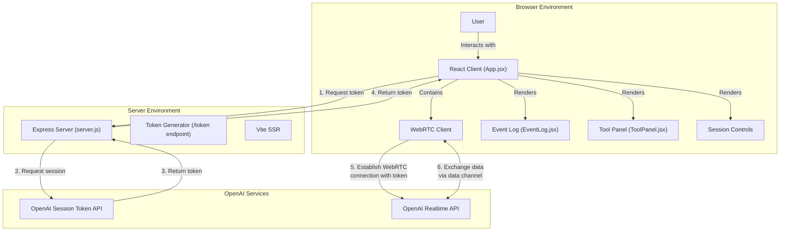
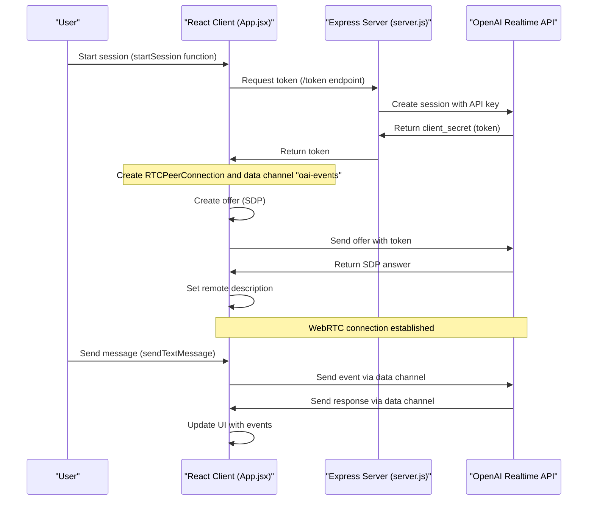
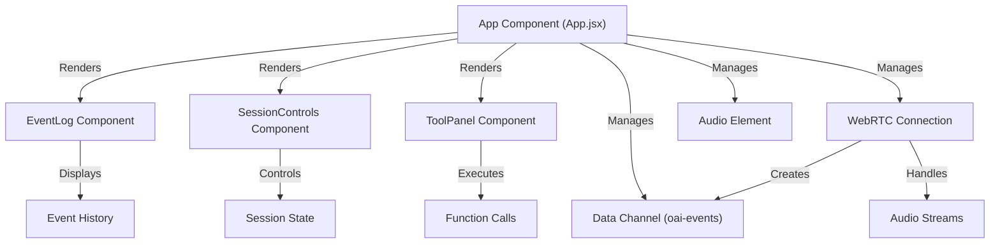
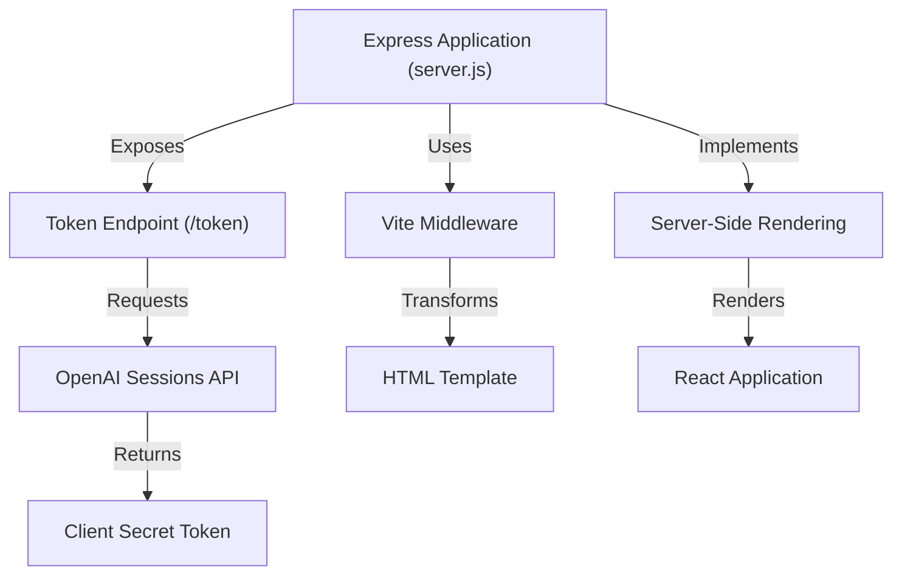
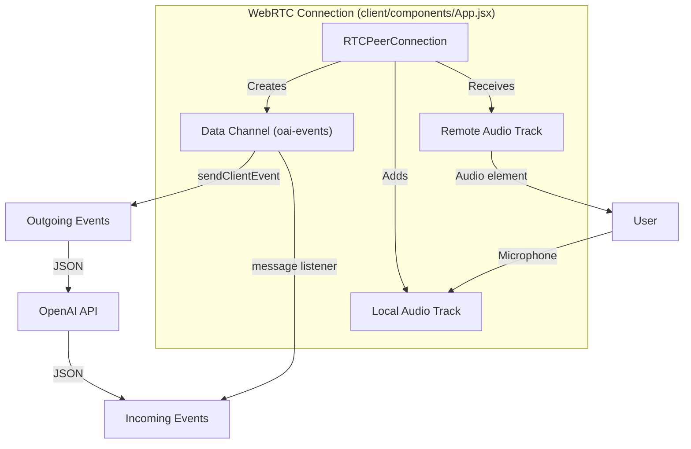
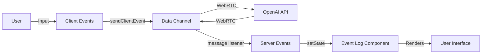
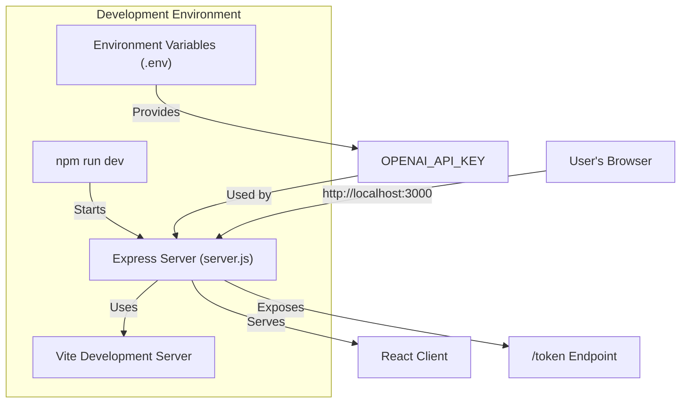

<!-- source: DeepWiki mcp.deepwiki.com · repo openai/openai-realtime-console · page 1.2 System Architecture · fetched 2026-10-26 -->

# System Architecture

Relevant source files

The following files were used as context for generating this wiki page:

- [README.md](README.md)
- [client/components/App.jsx](client/components/App.jsx)
- [client/components/EventLog.jsx](client/components/EventLog.jsx)
- [server.js](server.js)

This document provides a high-level overview of the OpenAI Realtime Console system architecture, explaining how the client, server, and OpenAI Realtime API interact with each other. For details on setting up the project, see [Project Setup](#1.1), and for more in-depth information on WebRTC communication, refer to [WebRTC Communication](#4).

## Overview

The OpenAI Realtime Console is an example application that demonstrates real-time communication with OpenAI's models using WebRTC. The system consists of three main components:

1. **React Frontend**: Client-side application that provides the user interface and manages WebRTC connections
2. **Express Server**: Backend service that handles authentication and token generation
3. **OpenAI Realtime API**: External service that provides AI capabilities via WebRTC

## High-Level Architecture

Sources: [README.md:1-40]()</pre>, [client/components/App.jsx:1-181]()</pre>, [server.js:1-65]()

## Client-Server-API Communication Flow

The following sequence diagram illustrates the communication flow between the client, server, and OpenAI Realtime API:

Sources: [client/components/App.jsx:14-61]()</pre>, [server.js:17-41]()

## Client-Side Architecture

The client side is built using React and consists of several key components:

### Main Components

Sources: [client/components/App.jsx:1-181]()</pre>, [client/components/EventLog.jsx:1-65]()

### State Management

The App component manages the following state:

| State Variable | Purpose | Implementation |
|----------------|---------|----------------|
| `isSessionActive` | Tracks whether a WebRTC session is active | Boolean state in App.jsx |
| `events` | Stores all events exchanged with the API | Array state in App.jsx |
| `dataChannel` | References the WebRTC data channel | State reference in App.jsx |
| `peerConnection` | References the RTCPeerConnection | useRef in App.jsx |
| `audioElement` | References the audio element for playback | useRef in App.jsx |

Sources: [client/components/App.jsx:8-12]()

### Key Client Functions

| Function | Purpose | Implementation |
|----------|---------|----------------|
| `startSession` | Initiates a WebRTC connection with OpenAI | Creates peer connection and data channel |
| `stopSession` | Terminates the WebRTC connection | Closes connection and resets state |
| `sendClientEvent` | Sends a JSON event to the OpenAI API | Transmits via data channel |
| `sendTextMessage` | Formats and sends a text message | Calls sendClientEvent with formatted message |

Sources: [client/components/App.jsx:14-123]()

## Server-Side Architecture

The server is built using Express.js and provides the following functionality:

### Server Components

Sources: [server.js:1-65]()

### Token Generation Process

1. The client requests a token from the server's `/token` endpoint
2. The server makes a POST request to `https://api.openai.com/v1/realtime/sessions` with its API key
3. The OpenAI API returns a client secret token that can be used by the client
4. The server forwards this token to the client
5. The client uses this token to establish a direct WebRTC connection with OpenAI

Sources: [server.js:17-41]()</pre>, [client/components/App.jsx:14-25]()

## WebRTC Implementation

The application uses WebRTC for real-time communication with the OpenAI API, which includes:

1. **Peer Connection**: Established using the `RTCPeerConnection` API
2. **Data Channel**: Named "oai-events" for sending and receiving JSON events
3. **Audio Tracks**: For voice input/output between the user and the model

Sources: [client/components/App.jsx:21-60]()</pre>, [client/components/App.jsx:127-144]()

## Event System

The application uses an event-driven architecture for communication:

### Event Flow

Sources: [client/components/App.jsx:84-103]()</pre>, [client/components/App.jsx:127-144]()</pre>, [client/components/EventLog.jsx:1-65]()

### Event Types

| Event Source | Example Event Types | Purpose |
|--------------|---------------------|---------|
| Client | `conversation.item.create` | Send user messages to the model |
| Client | `response.create` | Request a response from the model |
| Server | `conversation.response.delta` | Stream partial responses from the model |
| Server | `tool.calls` | Request function execution from the client |

Sources: [client/components/App.jsx:106-122]()</pre>, [client/components/EventLog.jsx:36-53]()

## Build and Deployment

The application is built using:

- **Vite**: For React frontend building and hot module replacement
- **Express**: For serving the application and API endpoints
- **Server-Side Rendering**: To improve initial page load performance

Sources: [README.md:5-29]()</pre>, [server.js:1-64]()

## Conclusion

The OpenAI Realtime Console demonstrates a modern architecture for real-time AI interaction using WebRTC:

1. **Express Server**: Handles authentication and token generation
2. **React Client**: Provides the user interface and manages WebRTC connections
3. **WebRTC**: Enables direct, low-latency communication with OpenAI's models
4. **Event-driven Architecture**: Facilitates asynchronous communication and UI updates

This architecture enables efficient real-time communication with OpenAI's models, showcasing the capabilities of the OpenAI Realtime API with WebRTC.

---

