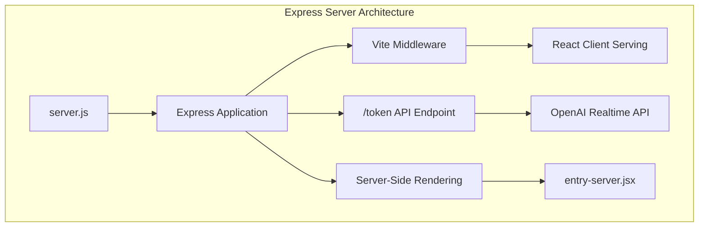
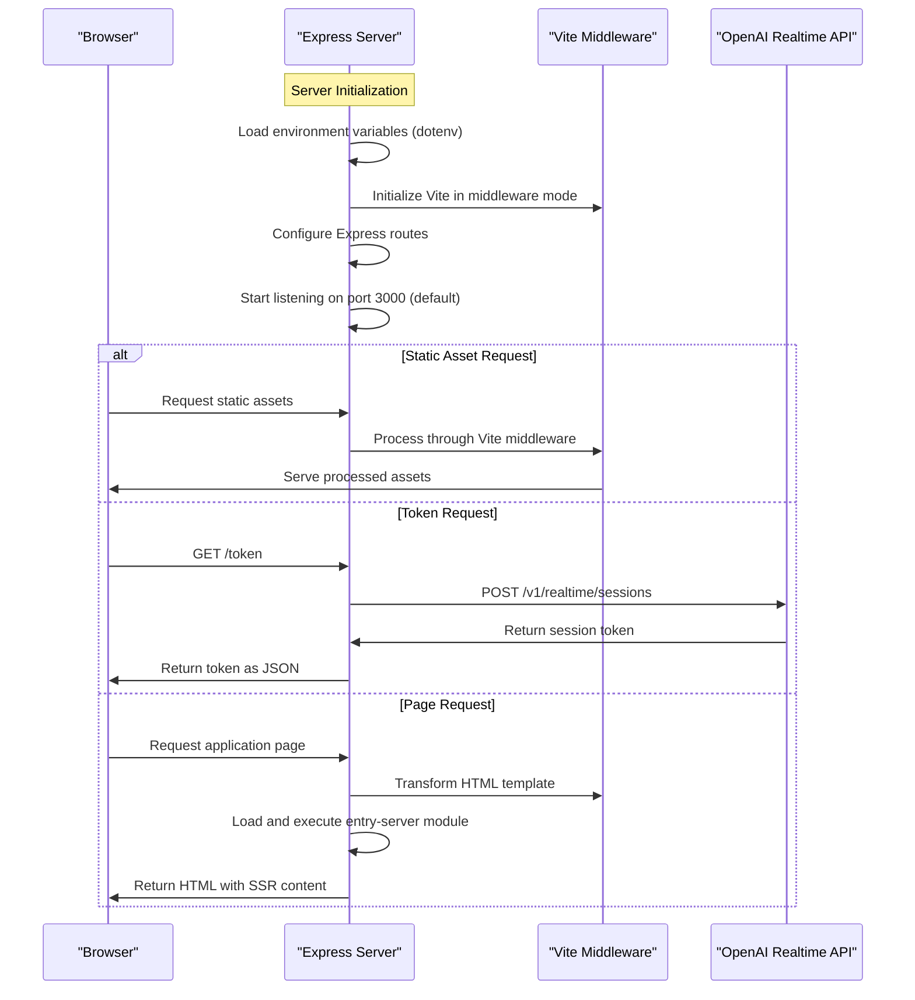
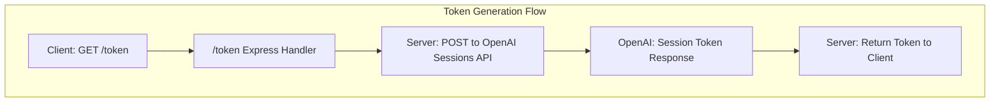

<!-- source: DeepWiki mcp.deepwiki.com · repo openai/openai-realtime-console · page 2 Server Components · fetched 2026-10-26 -->

# Server Components

<details>
<summary>Relevant source files</summary>

The following files were used as context for generating this wiki page:

- [client/entry-server.jsx](client/entry-server.jsx)
- [package.json](package.json)
- [server.js](server.js)

</details>


This page documents the server components in the OpenAI Realtime Console, focusing on the Express server implementation, token generation for OpenAI Realtime API authentication, and server-side rendering capabilities.

For information about client-side components, see [Client Components](#3).

## Express Server Overview

The OpenAI Realtime Console uses an Express.js server as its backend infrastructure, providing three core functionalities:

1. Serving the React client application
2. Generating authentication tokens for the OpenAI Realtime API
3. Supporting server-side rendering for improved performance



Sources: [server.js:1-64](), [package.json:12-15]()

## Server Setup and Configuration

The Express server is configured in `server.js` with the following key components:



The server configuration includes:

1. **Environment Setup**: Uses dotenv to load environment variables including the OPENAI_API_KEY
2. **Port Configuration**: Listens on the port specified in environment variables or defaults to 3000
3. **Vite Integration**: Configures Vite middleware for development and production builds
4. **API Routes**: Defines the `/token` endpoint for OpenAI authentication
5. **Error Handling**: Implements error handling for API requests and SSR rendering

Sources: [server.js:1-15](), [server.js:62-64]()

## Token Generation

One of the core responsibilities of the server is to generate authentication tokens for the OpenAI Realtime API. This is implemented through a dedicated REST API endpoint at `/token`.

| Component | Description |
|-----------|-------------|
| Route | GET `/token` |
| Authentication | Uses server-side OPENAI_API_KEY |
| Target API | OpenAI Realtime Sessions API |
| Request Type | POST with JSON body |
| Model Specification | gpt-4o-realtime-preview-2024-12-17 |
| Voice Setting | verse |
| Response | JSON containing session token |

The token generation process keeps the API key secure by never exposing it to the client:



The implementation uses native fetch to make a POST request to the OpenAI API with appropriate headers and body configuration. The response is then parsed and forwarded to the client.

Sources: [server.js:17-41]()

## Server-Side Rendering

The server implements server-side rendering (SSR) to improve initial load performance and SEO. This feature is integrated with Vite for a modern development experience while maintaining production optimization.

```mermaid
graph TD
    subgraph "Server-Side Rendering Pipeline"
        ClientRequest["Client Page Request"]
        URLCapture["Capture Request URL"]
        TemplateLoad["Load index.html Template"]
        ViteTransform["Vite: Transform HTML"]
        ModuleLoad["Load entry-server.jsx Module"]
        RenderFunction["Execute render() Function"]
        HTMLInjection["Inject Rendered HTML into Template"]
        ResponseSend["Send Complete HTML to Client"]
        
        ClientRequest --> URLCapture
        URLCapture --> TemplateLoad
        TemplateLoad --> ViteTransform
        ViteTransform --> ModuleLoad
        ModuleLoad --> RenderFunction
        RenderFunction --> HTMLInjection
        HTMLInjection --> ResponseSend
    end
```



The SSR process follows these steps:

1. The server captures the client's requested URL
2. It reads the HTML template from `./client/index.html`
3. Vite transforms the HTML template for the current URL
4. The server loads the entry-server module using Vite's `ssrLoadModule`
5. The render function from entry-server is called to generate HTML
6. The generated HTML is injected into the template at the `<!--ssr-outlet-->` placeholder
7. The complete HTML is sent to the client

### Entry Server Module

The `entry-server.jsx` file provides the core rendering logic for SSR:

```jsx
import { StrictMode } from "react";
import { renderToString } from "react-dom/server";
import App from "./components/App";

export function render() {
  const html = renderToString(
    <StrictMode>
      <App />
    </StrictMode>
  );
  return { html };
}
```

This module exports a `render` function that:
- Uses React's `renderToString` to convert the App component to HTML
- Wraps the App in StrictMode for better development error detection
- Returns an object with the HTML string for injection into the template

Sources: [server.js:43-60](), [client/entry-server.jsx:1-12]()

## Development and Production Modes

The server supports both development and production modes through npm scripts defined in `package.json`:

| Environment | Command | Description |
|-------------|---------|-------------|
| Development | `npm run dev` | Runs server with hot-reloading via Vite |
| Production | `npm run start` | Runs server with pre-built assets |
| Build | `npm run build` | Builds both client and server |
| Client Build | `npm run build:client` | Builds client with SSR manifest |
| Server Build | `npm run build:server` | Builds server with SSR support |

In development mode, Vite provides:
- Hot Module Replacement for instant updates
- Source maps for debugging
- Development-friendly error messages

In production mode, the server:
- Serves pre-built optimized assets
- Minimizes error details for security
- Optimizes for performance

Sources: [package.json:3-11](), [server.js:10-15]()

## Server Dependencies

The server relies on several key packages to function properly:

| Dependency | Purpose |
|------------|---------|
| express | Web server framework |
| dotenv | Environment variable management |
| react-dom | Server-side rendering capabilities |
| vite | Development server and build tool |

The server is intentionally kept minimal, focusing only on the essentials needed to serve the application and interface with the OpenAI Realtime API.

Sources: [package.json:12-29]()

## Conclusion

The server components provide the foundation for the OpenAI Realtime Console application by:

1. Securely managing API authentication
2. Serving the React client application
3. Supporting server-side rendering for improved performance
4. Providing a development environment with hot-reloading

For more detailed information about token generation specifically, see [Token Generation](#2.1). For server-side rendering details, see [Server-Side Rendering](#2.2).

---

