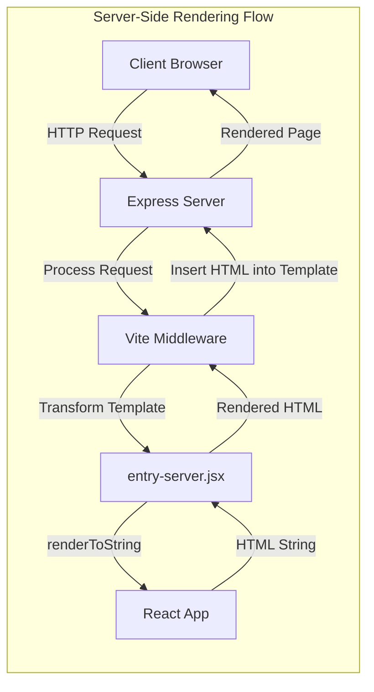
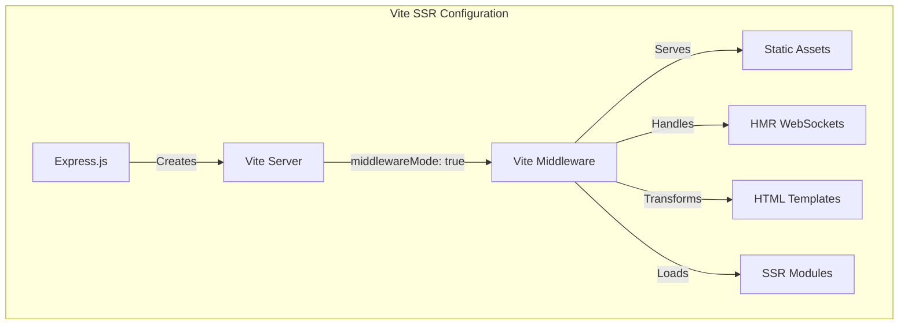
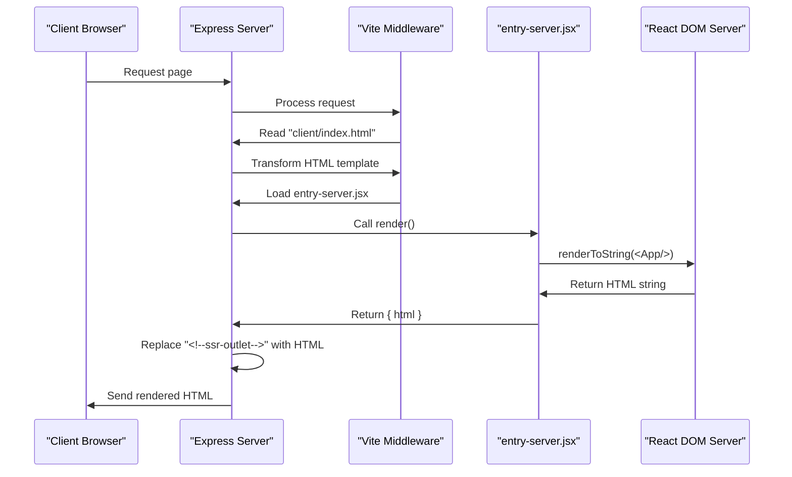
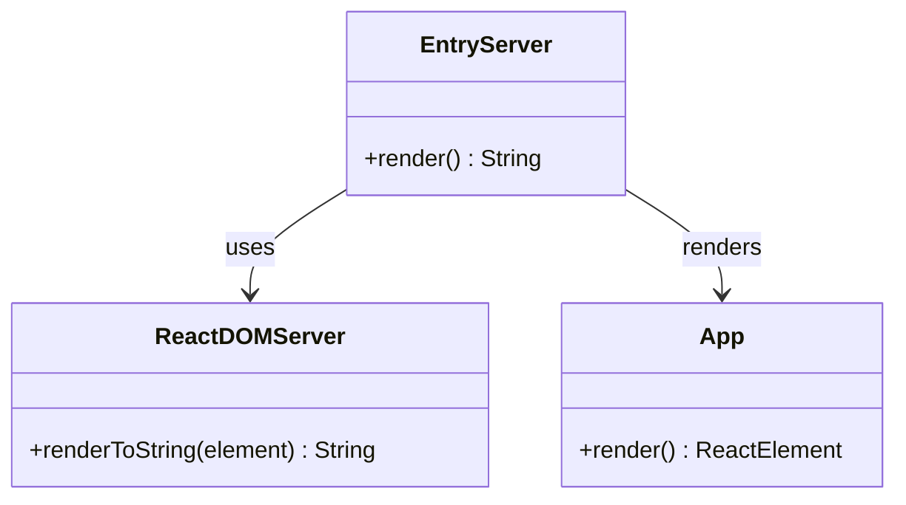
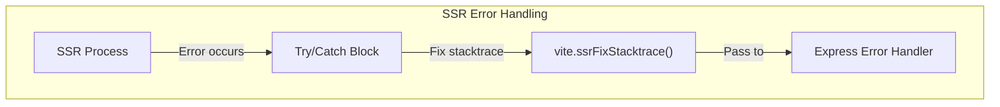

<!-- source: DeepWiki mcp.deepwiki.com · repo openai/openai-realtime-console · page 2.2 Server-Side Rendering · fetched 2026-10-26 -->

# Server-Side Rendering

Relevant source files

The following files were used as context for generating this wiki page:

- [client/entry-server.jsx](client/entry-server.jsx)
- [server.js](server.js)
- [vite.config.js](vite.config.js)

## Purpose and Scope

This document describes the Server-Side Rendering (SSR) implementation in the OpenAI Realtime Console application. It covers how the Express server renders React components on the server and delivers pre-rendered HTML to clients, improving initial page load performance and enabling better search engine optimization. For information about client-side components and their functionality, see [Client Components](#3).

## SSR Architecture Overview

The OpenAI Realtime Console implements server-side rendering using Express.js with Vite middleware in middleware mode, along with React's `renderToString` capability. This architecture allows the application to deliver pre-rendered HTML content to clients while maintaining the interactive capabilities of a single-page application.

Sources: [server.js:44-60](), [client/entry-server.jsx:5-12]()

## Vite Integration

The application uses Vite's middleware mode for server-side rendering, which provides development features like hot module replacement while enabling SSR capabilities.

Sources: [server.js:10-15](), [vite.config.js:7-10]()

## Server-Side Rendering Implementation

### Express Server Configuration

The Express server is configured to use Vite's middleware and includes a catch-all route that handles server-side rendering for all page requests.

| Component | Purpose |
|-----------|---------|
| Vite Middleware | Handles asset serving, module transformation, and HMR |
| Catch-all Route | Processes all page requests through the SSR pipeline |
| Template Transformation | Processes the HTML template with Vite |
| SSR Module Loading | Dynamically loads the server entry point |

Sources: [server.js:10-15](), [server.js:44-60]()

### HTML Template Processing

The SSR process follows these steps:

1. Reads the HTML template from `client/index.html`
2. Transforms the template with Vite
3. Loads the `entry-server.jsx` module using `vite.ssrLoadModule`
4. Renders the React application to an HTML string
5. Replaces `<!--ssr-outlet-->` placeholder with the rendered HTML
6. Sends the complete HTML to the client

Sources: [server.js:47-55](), [client/entry-server.jsx:5-12]()

## Entry Server Module

The `entry-server.jsx` file serves as the entry point for server-side rendering. It exports a `render` function that uses React's `renderToString` to convert the React component tree into an HTML string.

The `render` function:
- Wraps the `App` component in `StrictMode`
- Uses `renderToString` to generate HTML
- Returns an object with the HTML string

Sources: [client/entry-server.jsx:1-12]()

## Error Handling

The SSR implementation includes error handling that improves developer experience by fixing stack traces for SSR-related errors.

When an error occurs during SSR:
1. The error is caught in the try/catch block
2. Vite's `ssrFixStacktrace` method improves the error stacktrace
3. The error is passed to Express's error handling middleware via `next(e)`

Sources: [server.js:56-59]()

## Integration with Client Hydration

While not explicitly shown in the provided code, it's worth noting that after the server renders and delivers the HTML, the client-side JavaScript would "hydrate" the server-rendered markup to make it interactive. The hydration process would use the same React component tree as the server rendering.

Sources: [client/entry-server.jsx:5-12]()

---

