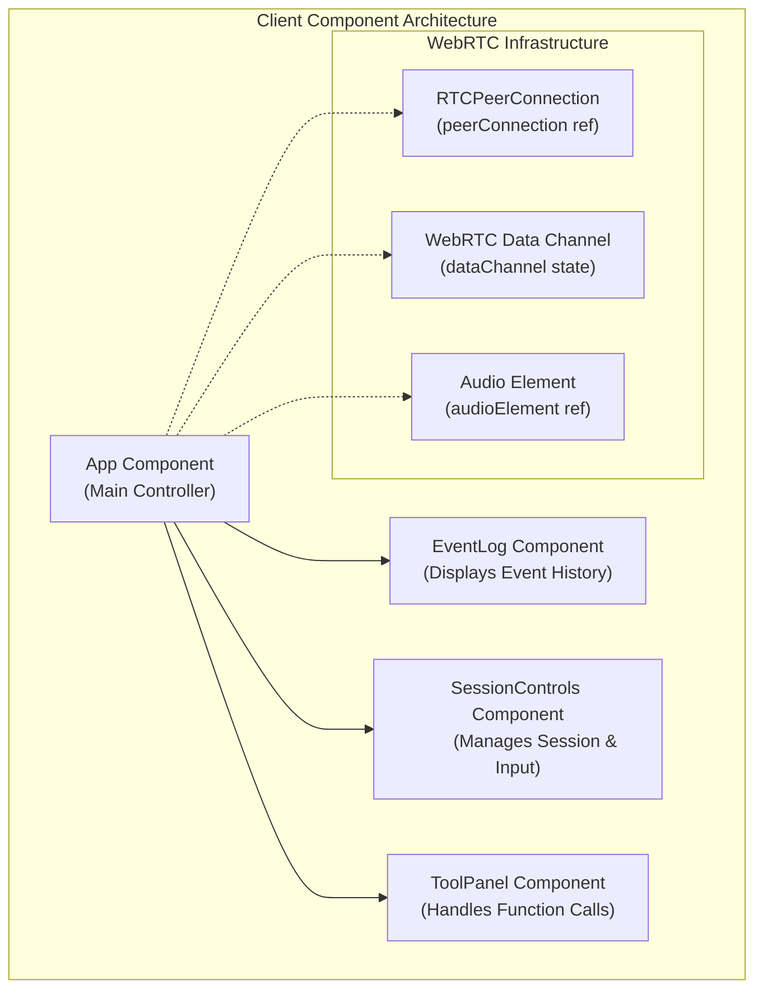
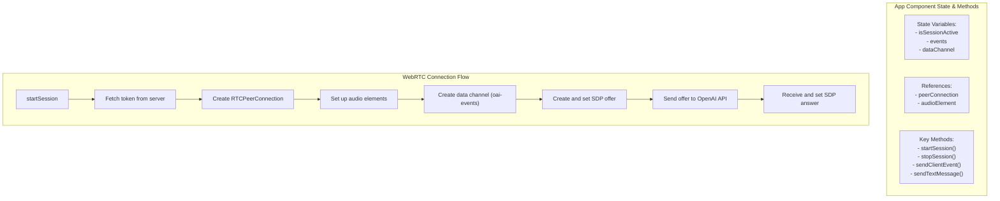
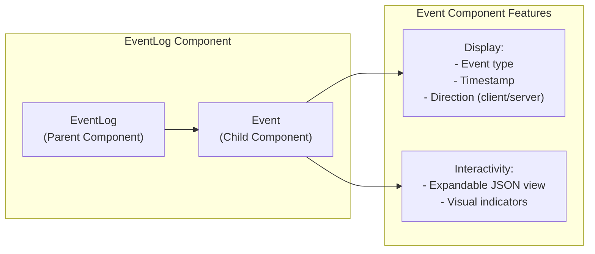
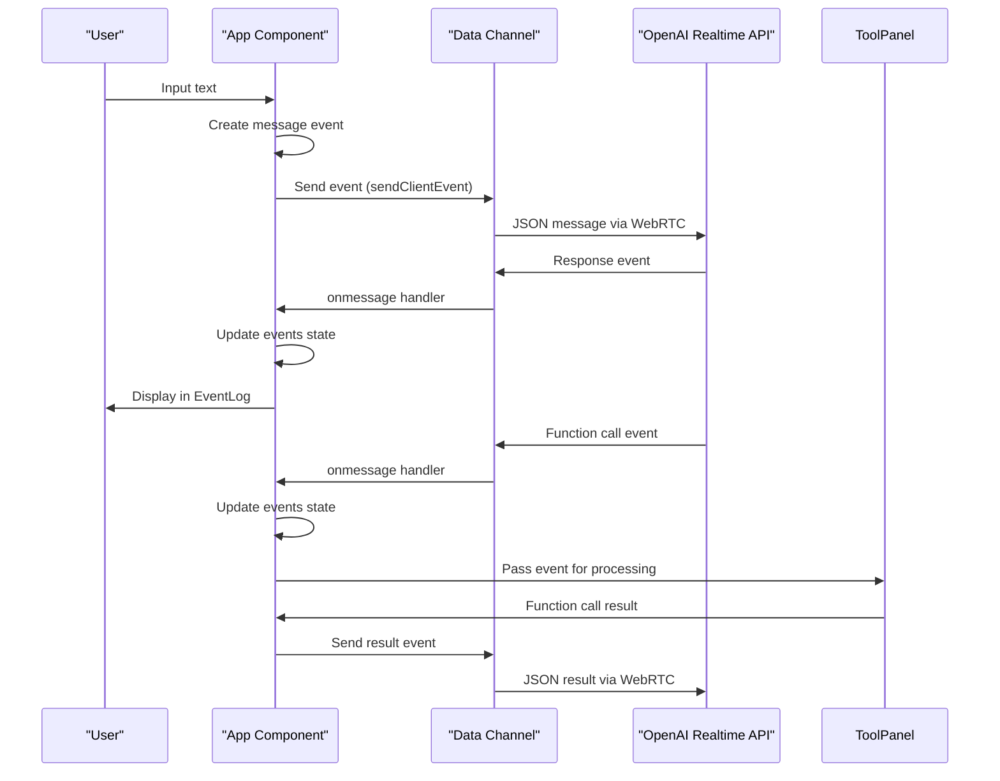
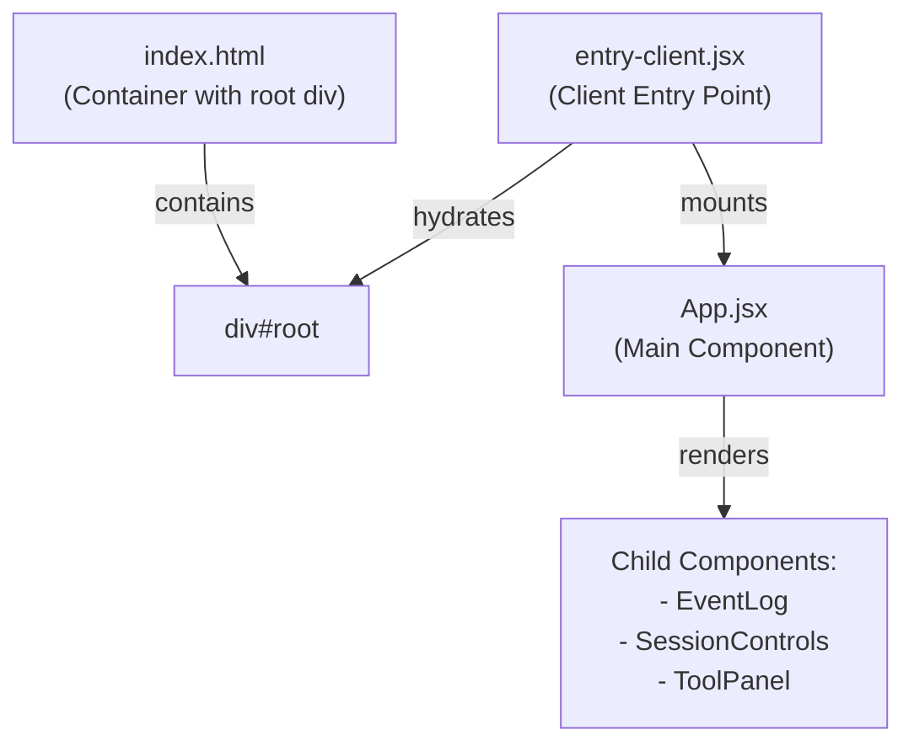
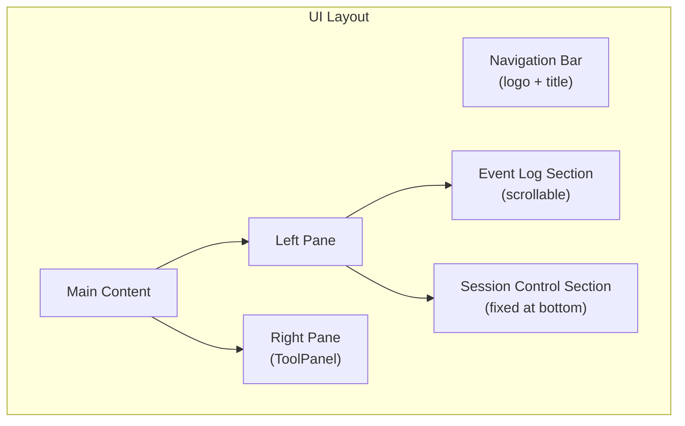

<!-- source: DeepWiki mcp.deepwiki.com · repo openai/openai-realtime-console · page 3 Client Components · fetched 2026-10-26 -->

# Client Components

Relevant source files

The following files were used as context for generating this wiki page:

- [client/components/App.jsx](client/components/App.jsx)
- [client/components/EventLog.jsx](client/components/EventLog.jsx)
- [client/entry-client.jsx](client/entry-client.jsx)
- [client/index.html](client/index.html)

This page documents the client-side components of the OpenAI Realtime Console and their responsibilities. The client components form the frontend interface that users interact with to communicate with the OpenAI Realtime API via WebRTC. For information about server-side components, see [Server Components](#2).

## Overview of Client Architecture

The client side of the OpenAI Realtime Console is built using React and provides a real-time interface for interacting with OpenAI's Realtime API. The client components are responsible for:

1. Establishing and managing WebRTC connections with the OpenAI Realtime API
2. Sending and receiving events via the WebRTC data channel
3. Displaying the conversation and events in a user-friendly interface
4. Providing controls for session management and text input
5. Handling function calls received from the API

Sources: [client/components/App.jsx:1-181](), [client/components/EventLog.jsx:1-64]()

## Component Hierarchy and Responsibilities

The client application follows a hierarchical component structure with a single parent component (`App`) managing several specialized child components.

### App Component

The `App` component serves as the main container and controller for the application. It:

- Manages the WebRTC connection with the OpenAI Realtime API
- Maintains the application state (session status, events)
- Coordinates communication between child components
- Provides methods for sending and receiving events

The component maintains several key state variables:
- `isSessionActive`: Boolean indicating if a session is currently active
- `events`: Array of events exchanged with the API
- `dataChannel`: Reference to the WebRTC data channel
- `peerConnection`: Reference to the RTCPeerConnection object
- `audioElement`: Reference to the audio element for voice playback

Sources: [client/components/App.jsx:7-181]()

### Event Log Component

The `EventLog` component displays the events exchanged between the client and server. It receives the events array from the `App` component and renders them in a collapsible list format.

Key features:
- Differentiates between client and server events with visual indicators
- Provides collapsible JSON view for each event
- Handles delta events (continuous updates) efficiently

Sources: [client/components/EventLog.jsx:1-64]()

### Session Controls Component

The `SessionControls` component provides the interface for managing the WebRTC session and sending messages to the OpenAI API. This component:

- Offers controls to start and stop the session
- Provides a text input for sending messages
- Displays session status information
- Passes user inputs to the parent `App` component

Sources: [client/components/App.jsx:159-168]()

### Tool Panel Component

The `ToolPanel` component handles function calls received from the OpenAI API and provides a way to execute tools or functions in response. This component:

- Processes function call events from the events array
- Displays function call requests and results
- Provides controls for executing the requested functions
- Sends function call results back to the API

Sources: [client/components/App.jsx:170-176]()

## Event Flow and Communication

The client components communicate with the OpenAI Realtime API through a WebRTC data channel. Events flow bidirectionally between the client and server, with the client component orchestrating this communication.

Sources: [client/components/App.jsx:83-123](), [client/components/App.jsx:125-144]()

## WebRTC Connection Management

The `App` component handles the establishment and management of the WebRTC connection with the OpenAI Realtime API.

### Connection Establishment

The connection is established through a series of steps:

1. Obtain a session token from the server
2. Create an RTCPeerConnection
3. Set up audio tracks (both local and remote)
4. Create a data channel named "oai-events"
5. Generate and send an SDP offer
6. Receive and process the SDP answer
7. Establish the WebRTC connection

Sources: [client/components/App.jsx:14-60]()

### Session Management

The client provides methods for starting and stopping the WebRTC session:

- `startSession()`: Establishes the WebRTC connection with the OpenAI API
- `stopSession()`: Cleans up the connection, closes the data channel, and resets the state

### Event Handling 

Events are sent and received through the WebRTC data channel:

- `sendClientEvent()`: Formats and sends events to the API
- `sendTextMessage()`: Helper method to create and send text message events
- Event listeners on the data channel capture and process incoming events

Sources: [client/components/App.jsx:63-123]()

## Client-Side Rendering and Hydration

The client application is served with server-side rendering and then hydrated on the client side. The application entry point is `entry-client.jsx`, which hydrates the React application into the DOM.

Sources: [client/index.html:1-19](), [client/entry-client.jsx:1-12]()

## Component Layout and UI Structure

The client UI is divided into sections for different functional areas:

1. Top navigation bar with logo and title
2. Main content area with:
   - Event log section (left side)
   - Session controls (bottom of left side)
   - Tool panel (right side)

This layout provides a clear separation of concerns while keeping all necessary controls easily accessible.

Sources: [client/components/App.jsx:146-179]()

## Summary

The client components of the OpenAI Realtime Console work together to provide a seamless interface for interacting with the OpenAI Realtime API. The architecture follows a hierarchical pattern with a clear separation of responsibilities:

- `App`: Main controller managing state and WebRTC connection
- `EventLog`: Display of events exchanged with the API
- `SessionControls`: Interface for managing the session and sending messages
- `ToolPanel`: Handling of function calls and tool execution

This design allows for efficient real-time communication with the OpenAI API while providing a clean and usable interface for developers to test and debug their applications.

Sources: [client/components/App.jsx:1-181](), [client/components/EventLog.jsx:1-64](), [client/entry-client.jsx:1-12](), [client/index.html:1-19]()

---

