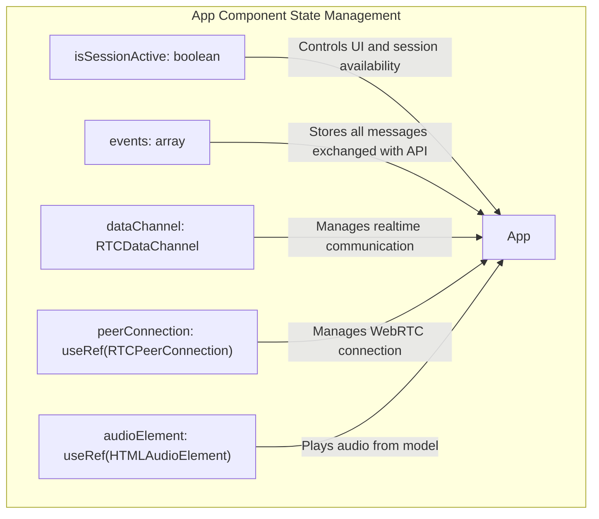
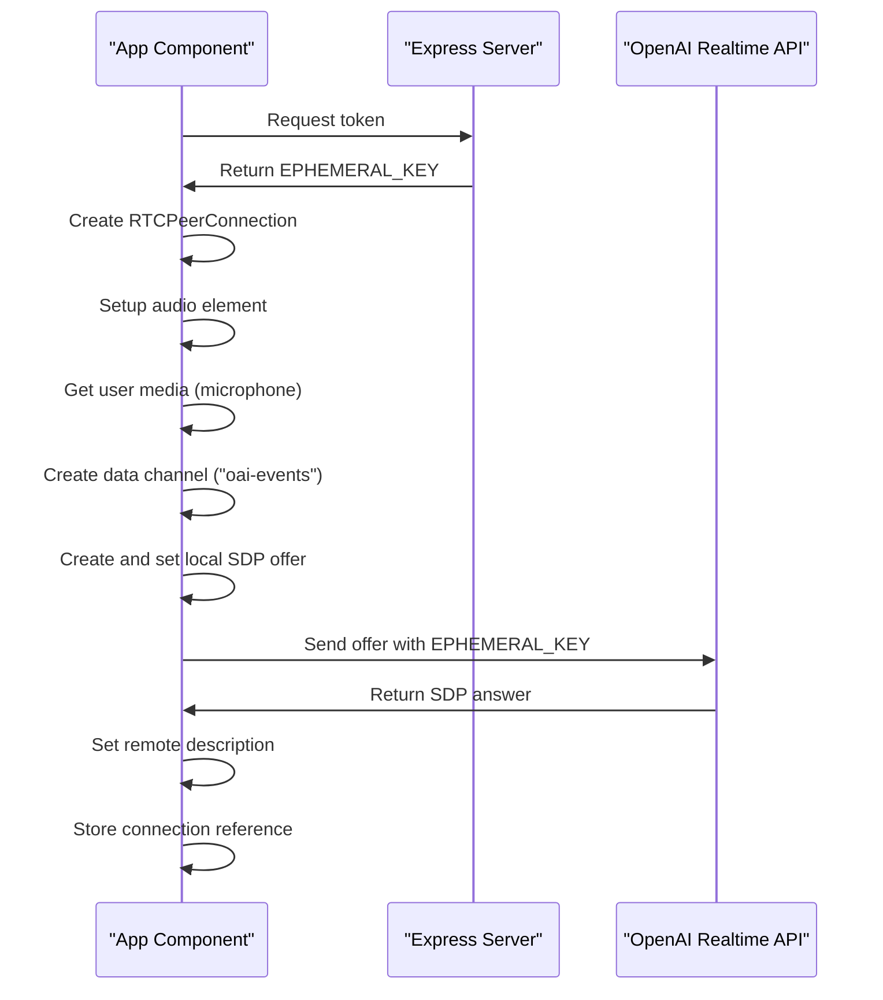
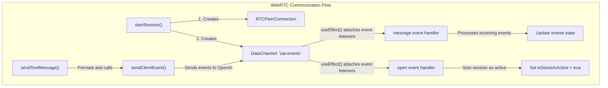
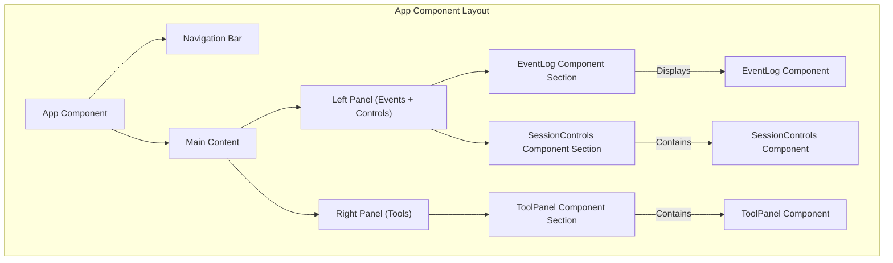
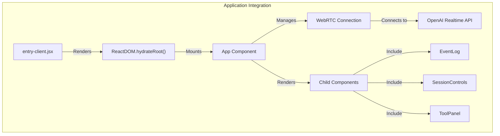
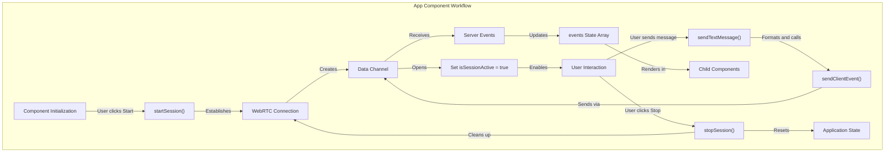

<!-- source: DeepWiki mcp.deepwiki.com · repo openai/openai-realtime-console · page 3.1 App Component · fetched 2026-10-26 -->

# App Component

Relevant source files

The following files were used as context for generating this wiki page:

- [client/components/App.jsx](client/components/App.jsx)
- [client/components/EventLog.jsx](client/components/EventLog.jsx)
- [client/entry-client.jsx](client/entry-client.jsx)

The App component serves as the central controller for the OpenAI Realtime Console application. It manages the WebRTC connection to the OpenAI Realtime API, handles session state, processes events, and coordinates all UI components. This document details the structure, functionality, and relationships of the App component.

For information about specific child components, see [Event Log System](#3.2) and [Session Controls and Tool Panel](#3.3).

## Component Structure and State Management

The App component maintains several key pieces of state and references:

Sources: [client/components/App.jsx:8-12]()

### State Variables
- `isSessionActive`: Boolean flag indicating if a session is currently active
- `events`: Array storing all events exchanged with the OpenAI Realtime API
- `dataChannel`: Reference to the WebRTC data channel for sending/receiving events
- `peerConnection`: useRef containing the RTCPeerConnection instance
- `audioElement`: useRef for the audio element to play model responses

## Session Lifecycle Management

The App component provides comprehensive session management through two primary functions:

### Session Initialization

The `startSession` function handles the complete WebRTC connection setup process:

Sources: [client/components/App.jsx:14-60]()

### Session Termination

The `stopSession` function cleans up resources and resets the application state:

1. Closes the data channel
2. Stops all media tracks
3. Closes the peer connection
4. Resets the state variables

Sources: [client/components/App.jsx:63-81]()

## WebRTC Communication

The App component establishes and manages a WebRTC connection with the OpenAI Realtime API:

Sources: [client/components/App.jsx:14-60](), [client/components/App.jsx:126-144]()

### Data Channel Event Handling

When a data channel is established, event listeners are attached to:
- Process incoming messages from the API
- Update the application state when the channel opens
- Add timestamps to events for display

Sources: [client/components/App.jsx:126-144]()

## Event Processing

The App component provides two main functions for sending events to the OpenAI Realtime API:

### sendClientEvent

This function:
1. Takes a message object as input
2. Adds an event_id if not present
3. Sends the event via the data channel
4. Adds a timestamp for UI display
5. Updates the events state array

Sources: [client/components/App.jsx:84-103]()

### sendTextMessage

A convenience function that:
1. Formats a text message into the proper event structure
2. Calls sendClientEvent with the formatted event
3. Also sends a response.create event to initiate a response

Sources: [client/components/App.jsx:106-123]()

## Component Layout and Rendering

The App component renders a structured UI with several key sections:

Sources: [client/components/App.jsx:146-181]()

### Child Components and Props

The App component passes down state and functions to child components:

| Component | Props Received | Purpose |
|-----------|----------------|---------|
| EventLog | events | Displays events exchanged with the API |
| SessionControls | startSession, stopSession, sendClientEvent, sendTextMessage, events, isSessionActive | Controls session state and provides messaging interface |
| ToolPanel | sendClientEvent, sendTextMessage, events, isSessionActive | Provides tool execution functionality |

Sources: [client/components/App.jsx:157-176]()

## Integration with Overall Application

The App component is the root component of the React application, as shown in the entry-client.jsx file:

Sources: [client/entry-client.jsx:1-11]()

## Complete Component Workflow

The following diagram illustrates the complete workflow of the App component, including initialization, communication, and termination:

Sources: [client/components/App.jsx:7-181]()

## Summary

The App component serves as the foundation of the OpenAI Realtime Console application. It:

1. Manages the WebRTC connection to the OpenAI Realtime API
2. Handles session lifecycle (initialization and termination)
3. Processes events sent to and received from the API
4. Coordinates audio input/output for voice interaction
5. Renders the UI layout and integrates child components
6. Provides core functionality for text messaging and event dispatching

This component demonstrates a complete implementation of a WebRTC-based application for interacting with the OpenAI Realtime API, showcasing real-time communication and event-driven architecture.

---

