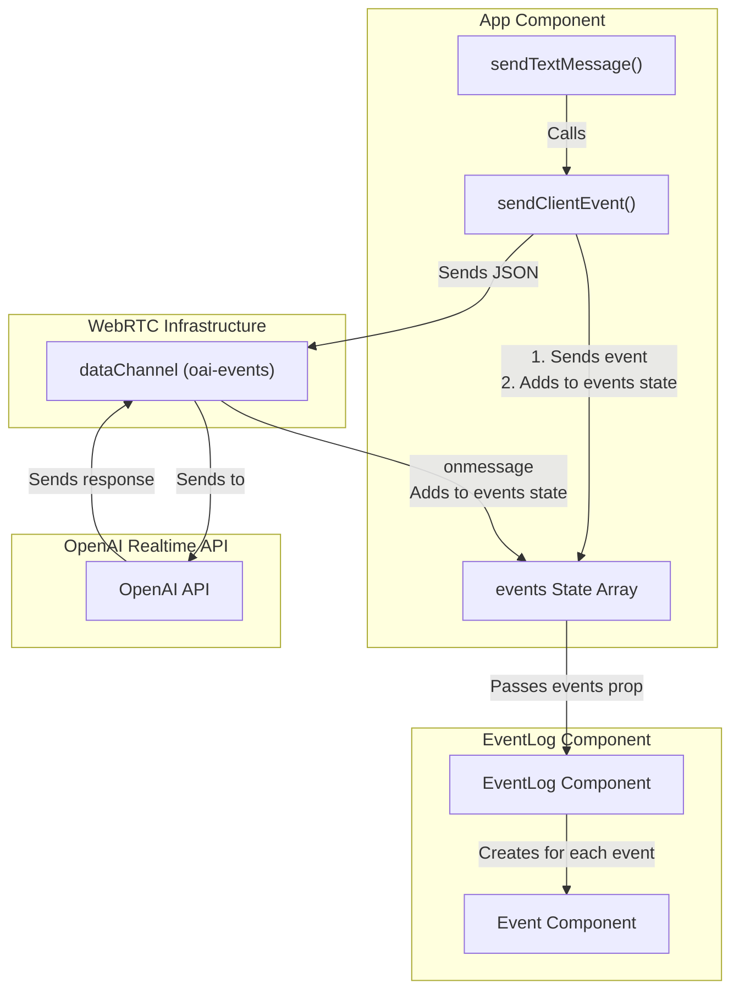
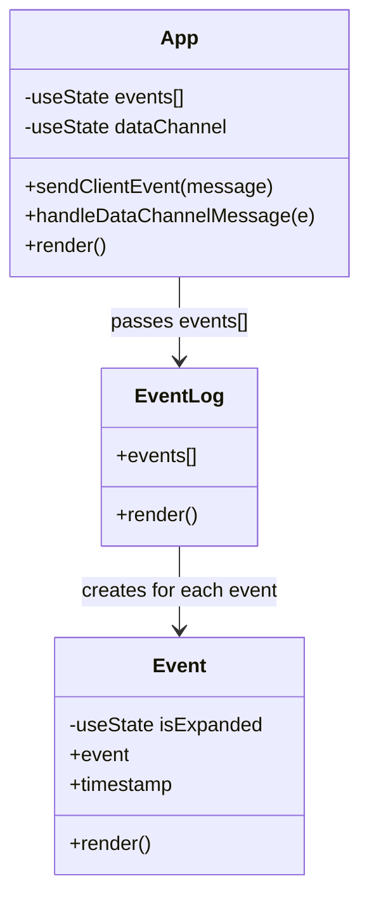
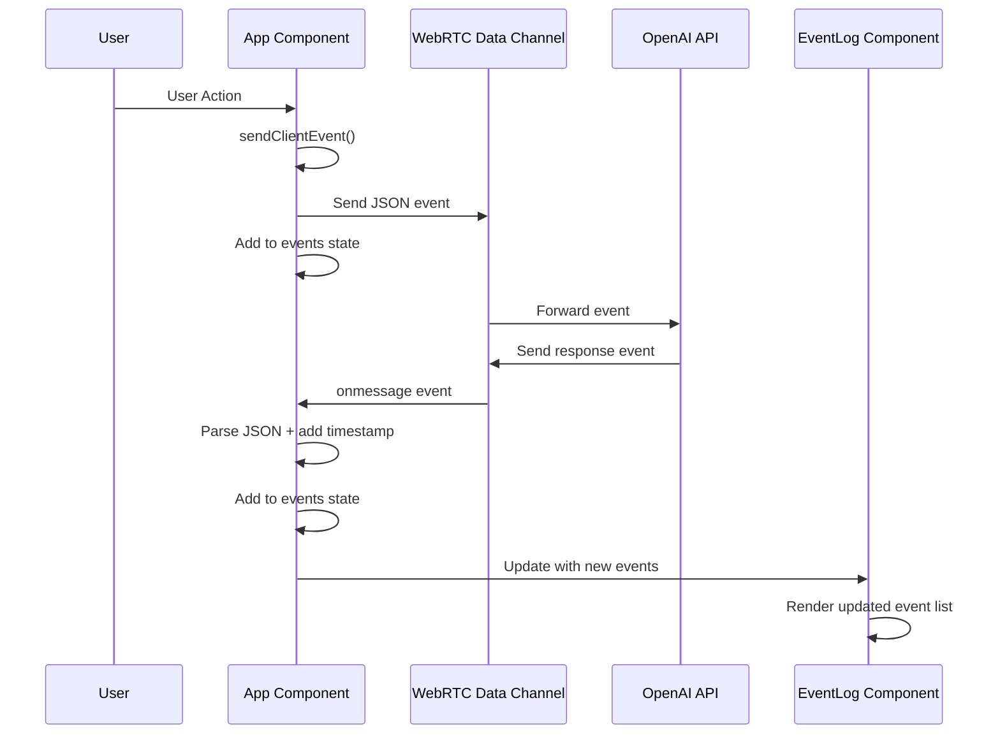
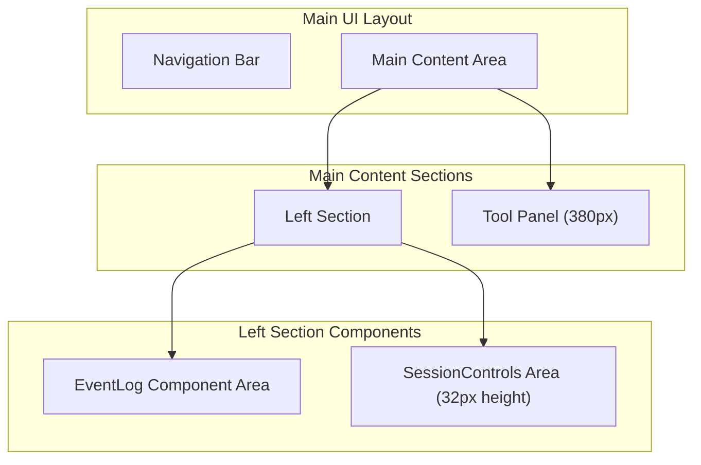

<!-- source: DeepWiki mcp.deepwiki.com · repo openai/openai-realtime-console · page 3.2 Event Log System · fetched 2026-10-26 -->

# Event Log System

<details>
<summary>Relevant source files</summary>

The following files were used as context for generating this wiki page:

- [client/components/App.jsx](client/components/App.jsx)
- [client/components/EventLog.jsx](client/components/EventLog.jsx)

</details>


## Purpose and Overview

The Event Log System is a core component of the OpenAI Realtime Console that displays and manages the bidirectional flow of events between the client application and the OpenAI Realtime API. This system provides developers with a real-time, visual representation of the JSON payloads being exchanged during a session, making it an essential debugging and monitoring tool.

For information about how events are processed and how function calling works, see [Event Processing](#4.2).

## Event Flow Architecture

The Event Log System captures, stores, and displays events that flow through the WebRTC data channel. Events originate from either the client application or the OpenAI Realtime API.



Sources: [client/components/App.jsx:84-103](), [client/components/App.jsx:125-144](), [client/components/EventLog.jsx:36-64]()

## Event Data Structure

Events in the system follow a consistent structure with several key properties:

| Property | Description | Example |
|----------|-------------|---------|
| `type` | Identifies the event category and action | `"conversation.item.create"` |
| `event_id` | Unique identifier for the event | Client: UUID, Server: starts with "event_" |
| `timestamp` | When the event occurred | Added by the client for both directions |
| Event-specific data | Varies based on event type | Message content, function calls, etc. |

### Client vs Server Events

The system visually distinguishes between events originating from the client and those from the server:

- **Client Events**: Display with a downward blue arrow (↓)
- **Server Events**: Display with an upward green arrow (↑)

Events are identified as client-originated if they have an `event_id` that doesn't start with "event_".

Sources: [client/components/EventLog.jsx:4-34]()

## Component Architecture

The Event Log System consists of two main React components:



Sources: [client/components/App.jsx:7-181](), [client/components/EventLog.jsx:4-64]()

### EventLog Component

The EventLog component is the container that renders the list of events. It:

1. Receives the `events` array from the App component
2. Handles special cases like delta events (partial updates)
3. Creates an `Event` component for each event to be displayed
4. Shows a placeholder message when no events are available

Delta events (events with types ending in "delta") receive special handling - only one delta event of each type is displayed per render cycle to prevent overwhelming the display.

Sources: [client/components/EventLog.jsx:36-64]()

### Event Component

Individual events are rendered by the Event component, which:

1. Displays event direction (client/server), type, and timestamp
2. Allows expanding/collapsing to view the full JSON payload
3. Uses visual indicators (arrows) to distinguish between client and server events
4. Formats the JSON payload with proper indentation when expanded

Sources: [client/components/EventLog.jsx:4-34]()

## Event Handling in the App Component

The App component serves as the central manager for events in the system:



The App component manages events through several key functions:

1. **sendClientEvent()**: Formats and sends events to the OpenAI Realtime API via the data channel, and adds them to the events state
2. **sendTextMessage()**: Creates a properly formatted text message event and calls sendClientEvent()
3. **Data channel onmessage handler**: Processes incoming events from the API, adds timestamps, and updates the events state

Events are stored in reverse chronological order (newest first) in the events state array.

Sources: [client/components/App.jsx:84-123](), [client/components/App.jsx:125-144]()

## UI Layout and Integration

The Event Log is positioned as a central element in the user interface:



The EventLog component occupies the primary screen area, taking up the left section of the UI above the session controls.

Sources: [client/components/App.jsx:146-181]()

## Example Event Flow

Here's a typical event flow showing how a user message is processed:

1. User sends a message through the SessionControls component
2. App calls `sendTextMessage("Hello, how are you?")`
3. `sendTextMessage` creates an event with type `conversation.item.create`
4. `sendClientEvent` is called with this event, which:
   - Adds a unique event_id
   - Sends the event via the data channel to OpenAI
   - Adds the event with a timestamp to the events state
5. App then automatically sends a `response.create` event
6. OpenAI API processes these events and sends back response events
7. These events are received via the data channel, timestamped, and added to the events state
8. The EventLog component re-renders with all events displayed in reverse chronological order

Sources: [client/components/App.jsx:84-123](), [client/components/App.jsx:125-144]()

## Technical Implementation Details

### Event Expansion and Collapsing

Each event in the log can be expanded to view its full JSON payload. This is implemented using:
- A local `isExpanded` state in the Event component
- A click handler that toggles this state
- Conditional CSS classes that show or hide the JSON pre-formatted block

### Event Filtering and Processing

The EventLog component implements filtering for delta events to prevent overwhelming the UI:

```javascript
if (event.type.endsWith("delta")) {
  if (deltaEvents[event.type]) {
    // for now just log a single event per render pass
    return;
  } else {
    deltaEvents[event.type] = event;
  }
}
```

This ensures that only one delta event of each type is displayed per render cycle.

Sources: [client/components/EventLog.jsx:40-48]()

## Integration with Other Components

The Event Log System integrates with several other components:

1. **App Component**: Manages the events state and provides it to the EventLog
2. **SessionControls**: Uses the sendTextMessage and sendClientEvent functions to create events
3. **ToolPanel**: Uses the events data to display function call outputs and provide tools

For more details on SessionControls and ToolPanel, see [Session Controls and Tool Panel](#3.3).

Sources: [client/components/App.jsx:159-177]()

---

