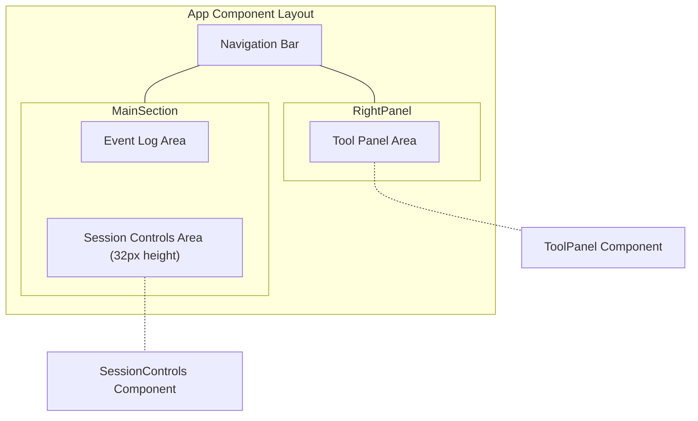
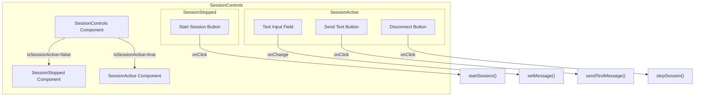
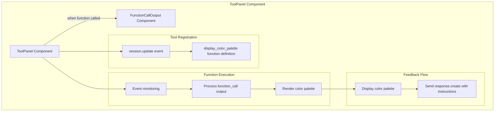
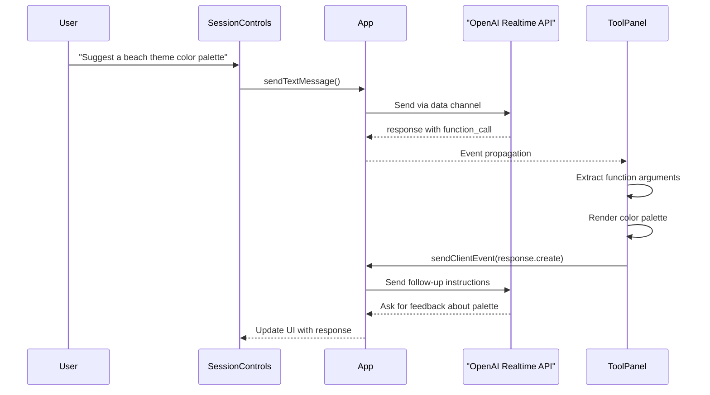
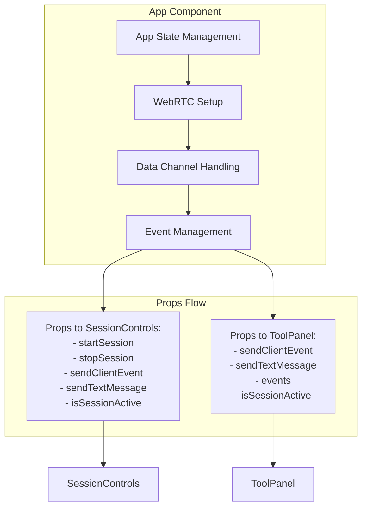

<!-- source: DeepWiki mcp.deepwiki.com · repo openai/openai-realtime-console · page 3.3 Session Controls and Tool Panel · fetched 2026-10-26 -->

# Session Controls and Tool Panel

<details>
<summary>Relevant source files</summary>

The following files were used as context for generating this wiki page:

- [client/components/App.jsx](client/components/App.jsx)
- [client/components/EventLog.jsx](client/components/EventLog.jsx)
- [client/components/SessionControls.jsx](client/components/SessionControls.jsx)
- [client/components/ToolPanel.jsx](client/components/ToolPanel.jsx)

</details>


## Purpose and Scope

This document details the Session Controls and Tool Panel components of the OpenAI Realtime Console application. These two components provide essential user interface elements that enable:

1. Managing WebRTC sessions with the OpenAI Realtime API
2. Sending text messages to the model
3. Registering and executing tools via function calling
4. Displaying function call results

For information about general event handling and WebRTC communication, see [WebRTC Communication](#4), and for details about how events are logged, see [Event Log System](#3.2).

## Component Location and Overview

The SessionControls and ToolPanel components occupy specific regions in the application interface:



Sources: [client/components/App.jsx:146-180]()

## Session Controls Component

The SessionControls component manages user interactions for establishing, maintaining, and terminating WebRTC sessions with the OpenAI Realtime API.

### Component States

The SessionControls component has two main states:

1. **Session Inactive** - Displays a button to start a new session
2. **Session Active** - Displays a text input field, send button, and disconnect button

```mermaid
stateDiagram-v2
    [*] --> "Session Inactive"
    "Session Inactive" --> "Session Active": startSession()
    "Session Active" --> "Session Inactive": stopSession()
    
    state "Session Inactive" as SI {
        [*] --> "Ready"
        "Ready" --> "Starting": "Click Start Button"
        "Starting" --> [*]: "Session Established"
    }
    
    state "Session Active" as SA {
        [*] --> "Input Empty"
        "Input Empty" --> "Input Filled": "Type Message"
        "Input Filled" --> "Input Empty": "Send Message"
        "Input Empty" --> [*]: "Click Disconnect"
        "Input Filled" --> [*]: "Click Disconnect"
    }
```

Sources: [client/components/SessionControls.jsx:5-66](), [client/components/App.jsx:14-81]()

### Component Structure

The SessionControls component renders different UI elements based on the session state:



Sources: [client/components/SessionControls.jsx:5-66]()

### Functionality

#### Starting a Session

When a user clicks the "start session" button, the component:

1. Sets an "isActivating" state to prevent multiple clicks
2. Calls the `startSession()` function passed down from the App component
3. This initiates a chain of events in the App component:
   - Fetches a token from the server
   - Creates a WebRTC peer connection
   - Sets up a data channel
   - Establishes a connection with the OpenAI Realtime API

#### Sending Messages

When a session is active, users can:
1. Type text in the input field
2. Send the message by clicking the "send text" button or pressing Enter
3. This calls the `sendTextMessage()` function, which:
   - Formats the message as a client event
   - Sends it through the WebRTC data channel
   - Clears the input field

#### Stopping a Session

When the user clicks the "disconnect" button:
1. The `stopSession()` function is called
2. The WebRTC connection is closed
3. The UI returns to the inactive state

Sources: [client/components/SessionControls.jsx:5-66](), [client/components/App.jsx:14-81](), [client/components/App.jsx:105-123]()

## Tool Panel Component

The ToolPanel component demonstrates OpenAI's function calling capabilities by implementing a color palette generation tool.

### Component Structure and Function



Sources: [client/components/ToolPanel.jsx:1-133]()

### Function Registration

When a session is created, the ToolPanel component:

1. Detects the `session.created` event
2. Sends a `session.update` event containing the function definition:
   - Name: `display_color_palette`
   - Parameters: `theme` (string) and `colors` (array of hex color codes)
   - Description of the function's purpose

The function definition is structured as follows:

```
{
  type: "function",
  name: "display_color_palette",
  description: "Call this function when a user asks for a color palette.",
  parameters: {
    type: "object",
    strict: true,
    properties: {
      theme: { type: "string", description: "..." },
      colors: { type: "array", description: "...", items: { ... } }
    },
    required: ["theme", "colors"]
  }
}
```

Sources: [client/components/ToolPanel.jsx:3-38]()

### Function Execution Flow

The function execution follows this sequence:

1. User asks for a color palette
2. Model decides to call the `display_color_palette` function
3. ToolPanel detects the function call in the `response.done` event
4. It extracts the function arguments (theme and colors)
5. Renders the color palette in the UI
6. After a short delay (500ms), it sends a follow-up prompt to the model



Sources: [client/components/ToolPanel.jsx:66-108](), [client/components/App.jsx:83-103]()

### UI Rendering

The ToolPanel displays different content based on the state:

1. When no session is active: "Start the session to use this tool..."
2. When a session is active but no function has been called: "Ask for advice on a color palette..."
3. When a function has been called: The color palette with theme name and hex colors

The `FunctionCallOutput` component handles rendering the color palette by:
1. Parsing the function arguments (theme and colors)
2. Creating color boxes for each hex color
3. Displaying the theme name
4. Showing the raw function call output in a collapsible section

Sources: [client/components/ToolPanel.jsx:40-64](), [client/components/ToolPanel.jsx:116-132]()

## Integration with App Component

Both SessionControls and ToolPanel are integrated into the App component and share common functionality:



Sources: [client/components/App.jsx:146-177]()

### Key Shared Functions

Both components rely on these functions from the App component:

1. **sendClientEvent** - Formats and sends a generic event to the OpenAI API
2. **sendTextMessage** - Specifically formats and sends a text message event
3. **startSession / stopSession** - Manages the WebRTC connection lifecycle

The App component also manages shared state that affects both components:
- `isSessionActive` - Controls which UI state to display
- `events` - The history of events exchanged with the API

Sources: [client/components/App.jsx:83-123]()

## Usage Workflow

The typical workflow for users interacting with these components:

1. User clicks "start session" in the SessionControls component
2. App establishes WebRTC connection with OpenAI Realtime API
3. ToolPanel registers the `display_color_palette` function
4. User types a request for a color palette and sends it
5. Model responds and calls the function
6. ToolPanel displays the color palette
7. ToolPanel prompts the model to ask for feedback
8. User responds via SessionControls
9. Eventually, user clicks "disconnect" to end the session

This workflow demonstrates how these components work together to provide a complete interaction cycle with function calling capabilities.

Sources: [client/components/App.jsx:146-180](), [client/components/SessionControls.jsx:5-66](), [client/components/ToolPanel.jsx:1-133]()

---

