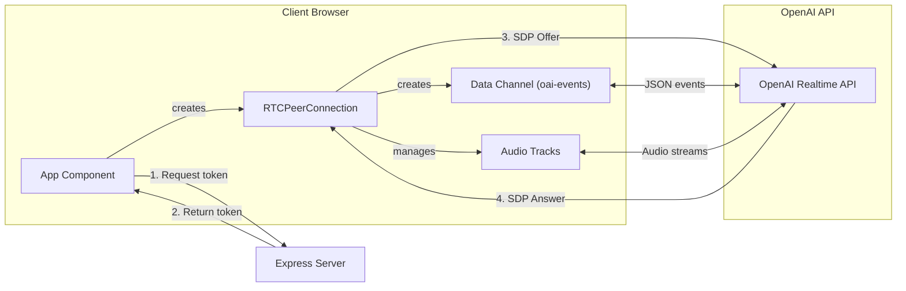
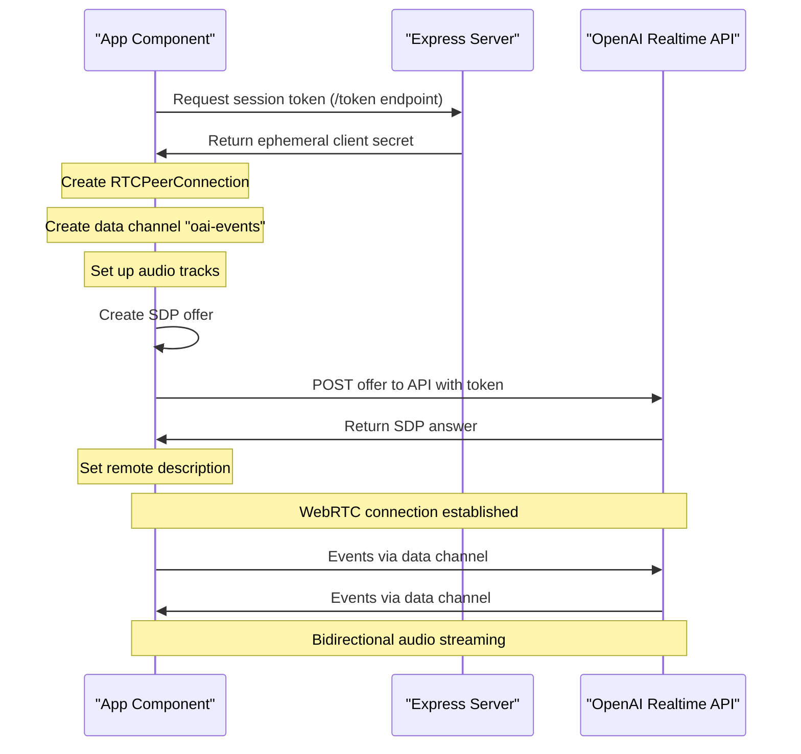
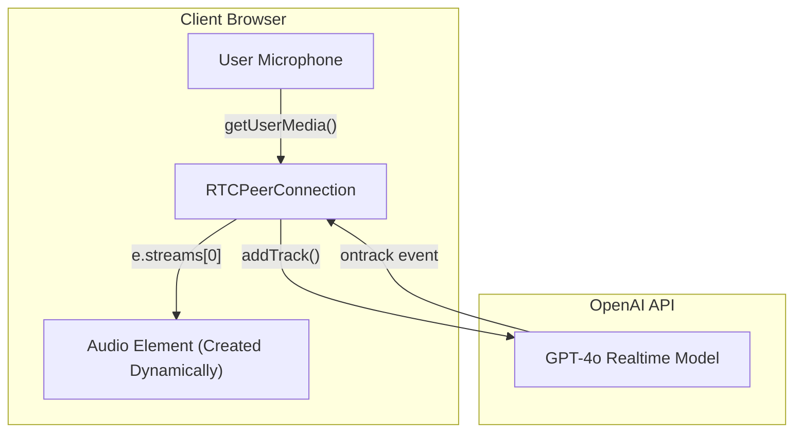
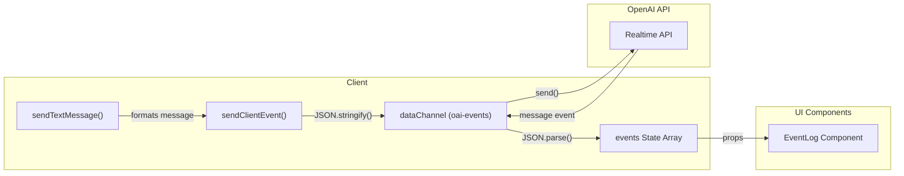
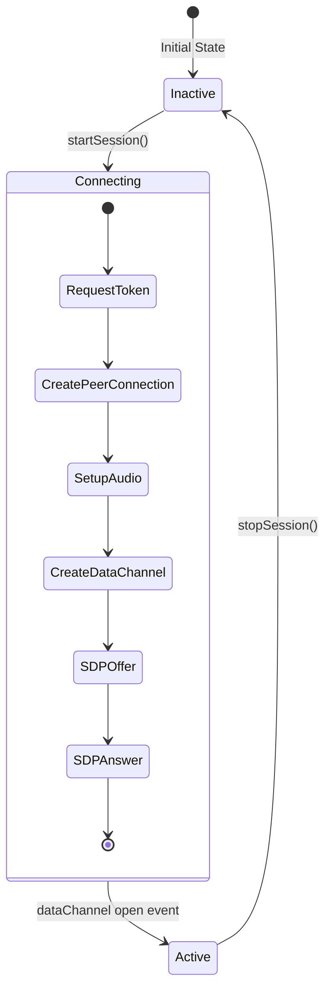

<!-- source: DeepWiki mcp.deepwiki.com · repo openai/openai-realtime-console · page 4 WebRTC Communication · fetched 2026-10-26 -->

# WebRTC Communication

<details>
<summary>Relevant source files</summary>

The following files were used as context for generating this wiki page:

- [README.md](README.md)
- [client/components/App.jsx](client/components/App.jsx)
- [client/components/EventLog.jsx](client/components/EventLog.jsx)

</details>


This page documents how the OpenAI Realtime Console implements WebRTC to establish direct, real-time communication between the client browser and the OpenAI Realtime API. WebRTC provides low-latency transmission of both data messages and audio streams without requiring a proxy server for the actual communication.

For details on the data channel implementation, see [Data Channel Setup](#4.1). For information about how events are processed through this channel, see [Event Processing](#4.2).

## Overview of WebRTC Implementation

The OpenAI Realtime Console uses WebRTC to create a peer-to-peer connection between the client browser and OpenAI's Realtime API. This connection serves two primary purposes:

1. **Data Channel**: A bidirectional channel named "oai-events" for exchanging JSON messages
2. **Media Streams**: Audio transmission for voice input from the user and audio output from the model



Sources: [client/components/App.jsx:14-61](), [README.md:3-29]()

## Connection Establishment Process

The WebRTC connection is established through a series of steps handled by the `startSession` function in the App component:

1. **Token Acquisition**: The client first requests a temporary authentication token from the server
2. **Peer Connection Creation**: A new RTCPeerConnection instance is created 
3. **Media Setup**: Audio tracks are configured for microphone input and model output
4. **Data Channel Creation**: A data channel named "oai-events" is established for exchanging JSON events
5. **SDP Negotiation**: The client creates an offer, sends it to the OpenAI API, and processes the answer



Sources: [client/components/App.jsx:14-61]()

## WebRTC Components in Code

The App component (`App.jsx`) manages several WebRTC-related objects through React state and refs:

| Component | Implementation | Purpose |
|-----------|----------------|---------|
| `peerConnection` | useRef(null) | Stores the RTCPeerConnection instance |
| `dataChannel` | useState(null) | Manages the WebRTC data channel |
| `audioElement` | useRef(null) | References the audio element for playing model output |
| `isSessionActive` | useState(false) | Tracks the connection state |

The primary WebRTC setup occurs in the `startSession()` function, which:

1. Creates an RTCPeerConnection
2. Sets up audio tracks
3. Creates a data channel
4. Performs SDP offer/answer negotiation with the OpenAI API

Sources: [client/components/App.jsx:8-13](), [client/components/App.jsx:14-61]()

## Audio Stream Management

The Realtime Console handles bidirectional audio streams using WebRTC's media capabilities:



Key implementation points:

1. **Local Audio**: Captured using `navigator.mediaDevices.getUserMedia()` and added to the peer connection
2. **Remote Audio**: Handled via the `ontrack` event, which sets the audio element's source
3. **Dynamic Creation**: The audio element is created programmatically and set to autoplay

Sources: [client/components/App.jsx:23-32]()

## Data Channel Communication

The data channel named "oai-events" is the primary means of exchanging JSON-formatted events between the client and the OpenAI Realtime API:



### Sending Events

Events are sent through two primary functions:

1. **`sendClientEvent(message)`**: Adds necessary metadata to events and sends them through the data channel
2. **`sendTextMessage(message)`**: Formats text input as a conversation item before sending

When sending events:
- A unique `event_id` is assigned if not provided
- Timestamps are added for display purposes
- Events are stored in the `events` state array for logging

Sources: [client/components/App.jsx:84-123]()

### Receiving Events

Incoming events from the OpenAI API are processed through a message event listener attached to the data channel:

1. The raw message data is parsed from JSON
2. Timestamps are added for display purposes
3. Events are prepended to the `events` state array
4. The EventLog component displays these events

Sources: [client/components/App.jsx:126-144](), [client/components/EventLog.jsx:36-64]()

## Session Management

The WebRTC connection's lifecycle is managed through two key functions:

### Starting a Session

The `startSession()` function handles:
- Token acquisition
- RTCPeerConnection creation
- Media stream setup
- Data channel creation
- SDP negotiation

### Stopping a Session

The `stopSession()` function performs cleanup:
- Closes the data channel
- Stops all media tracks
- Closes the peer connection
- Resets state variables



Sources: [client/components/App.jsx:14-81]()

## Technical Details and Considerations

### WebRTC Configuration

The implementation uses a minimal WebRTC configuration without ICE servers (STUN/TURN), as the connection is direct to the OpenAI API which has special handling for WebRTC:

```javascript
const pc = new RTCPeerConnection();
```

The data channel is created with default parameters, simply specifying the channel name:

```javascript
const dc = pc.createDataChannel("oai-events");
```

### API Authentication

The WebRTC connection is authenticated using a temporary token obtained from the server. This token is used in the initial SDP negotiation but not needed for subsequent data transmission:

```javascript
const sdpResponse = await fetch(`${baseUrl}?model=${model}`, {
  method: "POST",
  body: offer.sdp,
  headers: {
    Authorization: `Bearer ${EPHEMERAL_KEY}`,
    "Content-Type": "application/sdp",
  },
});
```

Sources: [client/components/App.jsx:42-51]()

## Event Structure and Protocol

The WebRTC data channel transmits structured JSON events between the client and the API. Key event types include:

- `conversation.item.create`: Used for sending user messages
- `response.create`: Triggers a model response
- Various delta events: Incremental updates from the model

This structured event protocol allows for rich interaction patterns beyond simple text exchange, including function calling and specialized UI updates.

Sources: [client/components/App.jsx:107-119](), [client/components/EventLog.jsx:40-48]()

---

