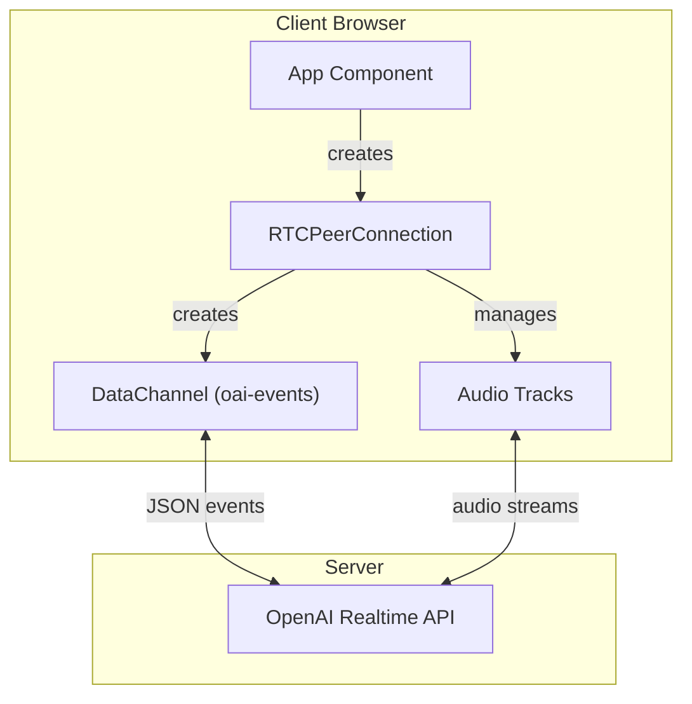
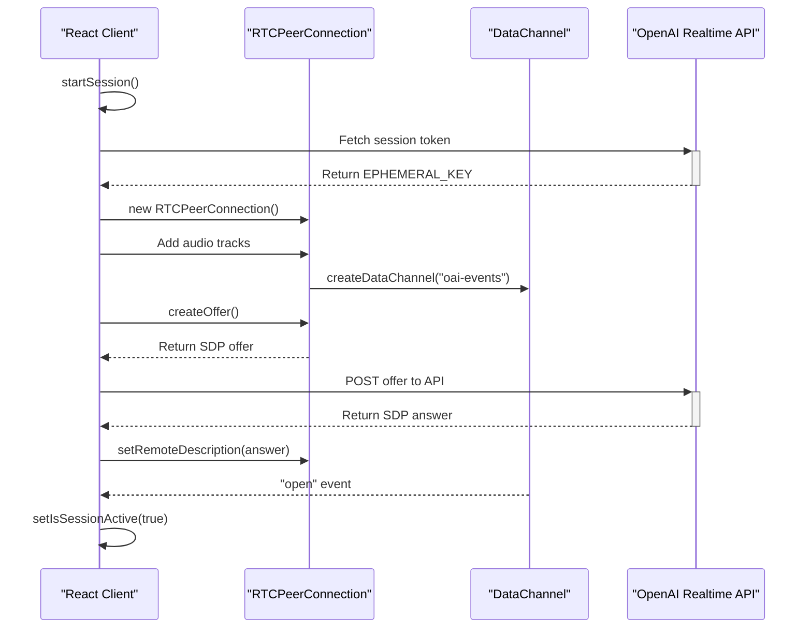
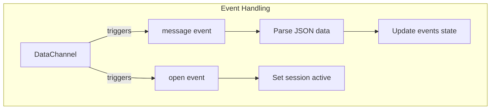
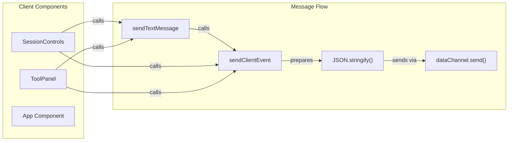
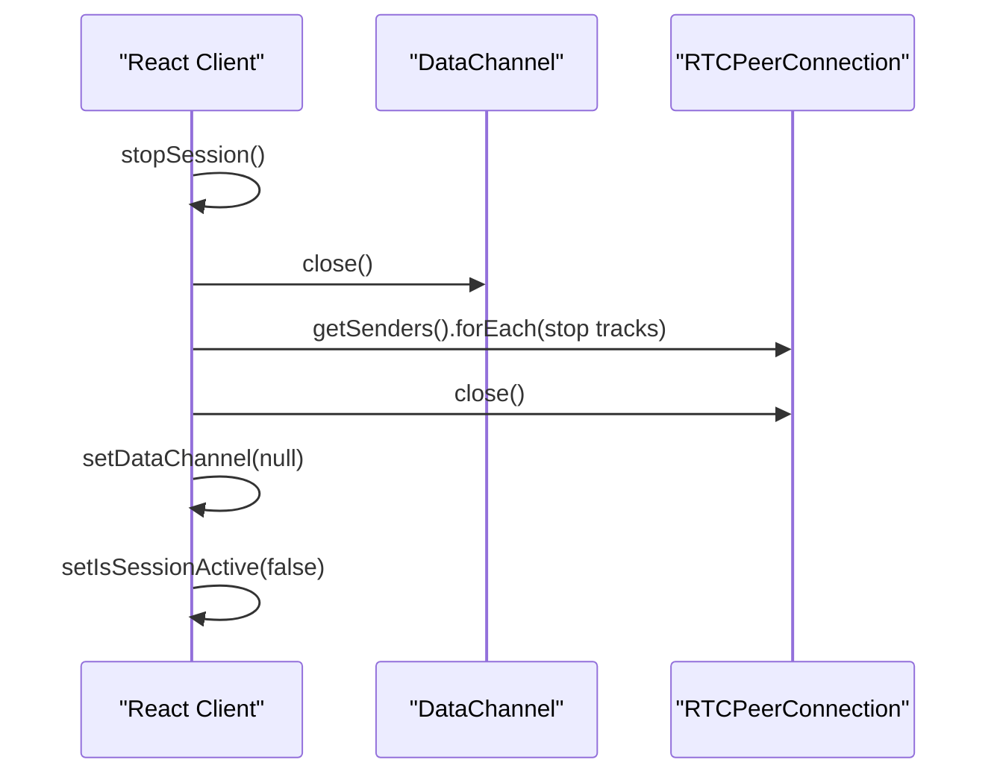
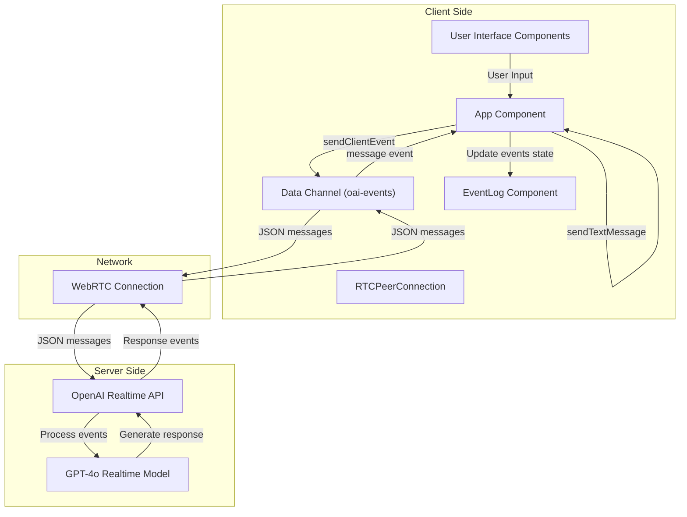
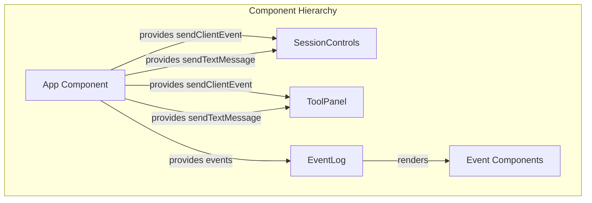

<!-- source: DeepWiki mcp.deepwiki.com · repo openai/openai-realtime-console · page 4.1 Data Channel Setup · fetched 2026-10-26 -->

# Data Channel Setup

<details>
<summary>Relevant source files</summary>

The following files were used as context for generating this wiki page:

- [client/components/App.jsx](client/components/App.jsx)
- [client/components/EventLog.jsx](client/components/EventLog.jsx)
- [package-lock.json](package-lock.json)

</details>


This page documents how the WebRTC data channel is established and used for communication between the client application and the OpenAI Realtime API. The data channel serves as the primary conduit for exchanging JSON events between the client and server, enabling real-time interactions. For information about event processing after the channel is established, see [Event Processing](#4.2).

## Overview

The OpenAI Realtime Console establishes a WebRTC data channel named "oai-events" to facilitate bidirectional communication with the OpenAI Realtime API. This channel operates alongside audio streams and enables the exchange of structured JSON events that control the conversation flow and function calling capabilities.



Sources: [client/components/App.jsx:35-36]()

## Data Channel Initialization

The data channel is created as part of the session startup process after a peer connection has been established. The channel is specifically named "oai-events" to identify its purpose.



Sources: [client/components/App.jsx:14-60]()

The initialization follows these key steps:

1. A session token is obtained from the server
2. A new RTCPeerConnection is created
3. Audio tracks are set up for audio communication
4. The data channel is created with the name "oai-events"
5. The WebRTC connection is established using SDP (Session Description Protocol)

### Key Code Implementation

The data channel is created within the `startSession` function:

```javascript
const dc = pc.createDataChannel("oai-events");
setDataChannel(dc);
```

Sources: [client/components/App.jsx:35-36]()

## Event Handling

Once established, the data channel requires event listeners to handle messages and connection state changes. Two primary events are handled:

1. **message**: Triggered when data is received
2. **open**: Triggered when the channel connection is established



Sources: [client/components/App.jsx:126-144]()

The event handlers are set up in a useEffect hook that runs whenever the data channel reference changes:

```javascript
useEffect(() => {
  if (dataChannel) {
    dataChannel.addEventListener("message", (e) => {
      const event = JSON.parse(e.data);
      if (!event.timestamp) {
        event.timestamp = new Date().toLocaleTimeString();
      }
      setEvents((prev) => [event, ...prev]);
    });

    dataChannel.addEventListener("open", () => {
      setIsSessionActive(true);
      setEvents([]);
    });
  }
}, [dataChannel]);
```

Sources: [client/components/App.jsx:126-144]()

## Sending Events Through the Data Channel

The application provides functions to send events through the data channel. The primary method is `sendClientEvent`, which handles event formatting and transmission.



Sources: [client/components/App.jsx:84-123](), [client/components/App.jsx:160-176]()

The `sendClientEvent` function formats the message, assigns a unique ID if needed, and transmits it via the data channel:

```javascript
function sendClientEvent(message) {
  if (dataChannel) {
    const timestamp = new Date().toLocaleTimeString();
    message.event_id = message.event_id || crypto.randomUUID();

    // send event before setting timestamp since the backend peer doesn't expect this field
    dataChannel.send(JSON.stringify(message));

    // if guard just in case the timestamp exists by miracle
    if (!message.timestamp) {
      message.timestamp = timestamp;
    }
    setEvents((prev) => [message, ...prev]);
  } else {
    console.error(
      "Failed to send message - no data channel available",
      message,
    );
  }
}
```

Sources: [client/components/App.jsx:84-103]()

A specialized function `sendTextMessage` formats user text input into the expected event format:

```javascript
function sendTextMessage(message) {
  const event = {
    type: "conversation.item.create",
    item: {
      type: "message",
      role: "user",
      content: [
        {
          type: "input_text",
          text: message,
        },
      ],
    },
  };

  sendClientEvent(event);
  sendClientEvent({ type: "response.create" });
}
```

Sources: [client/components/App.jsx:106-123]()

## Message Format

Events sent through the data channel follow a consistent JSON format. The basic structure varies based on event type but typically includes:

| Field | Description |
|-------|-------------|
| `type` | Event type identifier (e.g., "conversation.item.create") |
| `event_id` | Unique identifier for the event (generated if not provided) |
| `timestamp` | Time when the event was sent (added by the client) |
| Event-specific fields | Additional fields depending on the event type |

Example message format for user text:

```json
{
  "type": "conversation.item.create",
  "event_id": "[generated-uuid]",
  "timestamp": "12:34:56 PM",
  "item": {
    "type": "message",
    "role": "user",
    "content": [
      {
        "type": "input_text",
        "text": "User's message text"
      }
    ]
  }
}
```

Sources: [client/components/App.jsx:84-123](), [client/components/EventLog.jsx:4-34]()

## Data Channel Closure

When the session ends, the data channel needs to be properly closed to release resources:



Sources: [client/components/App.jsx:63-81]()

The closure process:

1. Closes the data channel
2. Stops any media tracks
3. Closes the peer connection
4. Resets state variables

```javascript
function stopSession() {
  if (dataChannel) {
    dataChannel.close();
  }

  peerConnection.current.getSenders().forEach((sender) => {
    if (sender.track) {
      sender.track.stop();
    }
  });

  if (peerConnection.current) {
    peerConnection.current.close();
  }

  setIsSessionActive(false);
  setDataChannel(null);
  peerConnection.current = null;
}
```

Sources: [client/components/App.jsx:63-81]()

## Complete Data Flow

The complete data flow through the application, emphasizing the data channel's role:



Sources: [client/components/App.jsx:7-181](), [client/components/EventLog.jsx:36-64]()

## Integration with UI Components

The data channel functionality is exposed to UI components through props:



Sources: [client/components/App.jsx:146-180](), [client/components/EventLog.jsx:36-64]()

The UI components use these functions to send events through the data channel, and they receive updated event data to display in the interface.

---

