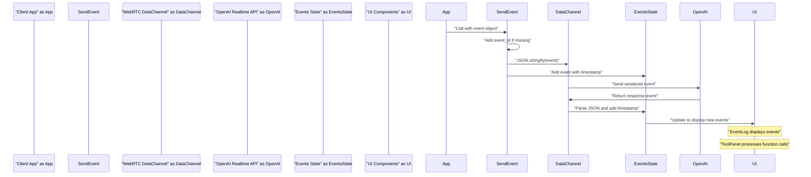
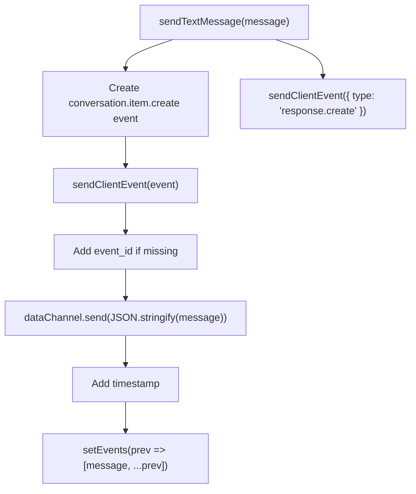
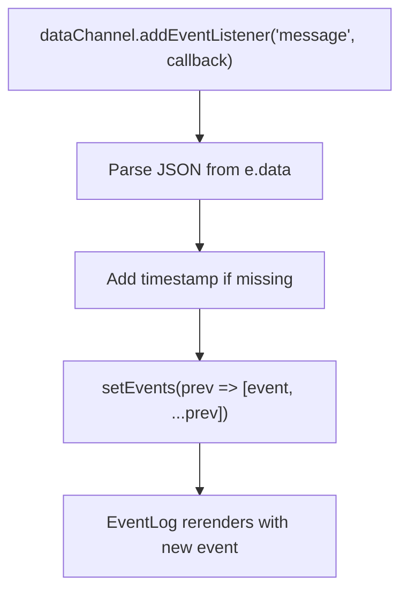
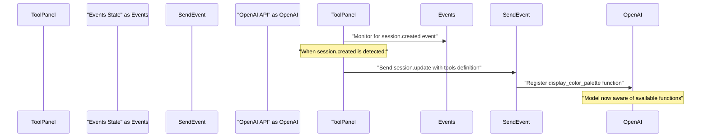
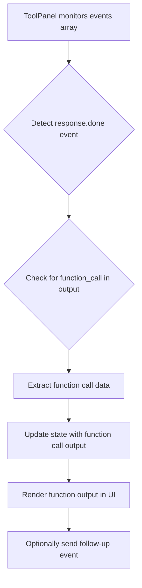
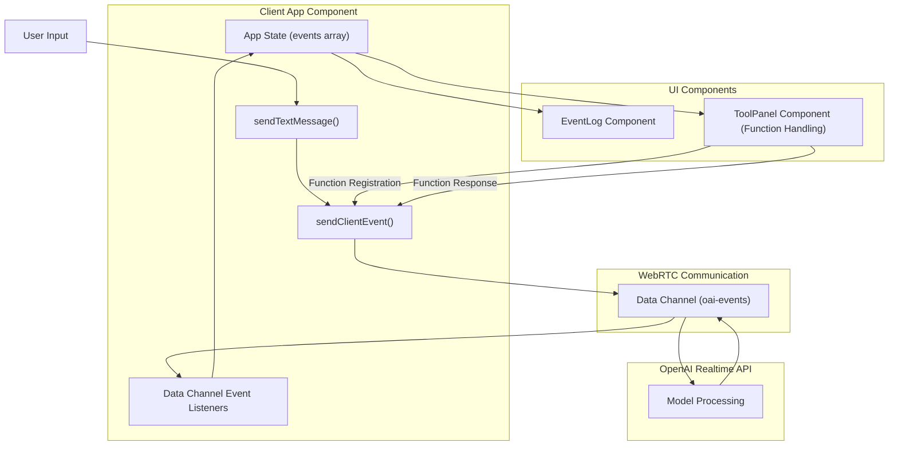

<!-- source: DeepWiki mcp.deepwiki.com · repo openai/openai-realtime-console · page 4.2 Event Processing · fetched 2026-10-26 -->

# Event Processing

Relevant source files

The following files were used as context for generating this wiki page:

- [client/components/App.jsx](client/components/App.jsx)
- [client/components/EventLog.jsx](client/components/EventLog.jsx)
- [client/components/SessionControls.jsx](client/components/SessionControls.jsx)
- [client/components/ToolPanel.jsx](client/components/ToolPanel.jsx)

## Purpose and Scope

This document describes the event processing system in the OpenAI Realtime Console, focusing on how events are sent, received, processed, and displayed in the application. It covers the bidirectional flow of events between the client and the OpenAI Realtime API through WebRTC data channels, as well as how these events trigger actions like function calling. For information about how the WebRTC data channel is initially set up, see [Data Channel Setup](#4.1).

## Event Data Structure

Events in the system are JSON objects with a common structure but varying content based on their type. The application handles two main categories of events:

1. **Client Events** - Sent from the client to the OpenAI Realtime API
2. **Server Events** - Sent from the OpenAI Realtime API to the client

### Common Event Properties

| Property    | Description                                                    | Example                                  |
|-------------|----------------------------------------------------------------|------------------------------------------|
| `type`      | Identifies the event's purpose                                | `"conversation.item.create"`             |
| `event_id`  | Unique identifier for the event                               | UUID for client events, starts with "event_" for server events |
| `timestamp` | Added by the application for tracking when events occur        | `"10:15:30 AM"`                          |

### Key Event Types

| Event Type                | Direction      | Purpose                                             |
|---------------------------|----------------|-----------------------------------------------------|
| `conversation.item.create`| Client → Server| Send a new user message                             |
| `response.create`         | Client → Server| Request the model to generate a response            |
| `session.update`          | Client → Server| Update session parameters (e.g., register tools)    |
| `response.delta`          | Server → Client| Stream partial model responses                      |
| `response.done`           | Server → Client| Signal completion of a response                     |
| `function_call`           | Server → Client| Request to execute a client-side function           |

Sources: [client/components/App.jsx:84-123](), [client/components/EventLog.jsx:4-34]()

## Event Flow Architecture

Sources: [client/components/App.jsx:84-103](), [client/components/App.jsx:125-144]()

## Event Management Implementation

### Sending Events

The application uses two primary functions to send events to the OpenAI Realtime API:

1. **sendClientEvent(message)** - Generic function for sending any event:
   - Ensures the event has a unique `event_id`
   - Serializes the event to JSON and sends it through the data channel
   - Adds a timestamp and updates the `events` state with the new event

2. **sendTextMessage(message)** - Helper for sending user text messages:
   - Creates an event with `type: "conversation.item.create"`
   - Structures the message in the required format
   - Calls `sendClientEvent` twice: once for the message and once to request a response

Sources: [client/components/App.jsx:84-123]()

### Receiving Events

Events from the OpenAI Realtime API are received through the WebRTC data channel and processed using an event listener:

1. The data channel's "message" event triggers a callback function
2. The received JSON data is parsed into an event object
3. A timestamp is added if one doesn't exist
4. The event is added to the `events` state, which triggers a UI update

Sources: [client/components/App.jsx:126-144]()

## Event Display System

Events are displayed in chronological order in the EventLog component, with the most recent events at the top. Each event shows:

1. Direction indicator (client or server)
2. Event type
3. Timestamp
4. Expandable JSON content

The EventLog component applies special handling for certain event types:
- Delta events (ending with "delta") are filtered to prevent flooding the UI
- Events are visually differentiated based on direction (client vs. server)

Sources: [client/components/EventLog.jsx:1-64]()

## Function Calling via Events

The application implements client-side function calling through the event system. This allows the OpenAI model to request the execution of functions defined by the client.

### Function Registration Process

Sources: [client/components/ToolPanel.jsx:66-108]()

### Function Execution Flow

The ToolPanel component in this application demonstrates function calling with a color palette generator:

1. When a session starts, it registers a `display_color_palette` function
2. When the user asks about color palettes, the model can call this function
3. The function call is detected in the response events
4. The function output (a color palette) is rendered in the UI
5. A follow-up event is sent to guide the model's next response

Sources: [client/components/ToolPanel.jsx:1-133]()

## Complete Event Processing Architecture

Sources: [client/components/App.jsx:7-181](), [client/components/EventLog.jsx:1-64](), [client/components/ToolPanel.jsx:1-133]()

## Best Practices for Working with Events

1. **Always check event types**: Different event types require different handling logic
2. **Handle event_id properly**: Client events should have unique IDs, typically generated with `crypto.randomUUID()`
3. **Be aware of event direction**: Check if an event is from the client or server before processing
4. **Monitor the events state**: Components like ToolPanel watch the events array for specific patterns
5. **Filter high-frequency events**: Consider filtering events like "delta" events that occur frequently

Sources: [client/components/App.jsx:84-103](), [client/components/EventLog.jsx:36-64](), [client/components/ToolPanel.jsx:66-108]()

---

