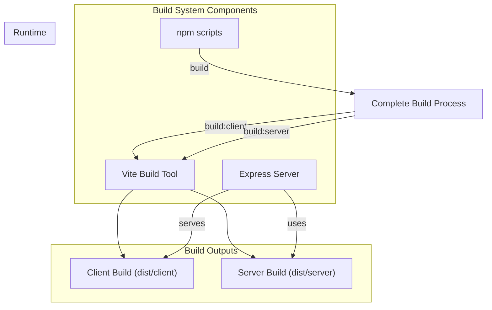
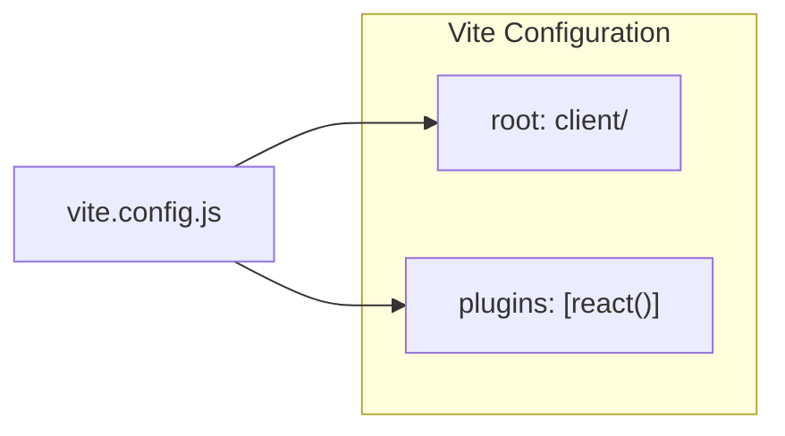
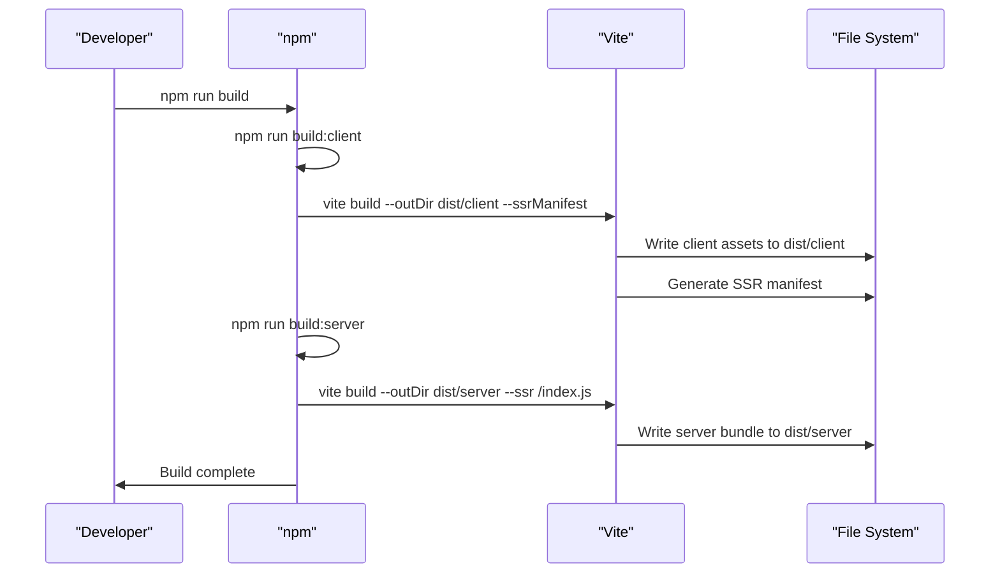
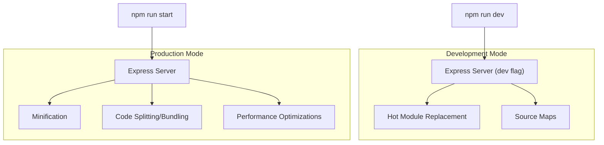
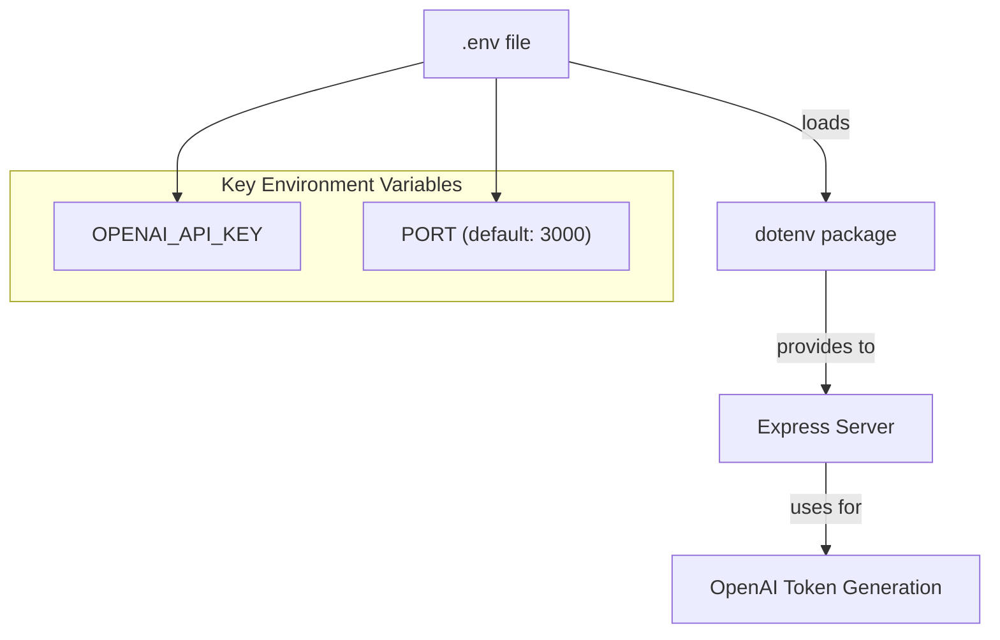
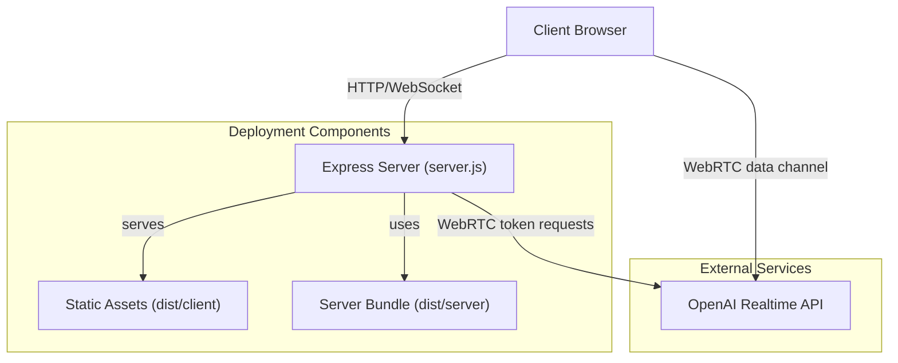

<!-- source: DeepWiki mcp.deepwiki.com · repo openai/openai-realtime-console · page 5 Build and Deployment · fetched 2026-10-26 -->

# Build and Deployment

<details>
<summary>Relevant source files</summary>

The following files were used as context for generating this wiki page:

- [package.json](package.json)
- [vite.config.js](vite.config.js)

</details>


This document explains the build process and deployment options for the OpenAI Realtime Console application. It covers the build configuration, development and production workflows, and important considerations for deploying the application. For specific details about development workflow including hot module replacement and debugging, see [Development Workflow](#5.1). For guidance on preparing the application for production, see [Production Considerations](#5.2).

## Build System Overview

The OpenAI Realtime Console uses a modern JavaScript build system centered around Vite and npm scripts to manage both client and server builds. The build process supports both development and production environments.



Sources: [package.json:5-8](), [vite.config.js:7-10]()

## Build Configuration

The build configuration is primarily defined in two files: `package.json` for npm scripts and `vite.config.js` for Vite configuration.

### npm Scripts

The application defines several npm scripts for building and running the application:

| Script Name | Command | Purpose |
|-------------|---------|---------|
| `dev` | `node server.js --dev` | Runs server in development mode |
| `start` | `node server.js` | Runs server in production mode |
| `build` | `npm run build:client && npm run build:server` | Runs complete build process |
| `build:client` | `vite build --outDir dist/client --ssrManifest` | Builds client-side code with SSR manifest |
| `build:server` | `vite build --outDir dist/server --ssr /index.js` | Builds server-side code |

Sources: [package.json:3-10]()

### Vite Configuration

Vite is configured to use the client directory as its root and includes the React plugin for handling JSX and React-specific optimizations.



Sources: [vite.config.js:1-10]()

## Build Process

The build process for the OpenAI Realtime Console application uses a two-step approach to support server-side rendering (SSR).



Sources: [package.json:6-8]()

### Client Build

The client build process creates optimized static assets that will be served to the browser. It also generates an SSR manifest that helps with server-side rendering.

Key aspects of the client build:
- Output directory: `dist/client`
- Includes SSR manifest generation
- Processes React components, CSS, and other static assets

### Server Build

The server build compiles the server-side code that runs on Node.js:
- Output directory: `dist/server`
- Entry point: `/index.js`
- Supports server-side rendering of React components

## Development vs. Production Modes

The application supports both development and production modes with different optimizations and features.



Sources: [package.json:4-5]()

### Development Mode

In development mode, the server is started with the `--dev` flag, which enables:
- Hot Module Replacement (HMR) for faster development
- Source maps for easier debugging
- No minification for better readability

To run the application in development mode:

```bash
npm run dev
```

### Production Mode

For production, a full build is required first, followed by starting the server:

```bash
npm run build
npm start
```

The production build includes:
- Minification of JavaScript and CSS
- Code splitting and efficient bundling
- Optimized assets for performance

## Environment Configuration

The application uses environment variables for configuration, managed through the `dotenv` package.



Sources: [package.json:13]()

Important environment variables:
- `OPENAI_API_KEY`: Required for authentication with OpenAI API
- `PORT`: Optional, specifies which port the server runs on (defaults to 3000)

## Deployment Architecture

The OpenAI Realtime Console is designed to be deployed as a Node.js application with an Express server that handles both API endpoints and serves the static frontend assets.



Sources: [package.json:5]()

## Dependency Management

The application depends on several key packages for building and running:

### Runtime Dependencies

- `express`: Web server framework
- `react` and `react-dom`: UI framework
- `dotenv`: Environment variable management

### Development Dependencies

- `vite`: Build tool
- `@vitejs/plugin-react`: React support for Vite
- `postcss` and related plugins: CSS processing
- `tailwindcss`: Utility-first CSS framework

Sources: [package.json:12-29]()

## Summary

The build and deployment system of the OpenAI Realtime Console is designed to be flexible and efficient, supporting both development and production workflows. It leverages modern tools like Vite for fast builds and hot module replacement during development, while producing optimized assets for production. The Express server handles both serving the application and providing necessary API endpoints for WebRTC token generation.

---

