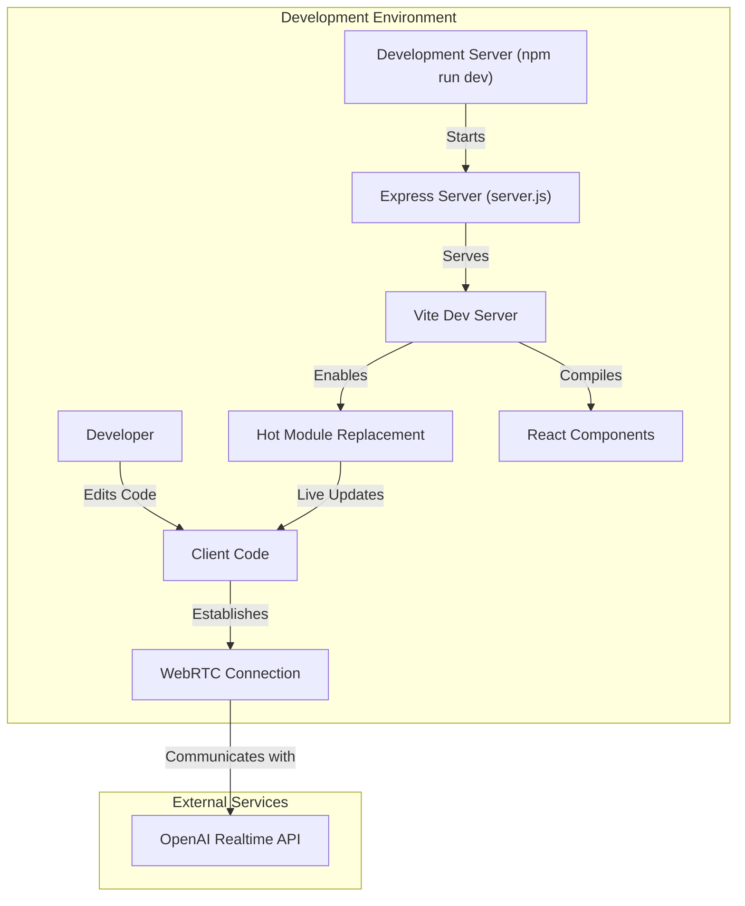
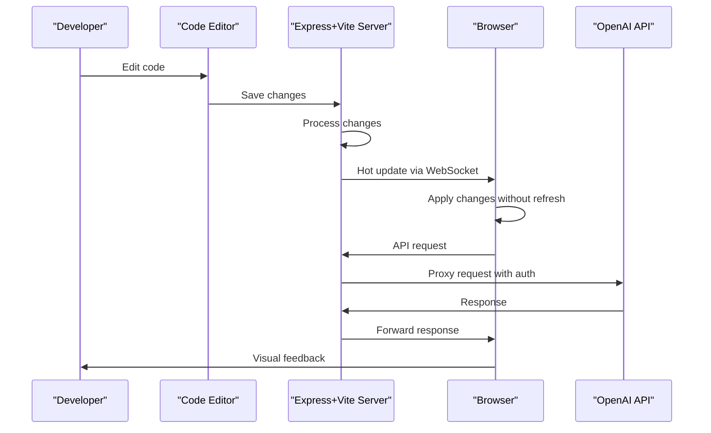
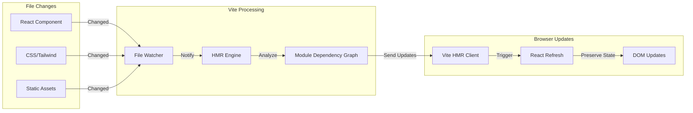
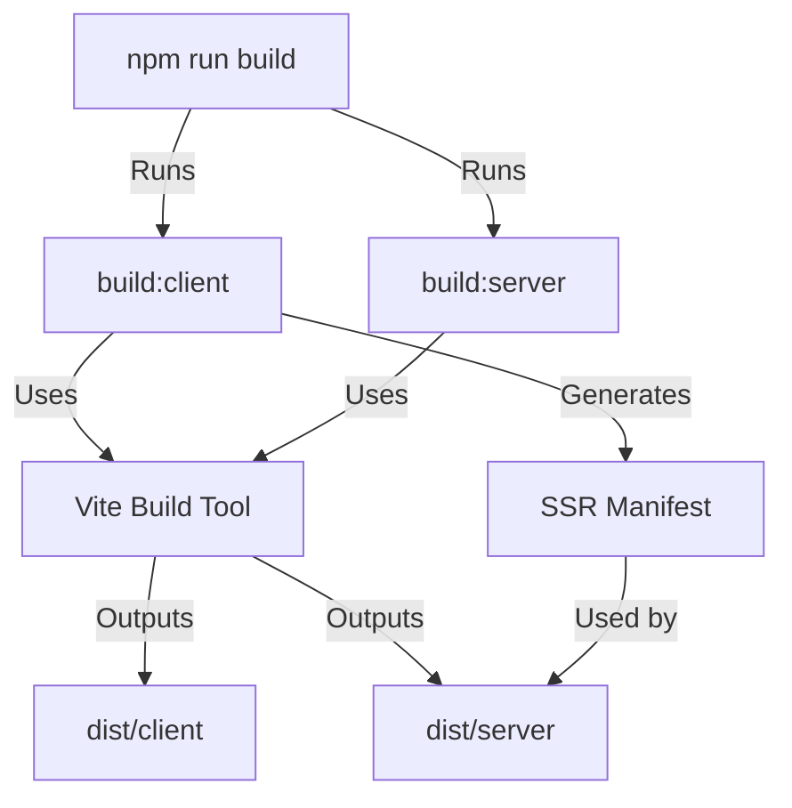
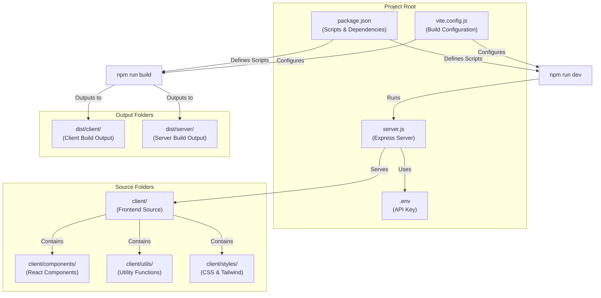

<!-- source: DeepWiki mcp.deepwiki.com · repo openai/openai-realtime-console · page 5.1 Development Workflow · fetched 2026-10-26 -->

# Development Workflow

<details>
<summary>Relevant source files</summary>

The following files were used as context for generating this wiki page:

- [package-lock.json](package-lock.json)
- [package.json](package.json)
- [vite.config.js](vite.config.js)

</details>


This document outlines the development workflow for working with the OpenAI Realtime Console. It explains how to set up your development environment, run the application in development mode, understand the build processes, and effectively debug the application. For information on deploying to production, see [Production Considerations](#5.2).

## Development Environment Setup

Setting up your development environment involves the following steps:

1. Clone the repository
2. Install dependencies
3. Configure environment variables
4. Start the development server

### Environment Setup

```bash
# Clone the repository
git clone https://github.com/openai/openai-realtime-console.git

# Navigate to the project directory
cd openai-realtime-console

# Install dependencies
npm install

# Create .env file (see below)

# Start the development server
npm run dev
```

The application requires an OpenAI API key to be set in your environment variables. Create a `.env` file in the project root with the following:

```
OPENAI_API_KEY=your_openai_api_key_here
```

Sources: [package.json:3-10](), [vite.config.js:1-11]()

## Development Server Architecture

The development workflow is built around a Vite development server integrated with an Express backend.

### Development Architecture Diagram



Sources: [package.json:3-5](), [vite.config.js:6-10]()

## Running the Development Server

The project uses a combined development approach with an Express server for API communication and Vite for frontend development.

### Starting the Development Server

To start the development server:

```bash
npm run dev
```

This command runs `node server.js --dev`, which:

1. Starts the Express server
2. Integrates with Vite for frontend development
3. Enables Hot Module Replacement
4. Sets up API routes for the OpenAI Realtime API

Sources: [package.json:4]()

### Development Workflow Process



Sources: [package.json:3-10]()

## Hot Module Replacement

The application uses Vite's Hot Module Replacement (HMR) for fast development cycles. When you make changes to the code, the changes are immediately reflected in the browser without a full page reload.

### How HMR Works in This Project



Sources: [package.json:22-28](), [vite.config.js:3]()

## Build Process

The build process creates production-ready assets for both client and server components.

### Build Commands

The project has several build commands:

- `npm run build`: Builds both client and server
- `npm run build:client`: Builds only the client with SSR manifest
- `npm run build:server`: Builds only the server-side rendering components

Sources: [package.json:6-8]()

### Build Architecture



Sources: [package.json:6-8]()

## Debugging Techniques

### Browser Debugging

The application is structured to facilitate browser-based debugging:

1. **React DevTools**: Install the React DevTools browser extension for component inspection
2. **Network Tab**: Monitor WebRTC connections and API requests in the browser's network tab
3. **Console**: View application logs and errors in the browser console

### Server Debugging

For server-side debugging:

1. **Terminal Output**: The Express server outputs logs to the terminal
2. **Node Inspector**: Use `--inspect` flag with `node` to enable Chrome DevTools debugging

### Event Logging Panel

The application includes a built-in event logging panel that displays WebRTC events and messages exchanged with the OpenAI Realtime API, providing visibility into the communication flow.

## Project Structure Relationship

This diagram shows how the development workflow relates to the project's file structure:



Sources: [package.json:1-30](), [vite.config.js:1-11]()

## Development Best Practices

### Code Organization

- Keep React components in the `client/components` directory
- Place utility functions in `client/utils`
- Group related components together
- Follow the established patterns for WebRTC communication

### Development Tips

1. **Use the Event Log Panel**: The built-in event log panel shows all messages exchanged with the OpenAI API
2. **API Key Management**: Never commit your OpenAI API key to the repository
3. **Component Testing**: Test WebRTC functionality with realistic data samples
4. **Error Handling**: Implement proper error handling for WebRTC and API communication
5. **Responsive Design**: Test the UI across different screen sizes

## Development Tools and Extensions

| Tool | Purpose | Configuration |
|------|---------|---------------|
| Vite | Fast development server with HMR | Configured in `vite.config.js` |
| ESLint | Code linting and formatting | Run with `npm run lint` |
| TailwindCSS | Utility-first CSS framework | Configured for the project |
| React DevTools | Component debugging | Browser extension |
| Chrome DevTools | Network and performance debugging | Built into Chrome |

Sources: [package.json:22-28]()

## Common Development Tasks

| Task | Command | Description |
|------|---------|-------------|
| Start development server | `npm run dev` | Runs the app in development mode with hot reloading |
| Build for production | `npm run build` | Creates optimized production build |
| Lint code | `npm run lint` | Runs ESLint to check and fix code issues |
| Build client only | `npm run build:client` | Builds only the client-side code |
| Build server only | `npm run build:server` | Builds only the server-side code |

Sources: [package.json:3-10]()

---

