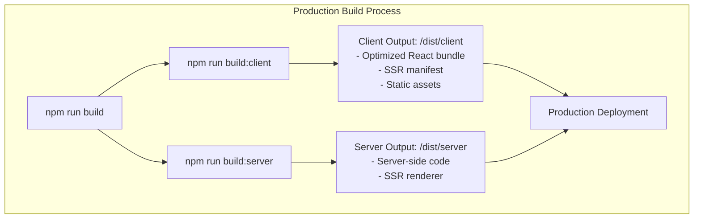
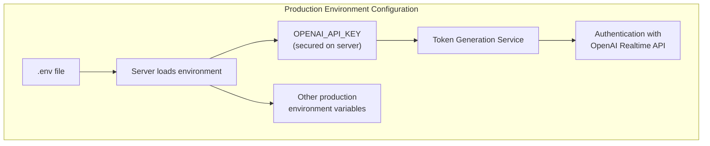
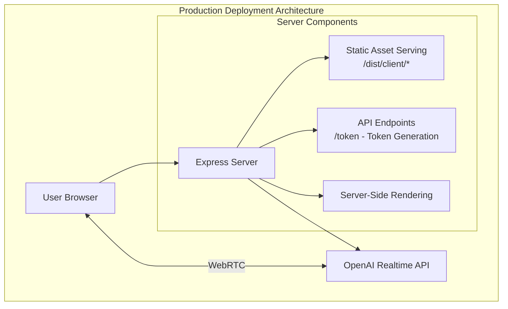
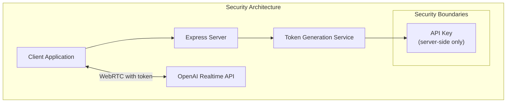
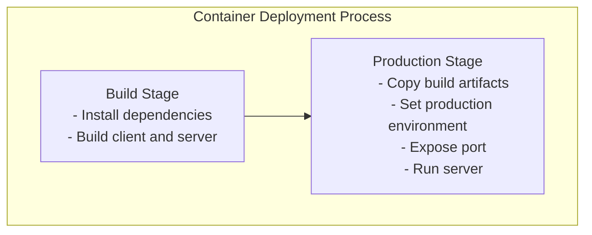

<!-- source: DeepWiki mcp.deepwiki.com · repo openai/openai-realtime-console · page 5.2 Production Considerations · fetched 2026-10-26 -->

# Production Considerations

<details>
<summary>Relevant source files</summary>

The following files were used as context for generating this wiki page:

- [LICENSE](LICENSE)
- [package.json](package.json)
- [vite.config.js](vite.config.js)

</details>


This document provides guidance on preparing the OpenAI Realtime Console for production deployment. It covers build processes, environment configurations, deployment strategies, performance optimizations, and security considerations specific to this application. For information about the development workflow, see [Development Workflow](#5.1).

## Build Process

The OpenAI Realtime Console uses a two-step build process that creates separate bundles for the client and server components.



### Build Commands

To build the application for production:

1. Run the complete build process:
   ```
   npm run build
   ```

2. This executes two commands in sequence:
   - `npm run build:client`: Generates optimized client-side assets in the `/dist/client` directory
   - `npm run build:server`: Builds server-side code in the `/dist/server` directory

3. Start the production server:
   ```
   npm start
   ```

Sources: [package.json:3-10]()

## Environment Configuration

In production, environment variables should be properly configured to ensure secure and stable operation.



### Required Environment Variables

| Variable | Purpose | Notes |
|----------|---------|-------|
| `OPENAI_API_KEY` | Authentication with OpenAI API | Keep secure; never expose in client code |
| `PORT` | Server listening port | Defaults to 3000 if not specified |
| `NODE_ENV` | Execution environment | Set to `production` for optimizations |

### Setting Environment Variables

For production deployments, environment variables should be set according to the hosting platform's recommended practices:

- For containerized deployments (Docker): Use environment variables in container configuration
- For cloud platforms: Use the platform's environment variable or secrets management system
- For traditional servers: Use system environment variables or a secured `.env` file

Sources: [package.json:13]()

## Deployment Architecture

The production deployment architecture separates the client and server components while maintaining their communication channels.



### Deployment Considerations

1. **Static Assets**: The Express server serves optimized static assets from the `/dist/client` directory
2. **Server-Side Rendering**: The server uses the built SSR code from `/dist/client`
3. **WebRTC Communication**: Direct WebRTC communication between clients and OpenAI API must be allowed by network configuration

Sources: [package.json:3-10](), [vite.config.js:1-10]()

## Performance Optimization

### Client-Side Optimizations

Vite provides several production optimizations automatically:

1. **Code Splitting**: JavaScript is split into chunks for better loading performance
2. **Asset Optimization**: Static assets are minified and optimized
3. **SSR Manifest**: The SSR manifest helps with efficient hydration

### Server-Side Optimizations

For optimal server performance in production:

1. **Node.js Optimizations**:
   - Consider using `NODE_ENV=production` to enable built-in optimizations
   - Use a process manager like PM2 for reliability and automatic restarts

2. **Caching**:
   - Implement appropriate caching headers for static assets
   - Consider using a CDN for static assets in high-traffic scenarios

Sources: [package.json:3-10](), [vite.config.js:1-10]()

## Security Considerations



### Critical Security Practices

1. **API Key Protection**:
   - Never expose the OpenAI API key in client-side code
   - Use the server-side token generation approach as implemented

2. **WebRTC Security**:
   - Ensure WebRTC connections are properly authenticated using tokens
   - Consider implementing additional validation if required for your use case

3. **Network Security**:
   - Use HTTPS in production to secure all communications
   - Configure appropriate CORS settings for the API endpoints

Sources: [package.json:13]()

## Monitoring and Logging

For production deployments, implement appropriate monitoring and logging:

1. **Application Logs**: 
   - Consider integrating structured logging solutions
   - Log important events and errors for debugging

2. **Performance Monitoring**:
   - Monitor server response times and resource usage
   - Track WebRTC connection success rates and performance

3. **Error Tracking**:
   - Implement proper error handling throughout the application
   - Consider using error tracking services for production issues

## Container Deployment

For containerized deployments, consider creating a Dockerfile that:

1. Uses a multi-stage build process for smaller image size
2. Securely handles environment variables
3. Runs the application with a non-root user



Sources: [package.json:3-10]()

## Scaling Considerations

For applications requiring high availability or handling significant traffic:

1. **Horizontal Scaling**:
   - The application can be horizontally scaled behind a load balancer
   - Ensure any shared state is properly managed across instances

2. **Resource Allocation**:
   - Monitor memory usage patterns to appropriately size containers or VMs
   - Consider the WebRTC connection load when planning capacity

Sources: [package.json:3-10]()