# Page: Overview

# Overview

<details>
<summary>Relevant source files</summary>

The following files were used as context for generating this wiki page:

- [README.md](README.md)
- [package.json](package.json)

</details>


This document provides an introduction to the OpenAI Realtime Console application, a reference implementation demonstrating how to use the OpenAI Realtime API with WebRTC for browser-based applications. The application showcases real-time communication with OpenAI's models using WebRTC data channels, client-side function calling, and event logging capabilities.

For project setup instructions, see [Project Setup](#1.1). For more detailed information about the system architecture, see [System Architecture](#1.2).

## Purpose and Key Features

The OpenAI Realtime Console serves as a minimal template to help developers understand and implement applications that leverage OpenAI's Realtime API. Key features include:

- WebRTC-based communication with the OpenAI Realtime API
- Token-based authentication for secure API access
- Client-side function calling capabilities
- Event logging for debugging and transparency
- Modern React frontend with Express backend

Sources: [README.md:1-31]()

## System Architecture

The application follows a client-server architecture with WebRTC communication to the OpenAI Realtime API.

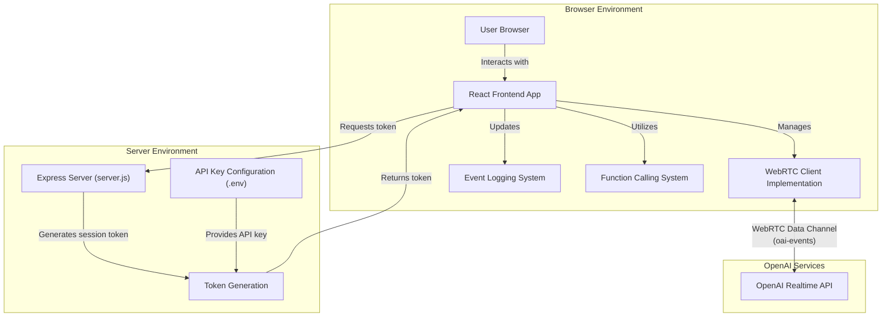

The system consists of three main parts:
1. **React Frontend**: Manages user interaction, WebRTC connections, and event display
2. **Express Server**: Handles token generation and authentication with the OpenAI API
3. **OpenAI Realtime API**: Processes requests and provides real-time responses via WebRTC

Sources: [README.md:26-29](), [package.json:12-20]()

## Communication Flow

The following diagram illustrates the communication flow between system components:

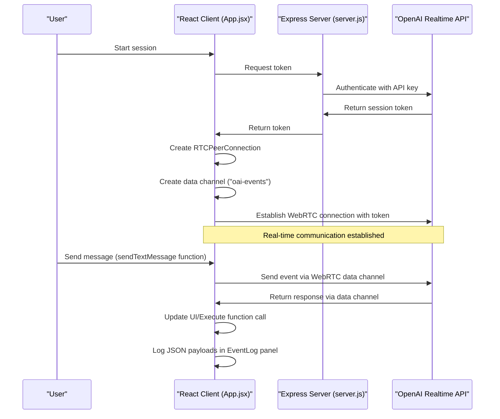

This sequence shows how the application establishes and maintains communication with the OpenAI Realtime API using WebRTC technology.

Sources: [README.md:29]()

## Key Technical Concepts

### WebRTC Communication

The application uses WebRTC, specifically data channels, for real-time communication with the OpenAI API. This provides low-latency, peer-to-peer communication without requiring constant server intermediation after the initial connection is established.

### Token-based Authentication

To maintain security, the server generates temporary tokens for authenticating with the OpenAI Realtime API. This approach keeps the API key secure on the server side while allowing the client to establish direct WebRTC connections.

### Function Calling

The application implements function calling capabilities that allow the OpenAI Realtime API to trigger actions in the client application. This enables the creation of interactive applications where AI can request specific operations be performed on the client side.

### Event-Driven Architecture

The system uses an event-driven architecture where JSON events flow between the client and OpenAI through the WebRTC data channel. A logging panel displays these events for debugging and transparency.

Sources: [README.md:29]()

## Repository Structure

The repository is organized into client and server components:

| Component | Description | Key Files |
|-----------|-------------|-----------|
| Server | Express server that handles token generation and serves the React frontend | server.js |
| Client | React application with WebRTC communication and UI components | /client folder |
| Configuration | Environment configuration for API keys | .env, .env.example |
| Build System | Vite-based build system for the React frontend | package.json |

The client-side React application contains several key components:
- Main App component that manages the WebRTC connection and state
- EventLog component that displays sent and received events
- SessionControls component for managing the session
- ToolPanel component that handles function calling

Sources: [README.md:27-29](), [package.json:2-29]()

## Comparison with Other Implementations

This console application provides a minimal implementation focused on demonstrating core Realtime API concepts. For more comprehensive examples:

- The [OpenAI Realtime Agents](https://github.com/openai/openai-realtime-agents) demo provides a more advanced implementation built with Next.js and an agentic architecture.
- A previous version of this application used WebSockets instead of WebRTC, which is no longer recommended for browser implementations.

Sources: [README.md:31-35]()

---

# Page: Project Setup

# Project Setup

<details>
<summary>Relevant source files</summary>

The following files were used as context for generating this wiki page:

- [.env.example](.env.example)
- [README.md](README.md)
- [package.json](package.json)

</details>


This document covers the step-by-step process for setting up and running the OpenAI Realtime Console locally. It focuses on environment configuration, dependency installation, and application startup. For information about the overall system architecture, see [System Architecture](#1.2).

## Prerequisites

Before setting up the project, ensure you have the following:

- [Node.js](https://nodejs.org/) installed on your machine
- An OpenAI API key (obtainable from the [OpenAI dashboard](https://platform.openai.com/settings/api-keys))
- A terminal or command prompt to run commands

Sources: [README.md:5-14]()

## Setup Process

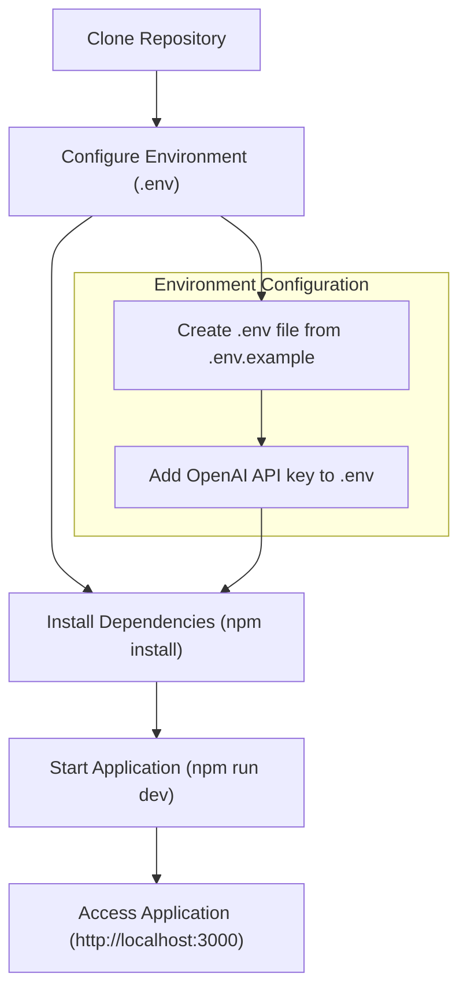

### 1. Environment Configuration

1. Create a `.env` file from the provided example:
   ```bash
   cp .env.example .env
   ```

2. Open the `.env` file and replace `<your-key-here>` with your actual OpenAI API key:
   ```
   OPENAI_API_KEY="sk-your-actual-api-key"
   ```

Sources: [README.md:7-11](), [.env.example:1]()

### 2. Dependencies Installation

Install all required dependencies using npm:

```bash
npm install
```

This will install both production and development dependencies defined in the `package.json` file.

Sources: [README.md:15-17](), [package.json:12-28]()

### 3. Starting the Application

Start the application in development mode:

```bash
npm run dev
```

This command runs the `server.js` file with the `--dev` flag, which serves the application on [http://localhost:3000](http://localhost:3000).

Sources: [README.md:19-25](), [package.json:4]()

## Project Structure

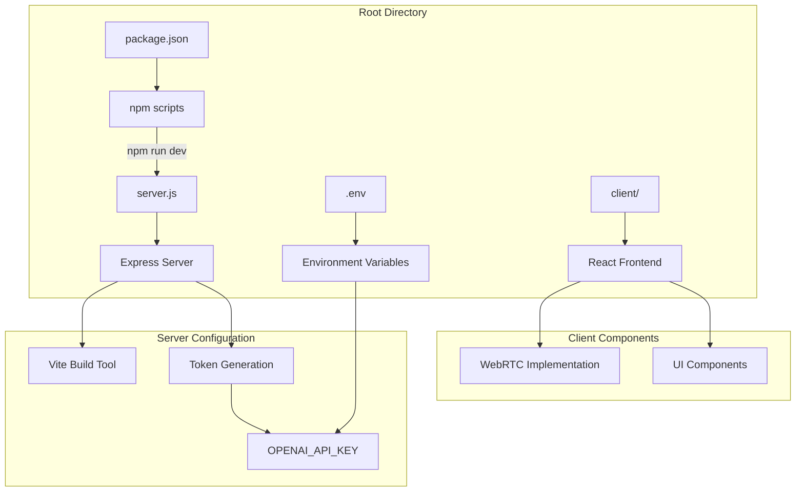

### Key Project Files

| File | Purpose |
|------|---------|
| `package.json` | Defines project dependencies and npm scripts |
| `.env` | Contains environment variables (particularly the OpenAI API key) |
| `server.js` | Main server file that serves the React frontend and handles API requests |
| `/client` | Directory containing the React frontend code |

Sources: [README.md:27-29](), [package.json:1-30]()

## NPM Scripts

The project includes several npm scripts defined in `package.json`:

| Script | Command | Purpose |
|--------|---------|---------|
| `dev` | `node server.js --dev` | Run the server in development mode |
| `start` | `node server.js` | Run the server in production mode |
| `build` | `npm run build:client && npm run build:server` | Build both client and server |
| `build:client` | `vite build --outDir dist/client --ssrManifest` | Build the client-side code |
| `build:server` | `vite build --outDir dist/server --ssr /index.js` | Build the server-side code |
| `lint` | `eslint . --ext .js,.jsx --fix` | Lint the codebase |

Sources: [package.json:3-11]()

## Dependencies Overview

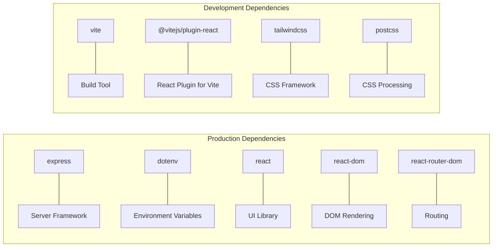

The project uses a modern JavaScript stack with React for the frontend and Express for the backend. Vite is used as the build tool for fast development and optimized production builds.

Sources: [package.json:12-28]()

## Troubleshooting

Common setup issues and their solutions:

1. **API Key Issues**: If you encounter authentication errors, ensure your OpenAI API key is correctly set in the `.env` file and that it has access to the Realtime API.

2. **Port Conflicts**: If port 3000 is already in use, modify the port number in `server.js` or close the application using that port.

3. **Node.js Version**: This application requires a modern version of Node.js. If you encounter errors during installation or startup, check that your Node.js version is up to date.

Sources: [README.md:5-25]()

## Next Steps

After completing the setup, you can:

1. Access the application at [http://localhost:3000](http://localhost:3000)
2. Use the console to interact with the OpenAI Realtime API
3. Examine the JSON payloads for client and server events in the logging panel

For more information about the system architecture and how the components interact, refer to [System Architecture](#1.2).

Sources: [README.md:25-29]()

---

# Page: System Architecture

# System Architecture

<details>
<summary>Relevant source files</summary>

The following files were used as context for generating this wiki page:

- [README.md](README.md)
- [client/components/App.jsx](client/components/App.jsx)
- [client/components/EventLog.jsx](client/components/EventLog.jsx)
- [server.js](server.js)

</details>


This document provides a high-level overview of the OpenAI Realtime Console system architecture, explaining how the client, server, and OpenAI Realtime API interact with each other. For details on setting up the project, see [Project Setup](#1.1), and for more in-depth information on WebRTC communication, refer to [WebRTC Communication](#4).

## Overview

The OpenAI Realtime Console is an example application that demonstrates real-time communication with OpenAI's models using WebRTC. The system consists of three main components:

1. **React Frontend**: Client-side application that provides the user interface and manages WebRTC connections
2. **Express Server**: Backend service that handles authentication and token generation
3. **OpenAI Realtime API**: External service that provides AI capabilities via WebRTC

## High-Level Architecture

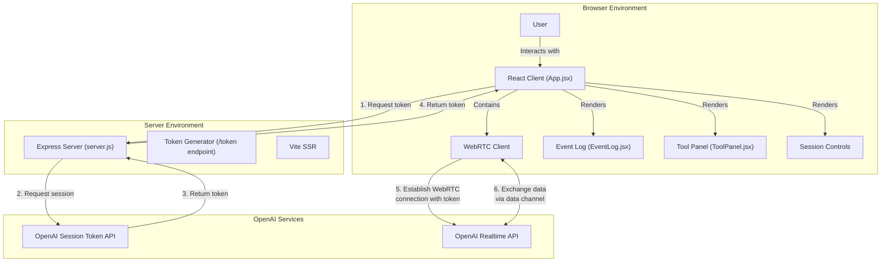

Sources: [README.md:1-40]()</pre>, [client/components/App.jsx:1-181]()</pre>, [server.js:1-65]()

## Client-Server-API Communication Flow

The following sequence diagram illustrates the communication flow between the client, server, and OpenAI Realtime API:

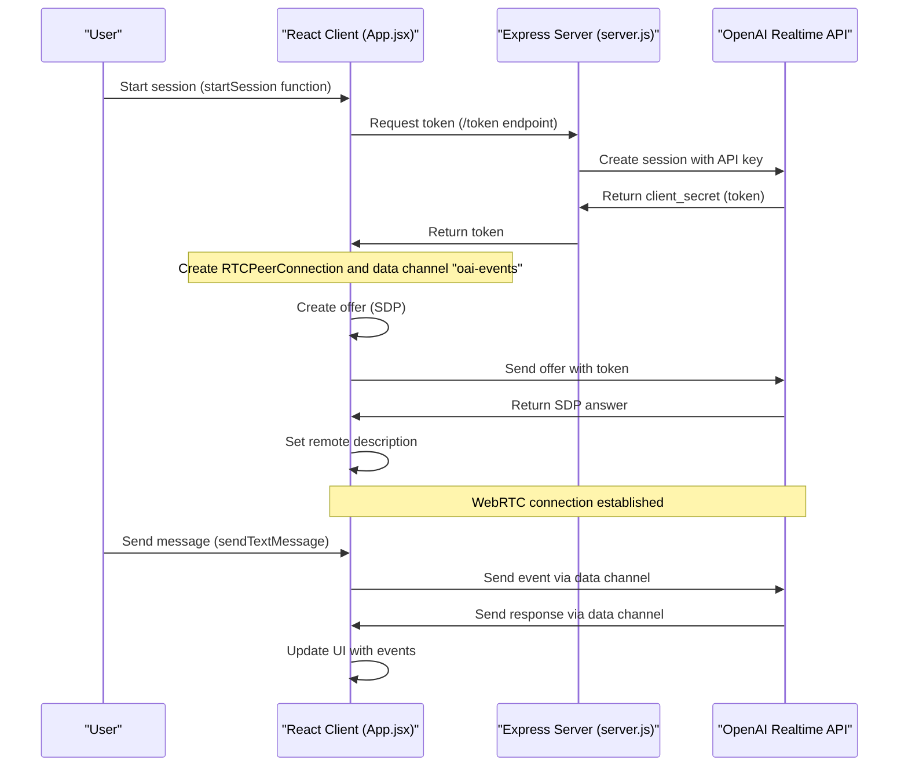

Sources: [client/components/App.jsx:14-61]()</pre>, [server.js:17-41]()

## Client-Side Architecture

The client side is built using React and consists of several key components:

### Main Components

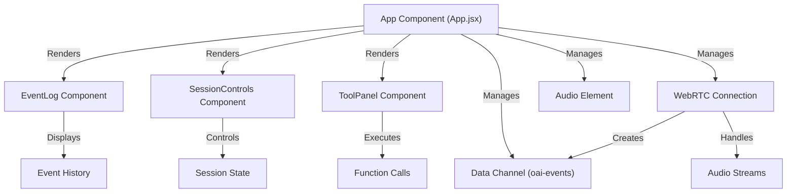

Sources: [client/components/App.jsx:1-181]()</pre>, [client/components/EventLog.jsx:1-65]()

### State Management

The App component manages the following state:

| State Variable | Purpose | Implementation |
|----------------|---------|----------------|
| `isSessionActive` | Tracks whether a WebRTC session is active | Boolean state in App.jsx |
| `events` | Stores all events exchanged with the API | Array state in App.jsx |
| `dataChannel` | References the WebRTC data channel | State reference in App.jsx |
| `peerConnection` | References the RTCPeerConnection | useRef in App.jsx |
| `audioElement` | References the audio element for playback | useRef in App.jsx |

Sources: [client/components/App.jsx:8-12]()

### Key Client Functions

| Function | Purpose | Implementation |
|----------|---------|----------------|
| `startSession` | Initiates a WebRTC connection with OpenAI | Creates peer connection and data channel |
| `stopSession` | Terminates the WebRTC connection | Closes connection and resets state |
| `sendClientEvent` | Sends a JSON event to the OpenAI API | Transmits via data channel |
| `sendTextMessage` | Formats and sends a text message | Calls sendClientEvent with formatted message |

Sources: [client/components/App.jsx:14-123]()

## Server-Side Architecture

The server is built using Express.js and provides the following functionality:

### Server Components

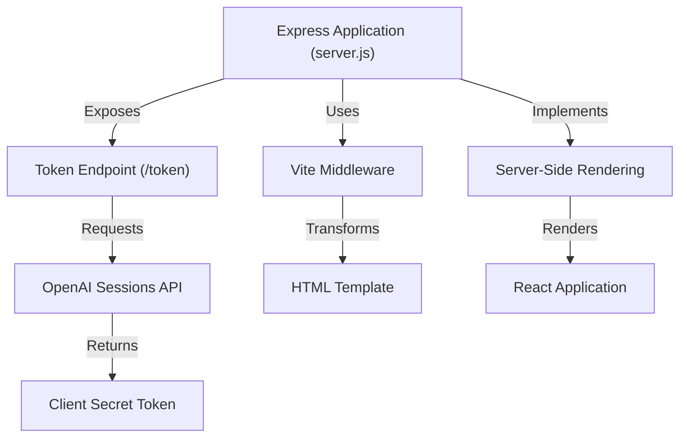

Sources: [server.js:1-65]()

### Token Generation Process

1. The client requests a token from the server's `/token` endpoint
2. The server makes a POST request to `https://api.openai.com/v1/realtime/sessions` with its API key
3. The OpenAI API returns a client secret token that can be used by the client
4. The server forwards this token to the client
5. The client uses this token to establish a direct WebRTC connection with OpenAI

Sources: [server.js:17-41]()</pre>, [client/components/App.jsx:14-25]()

## WebRTC Implementation

The application uses WebRTC for real-time communication with the OpenAI API, which includes:

1. **Peer Connection**: Established using the `RTCPeerConnection` API
2. **Data Channel**: Named "oai-events" for sending and receiving JSON events
3. **Audio Tracks**: For voice input/output between the user and the model

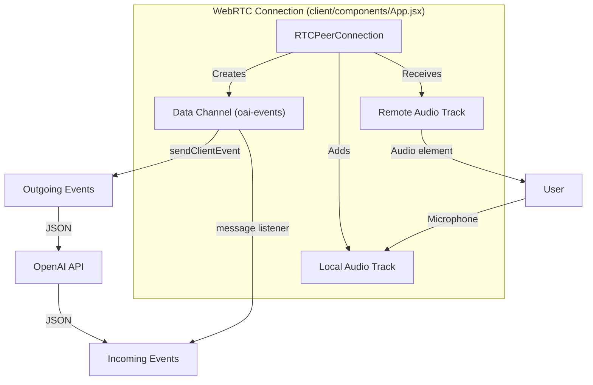

Sources: [client/components/App.jsx:21-60]()</pre>, [client/components/App.jsx:127-144]()

## Event System

The application uses an event-driven architecture for communication:

### Event Flow

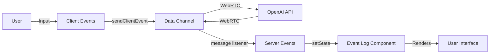

Sources: [client/components/App.jsx:84-103]()</pre>, [client/components/App.jsx:127-144]()</pre>, [client/components/EventLog.jsx:1-65]()

### Event Types

| Event Source | Example Event Types | Purpose |
|--------------|---------------------|---------|
| Client | `conversation.item.create` | Send user messages to the model |
| Client | `response.create` | Request a response from the model |
| Server | `conversation.response.delta` | Stream partial responses from the model |
| Server | `tool.calls` | Request function execution from the client |

Sources: [client/components/App.jsx:106-122]()</pre>, [client/components/EventLog.jsx:36-53]()

## Build and Deployment

The application is built using:

- **Vite**: For React frontend building and hot module replacement
- **Express**: For serving the application and API endpoints
- **Server-Side Rendering**: To improve initial page load performance

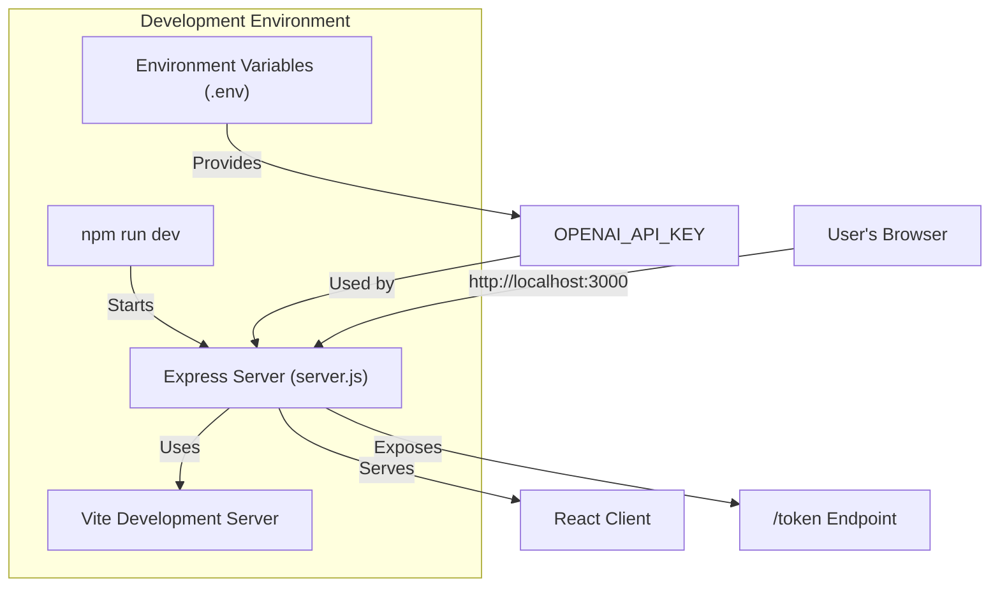

Sources: [README.md:5-29]()</pre>, [server.js:1-64]()

## Conclusion

The OpenAI Realtime Console demonstrates a modern architecture for real-time AI interaction using WebRTC:

1. **Express Server**: Handles authentication and token generation
2. **React Client**: Provides the user interface and manages WebRTC connections
3. **WebRTC**: Enables direct, low-latency communication with OpenAI's models
4. **Event-driven Architecture**: Facilitates asynchronous communication and UI updates

This architecture enables efficient real-time communication with OpenAI's models, showcasing the capabilities of the OpenAI Realtime API with WebRTC.

---

# Page: Server Components

# Server Components

<details>
<summary>Relevant source files</summary>

The following files were used as context for generating this wiki page:

- [client/entry-server.jsx](client/entry-server.jsx)
- [package.json](package.json)
- [server.js](server.js)

</details>


This page documents the server components in the OpenAI Realtime Console, focusing on the Express server implementation, token generation for OpenAI Realtime API authentication, and server-side rendering capabilities.

For information about client-side components, see [Client Components](#3).

## Express Server Overview

The OpenAI Realtime Console uses an Express.js server as its backend infrastructure, providing three core functionalities:

1. Serving the React client application
2. Generating authentication tokens for the OpenAI Realtime API
3. Supporting server-side rendering for improved performance

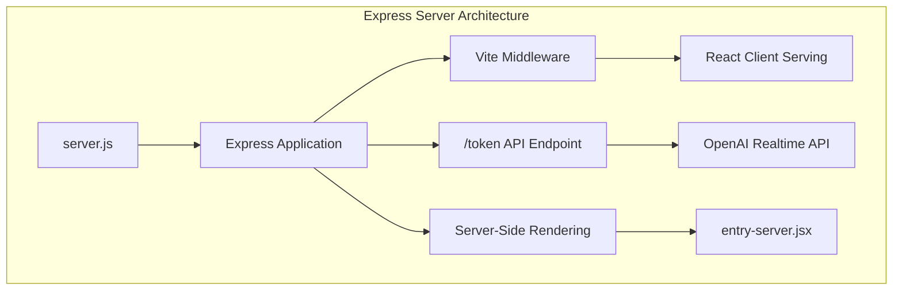

Sources: [server.js:1-64](), [package.json:12-15]()

## Server Setup and Configuration

The Express server is configured in `server.js` with the following key components:

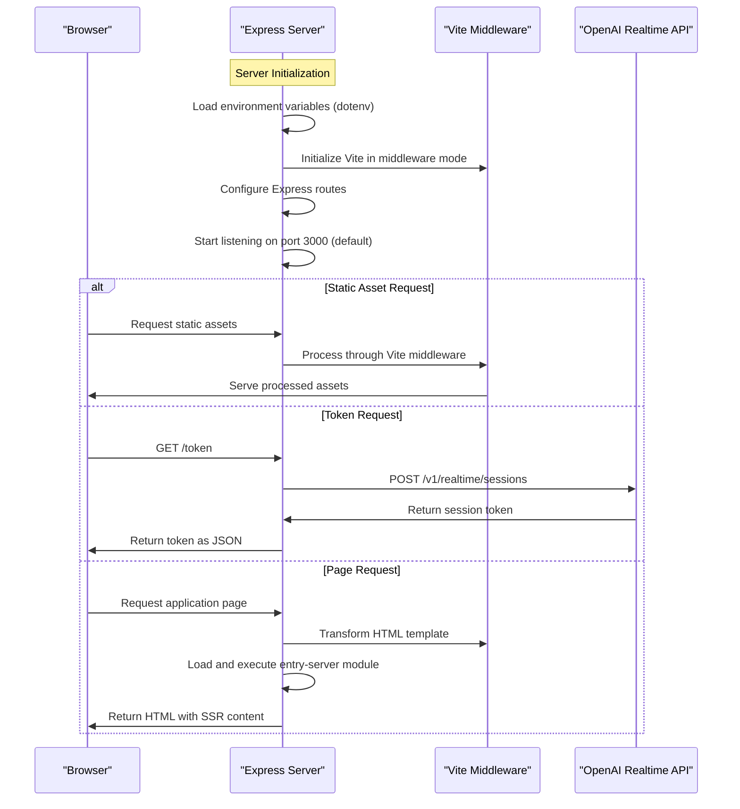

The server configuration includes:

1. **Environment Setup**: Uses dotenv to load environment variables including the OPENAI_API_KEY
2. **Port Configuration**: Listens on the port specified in environment variables or defaults to 3000
3. **Vite Integration**: Configures Vite middleware for development and production builds
4. **API Routes**: Defines the `/token` endpoint for OpenAI authentication
5. **Error Handling**: Implements error handling for API requests and SSR rendering

Sources: [server.js:1-15](), [server.js:62-64]()

## Token Generation

One of the core responsibilities of the server is to generate authentication tokens for the OpenAI Realtime API. This is implemented through a dedicated REST API endpoint at `/token`.

| Component | Description |
|-----------|-------------|
| Route | GET `/token` |
| Authentication | Uses server-side OPENAI_API_KEY |
| Target API | OpenAI Realtime Sessions API |
| Request Type | POST with JSON body |
| Model Specification | gpt-4o-realtime-preview-2024-12-17 |
| Voice Setting | verse |
| Response | JSON containing session token |

The token generation process keeps the API key secure by never exposing it to the client:

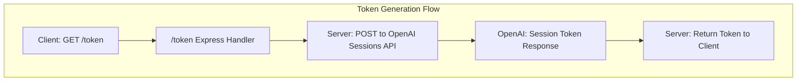

The implementation uses native fetch to make a POST request to the OpenAI API with appropriate headers and body configuration. The response is then parsed and forwarded to the client.

Sources: [server.js:17-41]()

## Server-Side Rendering

The server implements server-side rendering (SSR) to improve initial load performance and SEO. This feature is integrated with Vite for a modern development experience while maintaining production optimization.

```mermaid
graph TD
    subgraph "Server-Side Rendering Pipeline"
        ClientRequest["Client Page Request"]
        URLCapture["Capture Request URL"]
        TemplateLoad["Load index.html Template"]
        ViteTransform["Vite: Transform HTML"]
        ModuleLoad["Load entry-server.jsx Module"]
        RenderFunction["Execute render() Function"]
        HTMLInjection["Inject Rendered HTML into Template"]
        ResponseSend["Send Complete HTML to Client"]
        
        ClientRequest --> URLCapture
        URLCapture --> TemplateLoad
        TemplateLoad --> ViteTransform
        ViteTransform --> ModuleLoad
        ModuleLoad --> RenderFunction
        RenderFunction --> HTMLInjection
        HTMLInjection --> ResponseSend
    end
```

The SSR process follows these steps:

1. The server captures the client's requested URL
2. It reads the HTML template from `./client/index.html`
3. Vite transforms the HTML template for the current URL
4. The server loads the entry-server module using Vite's `ssrLoadModule`
5. The render function from entry-server is called to generate HTML
6. The generated HTML is injected into the template at the `<!--ssr-outlet-->` placeholder
7. The complete HTML is sent to the client

### Entry Server Module

The `entry-server.jsx` file provides the core rendering logic for SSR:

```jsx
import { StrictMode } from "react";
import { renderToString } from "react-dom/server";
import App from "./components/App";

export function render() {
  const html = renderToString(
    <StrictMode>
      <App />
    </StrictMode>
  );
  return { html };
}
```

This module exports a `render` function that:
- Uses React's `renderToString` to convert the App component to HTML
- Wraps the App in StrictMode for better development error detection
- Returns an object with the HTML string for injection into the template

Sources: [server.js:43-60](), [client/entry-server.jsx:1-12]()

## Development and Production Modes

The server supports both development and production modes through npm scripts defined in `package.json`:

| Environment | Command | Description |
|-------------|---------|-------------|
| Development | `npm run dev` | Runs server with hot-reloading via Vite |
| Production | `npm run start` | Runs server with pre-built assets |
| Build | `npm run build` | Builds both client and server |
| Client Build | `npm run build:client` | Builds client with SSR manifest |
| Server Build | `npm run build:server` | Builds server with SSR support |

In development mode, Vite provides:
- Hot Module Replacement for instant updates
- Source maps for debugging
- Development-friendly error messages

In production mode, the server:
- Serves pre-built optimized assets
- Minimizes error details for security
- Optimizes for performance

Sources: [package.json:3-11](), [server.js:10-15]()

## Server Dependencies

The server relies on several key packages to function properly:

| Dependency | Purpose |
|------------|---------|
| express | Web server framework |
| dotenv | Environment variable management |
| react-dom | Server-side rendering capabilities |
| vite | Development server and build tool |

The server is intentionally kept minimal, focusing only on the essentials needed to serve the application and interface with the OpenAI Realtime API.

Sources: [package.json:12-29]()

## Conclusion

The server components provide the foundation for the OpenAI Realtime Console application by:

1. Securely managing API authentication
2. Serving the React client application
3. Supporting server-side rendering for improved performance
4. Providing a development environment with hot-reloading

For more detailed information about token generation specifically, see [Token Generation](#2.1). For server-side rendering details, see [Server-Side Rendering](#2.2).

---

# Page: Token Generation

# Token Generation

<details>
<summary>Relevant source files</summary>

The following files were used as context for generating this wiki page:

- [.env.example](.env.example)
- [server.js](server.js)

</details>


## Purpose and Overview

This page documents the token generation system in the OpenAI Realtime Console. The token generation process is a critical server-side component responsible for securely obtaining temporary authentication tokens from the OpenAI API. These tokens allow the client application to establish WebRTC connections with OpenAI's Realtime API without exposing the API key to the client.

For information about how these tokens are used in WebRTC communication, see [WebRTC Communication](#4).

## Token Generation Flow

The token generation process follows a specific sequence to maintain security while enabling client-server communication with the OpenAI Realtime API.

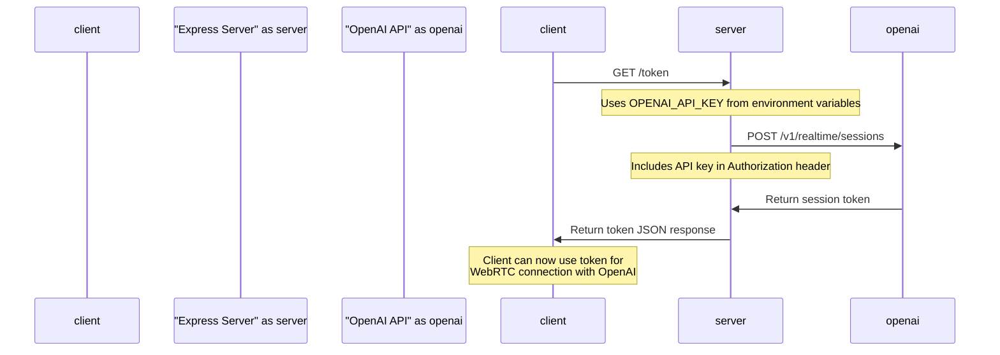

Sources: [server.js:17-41]()

## Server Implementation

The token generation is implemented as an Express route handler in the server application. The endpoint makes a secure request to the OpenAI API and forwards the resulting token to the client.

### Token Endpoint

The `/token` endpoint is defined in the Express server and handles requests for new authentication tokens:

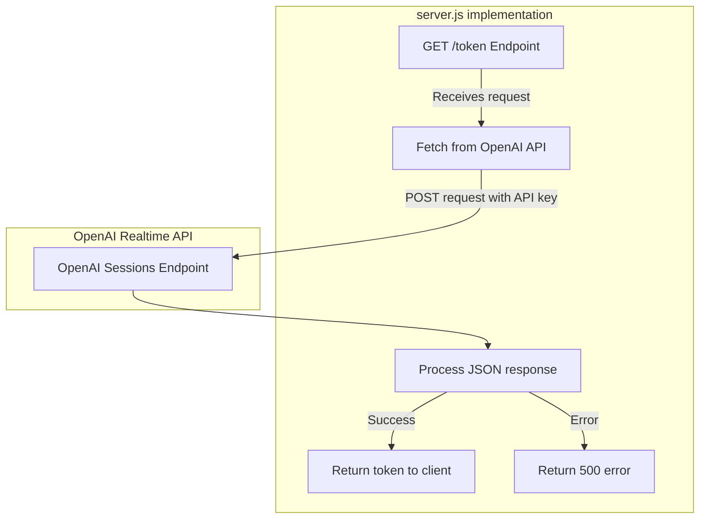

Sources: [server.js:17-41]()

The token endpoint performs the following operations:

1. Receives a GET request from the client
2. Makes a POST request to `https://api.openai.com/v1/realtime/sessions`
3. Includes the API key in the Authorization header
4. Specifies model and voice parameters in the request body
5. Returns the token data received from OpenAI to the client
6. Handles errors with appropriate HTTP status codes

## Request and Response Format

### Request to OpenAI

The server makes a POST request to the OpenAI API with the following structure:

| Component | Value |
|-----------|-------|
| HTTP Method | POST |
| URL | `https://api.openai.com/v1/realtime/sessions` |
| Authorization | `Bearer ${apiKey}` |
| Content-Type | `application/json` |
| Body | JSON with model and voice settings |

### Request Body Schema

```json
{
  "model": "gpt-4o-realtime-preview-2024-12-17",
  "voice": "verse"
}
```

Sources: [server.js:20-32]()

## Configuration

### API Key Setup

The token generation system requires an OpenAI API key, which is stored in the server environment variables to keep it secure and separate from the client-side code.

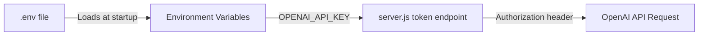

Sources: [server.js:8](), [.env.example:1]()

The API key is configured in two steps:

1. Create a `.env` file based on `.env.example`
2. Set your OpenAI API key in the `OPENAI_API_KEY` variable

## Error Handling

The token generation endpoint includes error handling to manage failed requests:

1. Catches exceptions during the fetch operation
2. Logs detailed error information to the server console
3. Returns a 500 status code with an error message
4. Prevents API key exposure in error responses

Sources: [server.js:37-40]()

## Token Usage

After generation, the token flows through the system as follows:

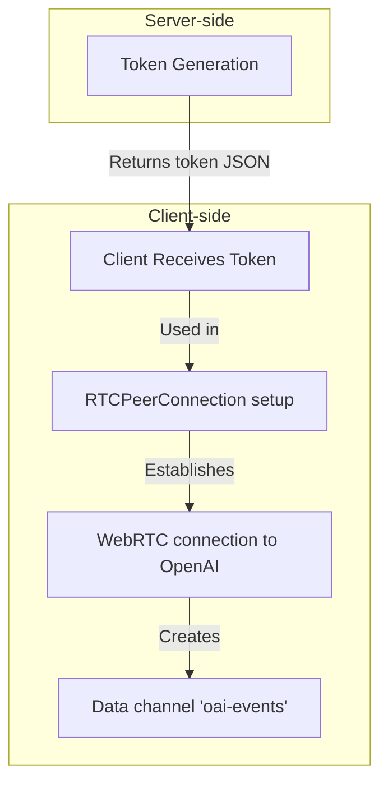

The token is used by the client to:

1. Authenticate WebRTC connection with OpenAI's Realtime API
2. Establish a secure communication channel without exposing the API key
3. Enable real-time message exchange with OpenAI models

Sources: [server.js:17-41]()

## Security Considerations

The token generation architecture offers several security benefits:

1. **API Key Protection**: The API key remains on the server and is never exposed to client-side code
2. **Temporary Tokens**: The generated tokens have limited lifespan, reducing risk if intercepted
3. **Server-side Authentication**: All authentication with OpenAI happens on the server
4. **Error Isolation**: Error handling prevents leaking sensitive information

Sources: [server.js:17-41](), [.env.example:1]()

## Integration with the Express Server

The token generation endpoint is integrated into the Express server alongside other application routes:

```mermaid
graph TD
    A["Express Server"] -->|"Hosts"| B["Token Generation Endpoint"]
    A -->|"Serves"| C["React Client"]
    B -->|"Provides tokens to"| C
    
    subgraph "server.js components"
        A
        B["GET /token"]
        D["Vite SSR Middleware"]
    end
    
    C -->|"Requests"| B
    A -->|"Uses"| D
```

Sources: [server.js:6-16](), [server.js:17-41](), [server.js:43-60]()

The Express server combines multiple responsibilities:
1. Serving the React client application 
2. Providing token generation services
3. Handling server-side rendering via Vite

## Summary

The token generation system is a critical security component that enables secure communication between the client application and OpenAI's Realtime API. By keeping the API key on the server and generating temporary tokens, it provides a secure mechanism for WebRTC connections while protecting sensitive credentials.

---

# Page: Server-Side Rendering

# Server-Side Rendering

<details>
<summary>Relevant source files</summary>

The following files were used as context for generating this wiki page:

- [client/entry-server.jsx](client/entry-server.jsx)
- [server.js](server.js)
- [vite.config.js](vite.config.js)

</details>


## Purpose and Scope

This document describes the Server-Side Rendering (SSR) implementation in the OpenAI Realtime Console application. It covers how the Express server renders React components on the server and delivers pre-rendered HTML to clients, improving initial page load performance and enabling better search engine optimization. For information about client-side components and their functionality, see [Client Components](#3).

## SSR Architecture Overview

The OpenAI Realtime Console implements server-side rendering using Express.js with Vite middleware in middleware mode, along with React's `renderToString` capability. This architecture allows the application to deliver pre-rendered HTML content to clients while maintaining the interactive capabilities of a single-page application.

```mermaid
flowchart TB
    subgraph "Server-Side Rendering Flow"
        direction TB
        Client["Client Browser"] -->|"HTTP Request"| ExpressServer["Express Server"]
        ExpressServer -->|"Process Request"| ViteMiddleware["Vite Middleware"]
        ViteMiddleware -->|"Transform Template"| EntryServer["entry-server.jsx"]
        EntryServer -->|"renderToString"| ReactApp["React App"]
        ReactApp -->|"HTML String"| EntryServer
        EntryServer -->|"Rendered HTML"| ViteMiddleware
        ViteMiddleware -->|"Insert HTML into Template"| ExpressServer
        ExpressServer -->|"Rendered Page"| Client
    end
```

Sources: [server.js:44-60](), [client/entry-server.jsx:5-12]()

## Vite Integration

The application uses Vite's middleware mode for server-side rendering, which provides development features like hot module replacement while enabling SSR capabilities.

```mermaid
flowchart LR
    subgraph "Vite SSR Configuration"
        direction LR
        ExpressJS["Express.js"] -->|"Creates"| ViteServer["Vite Server"]
        ViteServer -->|"middlewareMode: true"| ViteMiddleware["Vite Middleware"]
        ViteMiddleware -->|"Serves"| StaticAssets["Static Assets"]
        ViteMiddleware -->|"Handles"| HMRWS["HMR WebSockets"]
        ViteMiddleware -->|"Transforms"| HTMLTemplates["HTML Templates"]
        ViteMiddleware -->|"Loads"| SSRModules["SSR Modules"]
    end
```

Sources: [server.js:10-15](), [vite.config.js:7-10]()

## Server-Side Rendering Implementation

### Express Server Configuration

The Express server is configured to use Vite's middleware and includes a catch-all route that handles server-side rendering for all page requests.

| Component | Purpose |
|-----------|---------|
| Vite Middleware | Handles asset serving, module transformation, and HMR |
| Catch-all Route | Processes all page requests through the SSR pipeline |
| Template Transformation | Processes the HTML template with Vite |
| SSR Module Loading | Dynamically loads the server entry point |

Sources: [server.js:10-15](), [server.js:44-60]()

### HTML Template Processing

The SSR process follows these steps:

1. Reads the HTML template from `client/index.html`
2. Transforms the template with Vite
3. Loads the `entry-server.jsx` module using `vite.ssrLoadModule`
4. Renders the React application to an HTML string
5. Replaces `<!--ssr-outlet-->` placeholder with the rendered HTML
6. Sends the complete HTML to the client

```mermaid
sequenceDiagram
    participant Client as "Client Browser"
    participant Server as "Express Server"
    participant Vite as "Vite Middleware"
    participant EntryServer as "entry-server.jsx"
    participant React as "React DOM Server"
    
    Client->>Server: Request page
    Server->>Vite: Process request
    Vite->>Server: Read "client/index.html"
    Server->>Vite: Transform HTML template
    Vite->>Server: Load entry-server.jsx
    Server->>EntryServer: Call render()
    EntryServer->>React: renderToString(<App/>)
    React->>EntryServer: Return HTML string
    EntryServer->>Server: Return { html }
    Server->>Server: Replace "<!--ssr-outlet-->" with HTML
    Server->>Client: Send rendered HTML
```

Sources: [server.js:47-55](), [client/entry-server.jsx:5-12]()

## Entry Server Module

The `entry-server.jsx` file serves as the entry point for server-side rendering. It exports a `render` function that uses React's `renderToString` to convert the React component tree into an HTML string.

```mermaid
classDiagram
    class EntryServer {
        +render() String
    }
    
    class ReactDOMServer {
        +renderToString(element) String
    }
    
    class App {
        +render() ReactElement
    }
    
    EntryServer --> ReactDOMServer: uses
    EntryServer --> App: renders
```

The `render` function:
- Wraps the `App` component in `StrictMode`
- Uses `renderToString` to generate HTML
- Returns an object with the HTML string

Sources: [client/entry-server.jsx:1-12]()

## Error Handling

The SSR implementation includes error handling that improves developer experience by fixing stack traces for SSR-related errors.

```mermaid
flowchart TD
    subgraph "SSR Error Handling"
        SSRProcess["SSR Process"] -->|"Error occurs"| TryCatch["Try/Catch Block"]
        TryCatch -->|"Fix stacktrace"| ViteSSRFix["vite.ssrFixStacktrace()"]
        ViteSSRFix -->|"Pass to"| ExpressErrorHandler["Express Error Handler"]
    end
```

When an error occurs during SSR:
1. The error is caught in the try/catch block
2. Vite's `ssrFixStacktrace` method improves the error stacktrace
3. The error is passed to Express's error handling middleware via `next(e)`

Sources: [server.js:56-59]()

## Integration with Client Hydration

While not explicitly shown in the provided code, it's worth noting that after the server renders and delivers the HTML, the client-side JavaScript would "hydrate" the server-rendered markup to make it interactive. The hydration process would use the same React component tree as the server rendering.

Sources: [client/entry-server.jsx:5-12]()

---

# Page: Client Components

# Client Components

<details>
<summary>Relevant source files</summary>

The following files were used as context for generating this wiki page:

- [client/components/App.jsx](client/components/App.jsx)
- [client/components/EventLog.jsx](client/components/EventLog.jsx)
- [client/entry-client.jsx](client/entry-client.jsx)
- [client/index.html](client/index.html)

</details>


This page documents the client-side components of the OpenAI Realtime Console and their responsibilities. The client components form the frontend interface that users interact with to communicate with the OpenAI Realtime API via WebRTC. For information about server-side components, see [Server Components](#2).

## Overview of Client Architecture

The client side of the OpenAI Realtime Console is built using React and provides a real-time interface for interacting with OpenAI's Realtime API. The client components are responsible for:

1. Establishing and managing WebRTC connections with the OpenAI Realtime API
2. Sending and receiving events via the WebRTC data channel
3. Displaying the conversation and events in a user-friendly interface
4. Providing controls for session management and text input
5. Handling function calls received from the API

```mermaid
graph TD
    subgraph "Client Component Architecture"
        App["App Component
        (Main Controller)"]
        EventLog["EventLog Component
        (Displays Event History)"]
        SessionControls["SessionControls Component
        (Manages Session & Input)"]
        ToolPanel["ToolPanel Component
        (Handles Function Calls)"]
        
        App --> EventLog
        App --> SessionControls
        App --> ToolPanel
        
        subgraph "WebRTC Infrastructure"
            PC["RTCPeerConnection
            (peerConnection ref)"]
            DC["WebRTC Data Channel
            (dataChannel state)"]
            Audio["Audio Element
            (audioElement ref)"]
        end
        
        App -.-> PC
        App -.-> DC
        App -.-> Audio
    end
```

Sources: [client/components/App.jsx:1-181](), [client/components/EventLog.jsx:1-64]()

## Component Hierarchy and Responsibilities

The client application follows a hierarchical component structure with a single parent component (`App`) managing several specialized child components.

### App Component

The `App` component serves as the main container and controller for the application. It:

- Manages the WebRTC connection with the OpenAI Realtime API
- Maintains the application state (session status, events)
- Coordinates communication between child components
- Provides methods for sending and receiving events

The component maintains several key state variables:
- `isSessionActive`: Boolean indicating if a session is currently active
- `events`: Array of events exchanged with the API
- `dataChannel`: Reference to the WebRTC data channel
- `peerConnection`: Reference to the RTCPeerConnection object
- `audioElement`: Reference to the audio element for voice playback

```mermaid
flowchart TD
    subgraph "App Component State & Methods"
        State["State Variables:
        - isSessionActive
        - events
        - dataChannel"]
        
        Refs["References:
        - peerConnection
        - audioElement"]
        
        Methods["Key Methods:
        - startSession()
        - stopSession()
        - sendClientEvent()
        - sendTextMessage()"]
    end
    
    subgraph "WebRTC Connection Flow"
        startSession --> getToken["Fetch token from server"]
        getToken --> createPC["Create RTCPeerConnection"]
        createPC --> setupAudio["Set up audio elements"]
        setupAudio --> createDC["Create data channel (oai-events)"]
        createDC --> createOffer["Create and set SDP offer"]
        createOffer --> sendOffer["Send offer to OpenAI API"]
        sendOffer --> receiveAnswer["Receive and set SDP answer"]
    end
```

Sources: [client/components/App.jsx:7-181]()

### Event Log Component

The `EventLog` component displays the events exchanged between the client and server. It receives the events array from the `App` component and renders them in a collapsible list format.

Key features:
- Differentiates between client and server events with visual indicators
- Provides collapsible JSON view for each event
- Handles delta events (continuous updates) efficiently

```mermaid
flowchart LR
    subgraph "EventLog Component"
        EventLogComp["EventLog
        (Parent Component)"]
        EventComp["Event
        (Child Component)"]
        EventLogComp --> EventComp
    end
    
    subgraph "Event Component Features"
        Display["Display:
        - Event type
        - Timestamp
        - Direction (client/server)"]
        
        Interactivity["Interactivity:
        - Expandable JSON view
        - Visual indicators"]
    end
    
    EventComp --> Display
    EventComp --> Interactivity
```

Sources: [client/components/EventLog.jsx:1-64]()

### Session Controls Component

The `SessionControls` component provides the interface for managing the WebRTC session and sending messages to the OpenAI API. This component:

- Offers controls to start and stop the session
- Provides a text input for sending messages
- Displays session status information
- Passes user inputs to the parent `App` component

Sources: [client/components/App.jsx:159-168]()

### Tool Panel Component

The `ToolPanel` component handles function calls received from the OpenAI API and provides a way to execute tools or functions in response. This component:

- Processes function call events from the events array
- Displays function call requests and results
- Provides controls for executing the requested functions
- Sends function call results back to the API

Sources: [client/components/App.jsx:170-176]()

## Event Flow and Communication

The client components communicate with the OpenAI Realtime API through a WebRTC data channel. Events flow bidirectionally between the client and server, with the client component orchestrating this communication.

```mermaid
sequenceDiagram
    participant User as "User"
    participant App as "App Component"
    participant DC as "Data Channel"
    participant API as "OpenAI Realtime API"
    
    User->>App: Input text
    App->>App: Create message event
    App->>DC: Send event (sendClientEvent)
    DC->>API: JSON message via WebRTC
    
    API->>DC: Response event
    DC->>App: onmessage handler
    App->>App: Update events state
    App->>User: Display in EventLog
    
    API->>DC: Function call event
    DC->>App: onmessage handler
    App->>App: Update events state
    App->>ToolPanel: Pass event for processing
    ToolPanel->>App: Function call result
    App->>DC: Send result event
    DC->>API: JSON result via WebRTC
```

Sources: [client/components/App.jsx:83-123](), [client/components/App.jsx:125-144]()

## WebRTC Connection Management

The `App` component handles the establishment and management of the WebRTC connection with the OpenAI Realtime API.

### Connection Establishment

The connection is established through a series of steps:

1. Obtain a session token from the server
2. Create an RTCPeerConnection
3. Set up audio tracks (both local and remote)
4. Create a data channel named "oai-events"
5. Generate and send an SDP offer
6. Receive and process the SDP answer
7. Establish the WebRTC connection

Sources: [client/components/App.jsx:14-60]()

### Session Management

The client provides methods for starting and stopping the WebRTC session:

- `startSession()`: Establishes the WebRTC connection with the OpenAI API
- `stopSession()`: Cleans up the connection, closes the data channel, and resets the state

### Event Handling 

Events are sent and received through the WebRTC data channel:

- `sendClientEvent()`: Formats and sends events to the API
- `sendTextMessage()`: Helper method to create and send text message events
- Event listeners on the data channel capture and process incoming events

Sources: [client/components/App.jsx:63-123]()

## Client-Side Rendering and Hydration

The client application is served with server-side rendering and then hydrated on the client side. The application entry point is `entry-client.jsx`, which hydrates the React application into the DOM.

```mermaid
flowchart TD
    HTML["index.html
    (Container with root div)"]
    Entry["entry-client.jsx
    (Client Entry Point)"]
    App["App.jsx
    (Main Component)"]
    
    HTML -->|contains| RootDiv["div#root"]
    Entry -->|hydrates| RootDiv
    Entry -->|mounts| App
    App -->|renders| Components["Child Components:
    - EventLog
    - SessionControls
    - ToolPanel"]
```

Sources: [client/index.html:1-19](), [client/entry-client.jsx:1-12]()

## Component Layout and UI Structure

The client UI is divided into sections for different functional areas:

1. Top navigation bar with logo and title
2. Main content area with:
   - Event log section (left side)
   - Session controls (bottom of left side)
   - Tool panel (right side)

This layout provides a clear separation of concerns while keeping all necessary controls easily accessible.

```mermaid
graph TD
    subgraph "UI Layout"
        Nav["Navigation Bar
        (logo + title)"]
        Main["Main Content"]
        
        Main --> LeftPane["Left Pane"]
        Main --> RightPane["Right Pane
        (ToolPanel)"]
        
        LeftPane --> EventLogSection["Event Log Section
        (scrollable)"]
        LeftPane --> SessionControlSection["Session Control Section
        (fixed at bottom)"]
    end
```

Sources: [client/components/App.jsx:146-179]()

## Summary

The client components of the OpenAI Realtime Console work together to provide a seamless interface for interacting with the OpenAI Realtime API. The architecture follows a hierarchical pattern with a clear separation of responsibilities:

- `App`: Main controller managing state and WebRTC connection
- `EventLog`: Display of events exchanged with the API
- `SessionControls`: Interface for managing the session and sending messages
- `ToolPanel`: Handling of function calls and tool execution

This design allows for efficient real-time communication with the OpenAI API while providing a clean and usable interface for developers to test and debug their applications.

Sources: [client/components/App.jsx:1-181](), [client/components/EventLog.jsx:1-64](), [client/entry-client.jsx:1-12](), [client/index.html:1-19]()

---

# Page: App Component

# App Component

<details>
<summary>Relevant source files</summary>

The following files were used as context for generating this wiki page:

- [client/components/App.jsx](client/components/App.jsx)
- [client/components/EventLog.jsx](client/components/EventLog.jsx)
- [client/entry-client.jsx](client/entry-client.jsx)

</details>


The App component serves as the central controller for the OpenAI Realtime Console application. It manages the WebRTC connection to the OpenAI Realtime API, handles session state, processes events, and coordinates all UI components. This document details the structure, functionality, and relationships of the App component.

For information about specific child components, see [Event Log System](#3.2) and [Session Controls and Tool Panel](#3.3).

## Component Structure and State Management

The App component maintains several key pieces of state and references:

```mermaid
graph TD
    subgraph "App Component State Management"
        isSessionActive["isSessionActive: boolean"] -->|"Controls UI and session availability"| App
        events["events: array"] -->|"Stores all messages exchanged with API"| App
        dataChannel["dataChannel: RTCDataChannel"] -->|"Manages realtime communication"| App
        peerConnection["peerConnection: useRef(RTCPeerConnection)"] -->|"Manages WebRTC connection"| App
        audioElement["audioElement: useRef(HTMLAudioElement)"] -->|"Plays audio from model"| App
    end
```

Sources: [client/components/App.jsx:8-12]()

### State Variables
- `isSessionActive`: Boolean flag indicating if a session is currently active
- `events`: Array storing all events exchanged with the OpenAI Realtime API
- `dataChannel`: Reference to the WebRTC data channel for sending/receiving events
- `peerConnection`: useRef containing the RTCPeerConnection instance
- `audioElement`: useRef for the audio element to play model responses

## Session Lifecycle Management

The App component provides comprehensive session management through two primary functions:

### Session Initialization

The `startSession` function handles the complete WebRTC connection setup process:

```mermaid
sequenceDiagram
    participant App as "App Component"
    participant Server as "Express Server"
    participant API as "OpenAI Realtime API"
    
    App->>Server: Request token
    Server->>App: Return EPHEMERAL_KEY
    App->>App: Create RTCPeerConnection
    App->>App: Setup audio element
    App->>App: Get user media (microphone)
    App->>App: Create data channel ("oai-events")
    App->>App: Create and set local SDP offer
    App->>API: Send offer with EPHEMERAL_KEY
    API->>App: Return SDP answer
    App->>App: Set remote description
    App->>App: Store connection reference
```

Sources: [client/components/App.jsx:14-60]()

### Session Termination

The `stopSession` function cleans up resources and resets the application state:

1. Closes the data channel
2. Stops all media tracks
3. Closes the peer connection
4. Resets the state variables

Sources: [client/components/App.jsx:63-81]()

## WebRTC Communication

The App component establishes and manages a WebRTC connection with the OpenAI Realtime API:

```mermaid
graph TD
    subgraph "WebRTC Communication Flow"
        startSession["startSession()"] -->|"1. Creates"| peerConnection["RTCPeerConnection"]
        startSession -->|"2. Creates"| dataChannel["DataChannel: 'oai-events'"]
        dataChannel -->|"useEffect() attaches event listeners"| messageHandler["message event handler"]
        dataChannel -->|"useEffect() attaches event listeners"| openHandler["open event handler"]
        messageHandler -->|"Processes incoming events"| updateEvents["Update events state"]
        openHandler -->|"Sets session as active"| activateSession["Set isSessionActive = true"]
        
        sendClientEvent["sendClientEvent()"] -->|"Sends events to OpenAI"| dataChannel
        sendTextMessage["sendTextMessage()"] -->|"Formats and calls"| sendClientEvent
    end
```

Sources: [client/components/App.jsx:14-60](), [client/components/App.jsx:126-144]()

### Data Channel Event Handling

When a data channel is established, event listeners are attached to:
- Process incoming messages from the API
- Update the application state when the channel opens
- Add timestamps to events for display

Sources: [client/components/App.jsx:126-144]()

## Event Processing

The App component provides two main functions for sending events to the OpenAI Realtime API:

### sendClientEvent

This function:
1. Takes a message object as input
2. Adds an event_id if not present
3. Sends the event via the data channel
4. Adds a timestamp for UI display
5. Updates the events state array

Sources: [client/components/App.jsx:84-103]()

### sendTextMessage

A convenience function that:
1. Formats a text message into the proper event structure
2. Calls sendClientEvent with the formatted event
3. Also sends a response.create event to initiate a response

Sources: [client/components/App.jsx:106-123]()

## Component Layout and Rendering

The App component renders a structured UI with several key sections:

```mermaid
graph TD
    subgraph "App Component Layout"
        App["App Component"] --> Nav["Navigation Bar"]
        App --> Main["Main Content"]
        
        Main --> LeftSection["Left Panel (Events + Controls)"]
        Main --> RightSection["Right Panel (Tools)"]
        
        LeftSection --> EventLogSection["EventLog Component Section"]
        LeftSection --> SessionControlsSection["SessionControls Component Section"]
        
        RightSection --> ToolPanelSection["ToolPanel Component Section"]
        
        EventLogSection -->|"Displays"| EventLog["EventLog Component"]
        SessionControlsSection -->|"Contains"| SessionControls["SessionControls Component"]
        ToolPanelSection -->|"Contains"| ToolPanel["ToolPanel Component"]
    end
```

Sources: [client/components/App.jsx:146-181]()

### Child Components and Props

The App component passes down state and functions to child components:

| Component | Props Received | Purpose |
|-----------|----------------|---------|
| EventLog | events | Displays events exchanged with the API |
| SessionControls | startSession, stopSession, sendClientEvent, sendTextMessage, events, isSessionActive | Controls session state and provides messaging interface |
| ToolPanel | sendClientEvent, sendTextMessage, events, isSessionActive | Provides tool execution functionality |

Sources: [client/components/App.jsx:157-176]()

## Integration with Overall Application

The App component is the root component of the React application, as shown in the entry-client.jsx file:

```mermaid
graph TD
    subgraph "Application Integration"
        EntryClient["entry-client.jsx"] -->|"Renders"| ReactDOM["ReactDOM.hydrateRoot()"]
        ReactDOM -->|"Mounts"| App["App Component"]
        
        App -->|"Manages"| WebRTC["WebRTC Connection"]
        App -->|"Renders"| Components["Child Components"]
        
        WebRTC -->|"Connects to"| OpenAI["OpenAI Realtime API"]
        Components -->|"Include"| EventLog["EventLog"]
        Components -->|"Include"| SessionControls["SessionControls"]
        Components -->|"Include"| ToolPanel["ToolPanel"]
    end
```

Sources: [client/entry-client.jsx:1-11]()

## Complete Component Workflow

The following diagram illustrates the complete workflow of the App component, including initialization, communication, and termination:

```mermaid
graph TD
    subgraph "App Component Workflow"
        Init["Component Initialization"] -->|"User clicks Start"| StartSession["startSession()"]
        StartSession -->|"Establishes"| Connection["WebRTC Connection"]
        Connection -->|"Creates"| DataChannel["Data Channel"]
        
        DataChannel -->|"Opens"| SetActive["Set isSessionActive = true"]
        SetActive -->|"Enables"| Interaction["User Interaction"]
        
        Interaction -->|"User sends message"| SendText["sendTextMessage()"]
        SendText -->|"Formats and calls"| SendEvent["sendClientEvent()"]
        SendEvent -->|"Sends via"| DataChannel
        
        DataChannel -->|"Receives"| ServerEvents["Server Events"]
        ServerEvents -->|"Updates"| EventsState["events State Array"]
        EventsState -->|"Renders in"| ChildComponents["Child Components"]
        
        Interaction -->|"User clicks Stop"| StopSession["stopSession()"]
        StopSession -->|"Cleans up"| Connection
        StopSession -->|"Resets"| AppState["Application State"]
    end
```

Sources: [client/components/App.jsx:7-181]()

## Summary

The App component serves as the foundation of the OpenAI Realtime Console application. It:

1. Manages the WebRTC connection to the OpenAI Realtime API
2. Handles session lifecycle (initialization and termination)
3. Processes events sent to and received from the API
4. Coordinates audio input/output for voice interaction
5. Renders the UI layout and integrates child components
6. Provides core functionality for text messaging and event dispatching

This component demonstrates a complete implementation of a WebRTC-based application for interacting with the OpenAI Realtime API, showcasing real-time communication and event-driven architecture.

---

# Page: Event Log System

# Event Log System

<details>
<summary>Relevant source files</summary>

The following files were used as context for generating this wiki page:

- [client/components/App.jsx](client/components/App.jsx)
- [client/components/EventLog.jsx](client/components/EventLog.jsx)

</details>


## Purpose and Overview

The Event Log System is a core component of the OpenAI Realtime Console that displays and manages the bidirectional flow of events between the client application and the OpenAI Realtime API. This system provides developers with a real-time, visual representation of the JSON payloads being exchanged during a session, making it an essential debugging and monitoring tool.

For information about how events are processed and how function calling works, see [Event Processing](#4.2).

## Event Flow Architecture

The Event Log System captures, stores, and displays events that flow through the WebRTC data channel. Events originate from either the client application or the OpenAI Realtime API.

```mermaid
flowchart TD
    subgraph "App Component"
        sendClientEvent["sendClientEvent()"]
        sendTextMessage["sendTextMessage()"]
        eventsState["events State Array"]
    end
    
    subgraph "WebRTC Infrastructure"
        dataChannel["dataChannel (oai-events)"]
    end
    
    subgraph "EventLog Component"
        EventLogComponent["EventLog Component"]
        EventComponent["Event Component"]
    end
    
    subgraph "OpenAI Realtime API"
        api["OpenAI API"]
    end
    
    sendTextMessage -->|"Calls"| sendClientEvent
    sendClientEvent -->|"1. Sends event\n2. Adds to events state"| eventsState
    sendClientEvent -->|"Sends JSON"| dataChannel
    dataChannel -->|"Sends to"| api
    api -->|"Sends response"| dataChannel
    dataChannel -->|"onmessage\nAdds to events state"| eventsState
    eventsState -->|"Passes events prop"| EventLogComponent
    EventLogComponent -->|"Creates for each event"| EventComponent
```

Sources: [client/components/App.jsx:84-103](), [client/components/App.jsx:125-144](), [client/components/EventLog.jsx:36-64]()

## Event Data Structure

Events in the system follow a consistent structure with several key properties:

| Property | Description | Example |
|----------|-------------|---------|
| `type` | Identifies the event category and action | `"conversation.item.create"` |
| `event_id` | Unique identifier for the event | Client: UUID, Server: starts with "event_" |
| `timestamp` | When the event occurred | Added by the client for both directions |
| Event-specific data | Varies based on event type | Message content, function calls, etc. |

### Client vs Server Events

The system visually distinguishes between events originating from the client and those from the server:

- **Client Events**: Display with a downward blue arrow (↓)
- **Server Events**: Display with an upward green arrow (↑)

Events are identified as client-originated if they have an `event_id` that doesn't start with "event_".

Sources: [client/components/EventLog.jsx:4-34]()

## Component Architecture

The Event Log System consists of two main React components:

```mermaid
classDiagram
    class App {
        -useState events[]
        -useState dataChannel
        +sendClientEvent(message)
        +handleDataChannelMessage(e)
        +render()
    }
    
    class EventLog {
        +events[]
        +render()
    }
    
    class Event {
        -useState isExpanded
        +event
        +timestamp
        +render()
    }
    
    App --> EventLog : passes events[]
    EventLog --> Event : creates for each event
```

Sources: [client/components/App.jsx:7-181](), [client/components/EventLog.jsx:4-64]()

### EventLog Component

The EventLog component is the container that renders the list of events. It:

1. Receives the `events` array from the App component
2. Handles special cases like delta events (partial updates)
3. Creates an `Event` component for each event to be displayed
4. Shows a placeholder message when no events are available

Delta events (events with types ending in "delta") receive special handling - only one delta event of each type is displayed per render cycle to prevent overwhelming the display.

Sources: [client/components/EventLog.jsx:36-64]()

### Event Component

Individual events are rendered by the Event component, which:

1. Displays event direction (client/server), type, and timestamp
2. Allows expanding/collapsing to view the full JSON payload
3. Uses visual indicators (arrows) to distinguish between client and server events
4. Formats the JSON payload with proper indentation when expanded

Sources: [client/components/EventLog.jsx:4-34]()

## Event Handling in the App Component

The App component serves as the central manager for events in the system:

```mermaid
sequenceDiagram
    participant User as User
    participant App as App Component
    participant DataChannel as WebRTC Data Channel
    participant API as OpenAI API
    participant EventLog as EventLog Component
    
    User->>App: User Action
    App->>App: sendClientEvent()
    App->>DataChannel: Send JSON event
    App->>App: Add to events state
    DataChannel->>API: Forward event
    API->>DataChannel: Send response event
    DataChannel->>App: onmessage event
    App->>App: Parse JSON + add timestamp
    App->>App: Add to events state
    App->>EventLog: Update with new events
    EventLog->>EventLog: Render updated event list
```

The App component manages events through several key functions:

1. **sendClientEvent()**: Formats and sends events to the OpenAI Realtime API via the data channel, and adds them to the events state
2. **sendTextMessage()**: Creates a properly formatted text message event and calls sendClientEvent()
3. **Data channel onmessage handler**: Processes incoming events from the API, adds timestamps, and updates the events state

Events are stored in reverse chronological order (newest first) in the events state array.

Sources: [client/components/App.jsx:84-123](), [client/components/App.jsx:125-144]()

## UI Layout and Integration

The Event Log is positioned as a central element in the user interface:

```mermaid
graph TD
    subgraph "Main UI Layout"
        Nav["Navigation Bar"]
        Main["Main Content Area"]
    end
    
    subgraph "Main Content Sections"
        LeftSection["Left Section"]
        RightSection["Tool Panel (380px)"]
    end
    
    subgraph "Left Section Components"
        EventLogArea["EventLog Component Area"]
        SessionControlsArea["SessionControls Area (32px height)"]
    end
    
    Main --> LeftSection
    Main --> RightSection
    LeftSection --> EventLogArea
    LeftSection --> SessionControlsArea
```

The EventLog component occupies the primary screen area, taking up the left section of the UI above the session controls.

Sources: [client/components/App.jsx:146-181]()

## Example Event Flow

Here's a typical event flow showing how a user message is processed:

1. User sends a message through the SessionControls component
2. App calls `sendTextMessage("Hello, how are you?")`
3. `sendTextMessage` creates an event with type `conversation.item.create`
4. `sendClientEvent` is called with this event, which:
   - Adds a unique event_id
   - Sends the event via the data channel to OpenAI
   - Adds the event with a timestamp to the events state
5. App then automatically sends a `response.create` event
6. OpenAI API processes these events and sends back response events
7. These events are received via the data channel, timestamped, and added to the events state
8. The EventLog component re-renders with all events displayed in reverse chronological order

Sources: [client/components/App.jsx:84-123](), [client/components/App.jsx:125-144]()

## Technical Implementation Details

### Event Expansion and Collapsing

Each event in the log can be expanded to view its full JSON payload. This is implemented using:
- A local `isExpanded` state in the Event component
- A click handler that toggles this state
- Conditional CSS classes that show or hide the JSON pre-formatted block

### Event Filtering and Processing

The EventLog component implements filtering for delta events to prevent overwhelming the UI:

```javascript
if (event.type.endsWith("delta")) {
  if (deltaEvents[event.type]) {
    // for now just log a single event per render pass
    return;
  } else {
    deltaEvents[event.type] = event;
  }
}
```

This ensures that only one delta event of each type is displayed per render cycle.

Sources: [client/components/EventLog.jsx:40-48]()

## Integration with Other Components

The Event Log System integrates with several other components:

1. **App Component**: Manages the events state and provides it to the EventLog
2. **SessionControls**: Uses the sendTextMessage and sendClientEvent functions to create events
3. **ToolPanel**: Uses the events data to display function call outputs and provide tools

For more details on SessionControls and ToolPanel, see [Session Controls and Tool Panel](#3.3).

Sources: [client/components/App.jsx:159-177]()

---

# Page: Session Controls and Tool Panel

# Session Controls and Tool Panel

<details>
<summary>Relevant source files</summary>

The following files were used as context for generating this wiki page:

- [client/components/App.jsx](client/components/App.jsx)
- [client/components/EventLog.jsx](client/components/EventLog.jsx)
- [client/components/SessionControls.jsx](client/components/SessionControls.jsx)
- [client/components/ToolPanel.jsx](client/components/ToolPanel.jsx)

</details>


## Purpose and Scope

This document details the Session Controls and Tool Panel components of the OpenAI Realtime Console application. These two components provide essential user interface elements that enable:

1. Managing WebRTC sessions with the OpenAI Realtime API
2. Sending text messages to the model
3. Registering and executing tools via function calling
4. Displaying function call results

For information about general event handling and WebRTC communication, see [WebRTC Communication](#4), and for details about how events are logged, see [Event Log System](#3.2).

## Component Location and Overview

The SessionControls and ToolPanel components occupy specific regions in the application interface:

```mermaid
graph TD
    subgraph "App Component Layout"
        NavBar["Navigation Bar"]
        MainSection["Main Section"]
        RightPanel["Right Panel (380px)"]
        
        subgraph "MainSection"
            EventLogArea["Event Log Area"]
            SessionControlsArea["Session Controls Area (32px height)"]
        end
        
        subgraph "RightPanel"
            ToolPanelArea["Tool Panel Area"]
        end
    end
    
    NavBar --- MainSection
    NavBar --- RightPanel
    MainSection --- EventLogArea
    MainSection --- SessionControlsArea
    RightPanel --- ToolPanelArea
    
    SessionControlsArea -.- SessionControls["SessionControls Component"]
    ToolPanelArea -.- ToolPanel["ToolPanel Component"]
```

Sources: [client/components/App.jsx:146-180]()

## Session Controls Component

The SessionControls component manages user interactions for establishing, maintaining, and terminating WebRTC sessions with the OpenAI Realtime API.

### Component States

The SessionControls component has two main states:

1. **Session Inactive** - Displays a button to start a new session
2. **Session Active** - Displays a text input field, send button, and disconnect button

```mermaid
stateDiagram-v2
    [*] --> "Session Inactive"
    "Session Inactive" --> "Session Active": startSession()
    "Session Active" --> "Session Inactive": stopSession()
    
    state "Session Inactive" as SI {
        [*] --> "Ready"
        "Ready" --> "Starting": "Click Start Button"
        "Starting" --> [*]: "Session Established"
    }
    
    state "Session Active" as SA {
        [*] --> "Input Empty"
        "Input Empty" --> "Input Filled": "Type Message"
        "Input Filled" --> "Input Empty": "Send Message"
        "Input Empty" --> [*]: "Click Disconnect"
        "Input Filled" --> [*]: "Click Disconnect"
    }
```

Sources: [client/components/SessionControls.jsx:5-66](), [client/components/App.jsx:14-81]()

### Component Structure

The SessionControls component renders different UI elements based on the session state:

```mermaid
graph TD
    subgraph "SessionControls"
        SC["SessionControls Component"]
        
        SC -- "isSessionActive=false" --> SS["SessionStopped Component"]
        SC -- "isSessionActive=true" --> SA["SessionActive Component"]
        
        subgraph "SessionStopped"
            StartButton["Start Session Button"]
        end
        
        subgraph "SessionActive"
            MessageInput["Text Input Field"]
            SendButton["Send Text Button"]
            DisconnectButton["Disconnect Button"]
        end
    end
    
    StartButton -- "onClick" --> StartSession["startSession()"]
    MessageInput -- "onChange" --> UpdateMessage["setMessage()"]
    SendButton -- "onClick" --> SendText["sendTextMessage()"]
    DisconnectButton -- "onClick" --> StopSession["stopSession()"]
```

Sources: [client/components/SessionControls.jsx:5-66]()

### Functionality

#### Starting a Session

When a user clicks the "start session" button, the component:

1. Sets an "isActivating" state to prevent multiple clicks
2. Calls the `startSession()` function passed down from the App component
3. This initiates a chain of events in the App component:
   - Fetches a token from the server
   - Creates a WebRTC peer connection
   - Sets up a data channel
   - Establishes a connection with the OpenAI Realtime API

#### Sending Messages

When a session is active, users can:
1. Type text in the input field
2. Send the message by clicking the "send text" button or pressing Enter
3. This calls the `sendTextMessage()` function, which:
   - Formats the message as a client event
   - Sends it through the WebRTC data channel
   - Clears the input field

#### Stopping a Session

When the user clicks the "disconnect" button:
1. The `stopSession()` function is called
2. The WebRTC connection is closed
3. The UI returns to the inactive state

Sources: [client/components/SessionControls.jsx:5-66](), [client/components/App.jsx:14-81](), [client/components/App.jsx:105-123]()

## Tool Panel Component

The ToolPanel component demonstrates OpenAI's function calling capabilities by implementing a color palette generation tool.

### Component Structure and Function

```mermaid
graph TD
    subgraph "ToolPanel Component"
        TP["ToolPanel Component"]
        FCO["FunctionCallOutput Component"]
        
        TP -- "when function called" --> FCO
        
        subgraph "Tool Registration"
            SessionUpdate["session.update event"]
            ToolDefinition["display_color_palette function definition"]
        end
        
        subgraph "Function Execution"
            EventMonitoring["Event monitoring"]
            OutputProcessing["Process function_call output"]
            UIRendering["Render color palette"]
        end
        
        subgraph "Feedback Flow"
            ShowPalette["Display color palette"]
            FeedbackPrompt["Send response.create with instructions"]
        end
    end
    
    TP --> SessionUpdate
    SessionUpdate --> ToolDefinition
    TP --> EventMonitoring
    EventMonitoring --> OutputProcessing
    OutputProcessing --> UIRendering
    UIRendering --> ShowPalette
    ShowPalette --> FeedbackPrompt
```

Sources: [client/components/ToolPanel.jsx:1-133]()

### Function Registration

When a session is created, the ToolPanel component:

1. Detects the `session.created` event
2. Sends a `session.update` event containing the function definition:
   - Name: `display_color_palette`
   - Parameters: `theme` (string) and `colors` (array of hex color codes)
   - Description of the function's purpose

The function definition is structured as follows:

```
{
  type: "function",
  name: "display_color_palette",
  description: "Call this function when a user asks for a color palette.",
  parameters: {
    type: "object",
    strict: true,
    properties: {
      theme: { type: "string", description: "..." },
      colors: { type: "array", description: "...", items: { ... } }
    },
    required: ["theme", "colors"]
  }
}
```

Sources: [client/components/ToolPanel.jsx:3-38]()

### Function Execution Flow

The function execution follows this sequence:

1. User asks for a color palette
2. Model decides to call the `display_color_palette` function
3. ToolPanel detects the function call in the `response.done` event
4. It extracts the function arguments (theme and colors)
5. Renders the color palette in the UI
6. After a short delay (500ms), it sends a follow-up prompt to the model

```mermaid
sequenceDiagram
    participant User
    participant SessionControls
    participant App
    participant OpenAI as "OpenAI Realtime API"
    participant ToolPanel
    
    User->>SessionControls: "Suggest a beach theme color palette"
    SessionControls->>App: sendTextMessage()
    App->>OpenAI: Send via data channel
    OpenAI-->>App: response with function_call
    App-->>ToolPanel: Event propagation
    ToolPanel->>ToolPanel: Extract function arguments
    ToolPanel->>ToolPanel: Render color palette
    ToolPanel->>App: sendClientEvent(response.create)
    App->>OpenAI: Send follow-up instructions
    OpenAI-->>App: Ask for feedback about palette
    App-->>SessionControls: Update UI with response
```

Sources: [client/components/ToolPanel.jsx:66-108](), [client/components/App.jsx:83-103]()

### UI Rendering

The ToolPanel displays different content based on the state:

1. When no session is active: "Start the session to use this tool..."
2. When a session is active but no function has been called: "Ask for advice on a color palette..."
3. When a function has been called: The color palette with theme name and hex colors

The `FunctionCallOutput` component handles rendering the color palette by:
1. Parsing the function arguments (theme and colors)
2. Creating color boxes for each hex color
3. Displaying the theme name
4. Showing the raw function call output in a collapsible section

Sources: [client/components/ToolPanel.jsx:40-64](), [client/components/ToolPanel.jsx:116-132]()

## Integration with App Component

Both SessionControls and ToolPanel are integrated into the App component and share common functionality:

```mermaid
graph TD
    subgraph "App Component"
        AppState["App State Management"]
        WebRTCSetup["WebRTC Setup"]
        DataChannelHandling["Data Channel Handling"]
        EventManagement["Event Management"]
        
        AppState --> WebRTCSetup
        WebRTCSetup --> DataChannelHandling
        DataChannelHandling --> EventManagement
    end
    
    subgraph "Props Flow"
        AppToSession["Props to SessionControls:
        - startSession
        - stopSession
        - sendClientEvent
        - sendTextMessage
        - isSessionActive"]
        
        AppToTool["Props to ToolPanel:
        - sendClientEvent
        - sendTextMessage
        - events
        - isSessionActive"]
    end
    
    EventManagement --> AppToSession
    EventManagement --> AppToTool
    
    AppToSession --> SessionControls["SessionControls"]
    AppToTool --> ToolPanel["ToolPanel"]
```

Sources: [client/components/App.jsx:146-177]()

### Key Shared Functions

Both components rely on these functions from the App component:

1. **sendClientEvent** - Formats and sends a generic event to the OpenAI API
2. **sendTextMessage** - Specifically formats and sends a text message event
3. **startSession / stopSession** - Manages the WebRTC connection lifecycle

The App component also manages shared state that affects both components:
- `isSessionActive` - Controls which UI state to display
- `events` - The history of events exchanged with the API

Sources: [client/components/App.jsx:83-123]()

## Usage Workflow

The typical workflow for users interacting with these components:

1. User clicks "start session" in the SessionControls component
2. App establishes WebRTC connection with OpenAI Realtime API
3. ToolPanel registers the `display_color_palette` function
4. User types a request for a color palette and sends it
5. Model responds and calls the function
6. ToolPanel displays the color palette
7. ToolPanel prompts the model to ask for feedback
8. User responds via SessionControls
9. Eventually, user clicks "disconnect" to end the session

This workflow demonstrates how these components work together to provide a complete interaction cycle with function calling capabilities.

Sources: [client/components/App.jsx:146-180](), [client/components/SessionControls.jsx:5-66](), [client/components/ToolPanel.jsx:1-133]()

---

# Page: WebRTC Communication

# WebRTC Communication

<details>
<summary>Relevant source files</summary>

The following files were used as context for generating this wiki page:

- [README.md](README.md)
- [client/components/App.jsx](client/components/App.jsx)
- [client/components/EventLog.jsx](client/components/EventLog.jsx)

</details>


This page documents how the OpenAI Realtime Console implements WebRTC to establish direct, real-time communication between the client browser and the OpenAI Realtime API. WebRTC provides low-latency transmission of both data messages and audio streams without requiring a proxy server for the actual communication.

For details on the data channel implementation, see [Data Channel Setup](#4.1). For information about how events are processed through this channel, see [Event Processing](#4.2).

## Overview of WebRTC Implementation

The OpenAI Realtime Console uses WebRTC to create a peer-to-peer connection between the client browser and OpenAI's Realtime API. This connection serves two primary purposes:

1. **Data Channel**: A bidirectional channel named "oai-events" for exchanging JSON messages
2. **Media Streams**: Audio transmission for voice input from the user and audio output from the model

```mermaid
flowchart LR
    subgraph "Client Browser"
        App["App Component"]
        RTCPeerConnection["RTCPeerConnection"]
        DataChannel["Data Channel (oai-events)"]
        AudioTracks["Audio Tracks"]
    end

    subgraph "OpenAI API"
        RealtimeAPI["OpenAI Realtime API"]
    end

    Server["Express Server"]

    App -->|"creates"| RTCPeerConnection
    RTCPeerConnection -->|"creates"| DataChannel
    RTCPeerConnection -->|"manages"| AudioTracks
    
    App -->|"1. Request token"| Server
    Server -->|"2. Return token"| App
    
    RTCPeerConnection -->|"3. SDP Offer"| RealtimeAPI
    RealtimeAPI -->|"4. SDP Answer"| RTCPeerConnection
    
    DataChannel <-->|"JSON events"| RealtimeAPI
    AudioTracks <-->|"Audio streams"| RealtimeAPI
```

Sources: [client/components/App.jsx:14-61](), [README.md:3-29]()

## Connection Establishment Process

The WebRTC connection is established through a series of steps handled by the `startSession` function in the App component:

1. **Token Acquisition**: The client first requests a temporary authentication token from the server
2. **Peer Connection Creation**: A new RTCPeerConnection instance is created 
3. **Media Setup**: Audio tracks are configured for microphone input and model output
4. **Data Channel Creation**: A data channel named "oai-events" is established for exchanging JSON events
5. **SDP Negotiation**: The client creates an offer, sends it to the OpenAI API, and processes the answer

```mermaid
sequenceDiagram
    participant App as "App Component"
    participant Server as "Express Server"
    participant API as "OpenAI Realtime API"
    
    App->>Server: Request session token (/token endpoint)
    Server->>App: Return ephemeral client secret
    
    Note over App: Create RTCPeerConnection
    Note over App: Create data channel "oai-events"
    Note over App: Set up audio tracks
    
    App->>App: Create SDP offer
    App->>API: POST offer to API with token
    API->>App: Return SDP answer
    
    Note over App: Set remote description
    
    Note over App, API: WebRTC connection established
    
    App->>API: Events via data channel
    API->>App: Events via data channel
    
    Note over App, API: Bidirectional audio streaming
```

Sources: [client/components/App.jsx:14-61]()

## WebRTC Components in Code

The App component (`App.jsx`) manages several WebRTC-related objects through React state and refs:

| Component | Implementation | Purpose |
|-----------|----------------|---------|
| `peerConnection` | useRef(null) | Stores the RTCPeerConnection instance |
| `dataChannel` | useState(null) | Manages the WebRTC data channel |
| `audioElement` | useRef(null) | References the audio element for playing model output |
| `isSessionActive` | useState(false) | Tracks the connection state |

The primary WebRTC setup occurs in the `startSession()` function, which:

1. Creates an RTCPeerConnection
2. Sets up audio tracks
3. Creates a data channel
4. Performs SDP offer/answer negotiation with the OpenAI API

Sources: [client/components/App.jsx:8-13](), [client/components/App.jsx:14-61]()

## Audio Stream Management

The Realtime Console handles bidirectional audio streams using WebRTC's media capabilities:

```mermaid
flowchart TD
    subgraph "Client Browser"
        mic["User Microphone"]
        audioElement["Audio Element (Created Dynamically)"]
        pc["RTCPeerConnection"]
    end
    
    subgraph "OpenAI API"
        model["GPT-4o Realtime Model"]
    end
    
    mic -->|"getUserMedia()"| pc
    pc -->|"addTrack()"| model
    model -->|"ontrack event"| pc
    pc -->|"e.streams[0]"| audioElement
```

Key implementation points:

1. **Local Audio**: Captured using `navigator.mediaDevices.getUserMedia()` and added to the peer connection
2. **Remote Audio**: Handled via the `ontrack` event, which sets the audio element's source
3. **Dynamic Creation**: The audio element is created programmatically and set to autoplay

Sources: [client/components/App.jsx:23-32]()

## Data Channel Communication

The data channel named "oai-events" is the primary means of exchanging JSON-formatted events between the client and the OpenAI Realtime API:

```mermaid
flowchart LR
    subgraph "Client"
        sendClientEvent["sendClientEvent()"]
        sendTextMessage["sendTextMessage()"]
        dataChannel["dataChannel (oai-events)"]
        eventsState["events State Array"]
    end
    
    subgraph "UI Components"
        EventLog["EventLog Component"]
    end
    
    subgraph "OpenAI API"
        RealtimeAPI["Realtime API"]
    end
    
    sendTextMessage -->|"formats message"| sendClientEvent
    sendClientEvent -->|"JSON.stringify()"| dataChannel
    dataChannel -->|"send()"| RealtimeAPI
    
    RealtimeAPI -->|"message event"| dataChannel
    dataChannel -->|"JSON.parse()"| eventsState
    eventsState -->|"props"| EventLog
```

### Sending Events

Events are sent through two primary functions:

1. **`sendClientEvent(message)`**: Adds necessary metadata to events and sends them through the data channel
2. **`sendTextMessage(message)`**: Formats text input as a conversation item before sending

When sending events:
- A unique `event_id` is assigned if not provided
- Timestamps are added for display purposes
- Events are stored in the `events` state array for logging

Sources: [client/components/App.jsx:84-123]()

### Receiving Events

Incoming events from the OpenAI API are processed through a message event listener attached to the data channel:

1. The raw message data is parsed from JSON
2. Timestamps are added for display purposes
3. Events are prepended to the `events` state array
4. The EventLog component displays these events

Sources: [client/components/App.jsx:126-144](), [client/components/EventLog.jsx:36-64]()

## Session Management

The WebRTC connection's lifecycle is managed through two key functions:

### Starting a Session

The `startSession()` function handles:
- Token acquisition
- RTCPeerConnection creation
- Media stream setup
- Data channel creation
- SDP negotiation

### Stopping a Session

The `stopSession()` function performs cleanup:
- Closes the data channel
- Stops all media tracks
- Closes the peer connection
- Resets state variables

```mermaid
stateDiagram-v2
    [*] --> Inactive: Initial State
    Inactive --> Connecting: startSession()
    Connecting --> Active: dataChannel open event
    Active --> Inactive: stopSession()
    
    state Connecting {
        [*] --> RequestToken
        RequestToken --> CreatePeerConnection
        CreatePeerConnection --> SetupAudio
        SetupAudio --> CreateDataChannel
        CreateDataChannel --> SDPOffer
        SDPOffer --> SDPAnswer
        SDPAnswer --> [*]
    }
```

Sources: [client/components/App.jsx:14-81]()

## Technical Details and Considerations

### WebRTC Configuration

The implementation uses a minimal WebRTC configuration without ICE servers (STUN/TURN), as the connection is direct to the OpenAI API which has special handling for WebRTC:

```javascript
const pc = new RTCPeerConnection();
```

The data channel is created with default parameters, simply specifying the channel name:

```javascript
const dc = pc.createDataChannel("oai-events");
```

### API Authentication

The WebRTC connection is authenticated using a temporary token obtained from the server. This token is used in the initial SDP negotiation but not needed for subsequent data transmission:

```javascript
const sdpResponse = await fetch(`${baseUrl}?model=${model}`, {
  method: "POST",
  body: offer.sdp,
  headers: {
    Authorization: `Bearer ${EPHEMERAL_KEY}`,
    "Content-Type": "application/sdp",
  },
});
```

Sources: [client/components/App.jsx:42-51]()

## Event Structure and Protocol

The WebRTC data channel transmits structured JSON events between the client and the API. Key event types include:

- `conversation.item.create`: Used for sending user messages
- `response.create`: Triggers a model response
- Various delta events: Incremental updates from the model

This structured event protocol allows for rich interaction patterns beyond simple text exchange, including function calling and specialized UI updates.

Sources: [client/components/App.jsx:107-119](), [client/components/EventLog.jsx:40-48]()

---

# Page: Data Channel Setup

# Data Channel Setup

<details>
<summary>Relevant source files</summary>

The following files were used as context for generating this wiki page:

- [client/components/App.jsx](client/components/App.jsx)
- [client/components/EventLog.jsx](client/components/EventLog.jsx)
- [package-lock.json](package-lock.json)

</details>


This page documents how the WebRTC data channel is established and used for communication between the client application and the OpenAI Realtime API. The data channel serves as the primary conduit for exchanging JSON events between the client and server, enabling real-time interactions. For information about event processing after the channel is established, see [Event Processing](#4.2).

## Overview

The OpenAI Realtime Console establishes a WebRTC data channel named "oai-events" to facilitate bidirectional communication with the OpenAI Realtime API. This channel operates alongside audio streams and enables the exchange of structured JSON events that control the conversation flow and function calling capabilities.

```mermaid
graph TD
    subgraph "Client Browser"
        App["App Component"]
        PC["RTCPeerConnection"]
        DC["DataChannel (oai-events)"]
        AT["Audio Tracks"]
    end

    subgraph "Server"
        OAI["OpenAI Realtime API"]
    end

    App -->|"creates"| PC
    PC -->|"creates"| DC
    PC -->|"manages"| AT
    DC <-->|"JSON events"| OAI
    AT <-->|"audio streams"| OAI
```

Sources: [client/components/App.jsx:35-36]()

## Data Channel Initialization

The data channel is created as part of the session startup process after a peer connection has been established. The channel is specifically named "oai-events" to identify its purpose.

```mermaid
sequenceDiagram
    participant Client as "React Client"
    participant PC as "RTCPeerConnection"
    participant DC as "DataChannel"
    participant Server as "OpenAI Realtime API"
    
    Client->>Client: startSession()
    Client->>+Server: Fetch session token
    Server-->>-Client: Return EPHEMERAL_KEY
    
    Client->>PC: new RTCPeerConnection()
    Client->>PC: Add audio tracks
    
    PC->>DC: createDataChannel("oai-events")
    
    Client->>PC: createOffer()
    PC-->>Client: Return SDP offer
    Client->>+Server: POST offer to API
    Server-->>-Client: Return SDP answer
    Client->>PC: setRemoteDescription(answer)
    
    DC-->>Client: "open" event
    Client->>Client: setIsSessionActive(true)
```

Sources: [client/components/App.jsx:14-60]()

The initialization follows these key steps:

1. A session token is obtained from the server
2. A new RTCPeerConnection is created
3. Audio tracks are set up for audio communication
4. The data channel is created with the name "oai-events"
5. The WebRTC connection is established using SDP (Session Description Protocol)

### Key Code Implementation

The data channel is created within the `startSession` function:

```javascript
const dc = pc.createDataChannel("oai-events");
setDataChannel(dc);
```

Sources: [client/components/App.jsx:35-36]()

## Event Handling

Once established, the data channel requires event listeners to handle messages and connection state changes. Two primary events are handled:

1. **message**: Triggered when data is received
2. **open**: Triggered when the channel connection is established

```mermaid
flowchart TD
    subgraph "Event Handling"
        DC["DataChannel"]
        Message["message event"]
        Open["open event"]
        ParseJSON["Parse JSON data"]
        UpdateEvents["Update events state"]
        ActivateSession["Set session active"]
    end
    
    DC -->|"triggers"| Message
    DC -->|"triggers"| Open
    
    Message --> ParseJSON
    ParseJSON --> UpdateEvents
    Open --> ActivateSession
```

Sources: [client/components/App.jsx:126-144]()

The event handlers are set up in a useEffect hook that runs whenever the data channel reference changes:

```javascript
useEffect(() => {
  if (dataChannel) {
    dataChannel.addEventListener("message", (e) => {
      const event = JSON.parse(e.data);
      if (!event.timestamp) {
        event.timestamp = new Date().toLocaleTimeString();
      }
      setEvents((prev) => [event, ...prev]);
    });

    dataChannel.addEventListener("open", () => {
      setIsSessionActive(true);
      setEvents([]);
    });
  }
}, [dataChannel]);
```

Sources: [client/components/App.jsx:126-144]()

## Sending Events Through the Data Channel

The application provides functions to send events through the data channel. The primary method is `sendClientEvent`, which handles event formatting and transmission.

```mermaid
flowchart LR
    subgraph "Client Components"
        SC["SessionControls"]
        TP["ToolPanel"]
        App["App Component"]
    end
    
    subgraph "Message Flow"
        STM["sendTextMessage"]
        SCE["sendClientEvent"]
        DC["dataChannel.send()"]
        JSON["JSON.stringify()"]
    end
    
    SC -->|"calls"| STM
    TP -->|"calls"| STM
    STM -->|"calls"| SCE
    SC -->|"calls"| SCE
    TP -->|"calls"| SCE
    SCE -->|"prepares"| JSON
    JSON -->|"sends via"| DC
```

Sources: [client/components/App.jsx:84-123](), [client/components/App.jsx:160-176]()

The `sendClientEvent` function formats the message, assigns a unique ID if needed, and transmits it via the data channel:

```javascript
function sendClientEvent(message) {
  if (dataChannel) {
    const timestamp = new Date().toLocaleTimeString();
    message.event_id = message.event_id || crypto.randomUUID();

    // send event before setting timestamp since the backend peer doesn't expect this field
    dataChannel.send(JSON.stringify(message));

    // if guard just in case the timestamp exists by miracle
    if (!message.timestamp) {
      message.timestamp = timestamp;
    }
    setEvents((prev) => [message, ...prev]);
  } else {
    console.error(
      "Failed to send message - no data channel available",
      message,
    );
  }
}
```

Sources: [client/components/App.jsx:84-103]()

A specialized function `sendTextMessage` formats user text input into the expected event format:

```javascript
function sendTextMessage(message) {
  const event = {
    type: "conversation.item.create",
    item: {
      type: "message",
      role: "user",
      content: [
        {
          type: "input_text",
          text: message,
        },
      ],
    },
  };

  sendClientEvent(event);
  sendClientEvent({ type: "response.create" });
}
```

Sources: [client/components/App.jsx:106-123]()

## Message Format

Events sent through the data channel follow a consistent JSON format. The basic structure varies based on event type but typically includes:

| Field | Description |
|-------|-------------|
| `type` | Event type identifier (e.g., "conversation.item.create") |
| `event_id` | Unique identifier for the event (generated if not provided) |
| `timestamp` | Time when the event was sent (added by the client) |
| Event-specific fields | Additional fields depending on the event type |

Example message format for user text:

```json
{
  "type": "conversation.item.create",
  "event_id": "[generated-uuid]",
  "timestamp": "12:34:56 PM",
  "item": {
    "type": "message",
    "role": "user",
    "content": [
      {
        "type": "input_text",
        "text": "User's message text"
      }
    ]
  }
}
```

Sources: [client/components/App.jsx:84-123](), [client/components/EventLog.jsx:4-34]()

## Data Channel Closure

When the session ends, the data channel needs to be properly closed to release resources:

```mermaid
sequenceDiagram
    participant Client as "React Client"
    participant DC as "DataChannel"
    participant PC as "RTCPeerConnection"
    
    Client->>Client: stopSession()
    Client->>DC: close()
    Client->>PC: getSenders().forEach(stop tracks)
    Client->>PC: close()
    Client->>Client: setDataChannel(null)
    Client->>Client: setIsSessionActive(false)
```

Sources: [client/components/App.jsx:63-81]()

The closure process:

1. Closes the data channel
2. Stops any media tracks
3. Closes the peer connection
4. Resets state variables

```javascript
function stopSession() {
  if (dataChannel) {
    dataChannel.close();
  }

  peerConnection.current.getSenders().forEach((sender) => {
    if (sender.track) {
      sender.track.stop();
    }
  });

  if (peerConnection.current) {
    peerConnection.current.close();
  }

  setIsSessionActive(false);
  setDataChannel(null);
  peerConnection.current = null;
}
```

Sources: [client/components/App.jsx:63-81]()

## Complete Data Flow

The complete data flow through the application, emphasizing the data channel's role:

```mermaid
graph TD
    subgraph "Client Side"
        App["App Component"]
        UI["User Interface Components"]
        PC["RTCPeerConnection"]
        DC["Data Channel (oai-events)"]
        EL["EventLog Component"]
    end
    
    subgraph "Network"
        WRT["WebRTC Connection"]
    end
    
    subgraph "Server Side"
        OAI["OpenAI Realtime API"]
        Model["GPT-4o Realtime Model"]
    end
    
    UI -->|"User Input"| App
    App -->|"sendTextMessage"| App
    App -->|"sendClientEvent"| DC
    DC -->|"JSON messages"| WRT
    WRT -->|"JSON messages"| OAI
    OAI -->|"Process events"| Model
    Model -->|"Generate response"| OAI
    OAI -->|"Response events"| WRT
    WRT -->|"JSON messages"| DC
    DC -->|"message event"| App
    App -->|"Update events state"| EL
```

Sources: [client/components/App.jsx:7-181](), [client/components/EventLog.jsx:36-64]()

## Integration with UI Components

The data channel functionality is exposed to UI components through props:

```mermaid
graph TD
    subgraph "Component Hierarchy"
        App["App Component"]
        SC["SessionControls"]
        TP["ToolPanel"]
        EL["EventLog"]
        Ev["Event Components"]
    end
    
    App -->|"provides sendClientEvent"| SC
    App -->|"provides sendTextMessage"| SC
    App -->|"provides sendClientEvent"| TP
    App -->|"provides sendTextMessage"| TP
    App -->|"provides events"| EL
    EL -->|"renders"| Ev
```

Sources: [client/components/App.jsx:146-180](), [client/components/EventLog.jsx:36-64]()

The UI components use these functions to send events through the data channel, and they receive updated event data to display in the interface.

---

# Page: Event Processing

# Event Processing

<details>
<summary>Relevant source files</summary>

The following files were used as context for generating this wiki page:

- [client/components/App.jsx](client/components/App.jsx)
- [client/components/EventLog.jsx](client/components/EventLog.jsx)
- [client/components/SessionControls.jsx](client/components/SessionControls.jsx)
- [client/components/ToolPanel.jsx](client/components/ToolPanel.jsx)

</details>


## Purpose and Scope

This document describes the event processing system in the OpenAI Realtime Console, focusing on how events are sent, received, processed, and displayed in the application. It covers the bidirectional flow of events between the client and the OpenAI Realtime API through WebRTC data channels, as well as how these events trigger actions like function calling. For information about how the WebRTC data channel is initially set up, see [Data Channel Setup](#4.1).

## Event Data Structure

Events in the system are JSON objects with a common structure but varying content based on their type. The application handles two main categories of events:

1. **Client Events** - Sent from the client to the OpenAI Realtime API
2. **Server Events** - Sent from the OpenAI Realtime API to the client

### Common Event Properties

| Property    | Description                                                    | Example                                  |
|-------------|----------------------------------------------------------------|------------------------------------------|
| `type`      | Identifies the event's purpose                                | `"conversation.item.create"`             |
| `event_id`  | Unique identifier for the event                               | UUID for client events, starts with "event_" for server events |
| `timestamp` | Added by the application for tracking when events occur        | `"10:15:30 AM"`                          |

### Key Event Types

| Event Type                | Direction      | Purpose                                             |
|---------------------------|----------------|-----------------------------------------------------|
| `conversation.item.create`| Client → Server| Send a new user message                             |
| `response.create`         | Client → Server| Request the model to generate a response            |
| `session.update`          | Client → Server| Update session parameters (e.g., register tools)    |
| `response.delta`          | Server → Client| Stream partial model responses                      |
| `response.done`           | Server → Client| Signal completion of a response                     |
| `function_call`           | Server → Client| Request to execute a client-side function           |

Sources: [client/components/App.jsx:84-123](), [client/components/EventLog.jsx:4-34]()

## Event Flow Architecture

```mermaid
sequenceDiagram
    participant "Client App" as App
    participant "sendClientEvent()" as SendEvent
    participant "WebRTC DataChannel" as DataChannel
    participant "OpenAI Realtime API" as OpenAI
    participant "Events State" as EventsState
    participant "UI Components" as UI

    App->>SendEvent: "Call with event object"
    SendEvent->>SendEvent: "Add event_id if missing"
    SendEvent->>DataChannel: "JSON.stringify(event)"
    SendEvent->>EventsState: "Add event with timestamp"
    DataChannel->>OpenAI: "Send serialized event"
    
    OpenAI->>DataChannel: "Return response event"
    DataChannel->>EventsState: "Parse JSON and add timestamp"
    EventsState->>UI: "Update to display new events"
    
    Note over UI: "EventLog displays events"
    Note over UI: "ToolPanel processes function calls"
```

Sources: [client/components/App.jsx:84-103](), [client/components/App.jsx:125-144]()

## Event Management Implementation

### Sending Events

The application uses two primary functions to send events to the OpenAI Realtime API:

1. **sendClientEvent(message)** - Generic function for sending any event:
   - Ensures the event has a unique `event_id`
   - Serializes the event to JSON and sends it through the data channel
   - Adds a timestamp and updates the `events` state with the new event

2. **sendTextMessage(message)** - Helper for sending user text messages:
   - Creates an event with `type: "conversation.item.create"`
   - Structures the message in the required format
   - Calls `sendClientEvent` twice: once for the message and once to request a response

```mermaid
flowchart TD
    A["sendTextMessage(message)"] --> B["Create conversation.item.create event"]
    B --> C["sendClientEvent(event)"]
    C --> D["Add event_id if missing"]
    D --> E["dataChannel.send(JSON.stringify(message))"]
    E --> F["Add timestamp"]
    F --> G["setEvents(prev => [message, ...prev])"]
    A --> H["sendClientEvent({ type: 'response.create' })"]
```

Sources: [client/components/App.jsx:84-123]()

### Receiving Events

Events from the OpenAI Realtime API are received through the WebRTC data channel and processed using an event listener:

1. The data channel's "message" event triggers a callback function
2. The received JSON data is parsed into an event object
3. A timestamp is added if one doesn't exist
4. The event is added to the `events` state, which triggers a UI update

```mermaid
flowchart TD
    A["dataChannel.addEventListener('message', callback)"] --> B["Parse JSON from e.data"]
    B --> C["Add timestamp if missing"]
    C --> D["setEvents(prev => [event, ...prev])"]
    D --> E["EventLog rerenders with new event"]
```

Sources: [client/components/App.jsx:126-144]()

## Event Display System

Events are displayed in chronological order in the EventLog component, with the most recent events at the top. Each event shows:

1. Direction indicator (client or server)
2. Event type
3. Timestamp
4. Expandable JSON content

The EventLog component applies special handling for certain event types:
- Delta events (ending with "delta") are filtered to prevent flooding the UI
- Events are visually differentiated based on direction (client vs. server)

Sources: [client/components/EventLog.jsx:1-64]()

## Function Calling via Events

The application implements client-side function calling through the event system. This allows the OpenAI model to request the execution of functions defined by the client.

### Function Registration Process

```mermaid
sequenceDiagram
    participant "ToolPanel" as ToolPanel
    participant "Events State" as Events
    participant "sendClientEvent()" as SendEvent
    participant "OpenAI API" as OpenAI

    ToolPanel->>Events: "Monitor for session.created event"
    Note over ToolPanel: "When session.created is detected:"
    ToolPanel->>SendEvent: "Send session.update with tools definition"
    SendEvent->>OpenAI: "Register display_color_palette function"
    Note over OpenAI: "Model now aware of available functions"
```

Sources: [client/components/ToolPanel.jsx:66-108]()

### Function Execution Flow

```mermaid
flowchart TD
    A["ToolPanel monitors events array"] --> B{"Detect response.done event"}
    B --> C{"Check for function_call in output"}
    C --> D["Extract function call data"]
    D --> E["Update state with function call output"]
    E --> F["Render function output in UI"]
    F --> G["Optionally send follow-up event"]
```

The ToolPanel component in this application demonstrates function calling with a color palette generator:

1. When a session starts, it registers a `display_color_palette` function
2. When the user asks about color palettes, the model can call this function
3. The function call is detected in the response events
4. The function output (a color palette) is rendered in the UI
5. A follow-up event is sent to guide the model's next response

Sources: [client/components/ToolPanel.jsx:1-133]()

## Complete Event Processing Architecture

```mermaid
graph TD
    subgraph "Client App Component"
        AppState["App State (events array)"]
        SendClientEvent["sendClientEvent()"]
        SendTextMessage["sendTextMessage()"]
        DataChannelListeners["Data Channel Event Listeners"]
    end

    subgraph "WebRTC Communication"
        DataChannel["Data Channel (oai-events)"]
    end

    subgraph "OpenAI Realtime API"
        ModelProcessing["Model Processing"]
    end

    subgraph "UI Components"
        EventLogComponent["EventLog Component"]
        ToolPanelComponent["ToolPanel Component (Function Handling)"]
    end

    User["User Input"] --> SendTextMessage
    SendTextMessage --> SendClientEvent
    SendClientEvent --> DataChannel
    DataChannel --> ModelProcessing
    ModelProcessing --> DataChannel
    
    DataChannel --> DataChannelListeners
    DataChannelListeners --> AppState
    
    AppState --> EventLogComponent
    AppState --> ToolPanelComponent
    
    ToolPanelComponent -- "Function Registration" --> SendClientEvent
    ToolPanelComponent -- "Function Response" --> SendClientEvent
```

Sources: [client/components/App.jsx:7-181](), [client/components/EventLog.jsx:1-64](), [client/components/ToolPanel.jsx:1-133]()

## Best Practices for Working with Events

1. **Always check event types**: Different event types require different handling logic
2. **Handle event_id properly**: Client events should have unique IDs, typically generated with `crypto.randomUUID()`
3. **Be aware of event direction**: Check if an event is from the client or server before processing
4. **Monitor the events state**: Components like ToolPanel watch the events array for specific patterns
5. **Filter high-frequency events**: Consider filtering events like "delta" events that occur frequently

Sources: [client/components/App.jsx:84-103](), [client/components/EventLog.jsx:36-64](), [client/components/ToolPanel.jsx:66-108]()

---

# Page: Build and Deployment

# Build and Deployment

<details>
<summary>Relevant source files</summary>

The following files were used as context for generating this wiki page:

- [package.json](package.json)
- [vite.config.js](vite.config.js)

</details>


This document explains the build process and deployment options for the OpenAI Realtime Console application. It covers the build configuration, development and production workflows, and important considerations for deploying the application. For specific details about development workflow including hot module replacement and debugging, see [Development Workflow](#5.1). For guidance on preparing the application for production, see [Production Considerations](#5.2).

## Build System Overview

The OpenAI Realtime Console uses a modern JavaScript build system centered around Vite and npm scripts to manage both client and server builds. The build process supports both development and production environments.

```mermaid
flowchart TD
    subgraph "Build System Components"
        npm["npm scripts"]
        vite["Vite Build Tool"]
        express["Express Server"]
    end

    subgraph "Build Outputs"
        clientBuild["Client Build (dist/client)"]
        serverBuild["Server Build (dist/server)"]
    end

    npm -->|"build"| buildProcess["Complete Build Process"]
    buildProcess -->|"build:client"| vite
    buildProcess -->|"build:server"| vite
    vite --> clientBuild
    vite --> serverBuild
    
    subgraph "Runtime"
        express -->|"serves"| clientBuild
        express -->|"uses"| serverBuild
    end
```

Sources: [package.json:5-8](), [vite.config.js:7-10]()

## Build Configuration

The build configuration is primarily defined in two files: `package.json` for npm scripts and `vite.config.js` for Vite configuration.

### npm Scripts

The application defines several npm scripts for building and running the application:

| Script Name | Command | Purpose |
|-------------|---------|---------|
| `dev` | `node server.js --dev` | Runs server in development mode |
| `start` | `node server.js` | Runs server in production mode |
| `build` | `npm run build:client && npm run build:server` | Runs complete build process |
| `build:client` | `vite build --outDir dist/client --ssrManifest` | Builds client-side code with SSR manifest |
| `build:server` | `vite build --outDir dist/server --ssr /index.js` | Builds server-side code |

Sources: [package.json:3-10]()

### Vite Configuration

Vite is configured to use the client directory as its root and includes the React plugin for handling JSX and React-specific optimizations.

```mermaid
flowchart LR
    subgraph "Vite Configuration"
        root["root: client/"]
        plugins["plugins: [react()]"]
    end

    config["vite.config.js"] --> root
    config --> plugins
```

Sources: [vite.config.js:1-10]()

## Build Process

The build process for the OpenAI Realtime Console application uses a two-step approach to support server-side rendering (SSR).

```mermaid
sequenceDiagram
    participant Dev as "Developer"
    participant NPM as "npm"
    participant Vite as "Vite"
    participant FS as "File System"
    
    Dev->>NPM: npm run build
    NPM->>NPM: npm run build:client
    NPM->>Vite: vite build --outDir dist/client --ssrManifest
    Vite->>FS: Write client assets to dist/client
    Vite->>FS: Generate SSR manifest
    NPM->>NPM: npm run build:server
    NPM->>Vite: vite build --outDir dist/server --ssr /index.js
    Vite->>FS: Write server bundle to dist/server
    NPM->>Dev: Build complete
```

Sources: [package.json:6-8]()

### Client Build

The client build process creates optimized static assets that will be served to the browser. It also generates an SSR manifest that helps with server-side rendering.

Key aspects of the client build:
- Output directory: `dist/client`
- Includes SSR manifest generation
- Processes React components, CSS, and other static assets

### Server Build

The server build compiles the server-side code that runs on Node.js:
- Output directory: `dist/server`
- Entry point: `/index.js`
- Supports server-side rendering of React components

## Development vs. Production Modes

The application supports both development and production modes with different optimizations and features.

```mermaid
flowchart TD
    subgraph "Development Mode"
        devServer["Express Server (dev flag)"]
        hmr["Hot Module Replacement"]
        sourceMaps["Source Maps"]
    end

    subgraph "Production Mode"
        prodServer["Express Server"]
        minification["Minification"]
        bundling["Code Splitting/Bundling"]
        optimization["Performance Optimizations"]
    end

    npm1["npm run dev"] --> devServer
    devServer --> hmr
    devServer --> sourceMaps

    npm2["npm run start"] --> prodServer
    prodServer --> minification
    prodServer --> bundling
    prodServer --> optimization
```

Sources: [package.json:4-5]()

### Development Mode

In development mode, the server is started with the `--dev` flag, which enables:
- Hot Module Replacement (HMR) for faster development
- Source maps for easier debugging
- No minification for better readability

To run the application in development mode:

```bash
npm run dev
```

### Production Mode

For production, a full build is required first, followed by starting the server:

```bash
npm run build
npm start
```

The production build includes:
- Minification of JavaScript and CSS
- Code splitting and efficient bundling
- Optimized assets for performance

## Environment Configuration

The application uses environment variables for configuration, managed through the `dotenv` package.

```mermaid
flowchart TD
    env[".env file"] -->|"loads"| dotenv["dotenv package"]
    dotenv -->|"provides to"| server["Express Server"]
    server -->|"uses for"| openaiToken["OpenAI Token Generation"]
    
    subgraph "Key Environment Variables"
        apiKey["OPENAI_API_KEY"]
        port["PORT (default: 3000)"]
    end
    
    env --> apiKey
    env --> port
```

Sources: [package.json:13]()

Important environment variables:
- `OPENAI_API_KEY`: Required for authentication with OpenAI API
- `PORT`: Optional, specifies which port the server runs on (defaults to 3000)

## Deployment Architecture

The OpenAI Realtime Console is designed to be deployed as a Node.js application with an Express server that handles both API endpoints and serves the static frontend assets.

```mermaid
flowchart TD
    subgraph "Deployment Components"
        expressServer["Express Server (server.js)"]
        staticAssets["Static Assets (dist/client)"]
        serverBundle["Server Bundle (dist/server)"]
    end
    
    subgraph "External Services"
        openaiAPI["OpenAI Realtime API"]
    end
    
    client["Client Browser"] -->|"HTTP/WebSocket"| expressServer
    expressServer -->|"serves"| staticAssets
    expressServer -->|"uses"| serverBundle
    expressServer -->|"WebRTC token requests"| openaiAPI
    client -->|"WebRTC data channel"| openaiAPI
```

Sources: [package.json:5]()

## Dependency Management

The application depends on several key packages for building and running:

### Runtime Dependencies

- `express`: Web server framework
- `react` and `react-dom`: UI framework
- `dotenv`: Environment variable management

### Development Dependencies

- `vite`: Build tool
- `@vitejs/plugin-react`: React support for Vite
- `postcss` and related plugins: CSS processing
- `tailwindcss`: Utility-first CSS framework

Sources: [package.json:12-29]()

## Summary

The build and deployment system of the OpenAI Realtime Console is designed to be flexible and efficient, supporting both development and production workflows. It leverages modern tools like Vite for fast builds and hot module replacement during development, while producing optimized assets for production. The Express server handles both serving the application and providing necessary API endpoints for WebRTC token generation.

---

# Page: Development Workflow

# Development Workflow

<details>
<summary>Relevant source files</summary>

The following files were used as context for generating this wiki page:

- [package-lock.json](package-lock.json)
- [package.json](package.json)
- [vite.config.js](vite.config.js)

</details>


This document outlines the development workflow for working with the OpenAI Realtime Console. It explains how to set up your development environment, run the application in development mode, understand the build processes, and effectively debug the application. For information on deploying to production, see [Production Considerations](#5.2).

## Development Environment Setup

Setting up your development environment involves the following steps:

1. Clone the repository
2. Install dependencies
3. Configure environment variables
4. Start the development server

### Environment Setup

```bash
# Clone the repository
git clone https://github.com/openai/openai-realtime-console.git

# Navigate to the project directory
cd openai-realtime-console

# Install dependencies
npm install

# Create .env file (see below)

# Start the development server
npm run dev
```

The application requires an OpenAI API key to be set in your environment variables. Create a `.env` file in the project root with the following:

```
OPENAI_API_KEY=your_openai_api_key_here
```

Sources: [package.json:3-10](), [vite.config.js:1-11]()

## Development Server Architecture

The development workflow is built around a Vite development server integrated with an Express backend.

### Development Architecture Diagram

```mermaid
flowchart TB
    subgraph "Development Environment"
        Dev["Developer"]
        DevServer["Development Server (npm run dev)"]
        Express["Express Server (server.js)"]
        HMR["Hot Module Replacement"]
        Vite["Vite Dev Server"]
        React["React Components"]
        Client["Client Code"]
        WebRTC["WebRTC Connection"]
    end
    
    subgraph "External Services"
        OpenAI["OpenAI Realtime API"]
    end
    
    Dev -->|"Edits Code"| Client
    DevServer -->|"Starts"| Express
    Express -->|"Serves"| Vite
    Vite -->|"Compiles"| React
    Vite -->|"Enables"| HMR
    HMR -->|"Live Updates"| Client
    Client -->|"Establishes"| WebRTC
    WebRTC -->|"Communicates with"| OpenAI
```

Sources: [package.json:3-5](), [vite.config.js:6-10]()

## Running the Development Server

The project uses a combined development approach with an Express server for API communication and Vite for frontend development.

### Starting the Development Server

To start the development server:

```bash
npm run dev
```

This command runs `node server.js --dev`, which:

1. Starts the Express server
2. Integrates with Vite for frontend development
3. Enables Hot Module Replacement
4. Sets up API routes for the OpenAI Realtime API

Sources: [package.json:4]()

### Development Workflow Process

```mermaid
sequenceDiagram
    participant Dev as "Developer"
    participant Editor as "Code Editor"
    participant Server as "Express+Vite Server"
    participant Browser as "Browser"
    participant API as "OpenAI API"
    
    Dev->>Editor: Edit code
    Editor->>Server: Save changes
    Server->>Server: Process changes
    Server->>Browser: Hot update via WebSocket
    Browser->>Browser: Apply changes without refresh
    Browser->>Server: API request
    Server->>API: Proxy request with auth
    API->>Server: Response
    Server->>Browser: Forward response
    Browser->>Dev: Visual feedback
```

Sources: [package.json:3-10]()

## Hot Module Replacement

The application uses Vite's Hot Module Replacement (HMR) for fast development cycles. When you make changes to the code, the changes are immediately reflected in the browser without a full page reload.

### How HMR Works in This Project

```mermaid
flowchart LR
    subgraph "File Changes"
        ReactComponent["React Component"]
        CSS["CSS/Tailwind"]
        Assets["Static Assets"]
    end
    
    subgraph "Vite Processing"
        FileWatcher["File Watcher"]
        HMREngine["HMR Engine"]
        ModuleGraph["Module Dependency Graph"]
    end
    
    subgraph "Browser Updates"
        ViteClient["Vite HMR Client"]
        ReactRefresh["React Refresh"]
        DOM["DOM Updates"]
    end
    
    ReactComponent -->|"Changed"| FileWatcher
    CSS -->|"Changed"| FileWatcher
    Assets -->|"Changed"| FileWatcher
    
    FileWatcher -->|"Notify"| HMREngine
    HMREngine -->|"Analyze"| ModuleGraph
    ModuleGraph -->|"Send Updates"| ViteClient
    
    ViteClient -->|"Trigger"| ReactRefresh
    ReactRefresh -->|"Preserve State"| DOM
```

Sources: [package.json:22-28](), [vite.config.js:3]()

## Build Process

The build process creates production-ready assets for both client and server components.

### Build Commands

The project has several build commands:

- `npm run build`: Builds both client and server
- `npm run build:client`: Builds only the client with SSR manifest
- `npm run build:server`: Builds only the server-side rendering components

Sources: [package.json:6-8]()

### Build Architecture

```mermaid
flowchart TD
    BuildCommand["npm run build"]
    BuildClient["build:client"]
    BuildServer["build:server"]
    
    ViteBuild["Vite Build Tool"]
    
    ClientDist["dist/client"]
    ServerDist["dist/server"]
    
    SSRManifest["SSR Manifest"]
    
    BuildCommand -->|"Runs"| BuildClient
    BuildCommand -->|"Runs"| BuildServer
    
    BuildClient -->|"Uses"| ViteBuild
    BuildServer -->|"Uses"| ViteBuild
    
    ViteBuild -->|"Outputs"| ClientDist
    ViteBuild -->|"Outputs"| ServerDist
    
    BuildClient -->|"Generates"| SSRManifest
    SSRManifest -->|"Used by"| ServerDist
```

Sources: [package.json:6-8]()

## Debugging Techniques

### Browser Debugging

The application is structured to facilitate browser-based debugging:

1. **React DevTools**: Install the React DevTools browser extension for component inspection
2. **Network Tab**: Monitor WebRTC connections and API requests in the browser's network tab
3. **Console**: View application logs and errors in the browser console

### Server Debugging

For server-side debugging:

1. **Terminal Output**: The Express server outputs logs to the terminal
2. **Node Inspector**: Use `--inspect` flag with `node` to enable Chrome DevTools debugging

### Event Logging Panel

The application includes a built-in event logging panel that displays WebRTC events and messages exchanged with the OpenAI Realtime API, providing visibility into the communication flow.

## Project Structure Relationship

This diagram shows how the development workflow relates to the project's file structure:

```mermaid
flowchart TD
    subgraph "Project Root"
        PackageJSON["package.json\n(Scripts & Dependencies)"]
        ViteConfig["vite.config.js\n(Build Configuration)"]
        ServerJS["server.js\n(Express Server)"]
        EnvFile[".env\n(API Key)"]
    end
    
    subgraph "Source Folders"
        Client["client/\n(Frontend Source)"]
        Components["client/components/\n(React Components)"]
        Utils["client/utils/\n(Utility Functions)"]
        Styles["client/styles/\n(CSS & Tailwind)"]
    end
    
    subgraph "Output Folders"
        DistClient["dist/client/\n(Client Build Output)"]
        DistServer["dist/server/\n(Server Build Output)"]
    end
    
    PackageJSON -->|"Defines Scripts"| DevCommand["npm run dev"]
    PackageJSON -->|"Defines Scripts"| BuildCommand["npm run build"]
    
    DevCommand -->|"Runs"| ServerJS
    ServerJS -->|"Uses"| EnvFile
    ServerJS -->|"Serves"| Client
    
    BuildCommand -->|"Outputs to"| DistClient
    BuildCommand -->|"Outputs to"| DistServer
    
    ViteConfig -->|"Configures"| DevCommand
    ViteConfig -->|"Configures"| BuildCommand
    
    Client -->|"Contains"| Components
    Client -->|"Contains"| Utils
    Client -->|"Contains"| Styles
```

Sources: [package.json:1-30](), [vite.config.js:1-11]()

## Development Best Practices

### Code Organization

- Keep React components in the `client/components` directory
- Place utility functions in `client/utils`
- Group related components together
- Follow the established patterns for WebRTC communication

### Development Tips

1. **Use the Event Log Panel**: The built-in event log panel shows all messages exchanged with the OpenAI API
2. **API Key Management**: Never commit your OpenAI API key to the repository
3. **Component Testing**: Test WebRTC functionality with realistic data samples
4. **Error Handling**: Implement proper error handling for WebRTC and API communication
5. **Responsive Design**: Test the UI across different screen sizes

## Development Tools and Extensions

| Tool | Purpose | Configuration |
|------|---------|---------------|
| Vite | Fast development server with HMR | Configured in `vite.config.js` |
| ESLint | Code linting and formatting | Run with `npm run lint` |
| TailwindCSS | Utility-first CSS framework | Configured for the project |
| React DevTools | Component debugging | Browser extension |
| Chrome DevTools | Network and performance debugging | Built into Chrome |

Sources: [package.json:22-28]()

## Common Development Tasks

| Task | Command | Description |
|------|---------|-------------|
| Start development server | `npm run dev` | Runs the app in development mode with hot reloading |
| Build for production | `npm run build` | Creates optimized production build |
| Lint code | `npm run lint` | Runs ESLint to check and fix code issues |
| Build client only | `npm run build:client` | Builds only the client-side code |
| Build server only | `npm run build:server` | Builds only the server-side code |

Sources: [package.json:3-10]()

---

# Page: Production Considerations

# Production Considerations

<details>
<summary>Relevant source files</summary>

The following files were used as context for generating this wiki page:

- [LICENSE](LICENSE)
- [package.json](package.json)
- [vite.config.js](vite.config.js)

</details>


This document provides guidance on preparing the OpenAI Realtime Console for production deployment. It covers build processes, environment configurations, deployment strategies, performance optimizations, and security considerations specific to this application. For information about the development workflow, see [Development Workflow](#5.1).

## Build Process

The OpenAI Realtime Console uses a two-step build process that creates separate bundles for the client and server components.

```mermaid
graph TB
    subgraph "Production Build Process"
        npm["npm run build"] --> buildClient["npm run build:client"]
        npm --> buildServer["npm run build:server"]
        
        buildClient --> clientOutput["Client Output: /dist/client
        - Optimized React bundle
        - SSR manifest
        - Static assets"]
        
        buildServer --> serverOutput["Server Output: /dist/server
        - Server-side code
        - SSR renderer"]
        
        clientOutput --> production["Production Deployment"]
        serverOutput --> production
    end
```

### Build Commands

To build the application for production:

1. Run the complete build process:
   ```
   npm run build
   ```

2. This executes two commands in sequence:
   - `npm run build:client`: Generates optimized client-side assets in the `/dist/client` directory
   - `npm run build:server`: Builds server-side code in the `/dist/server` directory

3. Start the production server:
   ```
   npm start
   ```

Sources: [package.json:3-10]()

## Environment Configuration

In production, environment variables should be properly configured to ensure secure and stable operation.

```mermaid
flowchart TD
    subgraph "Production Environment Configuration"
        envFile[".env file"] --> serverEnv["Server loads environment"]
        serverEnv --> apiKey["OPENAI_API_KEY
        (secured on server)"]
        serverEnv --> otherVars["Other production
        environment variables"]
        apiKey --> tokenGen["Token Generation Service"]
        tokenGen --> auth["Authentication with
        OpenAI Realtime API"]
    end
```

### Required Environment Variables

| Variable | Purpose | Notes |
|----------|---------|-------|
| `OPENAI_API_KEY` | Authentication with OpenAI API | Keep secure; never expose in client code |
| `PORT` | Server listening port | Defaults to 3000 if not specified |
| `NODE_ENV` | Execution environment | Set to `production` for optimizations |

### Setting Environment Variables

For production deployments, environment variables should be set according to the hosting platform's recommended practices:

- For containerized deployments (Docker): Use environment variables in container configuration
- For cloud platforms: Use the platform's environment variable or secrets management system
- For traditional servers: Use system environment variables or a secured `.env` file

Sources: [package.json:13]()

## Deployment Architecture

The production deployment architecture separates the client and server components while maintaining their communication channels.

```mermaid
graph TB
    subgraph "Production Deployment Architecture"
        user["User Browser"] --> server["Express Server"]
        
        subgraph "Server Components"
            server --> static["Static Asset Serving
            /dist/client/*"]
            server --> api["API Endpoints
            /token - Token Generation"]
            server --> ssr["Server-Side Rendering"]
        end
        
        server --> openai["OpenAI Realtime API"]
        
        user <-->|"WebRTC"| openai
    end
```

### Deployment Considerations

1. **Static Assets**: The Express server serves optimized static assets from the `/dist/client` directory
2. **Server-Side Rendering**: The server uses the built SSR code from `/dist/client`
3. **WebRTC Communication**: Direct WebRTC communication between clients and OpenAI API must be allowed by network configuration

Sources: [package.json:3-10](), [vite.config.js:1-10]()

## Performance Optimization

### Client-Side Optimizations

Vite provides several production optimizations automatically:

1. **Code Splitting**: JavaScript is split into chunks for better loading performance
2. **Asset Optimization**: Static assets are minified and optimized
3. **SSR Manifest**: The SSR manifest helps with efficient hydration

### Server-Side Optimizations

For optimal server performance in production:

1. **Node.js Optimizations**:
   - Consider using `NODE_ENV=production` to enable built-in optimizations
   - Use a process manager like PM2 for reliability and automatic restarts

2. **Caching**:
   - Implement appropriate caching headers for static assets
   - Consider using a CDN for static assets in high-traffic scenarios

Sources: [package.json:3-10](), [vite.config.js:1-10]()

## Security Considerations

```mermaid
flowchart TD
    subgraph "Security Architecture"
        client["Client Application"] --> server["Express Server"]
        server --> tokenSvc["Token Generation Service"]
        tokenSvc --> apiKey["API Key 
        (server-side only)"]
        
        client <-->|"WebRTC with token"| openai["OpenAI Realtime API"]
        
        subgraph "Security Boundaries"
            direction LR
            apiKey
        end
    end
```

### Critical Security Practices

1. **API Key Protection**:
   - Never expose the OpenAI API key in client-side code
   - Use the server-side token generation approach as implemented

2. **WebRTC Security**:
   - Ensure WebRTC connections are properly authenticated using tokens
   - Consider implementing additional validation if required for your use case

3. **Network Security**:
   - Use HTTPS in production to secure all communications
   - Configure appropriate CORS settings for the API endpoints

Sources: [package.json:13]()

## Monitoring and Logging

For production deployments, implement appropriate monitoring and logging:

1. **Application Logs**: 
   - Consider integrating structured logging solutions
   - Log important events and errors for debugging

2. **Performance Monitoring**:
   - Monitor server response times and resource usage
   - Track WebRTC connection success rates and performance

3. **Error Tracking**:
   - Implement proper error handling throughout the application
   - Consider using error tracking services for production issues

## Container Deployment

For containerized deployments, consider creating a Dockerfile that:

1. Uses a multi-stage build process for smaller image size
2. Securely handles environment variables
3. Runs the application with a non-root user

```mermaid
graph TB
    subgraph "Container Deployment Process"
        build["Build Stage
        - Install dependencies
        - Build client and server"] --> production["Production Stage
        - Copy build artifacts
        - Set production environment
        - Expose port
        - Run server"]
    end
```

Sources: [package.json:3-10]()

## Scaling Considerations

For applications requiring high availability or handling significant traffic:

1. **Horizontal Scaling**:
   - The application can be horizontally scaled behind a load balancer
   - Ensure any shared state is properly managed across instances

2. **Resource Allocation**:
   - Monitor memory usage patterns to appropriately size containers or VMs
   - Consider the WebRTC connection load when planning capacity

Sources: [package.json:3-10]()