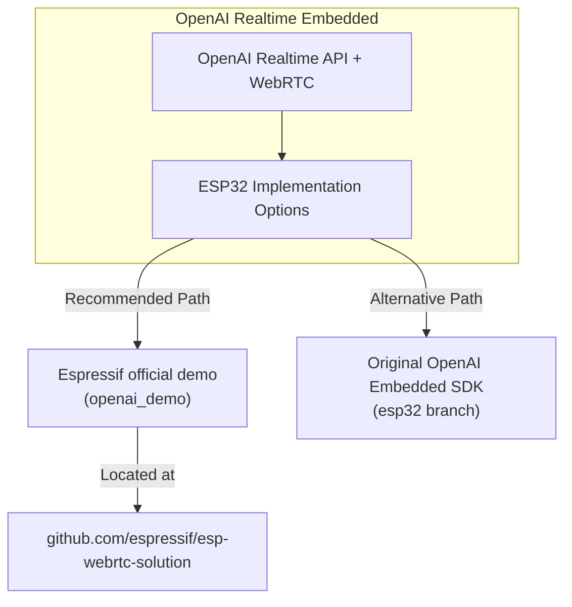
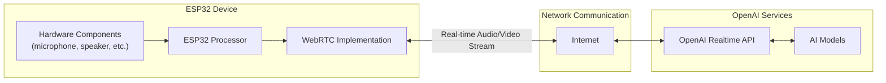
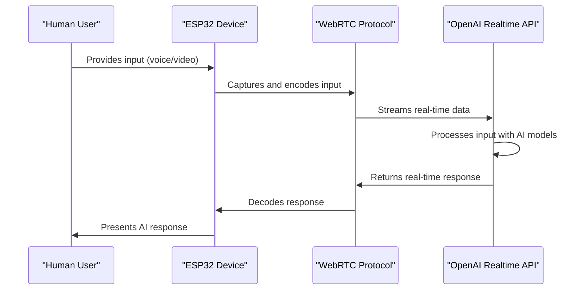
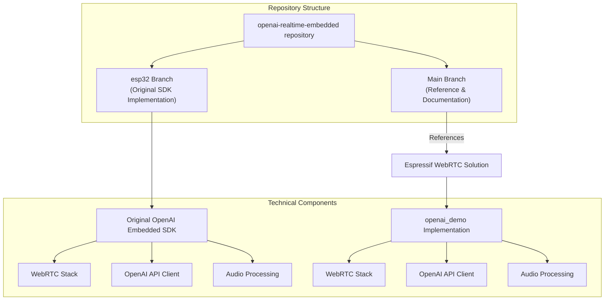

<!-- source: DeepWiki mcp.deepwiki.com · repo openai/openai-realtime-embedded · page 1 Overview · fetched 2026-10-26 -->

# Overview

<details>
<summary>Relevant source files</summary>

The following files were used as context for generating this wiki page:

- [README.md](README.md)

</details>


## Purpose and Scope

The OpenAI Realtime Embedded repository enables real-time communication between resource-constrained embedded devices (specifically ESP32) and OpenAI's Realtime API services using WebRTC protocol. This allows for bidirectional streaming of audio and video between ESP32 devices and OpenAI's AI models with minimal latency.

This overview document provides a high-level introduction to the repository's purpose, architecture, and implementation options. For detailed information about the system architecture, see [System Architecture](#2); for implementation paths, see [Implementation Options](#3).

Sources: [README.md:1-3]()

## Repository Context

The OpenAI Realtime Embedded repository primarily serves as a reference point to implementations rather than containing substantial code itself. It directs developers to two main implementation options for integrating OpenAI's Realtime API with ESP32 devices:

1. Espressif's official `openai_demo` (recommended path)
2. Original OpenAI Embedded SDK on the `esp32` branch (alternative path)



Sources: [README.md:5-9]()

## System Architecture Overview

The system integrates ESP32 hardware with WebRTC communication protocol to establish real-time bidirectional streams with OpenAI's Realtime API. This enables ESP32 devices to capture audio/video input, transmit it to OpenAI's services for AI processing, and receive responses in real-time.



Sources: [README.md:3-4]()

## Data Flow

The following diagram illustrates the end-to-end data flow from user input through the ESP32 device to OpenAI's API and back:



For more detailed information about the data flow, see [Data Flow](#2.1).

## Implementation Options

The repository offers two implementation paths for developers:

### Espressif Official Demo (Recommended)

Espressif maintains an official `openai_demo` implementation within their WebRTC solution repository. This is the recommended approach for most developers.

```
Location: github.com/espressif/esp-webrtc-solution/tree/main/solutions/openai_demo
```

For more details about this implementation, see [Espressif Official Demo](#3.1).

### Original OpenAI Embedded SDK

The original implementation of the OpenAI Embedded SDK remains available on the `esp32` branch of this repository. This serves as an alternative implementation path.

For more details about this implementation, see [Original OpenAI Embedded SDK](#3.2).

Sources: [README.md:5-9]()

## Technical Component Mapping

The following diagram illustrates how the conceptual components map to the actual code organization:



For detailed information about each technical component, see [Technical Components](#4).

## Getting Started

To start working with the OpenAI Realtime Embedded repository, developers should first decide which implementation path they wish to follow. The recommended approach is to use Espressif's official demo.

For step-by-step instructions on setting up and deploying the system, see [Getting Started](#5).

Sources: [README.md:1-9]()

---

