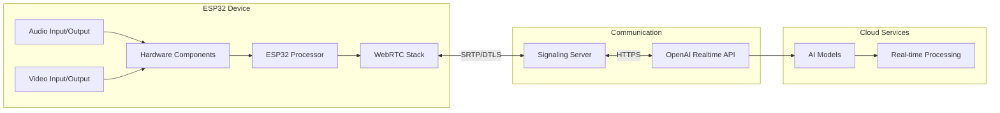
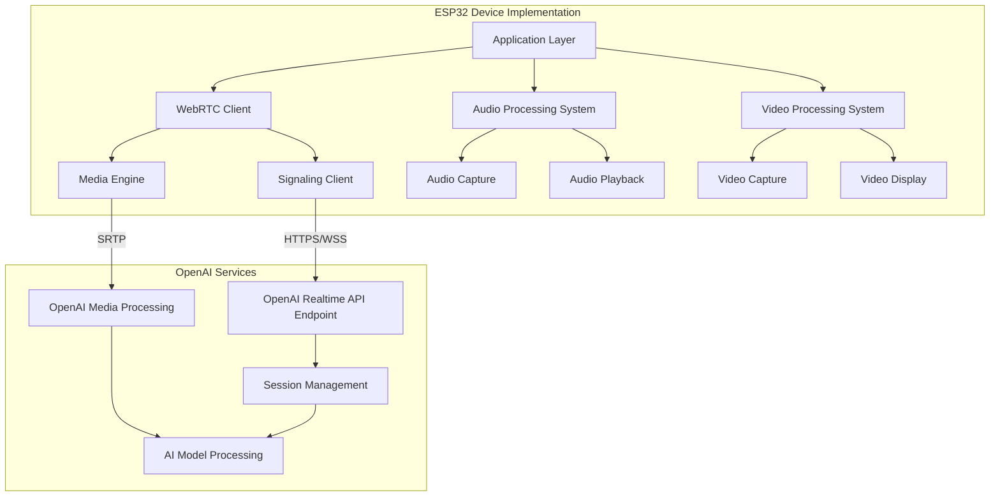
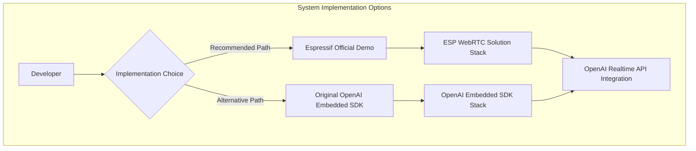

<!-- source: DeepWiki mcp.deepwiki.com · repo openai/openai-realtime-embedded · page 2 System Architecture · fetched 2026-10-26 -->

# System Architecture

Relevant source files

The following files were used as context for generating this wiki page:

- [README.md](README.md)

This document outlines the high-level system architecture of the OpenAI Realtime API integration with ESP32 devices using WebRTC as the communication protocol. It provides an overview of the major components and their relationships. For detailed information about the data flow through the system, see [Data Flow](#2.1). For implementation options, see [Implementation Options](#3).

## Architecture Overview

The OpenAI Realtime Embedded system connects resource-constrained ESP32 devices directly to OpenAI's powerful AI models through real-time audio/video streaming. This architecture leverages WebRTC to establish secure, low-latency communication channels between embedded devices and OpenAI's cloud-based services.

Sources: README.md

## Key Components

The system architecture consists of three main layers, each with specific components:

### 1. Device Layer

The ESP32 device serves as the embedded platform that captures and processes audio/video data:

- **Hardware Components**: Microphones, speakers, cameras, and other input/output peripherals
- **ESP32 Processor**: Handles local processing, encoding/decoding, and system coordination
- **WebRTC Stack**: Implements the WebRTC protocol for real-time media transmission

### 2. Communication Layer

WebRTC provides the real-time communication framework:

- **Signaling**: Establishes and manages the connection between the ESP32 device and OpenAI's services
- **Secure Transport**: Encrypts data using DTLS (Datagram Transport Layer Security)
- **Media Transport**: Transmits audio/video streams using RTP (Real-time Transport Protocol)

### 3. Service Layer

OpenAI's cloud infrastructure processes the incoming data:

- **Realtime API**: Receives and processes media streams from connected devices
- **AI Models**: Analyzes and interprets the audio/video content
- **Response Generation**: Creates and returns appropriate responses in real-time

Sources: README.md

## Component Relationships

The following diagram illustrates the relationship between code entities and system components:

Sources: README.md

## Integration Architecture

The system integration is designed to be flexible, supporting two main implementation paths as outlined in the repository:

| Implementation Option | Source | Characteristics |
|-----------------------|--------|-----------------|
| Espressif Official Demo | [esp-webrtc-solution/openai_demo](https://github.com/espressif/esp-webrtc-solution/tree/main/solutions/openai_demo) | Current, actively maintained implementation by Espressif |
| Original OpenAI Embedded SDK | esp32 branch | Original implementation, available as an alternative |

Sources: README.md

## Architectural Constraints and Considerations

The ESP32-based architecture operates within several key constraints:

1. **Resource Limitations**: ESP32 devices have limited processing power, memory, and energy capacity
2. **Network Requirements**: The system requires stable internet connectivity for real-time communication
3. **Latency Sensitivity**: Real-time AI applications require minimal delay in the communication pipeline
4. **Security Considerations**: End-to-end encryption is necessary for secure data transmission

The architecture is designed to balance these constraints while providing a responsive user experience with OpenAI's powerful AI capabilities.

Sources: README.md

---

