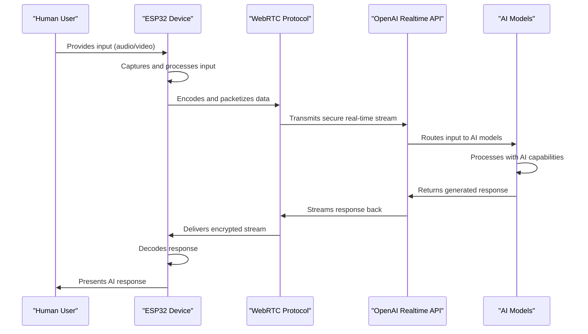
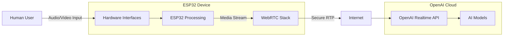
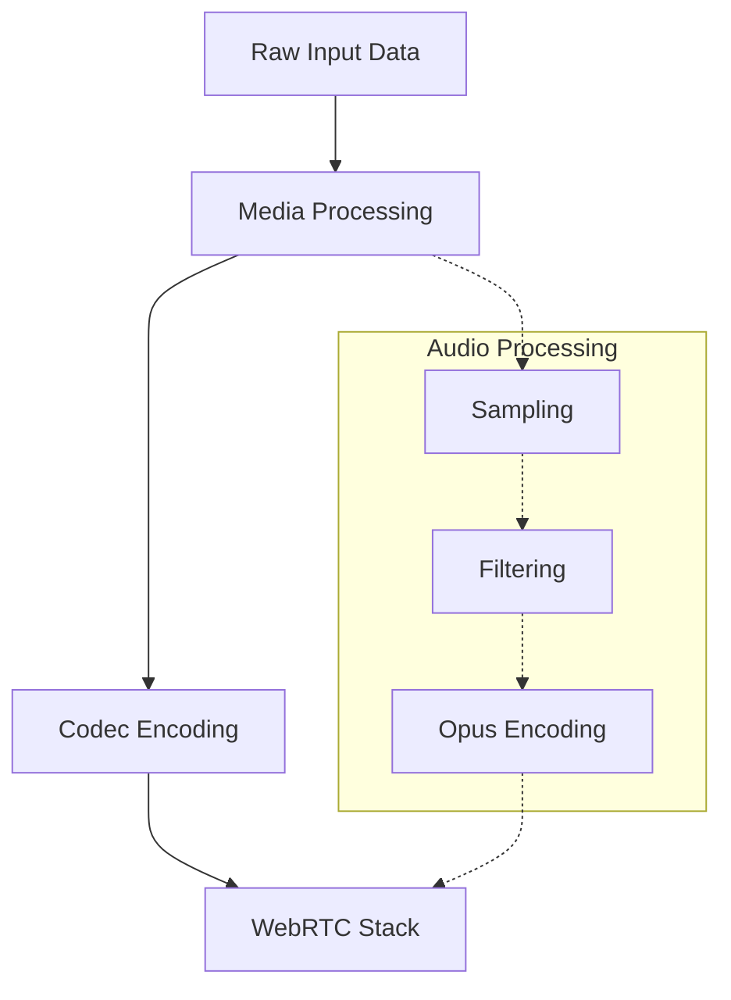
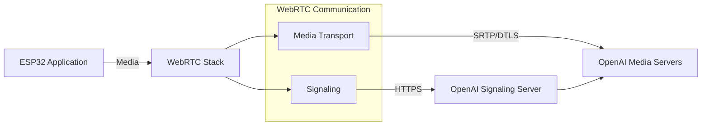
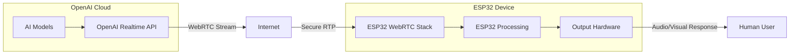
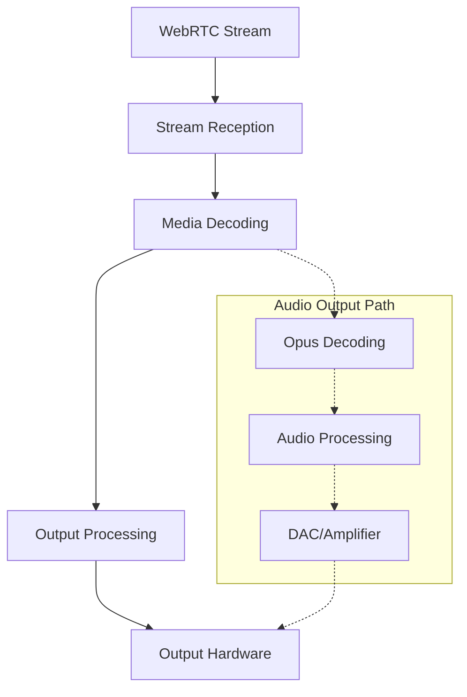
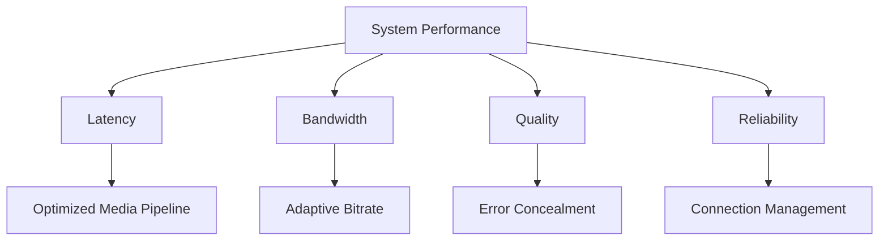

<!-- source: DeepWiki mcp.deepwiki.com · repo openai/openai-realtime-embedded · page 2.1 Data Flow · fetched 2026-10-26 -->

# Data Flow

Relevant source files

The following files were used as context for generating this wiki page:

- [README.md](README.md)

This document explains the end-to-end data flow in the OpenAI Realtime Embedded system, from user input through the ESP32 device to OpenAI's Realtime API and back. For information about the overall system architecture, see [System Architecture](#2), and for implementation options, see [Implementation Options](#3).

## Overview

The OpenAI Realtime Embedded system enables bidirectional, real-time communication between an ESP32 device and OpenAI's cloud-based AI models using WebRTC as the transport protocol.

Sources: README.md

## Input Data Path

The journey of data from the user to OpenAI's AI models follows this path:

Sources: README.md

### 1. Input Capture and Initial Processing

The data flow begins with the user providing input:

- **Audio Input**: Captured through a microphone connected to the ESP32's analog inputs or via I2S for digital microphones
- **Video Input** (if configured): Captured through a camera module connected to the ESP32

The raw input then undergoes initial processing:
- Analog-to-digital conversion (for analog inputs)
- Sampling at appropriate rates
- Basic filtering and enhancement
- Formatting for subsequent processing

### 2. Media Processing and Encoding

Before transmission, the ESP32 must encode the media:

Sources: Based on WebRTC audio processing common practices

For audio (the most common input type):
- Signal processing to improve quality
- Encoding using the Opus codec (WebRTC's standard audio codec)
- Framing into appropriate packet sizes

### 3. WebRTC Connection and Transmission

The WebRTC stack on the ESP32 handles the connection with OpenAI:

Sources: Based on standard WebRTC architecture

The WebRTC communication involves:

1. **Signaling Process**:
   - Establishing a secure HTTPS connection to OpenAI's signaling server
   - Exchanging session information (SDP - Session Description Protocol)
   - Negotiating compatible media formats and parameters
   - Exchanging ICE candidates for network connectivity

2. **Media Transmission**:
   - Secure media channel established using DTLS (Datagram Transport Layer Security)
   - Media packed into RTP (Real-time Transport Protocol) packets
   - Encrypted using SRTP (Secure Real-time Transport Protocol)
   - Transmitted over UDP for lower latency
   - RTCP (RTP Control Protocol) used for quality feedback

### 4. OpenAI Reception and AI Processing

Once the data reaches OpenAI's infrastructure:
- The WebRTC stream is received and authenticated
- The media is extracted and decoded
- The input is routed to the appropriate AI models
- The AI models process the input based on their capabilities

## Output Data Path

After processing by the AI models, the response takes a similar but reverse path back to the user:

Sources: README.md

### 1. AI Response Generation

Within OpenAI's infrastructure:
- The AI models generate appropriate responses based on the input
- The response is prepared for real-time streaming
- The response is formatted for WebRTC transmission

### 2. WebRTC Streaming to ESP32

The response travels back through the established WebRTC connection:
- The response is encoded into appropriate media formats
- The media is packetized for network transmission
- The stream is encrypted and transmitted to the ESP32
- Quality of Service mechanisms ensure timely delivery

### 3. ESP32 Reception and Output Processing

Finally, the ESP32 processes the incoming response:

Sources: Based on standard audio output processing

The processing includes:
- Receiving and decrypting the WebRTC stream
- Decoding the media from its compressed format
- Processing for output (e.g., digital-to-analog conversion for audio)
- Rendering to the appropriate output devices (speakers, displays)

## Key Data Transformations

Throughout the data flow, the information undergoes several format transformations:

| Stage | Input Format | Output Format | Transformation |
|-------|--------------|--------------|----------------|
| Input Capture | Analog signals | Digital samples | ADC conversion |
| ESP32 Encoding | Raw PCM audio | Opus-encoded audio | Compression encoding |
| WebRTC Packetization | Media frames | RTP packets | Network packetization |
| Network Transmission | RTP packets | SRTP stream | Encryption |
| OpenAI Processing | Media stream | AI-generated response | AI model processing |
| ESP32 Decoding | SRTP stream | Decoded media | Decryption and decoding |
| Output Rendering | Digital data | Analog signals | DAC conversion (for audio) |

Sources: Based on standard WebRTC media processing

## Performance and Reliability

The real-time nature of this system introduces several performance considerations:

Sources: Based on WebRTC performance practices

Key performance aspects include:
- Minimizing end-to-end latency for natural interaction
- Optimizing bandwidth usage for network efficiency
- Maintaining acceptable quality despite network variations
- Ensuring reliable operation under various conditions

The WebRTC protocol provides built-in mechanisms for handling many of these challenges, including:
- Dynamic adaptation to changing network conditions
- Packet loss recovery and concealment
- Jitter buffering to smooth out timing variations
- Fallback mechanisms for degraded connections

---

