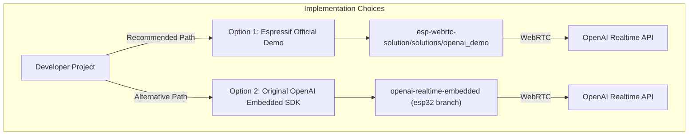
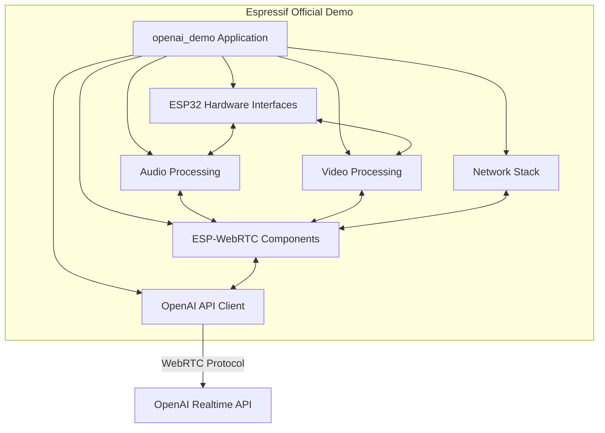
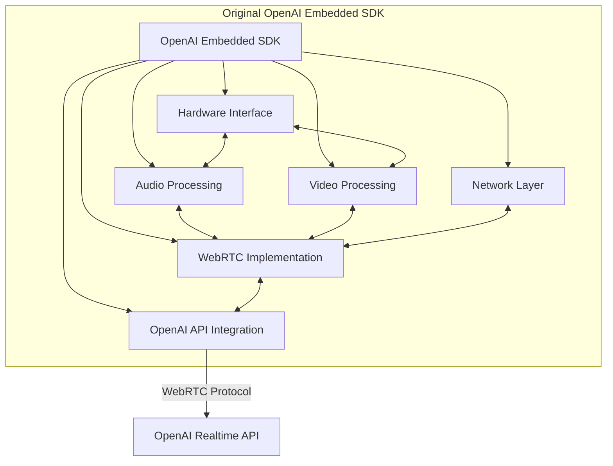
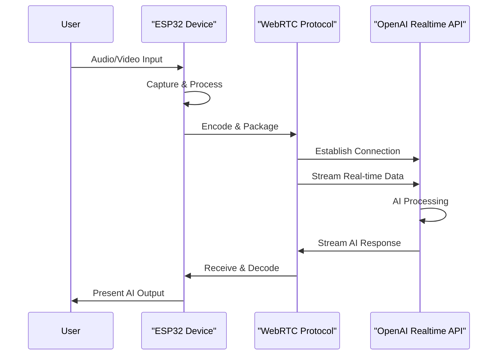

<!-- source: DeepWiki mcp.deepwiki.com · repo openai/openai-realtime-embedded · page 3 Implementation Options · fetched 2026-10-26 -->

# Implementation Options

Relevant source files

The following files were used as context for generating this wiki page:

- [README.md](README.md)

## Purpose

This document outlines the two available implementation paths for integrating OpenAI's Realtime API with ESP32 devices using WebRTC. Developers can choose between the Espressif Official Demo (recommended path) and the Original OpenAI Embedded SDK (alternative path) based on their project requirements. For specific setup instructions, see [Getting Started](#5).

## Overview of Implementation Paths

The OpenAI Realtime Embedded repository provides two distinct implementation options for developers:

Sources: README.md

## Implementation Comparison

| Feature | Espressif Official Demo | Original OpenAI Embedded SDK |
|---------|-------------------------|------------------------------|
| **Status** | Recommended implementation | Alternative implementation |
| **Repository Location** | github.com/espressif/esp-webrtc-solution/tree/main/solutions/openai_demo | esp32 branch of openai-realtime-embedded |
| **Maintained by** | Espressif (ESP32 manufacturer) | Available in esp32 branch |
| **Integration** | Part of Espressif WebRTC ecosystem | Standalone implementation |
| **Support** | Official support from Espressif | Community support |
| **Updates** | Regular updates expected | May not receive regular updates |
| **Recommended for** | New projects | Projects already using this SDK |

Sources: README.md

## Option 1: Espressif Official Demo (Recommended)

The Espressif Official Demo is the recommended implementation path for most developers. It is maintained by Espressif, the manufacturer of ESP32 chips, ensuring compatibility with the latest ESP32 hardware and software.

### Architecture Components

Sources: README.md

### Key Advantages

- Official implementation from Espressif
- Integrated with ESP-IDF framework
- Regular updates and maintenance
- Optimized for ESP32 hardware
- Official documentation and support

For detailed information about this implementation, including setup and configuration, see [Espressif Official Demo](#3.1).

## Option 2: Original OpenAI Embedded SDK

The original implementation of the OpenAI Embedded SDK is available on the `esp32` branch of this repository. This represents the initial work to enable OpenAI Realtime API on ESP32 devices.

### Architecture Components

Sources: README.md

### Key Considerations

- Original implementation available on the `esp32` branch
- May not receive the same level of updates as the Espressif demo
- Suitable for projects that have already begun development with this SDK

For detailed information about this implementation, see [Original OpenAI Embedded SDK](#3.2).

## Data Flow (Both Implementations)

Both implementations follow a similar data flow pattern for real-time communication with OpenAI's services:

Sources: README.md

## Implementation Decision Guide

### When to Use Espressif Official Demo

- Starting a new project with ESP32 and OpenAI Realtime API
- Need for official support and documentation
- Looking for long-term maintenance and updates
- Working within the broader Espressif ecosystem

### When to Consider Original OpenAI Embedded SDK

- Already started development with this implementation
- Specific requirements better met by this implementation
- Custom adaptations built on the original SDK

## Conclusion

For most new projects, the **Espressif Official Demo** is recommended as it offers better long-term support and integration with the ESP32 ecosystem. The Original OpenAI Embedded SDK remains available for projects that have already adopted it or have specific requirements better met by this implementation.

For detailed setup instructions and next steps, refer to the [Getting Started](#5) guide. For information about the technical components used in both implementations, see [Technical Components](#4).

Sources: README.md

---

