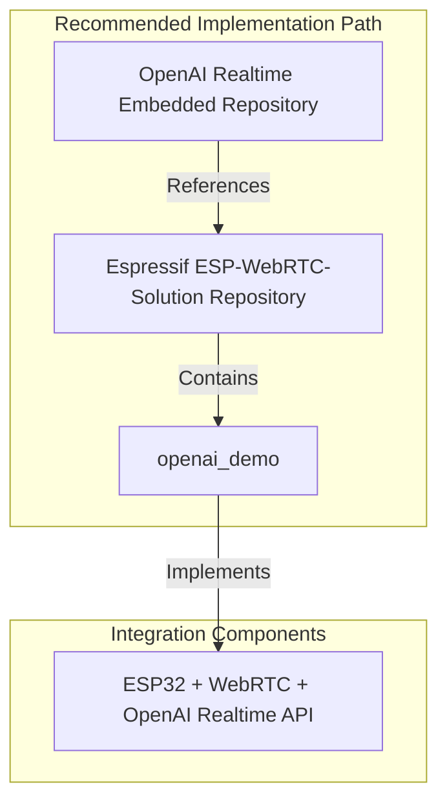
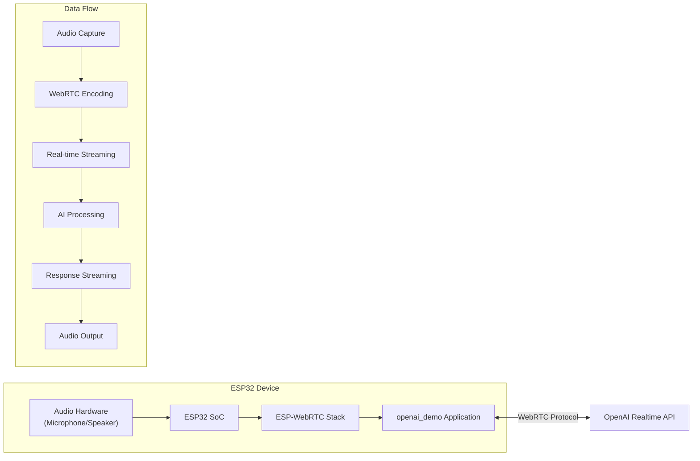
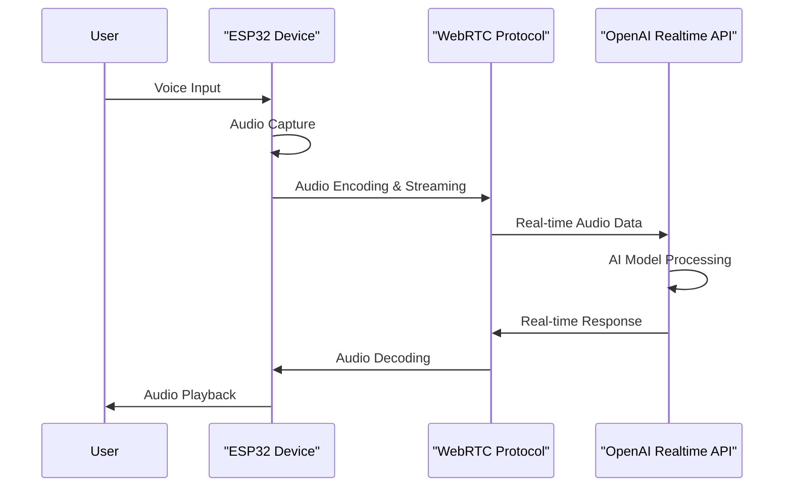

<!-- source: DeepWiki mcp.deepwiki.com · repo openai/openai-realtime-embedded · page 3.1 Espressif Official Demo · fetched 2026-10-26 -->

# Espressif Official Demo

Relevant source files

The following files were used as context for generating this wiki page:

- [README.md](README.md)

This document provides detailed information about the Espressif official `openai_demo`, which is the recommended implementation path for using OpenAI's Realtime API with WebRTC on ESP32 devices. For information about the alternative implementation using the original OpenAI Embedded SDK, see [Original OpenAI Embedded SDK](#3.2).

## Overview

The Espressif official demo (`openai_demo`) is maintained directly by Espressif Systems and serves as the primary recommended implementation for developers looking to integrate ESP32 devices with OpenAI's Realtime API using WebRTC. This demo is hosted in Espressif's ESP-WebRTC-Solution repository rather than within the OpenAI Realtime Embedded repository itself.

Sources: [README.md:5-9]()

## Repository Location

The `openai_demo` is not contained within the OpenAI Realtime Embedded repository. Instead, the OpenAI repository serves as a reference point that directs developers to the official implementation maintained by Espressif.

| Repository | URL Path |
|------------|----------|
| Main Reference | github.com/openai/openai-realtime-embedded |
| Implementation Location | github.com/espressif/esp-webrtc-solution/tree/main/solutions/openai_demo |

Sources: [README.md:7]()

## System Integration

The `openai_demo` integrates several key components to enable real-time communication between ESP32 devices and OpenAI's services:

Sources: [README.md:3-7]()

## Communication Sequence

The following diagram illustrates the typical communication sequence when using the Espressif official demo:

Sources: [README.md:3-7]()

## Benefits of the Official Demo

The Espressif official demo offers several advantages over alternative implementations:

1. **Official Support**: Directly maintained by Espressif, ensuring optimal compatibility with ESP32 hardware
2. **Integrated Development**: Works seamlessly with Espressif's development framework (ESP-IDF)
3. **Performance Optimization**: Specifically optimized for ESP32's capabilities and constraints
4. **Regular Updates**: Benefits from ongoing maintenance and improvements from Espressif

## Implementation Considerations

When implementing the Espressif official demo, developers should be aware of:

- **Hardware Requirements**: Specific ESP32 models and audio peripherals may be needed
- **Network Connectivity**: Stable internet connection is essential for WebRTC communication
- **API Authentication**: Requires proper OpenAI API keys and configuration
- **Resource Management**: ESP32 has limited processing power and memory compared to desktop systems

## Getting Started

To begin using the Espressif official demo:

1. Visit the official Espressif repository at github.com/espressif/esp-webrtc-solution
2. Navigate to the solutions/openai_demo directory
3. Follow the setup instructions provided in the repository's documentation
4. Configure your ESP32 device according to the guidelines
5. Implement the necessary OpenAI API authentication

For comprehensive getting started information, see [Getting Started](#5).

Sources: [README.md:7]()

## Related Documentation

For more detailed information about specific components of the system:

- [System Architecture](#2) - High-level architecture of the entire system
- [WebRTC on ESP32](#4.1) - Technical details about the WebRTC implementation
- [OpenAI Realtime API Integration](#4.2) - Information about integrating with OpenAI's services

---

