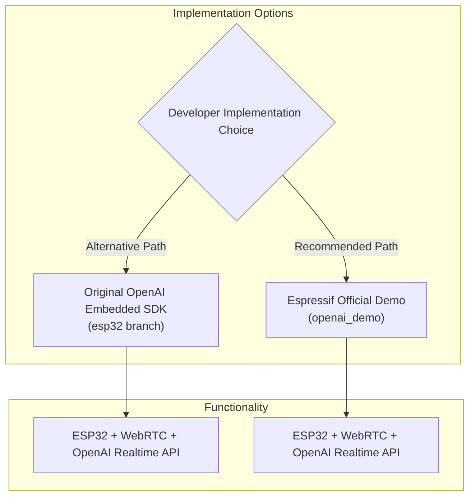
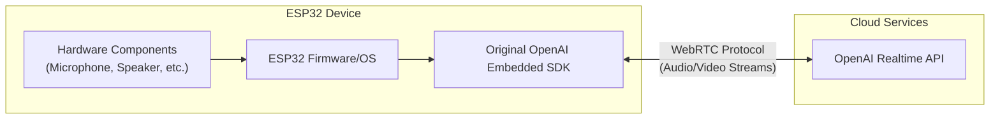
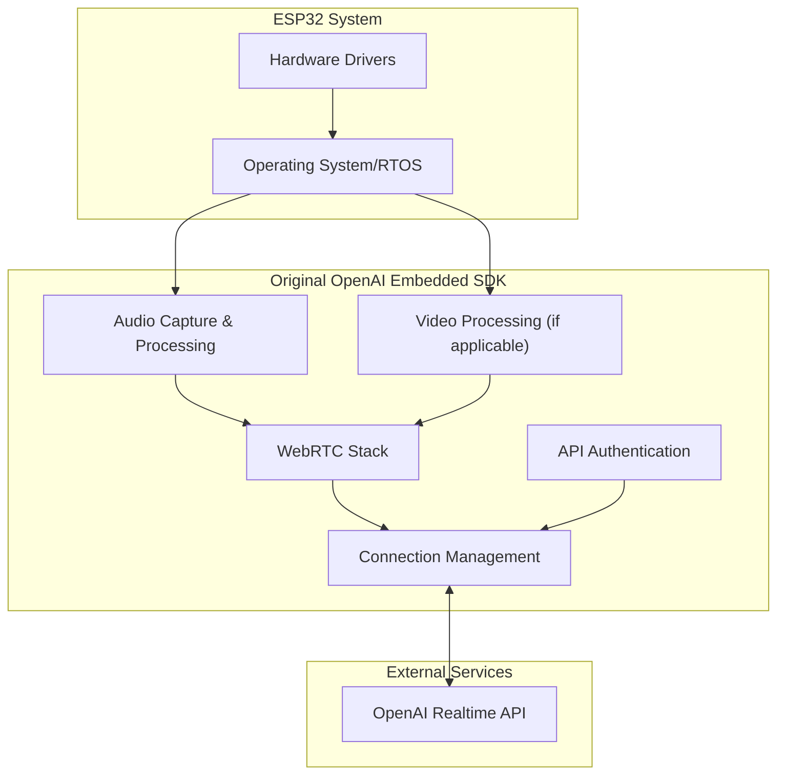

<!-- source: DeepWiki mcp.deepwiki.com · repo openai/openai-realtime-embedded · page 3.2 Original OpenAI Embedded SDK · fetched 2026-10-26 -->

# Original OpenAI Embedded SDK

<details>
<summary>Relevant source files</summary>

The following files were used as context for generating this wiki page:

- [README.md](README.md)

</details>


## Purpose and Scope

This document covers the Original OpenAI Embedded SDK, which is an alternative implementation for connecting ESP32 devices to the OpenAI Realtime API using WebRTC. This SDK is available on the `esp32` branch of the repository and represents the initial implementation approach. For information about the recommended implementation path using the Espressif official demo, see [Espressif Official Demo](#3.1).

Sources: [README.md:8-9]()

## Position in System Architecture

The Original OpenAI Embedded SDK exists as an alternative implementation path for developers who wish to integrate ESP32 devices with OpenAI's Realtime API services. It is maintained on a separate branch from the main implementation recommended by Espressif.



**Diagram: Implementation Options for OpenAI Realtime API on ESP32**

Sources: [README.md:7-9]()

## SDK Architecture

The Original OpenAI Embedded SDK serves as the intermediary layer between the ESP32 hardware and the OpenAI Realtime API. It handles WebRTC communication, audio/video processing, and manages the realtime data flow to and from the cloud service.



**Diagram: Original SDK Data Flow Architecture**

Sources: [README.md:3-9]()

## Functional Components

While specific implementation details are limited in the available documentation, the SDK necessarily implements several key components to enable WebRTC communication with OpenAI's Realtime API from an ESP32 device:



**Diagram: Conceptual Components of the Original SDK**

Sources: [README.md:3-9]()

## Technical Comparison

The following table highlights the key aspects of the Original OpenAI Embedded SDK compared to the Espressif official demo:

| Feature | Original OpenAI Embedded SDK | Espressif Official Demo |
|---------|------------------------------|-------------------------|
| Repository Location | `esp32` branch of OpenAI Realtime Embedded repo | [esp-webrtc-solution/solutions/openai_demo](https://github.com/espressif/esp-webrtc-solution/tree/main/solutions/openai_demo) |
| Maintenance Status | Original implementation | Actively maintained by Espressif |
| Official Recommendation | Alternative implementation | Recommended implementation |
| Core Functionality | ESP32 + WebRTC + OpenAI Realtime API | ESP32 + WebRTC + OpenAI Realtime API |

Sources: [README.md:5-9]()

## When to Use the Original SDK

Consider using the Original OpenAI Embedded SDK in the following scenarios:

- You have existing projects based on the original implementation and wish to maintain compatibility
- You need specific functionality that may be present in the original SDK but not in the Espressif demo
- You are researching the evolution of WebRTC implementations on the ESP32 platform
- You have specific requirements that align better with the original implementation

For most new development projects, the Espressif official demo is recommended as it represents the actively maintained implementation path.

Sources: [README.md:7-9]()

## Accessing the SDK

To access the Original OpenAI Embedded SDK:

1. Clone the OpenAI Realtime Embedded repository
2. Switch to the `esp32` branch
3. Follow the implementation documentation within that branch

```bash
git clone https://github.com/openai/openai-realtime-embedded
git checkout esp32
```

Sources: [README.md:9]()

---

