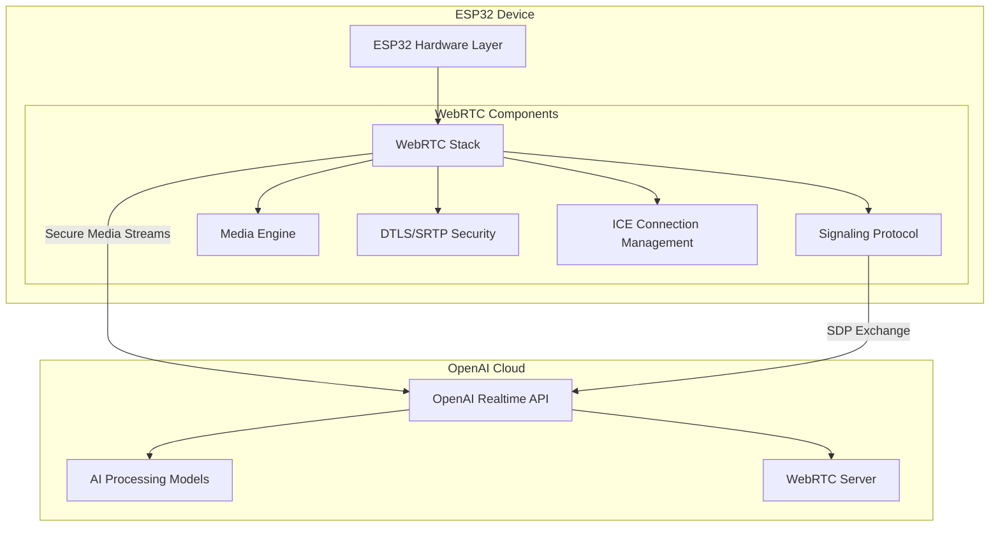
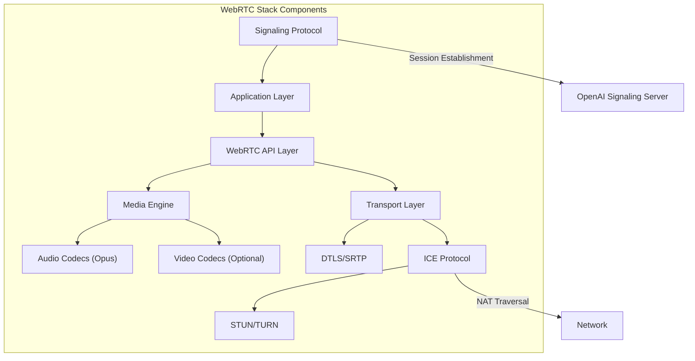
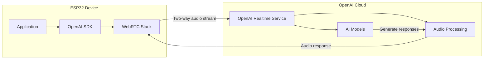
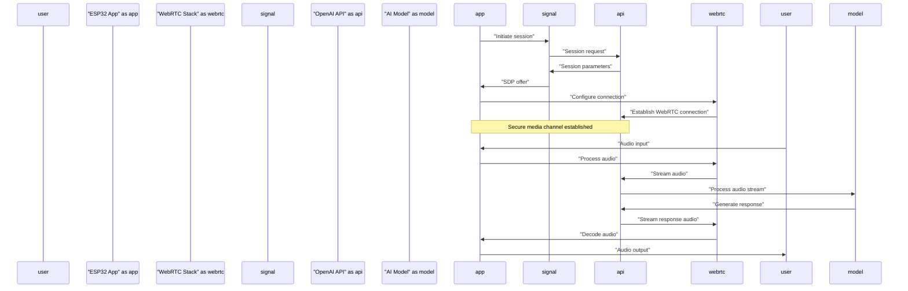

<!-- source: DeepWiki mcp.deepwiki.com · repo openai/openai-realtime-embedded · page 4 Technical Components · fetched 2026-10-26 -->

# Technical Components

Relevant source files

The following files were used as context for generating this wiki page:

- [README.md](README.md)

This page provides a detailed technical explanation of the key components that make up the OpenAI Realtime API + WebRTC on ESP32 system. It covers the technical architecture, responsibilities, and interactions of each component. For implementation options and setup details, see [Implementation Options](#3), and for data flow information, see [Data Flow](#2.1).

## Core Components Architecture

The OpenAI Realtime Embedded system consists of three primary technical components that work together to enable real-time AI communication on resource-constrained devices.

Sources: README.md

## ESP32 Hardware Layer

The ESP32 serves as the hardware foundation for the system, providing the computing power, memory, and connectivity needed for real-time communication.

Key technical specifications relevant to this implementation:

| Component | Specification | Relevance to WebRTC |
|-----------|---------------|---------------------|
| CPU | Dual-core 32-bit processor | Handles media processing and network tasks |
| Memory | Limited RAM (520KB SRAM) | Constrains buffer sizes for media processing |
| Connectivity | Wi-Fi and Bluetooth | Provides network transport for WebRTC |
| Audio interfaces | I2S, ADC | Enables audio capture and playback |
| Video interfaces | Camera interface support | Optional video capabilities |

The ESP32's architecture requires optimization techniques to handle real-time media processing within its resource constraints.

Sources: README.md

## WebRTC Stack

The WebRTC (Web Real-Time Communication) stack is a critical component that enables peer-to-peer audio/video communication without requiring plugins or native apps.

### WebRTC Architecture on ESP32

Sources: README.md

### Key WebRTC Components

1. **Signaling Protocol**: Manages session establishment and parameter negotiation
   - Exchanges Session Description Protocol (SDP) information
   - Coordinates ICE candidates for connection establishment

2. **Media Engine**: Handles audio/video processing
   - Audio codecs (particularly Opus for voice)
   - Optional video capabilities
   - Adaptive bitrate management

3. **Transport Layer**: Ensures secure, reliable delivery
   - DTLS (Datagram Transport Layer Security) for encryption
   - SRTP (Secure Real-time Transport Protocol) for media transport
   - ICE (Interactive Connectivity Establishment) for NAT traversal

4. **Connection Management**: Establishes and maintains peer connections
   - STUN/TURN for NAT traversal when necessary
   - Connection monitoring and adaptation

The WebRTC implementation on ESP32 is specifically optimized for embedded constraints, focusing on minimizing memory usage and processing overhead while maintaining acceptable latency.

Sources: README.md

## OpenAI Realtime API Integration

The OpenAI Realtime API allows for direct integration with OpenAI's language models through WebRTC, enabling real-time streaming audio processing.

### API Integration Architecture

Sources: README.md

### Technical Integration Points

The OpenAI Realtime API integration involves several technical considerations:

1. **Authentication and Session Management**
   - API key management
   - Session initialization and termination

2. **Media Format Requirements**
   - Audio sampling rate and format compatibility
   - Codec selection and configuration

3. **Latency Optimization**
   - Buffer management to minimize delay
   - Network quality adaptation

4. **Error Handling and Recovery**
   - Connection dropout recovery
   - Error state management and reporting

Sources: README.md

## Component Interaction Sequence

The following sequence diagram illustrates how these technical components interact during a typical session:

Sources: README.md

## Technical Implementation Differences

The system offers two different technical implementations, each with distinct architecture and component organization:

| Component | Espressif Official Demo | Original OpenAI Embedded SDK |
|-----------|-------------------------|------------------------------|
| Repository | esp-webrtc-solution/solutions/openai_demo | openai-realtime-embedded (esp32 branch) |
| WebRTC Stack | ESP-WebRTC (Espressif's optimized implementation) | Custom WebRTC port for ESP32 |
| Audio Processing | ESP-DSP and ESP-ADF integration | Custom audio processing |
| Integration Approach | Native integration with ESP-IDF | SDK abstraction layer |
| Memory Footprint | Optimized for ESP32 | Generic embedded approach |

Sources: README.md

## Memory and Performance Considerations

Real-time AI communication on embedded devices introduces specific technical challenges that the components must address:

1. **Memory Management**
   - Dynamic buffer allocation based on available memory
   - Careful stack usage to prevent overflows

2. **Processing Priorities**
   - Task scheduling to prioritize audio processing
   - Background processing for non-time-critical operations

3. **Power Optimization**
   - Power state management during connections
   - CPU frequency scaling based on processing needs

4. **Network Resilience**
   - Connection quality monitoring
   - Adaptive bitrate adjustment
   - Packet loss concealment techniques

These technical considerations ensure that the system can operate effectively within the constraints of the ESP32 platform while maintaining acceptable real-time performance.

Sources: README.md

## Technical Capabilities and Limitations

Understanding the technical boundaries of the system is important for developers:

| Capability | Details | Limitations |
|------------|---------|-------------|
| Audio Quality | 16kHz sampling, mono | Limited by ESP32 processing power |
| Latency | Typically 300-700ms round trip | Dependent on network quality |
| Session Duration | Extended sessions possible | Limited by power constraints |
| Connectivity | Requires stable internet | May struggle with poor Wi-Fi |
| Concurrent Processing | Limited multitasking during active sessions | Primary focus on audio processing |

Sources: README.md

The technical components work together to create a cohesive system that balances performance, power efficiency, and functionality within the constraints of embedded hardware, enabling AI-powered real-time communication on ESP32 devices.

---

