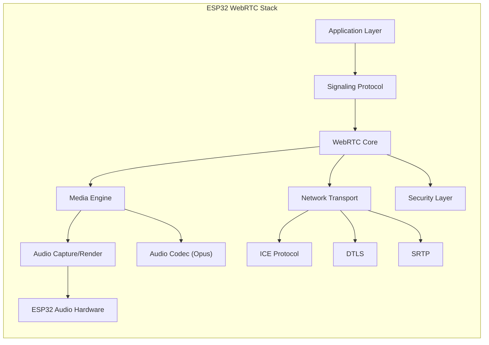
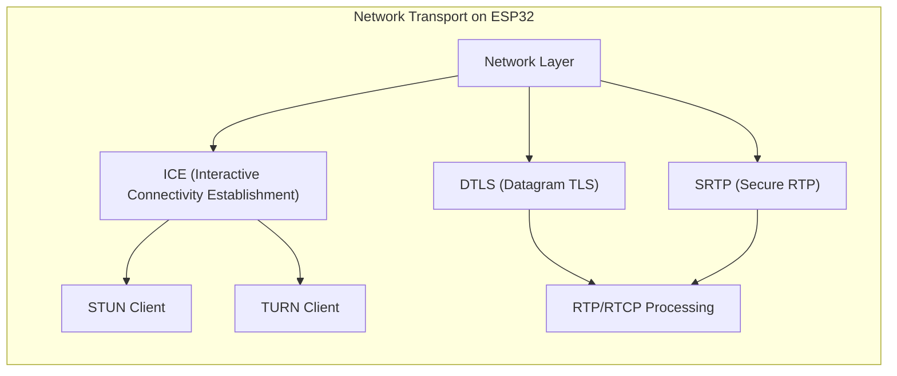
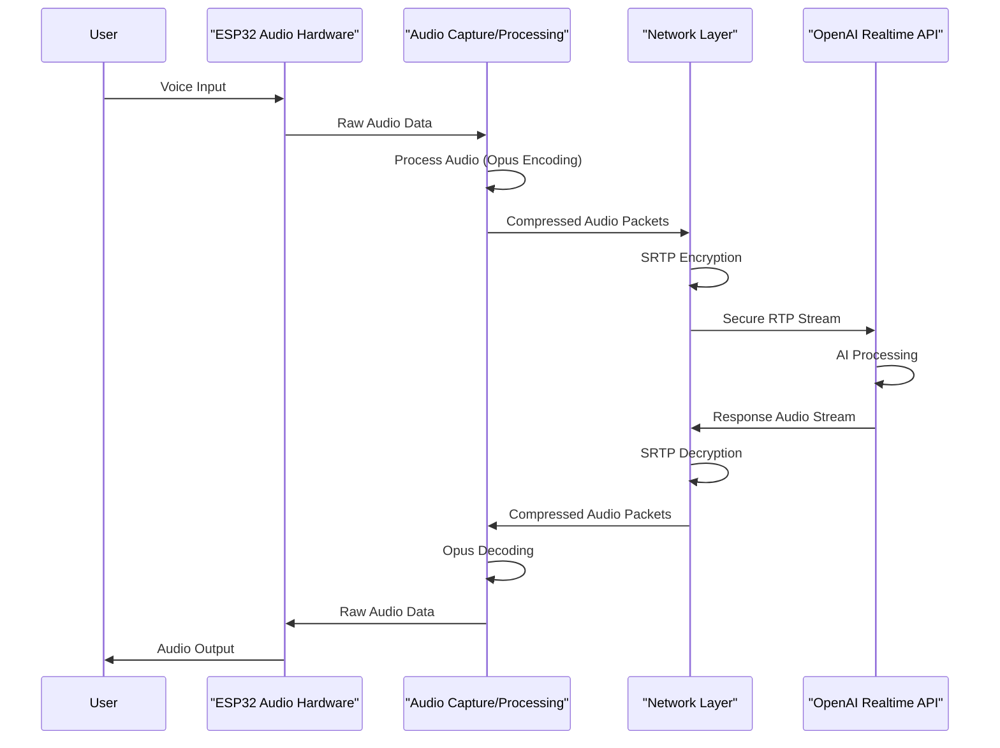
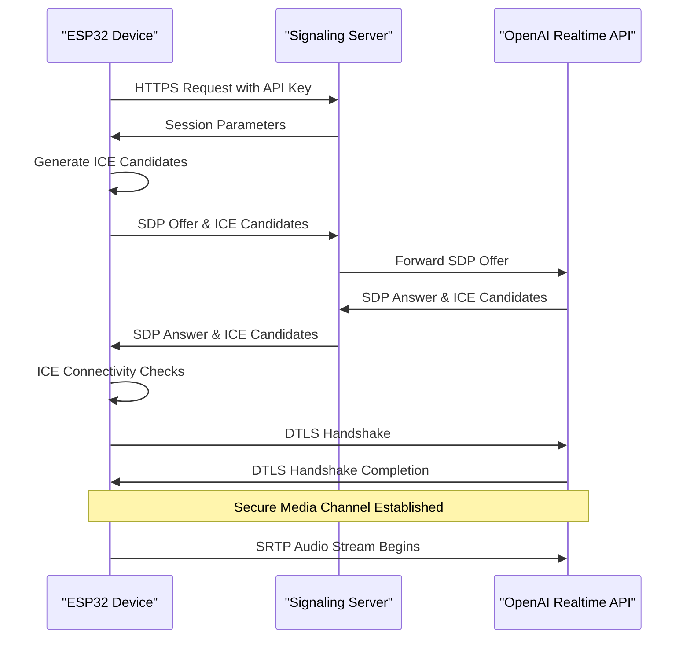

<!-- source: DeepWiki mcp.deepwiki.com · repo openai/openai-realtime-embedded · page 4.1 WebRTC on ESP32 · fetched 2026-10-26 -->

# WebRTC on ESP32

Relevant source files

The following files were used as context for generating this wiki page:

- [README.md](README.md)

## Purpose and Scope

This document provides technical details about the WebRTC implementation on ESP32 devices within the OpenAI Realtime Embedded framework. It explains the architecture, components, and data flow of WebRTC on ESP32, specifically focusing on how it enables real-time communication between ESP32 devices and OpenAI's Realtime API. For information about integrating with the OpenAI Realtime API itself, see [OpenAI Realtime API Integration](#4.2).

Sources: [README.md:3-7]()

## WebRTC Architecture on ESP32

WebRTC (Web Real-Time Communication) is an open-source project that provides web browsers and mobile applications with real-time communication capabilities via simple APIs. On the ESP32 platform, WebRTC has been adapted to work within the constraints of embedded systems while maintaining its core functionality.

### Overall WebRTC Stack on ESP32

The WebRTC implementation on ESP32 follows a layered architecture that handles media processing, network transport, and security while optimizing for resource constraints of the ESP32 platform.

Sources: [README.md:3-7]()

## Key Components

### 1. Signaling Protocol

The signaling protocol handles the initial connection establishment between the ESP32 device and OpenAI's Realtime API. While WebRTC doesn't specify a standard signaling protocol, the ESP32 implementation typically uses HTTPS for this purpose.

### 2. Media Engine

The media engine consists of:

| Component | Function | Implementation Details |
|-----------|----------|------------------------|
| Audio Capture | Captures audio from ESP32 microphone | Uses I2S interface for digital audio |
| Audio Rendering | Outputs audio responses | Implemented through I2S DACs |
| Audio Codec | Compresses/decompresses audio streams | Uses Opus codec optimized for ESP32 |

### 3. Network Transport Layer

WebRTC on ESP32 implements several critical network protocols:

These components enable secure, peer-to-peer connection establishment even across NATs and firewalls.

### 4. Security Implementation

Security in WebRTC on ESP32 includes:

- DTLS (Datagram Transport Layer Security) for encryption
- SRTP (Secure Real-time Transport Protocol) for media encryption
- Certificate validation and management

## WebRTC Data Flow on ESP32

The following diagram illustrates the data flow when using WebRTC on ESP32 with OpenAI's Realtime API:

This real-time bidirectional communication enables voice interactions with minimal latency, making it suitable for conversational AI applications.

## Resource Optimization for ESP32

WebRTC implementation on ESP32 requires careful resource management due to the platform's constraints:

| Resource | Constraint | Optimization |
|----------|------------|--------------|
| Memory | Limited RAM (~4-8MB) | Buffer optimization, minimal packet copying |
| CPU | Dual-core up to 240MHz | Task distribution between cores, optimized DSP routines |
| Power | Battery constraints | Efficient codec implementations, sleep modes when idle |
| Bandwidth | Network limitations | Adaptive bitrate, packet loss concealment |

## WebRTC Session Establishment

When connecting to OpenAI's Realtime API, the ESP32 device follows this connection procedure:

This connection procedure establishes a secure, direct communication channel between the ESP32 device and OpenAI's servers.

## Implementation Considerations

When working with WebRTC on ESP32 for OpenAI Realtime API integration, developers should consider:

1. **Memory Management**: WebRTC requires careful memory management on ESP32. Buffer sizes and memory allocation need optimization to prevent heap fragmentation.

2. **Audio Quality**: The quality of the microphone and audio hardware significantly impacts the performance of the AI interaction.

3. **Network Reliability**: ESP32's network stack must handle packet loss and jitter gracefully to maintain real-time communication quality.

4. **Power Consumption**: WebRTC streaming can be power-intensive. Implementations should include power-saving strategies for battery-powered applications.

## Available Implementations

As noted in the repository overview, there are two main implementation paths for WebRTC on ESP32:

1. **Espressif Official Demo**: The recommended implementation is maintained by Espressif in their [openai_demo](https://github.com/espressif/esp-webrtc-solution/tree/main/solutions/openai_demo).

2. **Original OpenAI Embedded SDK**: Available on the `esp32` branch of this repository, providing an alternative implementation.

Sources: [README.md:7-9]()

## Conclusion

WebRTC on ESP32 serves as the critical communication backbone that enables real-time audio streaming between ESP32 devices and OpenAI's Realtime API. Despite the resource constraints of embedded platforms, the optimized WebRTC implementation delivers the low-latency, secure communication necessary for interactive AI applications.

---

