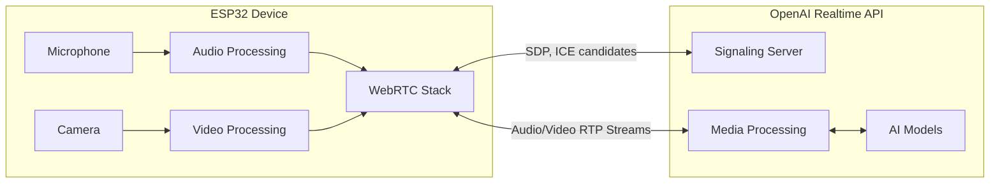
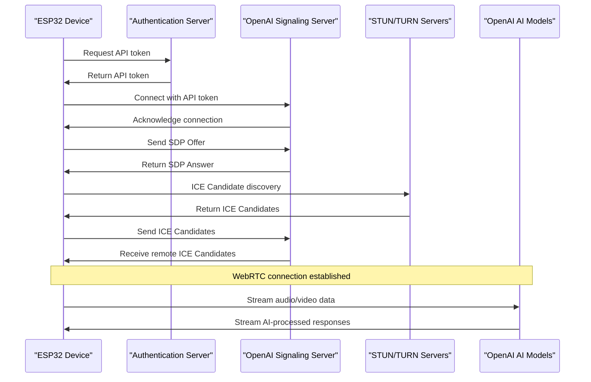
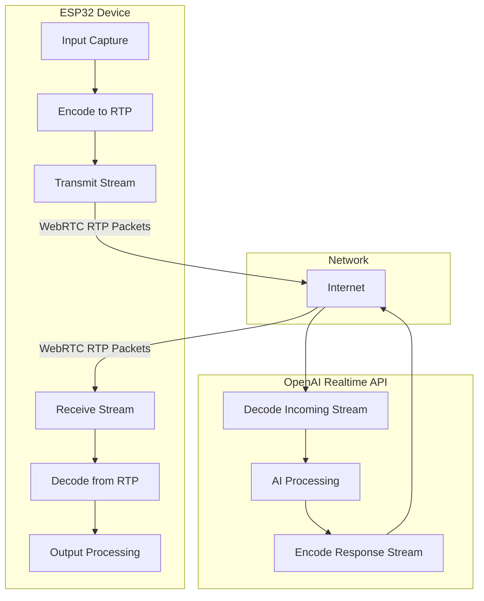
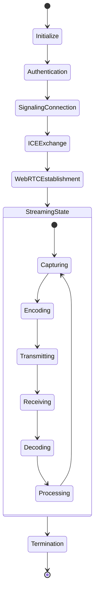

<!-- source: DeepWiki mcp.deepwiki.com · repo openai/openai-realtime-embedded · page 4.2 OpenAI Realtime API Integration · fetched 2026-10-26 -->

# OpenAI Realtime API Integration

Relevant source files

The following files were used as context for generating this wiki page:

- [README.md](README.md)

## Purpose and Scope

This document describes the technical aspects of integrating OpenAI's Realtime API with embedded devices, specifically focusing on the ESP32 platform. It covers the integration architecture, authentication flow, data streaming mechanisms, and key implementation considerations. For information about the WebRTC implementation on ESP32, see [WebRTC on ESP32](#4.1).

## OpenAI Realtime API Overview

The OpenAI Realtime API enables real-time, bidirectional communication between embedded devices and OpenAI's AI models. Unlike traditional REST APIs that follow a request-response pattern, the Realtime API uses WebRTC to establish persistent connections that support continuous audio and video streaming.

**Diagram: OpenAI Realtime API Communication Flow**

Sources: [README.md:3-3]()

## Integration Architecture

The integration between ESP32 devices and the OpenAI Realtime API follows a WebRTC-based architecture that enables real-time streaming of audio and video data.

**Diagram: OpenAI Realtime API Connection Establishment**

Sources: [README.md:3-3]()

## Authentication and Session Establishment

Before streaming data, the ESP32 device must authenticate with OpenAI's servers and establish a WebRTC connection:

1. **Authentication**: The device obtains an API token using OpenAI credentials
2. **Signaling**: The device connects to OpenAI's signaling server to exchange Session Description Protocol (SDP) information
3. **ICE Candidate Exchange**: Network address translation (NAT) traversal information is exchanged
4. **WebRTC Connection**: A peer-to-peer connection is established for media streaming

## Data Streaming Process

Once the WebRTC connection is established, the ESP32 device can stream audio and/or video data to OpenAI's Realtime API and receive processed responses.

**Diagram: Realtime Data Streaming Process**

Sources: [README.md:3-3]()

## Implementation Options

There are two main implementation paths for integrating with the OpenAI Realtime API on ESP32:

| Implementation Path | Location | Description |
|---------------------|----------|-------------|
| Espressif Official Demo | [esp-webrtc-solution/solutions/openai_demo](https://github.com/espressif/esp-webrtc-solution/tree/main/solutions/openai_demo) | Recommended implementation maintained by Espressif |
| Original OpenAI Embedded SDK | `esp32` branch of this repository | Alternative implementation with the original SDK |

Both implementations provide the necessary components to establish WebRTC connections to OpenAI's Realtime API from ESP32 devices.

Sources: [README.md:5-9]()

## Key Technical Considerations

When integrating with OpenAI's Realtime API from ESP32 devices, developers should consider:

1. **Bandwidth Requirements**: Real-time streaming requires sufficient network bandwidth
2. **CPU Usage**: Audio/video encoding/decoding is CPU-intensive on resource-constrained devices
3. **Memory Limitations**: ESP32 devices have limited RAM for buffering audio/video frames
4. **Power Consumption**: Continuous streaming significantly increases power usage
5. **Latency Management**: Minimizing end-to-end latency is critical for real-time applications

## Integration Workflow

The typical workflow for an application integrating with OpenAI's Realtime API involves:

**Diagram: OpenAI Realtime API Integration Workflow**

Sources: [README.md:3-3]()

## System Requirements

To successfully integrate with OpenAI's Realtime API, ESP32 devices should meet:

| Requirement | Minimum Specification |
|-------------|------------------------|
| ESP32 Model | ESP32-S3 or higher recommended |
| RAM | At least 512KB SRAM |
| Flash | 4MB+ Flash storage |
| Network | Reliable Wi-Fi connection |
| Audio | Microphone and speaker capability |
| Video (optional) | Camera module if video is required |

Sources: [README.md:3-9]()

## Conclusion

OpenAI Realtime API integration enables ESP32 devices to leverage real-time AI capabilities through WebRTC. This approach allows for continuous audio/video streaming and AI processing with minimal latency. Developers can choose between Espressif's official demo or the original OpenAI Embedded SDK implementation based on their specific requirements.

---

