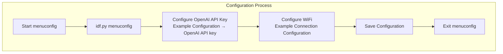
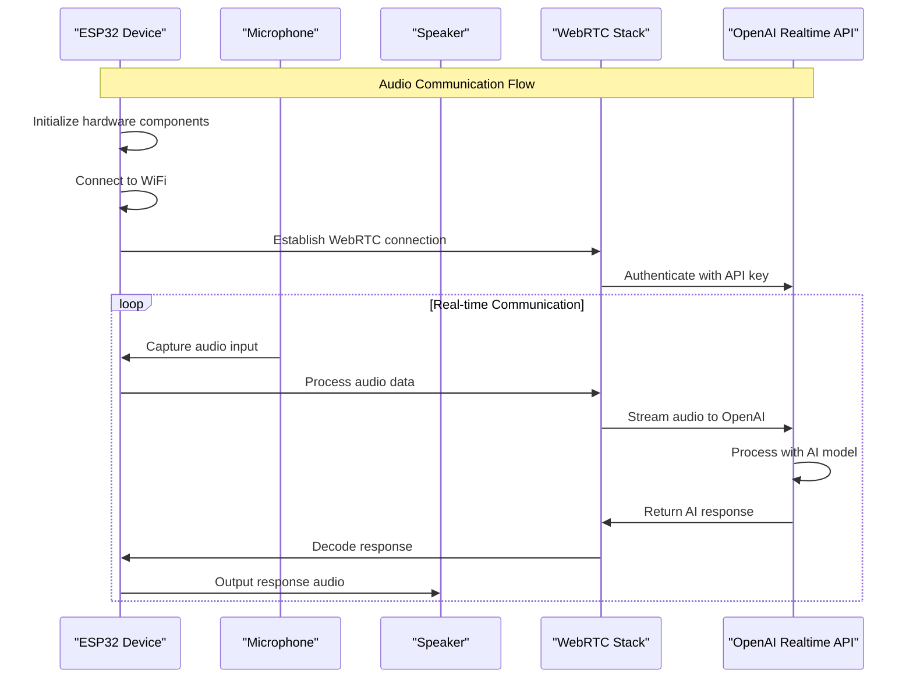
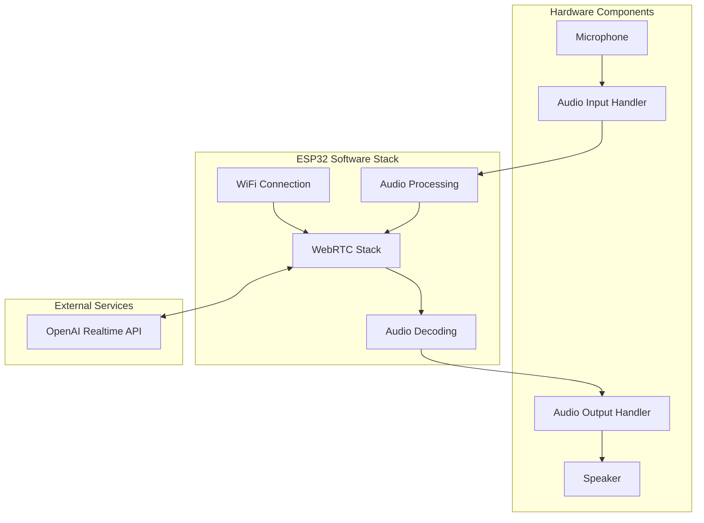

<!-- source: DeepWiki mcp.deepwiki.com · repo openai/openai-realtime-embedded · page 5 Getting Started · fetched 2026-10-26 -->

# Getting Started

<details>
<summary>Relevant source files</summary>

The following files were used as context for generating this wiki page:

- [README.md](README.md)

</details>


This guide provides step-by-step instructions for setting up and implementing the OpenAI Realtime API with WebRTC on ESP32 devices. It covers hardware requirements, software setup, and initial implementation for both available implementation paths.

For system architecture details, see [System Architecture](#2), and for more detailed information about technical components, refer to [Technical Components](#4).

## Prerequisites

Before beginning, ensure you have the following hardware and software components:

| Component | Requirement |
|-----------|-------------|
| Hardware  | ESP32 development board (ESP32-S3 recommended for better performance) |
|           | Microphone (for audio input) |
|           | Speaker (for audio output) |
| Software  | ESP-IDF development environment (v4.4 or later) |
|           | OpenAI API key with Realtime API access |
| Knowledge | Basic understanding of embedded systems |
|           | Familiarity with C/C++ programming |

Sources: [README.md:3-9]()

## Implementation Path Selection

There are two implementation options available. The following diagram illustrates these choices:

```mermaid
flowchart TD
    start["Start Implementation"] --> decision{"Choose Implementation Path"}
    decision -->|"Recommended"| espressif["Espressif Official Demo<br>(openai_demo)"]
    decision -->|"Alternative"| original["Original OpenAI Embedded SDK<br>(esp32 branch)"]
    
    espressif --> esp_setup["Setup using<br>esp-webrtc-solution repository"]
    original --> original_setup["Setup using<br>esp32 branch of this repository"]
    
    esp_setup --> demo_build["Build and flash<br>openai_demo application"]
    original_setup --> sdk_build["Build and flash<br>using Embedded SDK"]
    
    demo_build --> end["Test realtime communication<br>with OpenAI"]
    sdk_build --> end
```

Choose the implementation path that best suits your requirements:

1. **Espressif Official Demo (Recommended)**: Maintained by Espressif, this provides the most up-to-date and supported implementation.
2. **Original OpenAI Embedded SDK**: Available on the `esp32` branch, this alternative implementation may be useful for specific use cases.

Sources: [README.md:5-9]()

## Setting Up Espressif Official Demo (Recommended)

Follow these steps to set up the Espressif official demo:

### Step 1: Clone the ESP-WebRTC Solution Repository

```bash
git clone https://github.com/espressif/esp-webrtc-solution.git
cd esp-webrtc-solution
```

### Step 2: Set Up Environment Variables

Set up ESP-IDF environment variables:

```bash
. $IDF_PATH/export.sh
```

### Step 3: Navigate to OpenAI Demo

```bash
cd solutions/openai_demo
```

### Step 4: Configuration

Run the configuration utility and set up your OpenAI API key and WiFi credentials:

```bash
idf.py menuconfig
```

Navigate to:
- `Example Configuration` → Configure your OpenAI API key
- `Example Connection Configuration` → Configure WiFi credentials

The following diagram illustrates the configuration process:



Sources: [README.md:7]()

## Data Flow in Implementation

Understanding the data flow helps in implementing and debugging your application:



Sources: [README.md:3]()

## Building and Flashing

### Step 1: Build the Project

```bash
idf.py build
```

### Step 2: Flash the Project to ESP32

Connect your ESP32 board to your computer and run:

```bash
idf.py -p PORT flash
```

Replace `PORT` with your ESP32's serial port (e.g., `/dev/ttyUSB0` on Linux or `COM3` on Windows).

### Step 3: Monitor Output

```bash
idf.py -p PORT monitor
```

## System Components and Their Relationships

The following diagram illustrates the key components of the system and their relationships:



Sources: [README.md:3-7]()

## Setting Up Original OpenAI Embedded SDK (Alternative)

If you choose to use the original OpenAI Embedded SDK:

### Step 1: Clone the Repository and Switch to ESP32 Branch

```bash
git clone https://github.com/openai/openai-realtime-embedded.git
cd openai-realtime-embedded
git checkout esp32
```

### Step 2: Follow Setup Instructions on ESP32 Branch

The setup process will be similar to the Espressif demo but may require additional configuration specific to the SDK.

Sources: [README.md:9]()

## Troubleshooting Common Issues

| Issue | Possible Cause | Solution |
|-------|----------------|----------|
| Connection failure | WiFi credentials incorrect | Verify WiFi SSID and password in configuration |
| | OpenAI API key invalid | Check API key is correct and has Realtime API access |
| Audio not working | Microphone not connected properly | Check hardware connections |
| | Audio configurations incorrect | Verify audio input/output configuration |
| Build errors | Missing dependencies | Ensure ESP-IDF is properly installed |
| | Incompatible ESP-IDF version | Use compatible version as specified in documentation |

## Next Steps

After successfully setting up and running the initial implementation:

1. Explore the [System Architecture](#2) to understand how the components interact
2. Refer to [Technical Components](#4) for detailed information about WebRTC on ESP32 and OpenAI Realtime API integration
3. Customize the implementation for your specific use case

Remember that most implementation details are available in the respective repositories:
- For the Espressif official demo: https://github.com/espressif/esp-webrtc-solution
- For the original SDK: The `esp32` branch of this repository

Sources: [README.md:3-9]()

---

