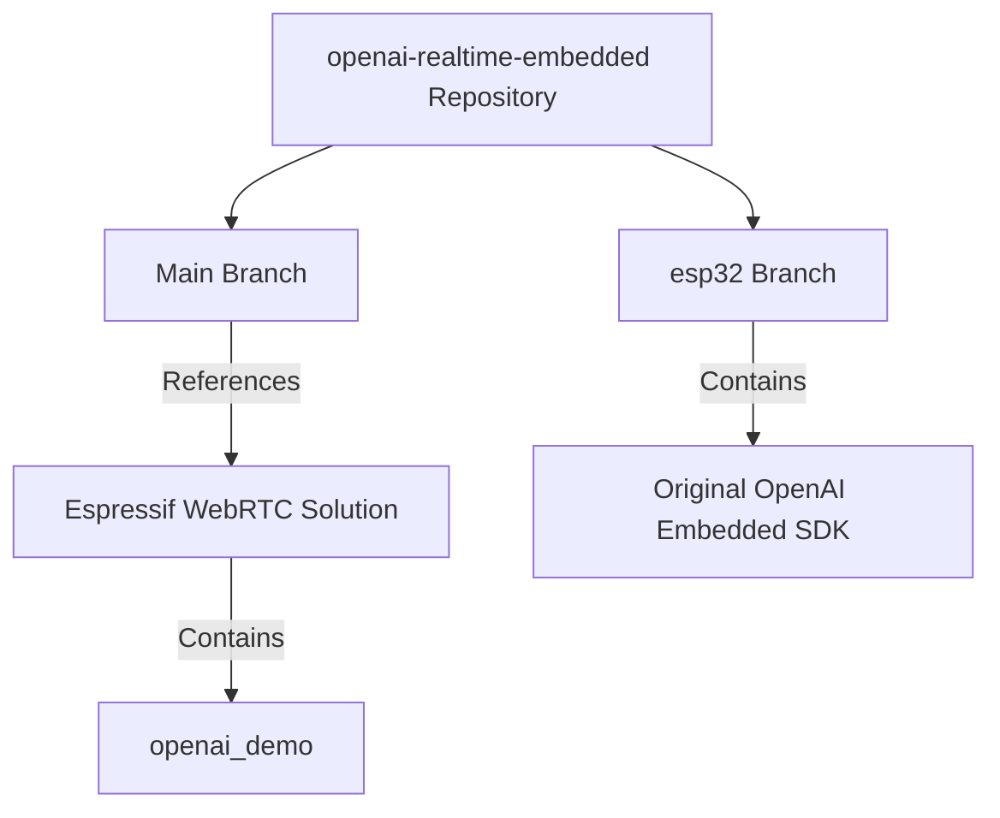
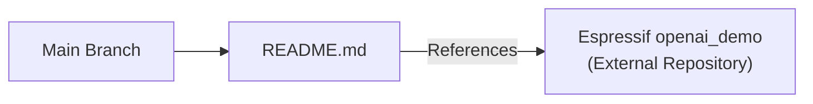
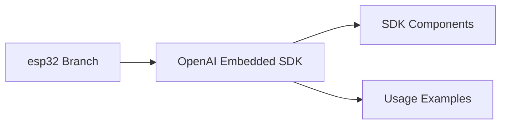
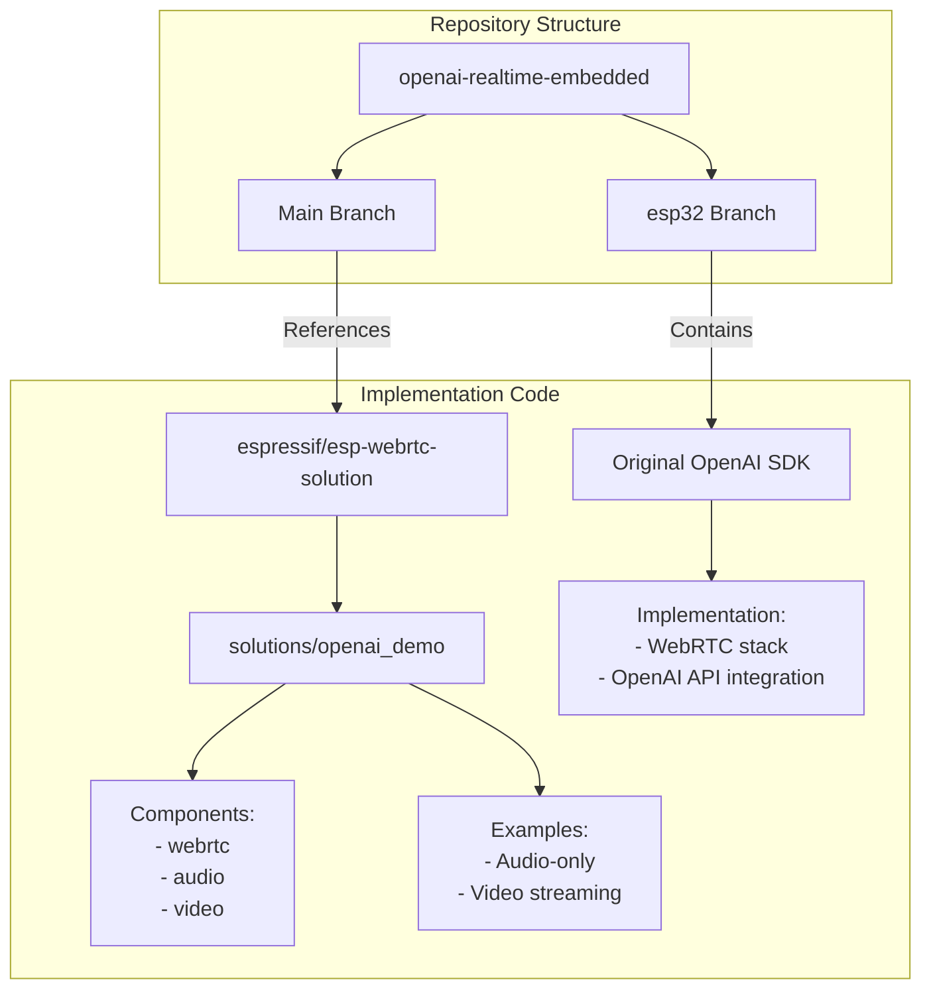
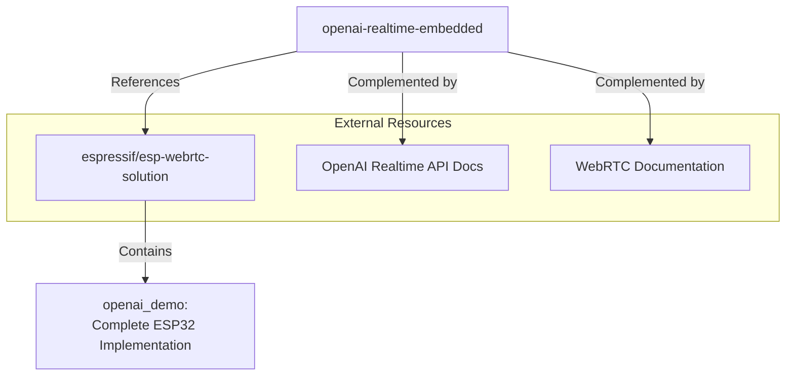

<!-- source: DeepWiki mcp.deepwiki.com · repo openai/openai-realtime-embedded · page 6 Repository Structure · fetched 2026-10-26 -->

# Repository Structure

Relevant source files

The following files were used as context for generating this wiki page:

- [README.md](README.md)

This document explains the organization of the OpenAI Realtime Embedded repository, detailing the structure of its branches and the resources they contain. For information about the overall system architecture, see [System Architecture](#2), and for implementation options, see [Implementation Options](#3).

## Repository Overview

The OpenAI Realtime Embedded repository serves primarily as a reference point rather than containing extensive implementation code itself. It provides resources for developers to connect ESP32 devices to OpenAI's Realtime API services using WebRTC.

**Sources:** [README.md:1-10]()

## Branch Structure

The repository is organized into two primary branches, each serving a different purpose but ultimately enabling the same functionality.

### Main Branch

The main branch primarily serves as a reference to the official Espressif implementation. Rather than implementing the functionality directly, it points developers to the Espressif-maintained solution.

Key characteristics:
- Contains minimal code
- References the Espressif implementation at [github.com/espressif/esp-webrtc-solution](https://github.com/espressif/esp-webrtc-solution/tree/main/solutions/openai_demo)
- Acts as the current recommended approach

**Sources:** [README.md:5-7]()

### esp32 Branch

The esp32 branch contains the original implementation of the OpenAI Embedded SDK specifically tailored for ESP32 devices.

Key characteristics:
- Contains the complete original implementation
- Represents the alternative implementation path
- Maintained for historical reference and alternative usage scenarios

**Sources:** [README.md:9-10]()

## Code Organization Mapping

The following diagram illustrates how the repository maps to actual code entities and implementations, showing the relationship between the repository references and the actual codebase locations.

**Sources:** [README.md:1-10]()

## Repository Contents

The repository is deliberately minimal, with the main branch primarily containing documentation that directs developers to external resources.

| Branch | Primary Contents | Purpose |
|--------|-----------------|---------|
| Main   | README.md       | Reference to Espressif's official implementation |
| esp32  | Original SDK code | Alternative implementation for ESP32 devices |

**Sources:** [README.md:1-10]()

## External Resources

The repository directs developers to these key external resources:

1. **Espressif Official Demo (Recommended)**
   - Located at: [github.com/espressif/esp-webrtc-solution/tree/main/solutions/openai_demo](https://github.com/espressif/esp-webrtc-solution/tree/main/solutions/openai_demo)
   - Contains the complete implementation for connecting ESP32 devices to OpenAI Realtime API via WebRTC

2. **OpenAI Realtime API Documentation**
   - Contains guidance on using OpenAI's Realtime API service
   - Provides WebRTC integration details

**Sources:** [README.md:3-7]()

## Repository Purpose Summary

This repository is deliberately lightweight and serves as a central reference point rather than a comprehensive code repository. It guides developers to the appropriate implementation resources based on their needs:

1. For most users: The Espressif official demo (recommended path)
2. For alternative use cases: The original SDK on the esp32 branch

The minimal structure of the repository reflects its purpose as a gateway to implementation resources rather than being the primary implementation itself.

**Sources:** [README.md:1-10]()