# Page: Overview

# Overview

<details>
<summary>Relevant source files</summary>

The following files were used as context for generating this wiki page:

- [README.md](README.md)

</details>


## Purpose and Scope

The OpenAI Realtime Embedded repository enables real-time communication between resource-constrained embedded devices (specifically ESP32) and OpenAI's Realtime API services using WebRTC protocol. This allows for bidirectional streaming of audio and video between ESP32 devices and OpenAI's AI models with minimal latency.

This overview document provides a high-level introduction to the repository's purpose, architecture, and implementation options. For detailed information about the system architecture, see [System Architecture](#2); for implementation paths, see [Implementation Options](#3).

Sources: [README.md:1-3]()

## Repository Context

The OpenAI Realtime Embedded repository primarily serves as a reference point to implementations rather than containing substantial code itself. It directs developers to two main implementation options for integrating OpenAI's Realtime API with ESP32 devices:

1. Espressif's official `openai_demo` (recommended path)
2. Original OpenAI Embedded SDK on the `esp32` branch (alternative path)

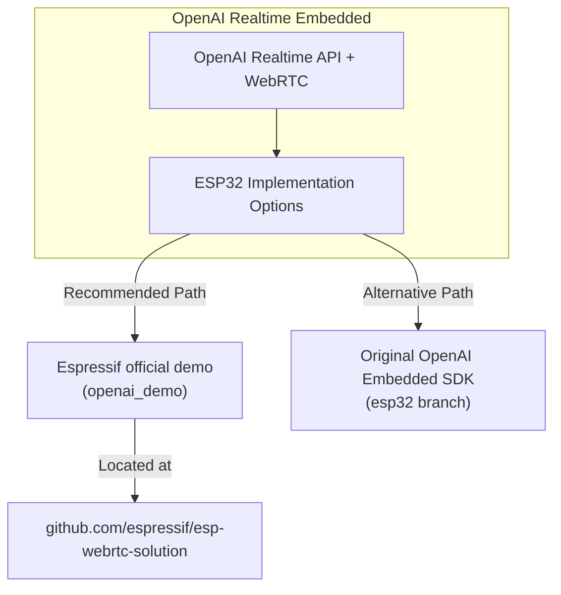

Sources: [README.md:5-9]()

## System Architecture Overview

The system integrates ESP32 hardware with WebRTC communication protocol to establish real-time bidirectional streams with OpenAI's Realtime API. This enables ESP32 devices to capture audio/video input, transmit it to OpenAI's services for AI processing, and receive responses in real-time.

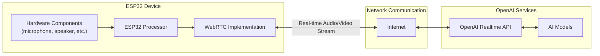

Sources: [README.md:3-4]()

## Data Flow

The following diagram illustrates the end-to-end data flow from user input through the ESP32 device to OpenAI's API and back:

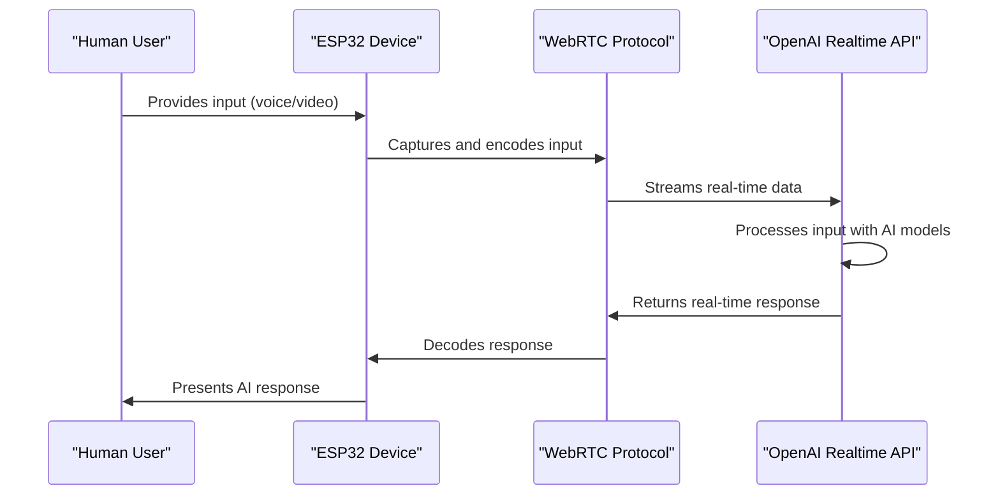

For more detailed information about the data flow, see [Data Flow](#2.1).

## Implementation Options

The repository offers two implementation paths for developers:

### Espressif Official Demo (Recommended)

Espressif maintains an official `openai_demo` implementation within their WebRTC solution repository. This is the recommended approach for most developers.

```
Location: github.com/espressif/esp-webrtc-solution/tree/main/solutions/openai_demo
```

For more details about this implementation, see [Espressif Official Demo](#3.1).

### Original OpenAI Embedded SDK

The original implementation of the OpenAI Embedded SDK remains available on the `esp32` branch of this repository. This serves as an alternative implementation path.

For more details about this implementation, see [Original OpenAI Embedded SDK](#3.2).

Sources: [README.md:5-9]()

## Technical Component Mapping

The following diagram illustrates how the conceptual components map to the actual code organization:

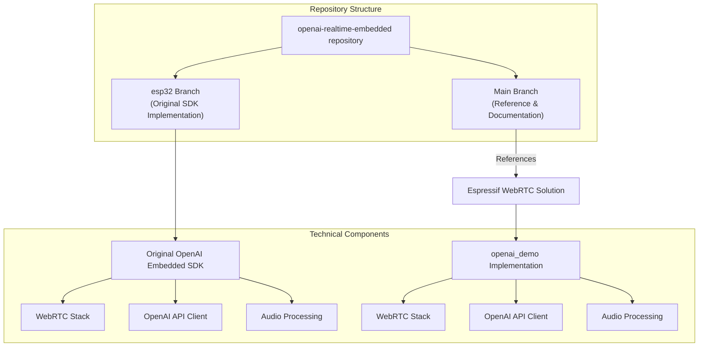

For detailed information about each technical component, see [Technical Components](#4).

## Getting Started

To start working with the OpenAI Realtime Embedded repository, developers should first decide which implementation path they wish to follow. The recommended approach is to use Espressif's official demo.

For step-by-step instructions on setting up and deploying the system, see [Getting Started](#5).

Sources: [README.md:1-9]()

---

# Page: System Architecture

# System Architecture

<details>
<summary>Relevant source files</summary>

The following files were used as context for generating this wiki page:

- [README.md](README.md)

</details>


This document outlines the high-level system architecture of the OpenAI Realtime API integration with ESP32 devices using WebRTC as the communication protocol. It provides an overview of the major components and their relationships. For detailed information about the data flow through the system, see [Data Flow](#2.1). For implementation options, see [Implementation Options](#3).

## Architecture Overview

The OpenAI Realtime Embedded system connects resource-constrained ESP32 devices directly to OpenAI's powerful AI models through real-time audio/video streaming. This architecture leverages WebRTC to establish secure, low-latency communication channels between embedded devices and OpenAI's cloud-based services.

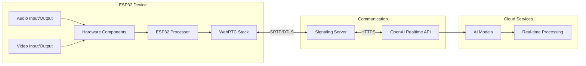

Sources: README.md

## Key Components

The system architecture consists of three main layers, each with specific components:

### 1. Device Layer

The ESP32 device serves as the embedded platform that captures and processes audio/video data:

- **Hardware Components**: Microphones, speakers, cameras, and other input/output peripherals
- **ESP32 Processor**: Handles local processing, encoding/decoding, and system coordination
- **WebRTC Stack**: Implements the WebRTC protocol for real-time media transmission

### 2. Communication Layer

WebRTC provides the real-time communication framework:

- **Signaling**: Establishes and manages the connection between the ESP32 device and OpenAI's services
- **Secure Transport**: Encrypts data using DTLS (Datagram Transport Layer Security)
- **Media Transport**: Transmits audio/video streams using RTP (Real-time Transport Protocol)

### 3. Service Layer

OpenAI's cloud infrastructure processes the incoming data:

- **Realtime API**: Receives and processes media streams from connected devices
- **AI Models**: Analyzes and interprets the audio/video content
- **Response Generation**: Creates and returns appropriate responses in real-time

Sources: README.md

## Component Relationships

The following diagram illustrates the relationship between code entities and system components:

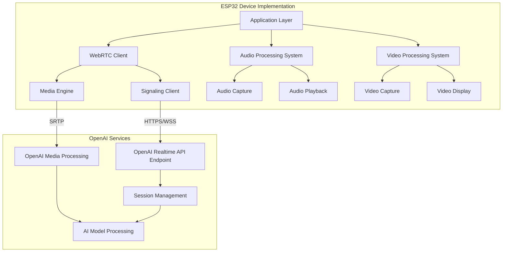

Sources: README.md

## Integration Architecture

The system integration is designed to be flexible, supporting two main implementation paths as outlined in the repository:

| Implementation Option | Source | Characteristics |
|-----------------------|--------|-----------------|
| Espressif Official Demo | [esp-webrtc-solution/openai_demo](https://github.com/espressif/esp-webrtc-solution/tree/main/solutions/openai_demo) | Current, actively maintained implementation by Espressif |
| Original OpenAI Embedded SDK | esp32 branch | Original implementation, available as an alternative |

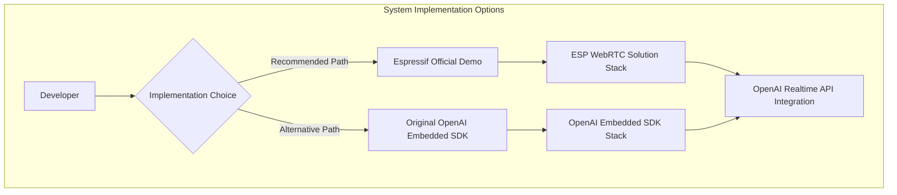

Sources: README.md

## Architectural Constraints and Considerations

The ESP32-based architecture operates within several key constraints:

1. **Resource Limitations**: ESP32 devices have limited processing power, memory, and energy capacity
2. **Network Requirements**: The system requires stable internet connectivity for real-time communication
3. **Latency Sensitivity**: Real-time AI applications require minimal delay in the communication pipeline
4. **Security Considerations**: End-to-end encryption is necessary for secure data transmission

The architecture is designed to balance these constraints while providing a responsive user experience with OpenAI's powerful AI capabilities.

Sources: README.md

---

# Page: Data Flow

# Data Flow

<details>
<summary>Relevant source files</summary>

The following files were used as context for generating this wiki page:

- [README.md](README.md)

</details>


This document explains the end-to-end data flow in the OpenAI Realtime Embedded system, from user input through the ESP32 device to OpenAI's Realtime API and back. For information about the overall system architecture, see [System Architecture](#2), and for implementation options, see [Implementation Options](#3).

## Overview

The OpenAI Realtime Embedded system enables bidirectional, real-time communication between an ESP32 device and OpenAI's cloud-based AI models using WebRTC as the transport protocol.

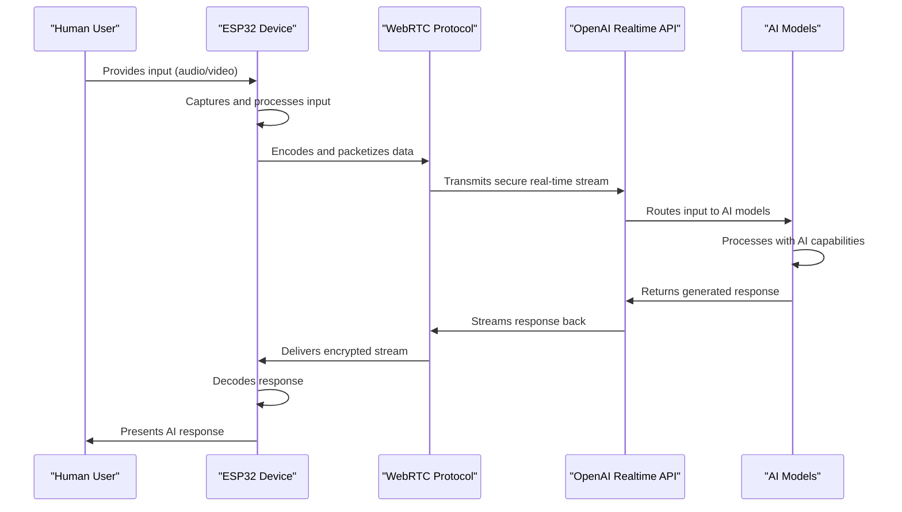

Sources: README.md

## Input Data Path

The journey of data from the user to OpenAI's AI models follows this path:

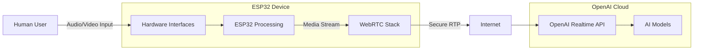

Sources: README.md

### 1. Input Capture and Initial Processing

The data flow begins with the user providing input:

- **Audio Input**: Captured through a microphone connected to the ESP32's analog inputs or via I2S for digital microphones
- **Video Input** (if configured): Captured through a camera module connected to the ESP32

The raw input then undergoes initial processing:
- Analog-to-digital conversion (for analog inputs)
- Sampling at appropriate rates
- Basic filtering and enhancement
- Formatting for subsequent processing

### 2. Media Processing and Encoding

Before transmission, the ESP32 must encode the media:

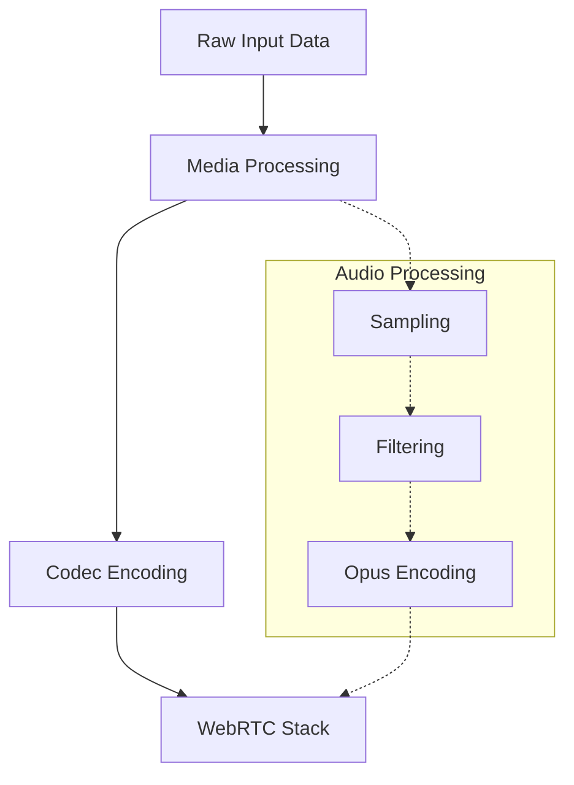

Sources: Based on WebRTC audio processing common practices

For audio (the most common input type):
- Signal processing to improve quality
- Encoding using the Opus codec (WebRTC's standard audio codec)
- Framing into appropriate packet sizes

### 3. WebRTC Connection and Transmission

The WebRTC stack on the ESP32 handles the connection with OpenAI:

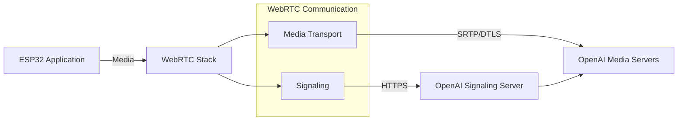

Sources: Based on standard WebRTC architecture

The WebRTC communication involves:

1. **Signaling Process**:
   - Establishing a secure HTTPS connection to OpenAI's signaling server
   - Exchanging session information (SDP - Session Description Protocol)
   - Negotiating compatible media formats and parameters
   - Exchanging ICE candidates for network connectivity

2. **Media Transmission**:
   - Secure media channel established using DTLS (Datagram Transport Layer Security)
   - Media packed into RTP (Real-time Transport Protocol) packets
   - Encrypted using SRTP (Secure Real-time Transport Protocol)
   - Transmitted over UDP for lower latency
   - RTCP (RTP Control Protocol) used for quality feedback

### 4. OpenAI Reception and AI Processing

Once the data reaches OpenAI's infrastructure:
- The WebRTC stream is received and authenticated
- The media is extracted and decoded
- The input is routed to the appropriate AI models
- The AI models process the input based on their capabilities

## Output Data Path

After processing by the AI models, the response takes a similar but reverse path back to the user:

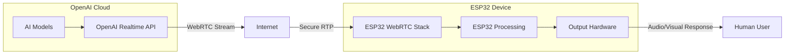

Sources: README.md

### 1. AI Response Generation

Within OpenAI's infrastructure:
- The AI models generate appropriate responses based on the input
- The response is prepared for real-time streaming
- The response is formatted for WebRTC transmission

### 2. WebRTC Streaming to ESP32

The response travels back through the established WebRTC connection:
- The response is encoded into appropriate media formats
- The media is packetized for network transmission
- The stream is encrypted and transmitted to the ESP32
- Quality of Service mechanisms ensure timely delivery

### 3. ESP32 Reception and Output Processing

Finally, the ESP32 processes the incoming response:

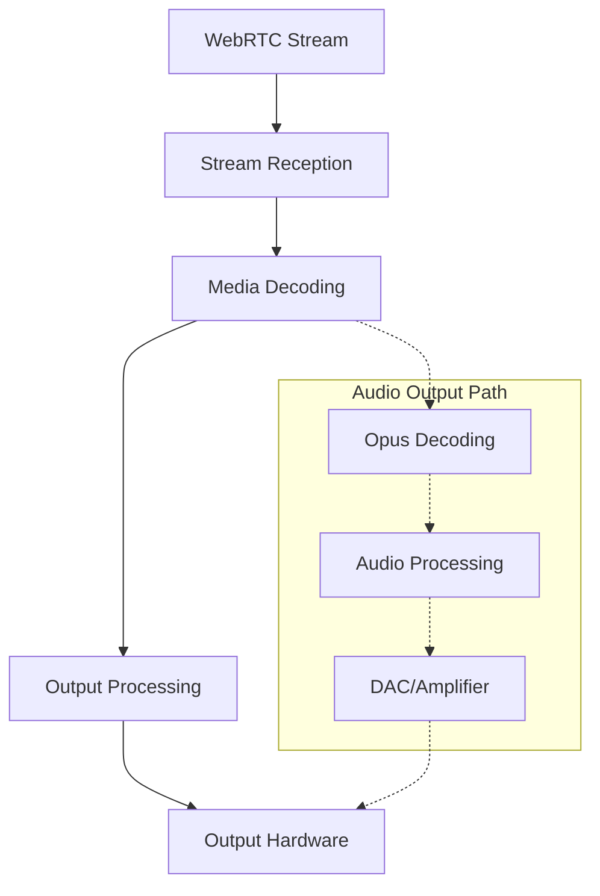

Sources: Based on standard audio output processing

The processing includes:
- Receiving and decrypting the WebRTC stream
- Decoding the media from its compressed format
- Processing for output (e.g., digital-to-analog conversion for audio)
- Rendering to the appropriate output devices (speakers, displays)

## Key Data Transformations

Throughout the data flow, the information undergoes several format transformations:

| Stage | Input Format | Output Format | Transformation |
|-------|--------------|--------------|----------------|
| Input Capture | Analog signals | Digital samples | ADC conversion |
| ESP32 Encoding | Raw PCM audio | Opus-encoded audio | Compression encoding |
| WebRTC Packetization | Media frames | RTP packets | Network packetization |
| Network Transmission | RTP packets | SRTP stream | Encryption |
| OpenAI Processing | Media stream | AI-generated response | AI model processing |
| ESP32 Decoding | SRTP stream | Decoded media | Decryption and decoding |
| Output Rendering | Digital data | Analog signals | DAC conversion (for audio) |

Sources: Based on standard WebRTC media processing

## Performance and Reliability

The real-time nature of this system introduces several performance considerations:

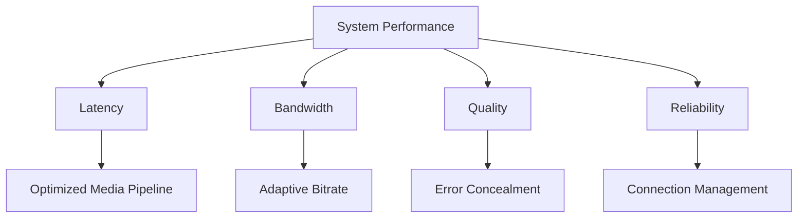

Sources: Based on WebRTC performance practices

Key performance aspects include:
- Minimizing end-to-end latency for natural interaction
- Optimizing bandwidth usage for network efficiency
- Maintaining acceptable quality despite network variations
- Ensuring reliable operation under various conditions

The WebRTC protocol provides built-in mechanisms for handling many of these challenges, including:
- Dynamic adaptation to changing network conditions
- Packet loss recovery and concealment
- Jitter buffering to smooth out timing variations
- Fallback mechanisms for degraded connections

---

# Page: Implementation Options

# Implementation Options

<details>
<summary>Relevant source files</summary>

The following files were used as context for generating this wiki page:

- [README.md](README.md)

</details>


## Purpose

This document outlines the two available implementation paths for integrating OpenAI's Realtime API with ESP32 devices using WebRTC. Developers can choose between the Espressif Official Demo (recommended path) and the Original OpenAI Embedded SDK (alternative path) based on their project requirements. For specific setup instructions, see [Getting Started](#5).

## Overview of Implementation Paths

The OpenAI Realtime Embedded repository provides two distinct implementation options for developers:

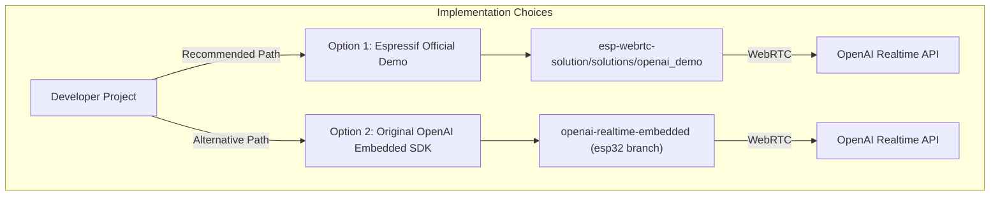

Sources: README.md

## Implementation Comparison

| Feature | Espressif Official Demo | Original OpenAI Embedded SDK |
|---------|-------------------------|------------------------------|
| **Status** | Recommended implementation | Alternative implementation |
| **Repository Location** | github.com/espressif/esp-webrtc-solution/tree/main/solutions/openai_demo | esp32 branch of openai-realtime-embedded |
| **Maintained by** | Espressif (ESP32 manufacturer) | Available in esp32 branch |
| **Integration** | Part of Espressif WebRTC ecosystem | Standalone implementation |
| **Support** | Official support from Espressif | Community support |
| **Updates** | Regular updates expected | May not receive regular updates |
| **Recommended for** | New projects | Projects already using this SDK |

Sources: README.md

## Option 1: Espressif Official Demo (Recommended)

The Espressif Official Demo is the recommended implementation path for most developers. It is maintained by Espressif, the manufacturer of ESP32 chips, ensuring compatibility with the latest ESP32 hardware and software.

### Architecture Components

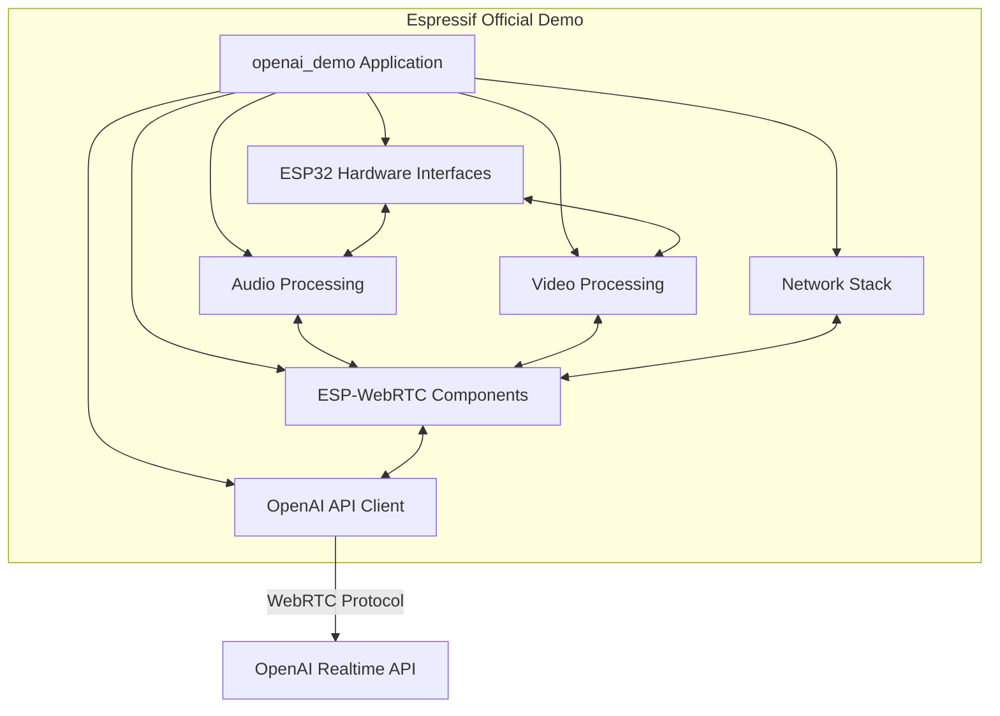

Sources: README.md

### Key Advantages

- Official implementation from Espressif
- Integrated with ESP-IDF framework
- Regular updates and maintenance
- Optimized for ESP32 hardware
- Official documentation and support

For detailed information about this implementation, including setup and configuration, see [Espressif Official Demo](#3.1).

## Option 2: Original OpenAI Embedded SDK

The original implementation of the OpenAI Embedded SDK is available on the `esp32` branch of this repository. This represents the initial work to enable OpenAI Realtime API on ESP32 devices.

### Architecture Components

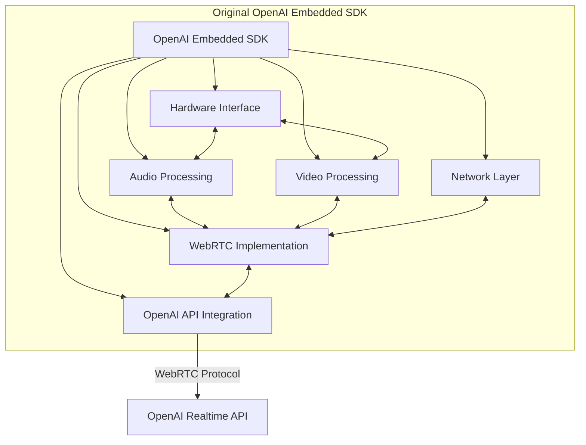

Sources: README.md

### Key Considerations

- Original implementation available on the `esp32` branch
- May not receive the same level of updates as the Espressif demo
- Suitable for projects that have already begun development with this SDK

For detailed information about this implementation, see [Original OpenAI Embedded SDK](#3.2).

## Data Flow (Both Implementations)

Both implementations follow a similar data flow pattern for real-time communication with OpenAI's services:

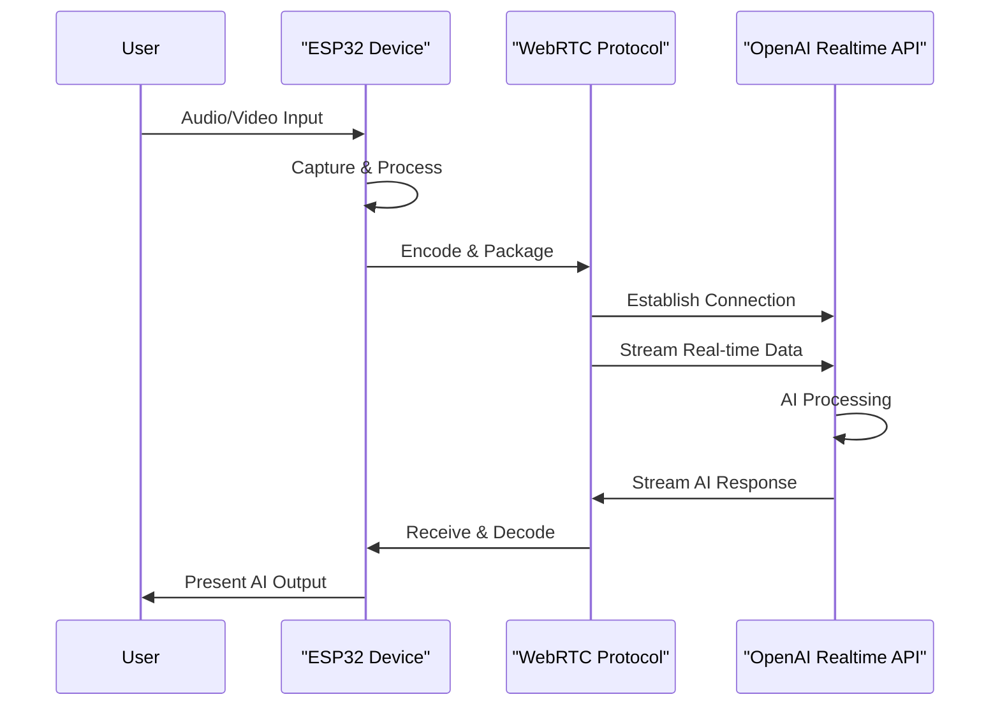

Sources: README.md

## Implementation Decision Guide

### When to Use Espressif Official Demo

- Starting a new project with ESP32 and OpenAI Realtime API
- Need for official support and documentation
- Looking for long-term maintenance and updates
- Working within the broader Espressif ecosystem

### When to Consider Original OpenAI Embedded SDK

- Already started development with this implementation
- Specific requirements better met by this implementation
- Custom adaptations built on the original SDK

## Conclusion

For most new projects, the **Espressif Official Demo** is recommended as it offers better long-term support and integration with the ESP32 ecosystem. The Original OpenAI Embedded SDK remains available for projects that have already adopted it or have specific requirements better met by this implementation.

For detailed setup instructions and next steps, refer to the [Getting Started](#5) guide. For information about the technical components used in both implementations, see [Technical Components](#4).

Sources: README.md

---

# Page: Espressif Official Demo

# Espressif Official Demo

<details>
<summary>Relevant source files</summary>

The following files were used as context for generating this wiki page:

- [README.md](README.md)

</details>


This document provides detailed information about the Espressif official `openai_demo`, which is the recommended implementation path for using OpenAI's Realtime API with WebRTC on ESP32 devices. For information about the alternative implementation using the original OpenAI Embedded SDK, see [Original OpenAI Embedded SDK](#3.2).

## Overview

The Espressif official demo (`openai_demo`) is maintained directly by Espressif Systems and serves as the primary recommended implementation for developers looking to integrate ESP32 devices with OpenAI's Realtime API using WebRTC. This demo is hosted in Espressif's ESP-WebRTC-Solution repository rather than within the OpenAI Realtime Embedded repository itself.

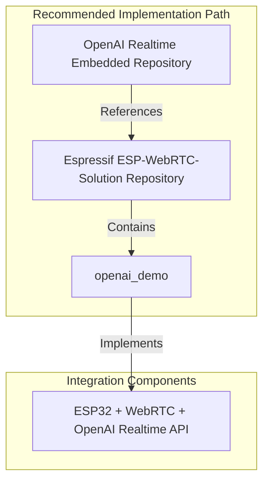

Sources: [README.md:5-9]()

## Repository Location

The `openai_demo` is not contained within the OpenAI Realtime Embedded repository. Instead, the OpenAI repository serves as a reference point that directs developers to the official implementation maintained by Espressif.

| Repository | URL Path |
|------------|----------|
| Main Reference | github.com/openai/openai-realtime-embedded |
| Implementation Location | github.com/espressif/esp-webrtc-solution/tree/main/solutions/openai_demo |

Sources: [README.md:7]()

## System Integration

The `openai_demo` integrates several key components to enable real-time communication between ESP32 devices and OpenAI's services:

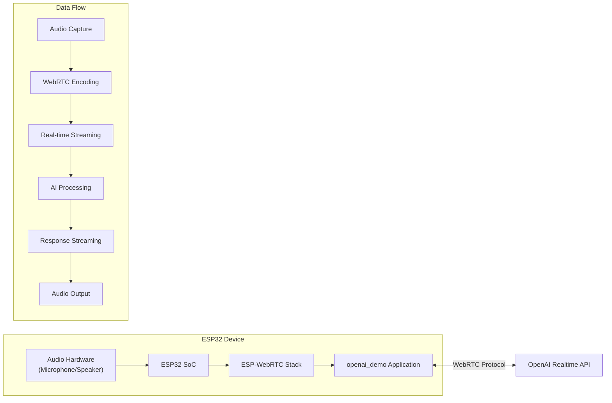

Sources: [README.md:3-7]()

## Communication Sequence

The following diagram illustrates the typical communication sequence when using the Espressif official demo:

```mermaid
sequenceDiagram
    participant User
    participant ESP32 as "ESP32 Device"
    participant WebRTC as "WebRTC Protocol"
    participant OpenAI as "OpenAI Realtime API"
    
    User->>ESP32: Voice Input
    ESP32->>ESP32: Audio Capture
    ESP32->>WebRTC: Audio Encoding & Streaming
    WebRTC->>OpenAI: Real-time Audio Data
    OpenAI->>OpenAI: AI Model Processing
    OpenAI->>WebRTC: Real-time Response
    WebRTC->>ESP32: Audio Decoding
    ESP32->>User: Audio Playback
```

Sources: [README.md:3-7]()

## Benefits of the Official Demo

The Espressif official demo offers several advantages over alternative implementations:

1. **Official Support**: Directly maintained by Espressif, ensuring optimal compatibility with ESP32 hardware
2. **Integrated Development**: Works seamlessly with Espressif's development framework (ESP-IDF)
3. **Performance Optimization**: Specifically optimized for ESP32's capabilities and constraints
4. **Regular Updates**: Benefits from ongoing maintenance and improvements from Espressif

## Implementation Considerations

When implementing the Espressif official demo, developers should be aware of:

- **Hardware Requirements**: Specific ESP32 models and audio peripherals may be needed
- **Network Connectivity**: Stable internet connection is essential for WebRTC communication
- **API Authentication**: Requires proper OpenAI API keys and configuration
- **Resource Management**: ESP32 has limited processing power and memory compared to desktop systems

## Getting Started

To begin using the Espressif official demo:

1. Visit the official Espressif repository at github.com/espressif/esp-webrtc-solution
2. Navigate to the solutions/openai_demo directory
3. Follow the setup instructions provided in the repository's documentation
4. Configure your ESP32 device according to the guidelines
5. Implement the necessary OpenAI API authentication

For comprehensive getting started information, see [Getting Started](#5).

Sources: [README.md:7]()

## Related Documentation

For more detailed information about specific components of the system:

- [System Architecture](#2) - High-level architecture of the entire system
- [WebRTC on ESP32](#4.1) - Technical details about the WebRTC implementation
- [OpenAI Realtime API Integration](#4.2) - Information about integrating with OpenAI's services

---

# Page: Original OpenAI Embedded SDK

# Original OpenAI Embedded SDK

<details>
<summary>Relevant source files</summary>

The following files were used as context for generating this wiki page:

- [README.md](README.md)

</details>


## Purpose and Scope

This document covers the Original OpenAI Embedded SDK, which is an alternative implementation for connecting ESP32 devices to the OpenAI Realtime API using WebRTC. This SDK is available on the `esp32` branch of the repository and represents the initial implementation approach. For information about the recommended implementation path using the Espressif official demo, see [Espressif Official Demo](#3.1).

Sources: [README.md:8-9]()

## Position in System Architecture

The Original OpenAI Embedded SDK exists as an alternative implementation path for developers who wish to integrate ESP32 devices with OpenAI's Realtime API services. It is maintained on a separate branch from the main implementation recommended by Espressif.

```mermaid
graph TD
    subgraph "Implementation Options"
        choice{"Developer Implementation Choice"}
        choice -->|"Alternative Path"| sdk["Original OpenAI Embedded SDK<br>(esp32 branch)"]
        choice -->|"Recommended Path"| esp["Espressif Official Demo<br>(openai_demo)"]
    end
    
    subgraph "Functionality"
        sdk --> webrtc1["ESP32 + WebRTC + OpenAI Realtime API"]
        esp --> webrtc2["ESP32 + WebRTC + OpenAI Realtime API"]
    end
```

**Diagram: Implementation Options for OpenAI Realtime API on ESP32**

Sources: [README.md:7-9]()

## SDK Architecture

The Original OpenAI Embedded SDK serves as the intermediary layer between the ESP32 hardware and the OpenAI Realtime API. It handles WebRTC communication, audio/video processing, and manages the realtime data flow to and from the cloud service.

```mermaid
graph LR
    subgraph "ESP32 Device"
        hw["Hardware Components<br>(Microphone, Speaker, etc.)"]
        fw["ESP32 Firmware/OS"]
        sdk["Original OpenAI Embedded SDK"]
    end
    
    subgraph "Cloud Services"
        api["OpenAI Realtime API"]
    end
    
    hw --> fw
    fw --> sdk
    sdk <-->|"WebRTC Protocol<br>(Audio/Video Streams)"| api
```

**Diagram: Original SDK Data Flow Architecture**

Sources: [README.md:3-9]()

## Functional Components

While specific implementation details are limited in the available documentation, the SDK necessarily implements several key components to enable WebRTC communication with OpenAI's Realtime API from an ESP32 device:

```mermaid
graph TD
    subgraph "Original OpenAI Embedded SDK"
        webrtc["WebRTC Stack"]
        audio["Audio Capture & Processing"]
        video["Video Processing (if applicable)"]
        conn["Connection Management"]
        auth["API Authentication"]
    end
    
    subgraph "ESP32 System"
        hw["Hardware Drivers"]
        os["Operating System/RTOS"]
    end
    
    subgraph "External Services"
        api["OpenAI Realtime API"]
    end
    
    hw --> os
    os --> audio
    os --> video
    audio --> webrtc
    video --> webrtc
    webrtc --> conn
    auth --> conn
    conn <--> api
```

**Diagram: Conceptual Components of the Original SDK**

Sources: [README.md:3-9]()

## Technical Comparison

The following table highlights the key aspects of the Original OpenAI Embedded SDK compared to the Espressif official demo:

| Feature | Original OpenAI Embedded SDK | Espressif Official Demo |
|---------|------------------------------|-------------------------|
| Repository Location | `esp32` branch of OpenAI Realtime Embedded repo | [esp-webrtc-solution/solutions/openai_demo](https://github.com/espressif/esp-webrtc-solution/tree/main/solutions/openai_demo) |
| Maintenance Status | Original implementation | Actively maintained by Espressif |
| Official Recommendation | Alternative implementation | Recommended implementation |
| Core Functionality | ESP32 + WebRTC + OpenAI Realtime API | ESP32 + WebRTC + OpenAI Realtime API |

Sources: [README.md:5-9]()

## When to Use the Original SDK

Consider using the Original OpenAI Embedded SDK in the following scenarios:

- You have existing projects based on the original implementation and wish to maintain compatibility
- You need specific functionality that may be present in the original SDK but not in the Espressif demo
- You are researching the evolution of WebRTC implementations on the ESP32 platform
- You have specific requirements that align better with the original implementation

For most new development projects, the Espressif official demo is recommended as it represents the actively maintained implementation path.

Sources: [README.md:7-9]()

## Accessing the SDK

To access the Original OpenAI Embedded SDK:

1. Clone the OpenAI Realtime Embedded repository
2. Switch to the `esp32` branch
3. Follow the implementation documentation within that branch

```bash
git clone https://github.com/openai/openai-realtime-embedded
git checkout esp32
```

Sources: [README.md:9]()

---

# Page: Technical Components

# Technical Components

<details>
<summary>Relevant source files</summary>

The following files were used as context for generating this wiki page:

- [README.md](README.md)

</details>


This page provides a detailed technical explanation of the key components that make up the OpenAI Realtime API + WebRTC on ESP32 system. It covers the technical architecture, responsibilities, and interactions of each component. For implementation options and setup details, see [Implementation Options](#3), and for data flow information, see [Data Flow](#2.1).

## Core Components Architecture

The OpenAI Realtime Embedded system consists of three primary technical components that work together to enable real-time AI communication on resource-constrained devices.

```mermaid
graph TD
    subgraph "ESP32 Device"
        esp["ESP32 Hardware Layer"] --> rtc["WebRTC Stack"]
        subgraph "WebRTC Components" 
            rtc --> signaling["Signaling Protocol"]
            rtc --> media["Media Engine"]
            rtc --> dtls["DTLS/SRTP Security"]
            rtc --> ice["ICE Connection Management"]
        end
    end
    
    rtc -->|"Secure Media Streams"| api["OpenAI Realtime API"]
    signaling -->|"SDP Exchange"| api
    
    subgraph "OpenAI Cloud"
        api --> aimodels["AI Processing Models"]
        api --> rtc_server["WebRTC Server"]
    end
```

Sources: README.md

## ESP32 Hardware Layer

The ESP32 serves as the hardware foundation for the system, providing the computing power, memory, and connectivity needed for real-time communication.

Key technical specifications relevant to this implementation:

| Component | Specification | Relevance to WebRTC |
|-----------|---------------|---------------------|
| CPU | Dual-core 32-bit processor | Handles media processing and network tasks |
| Memory | Limited RAM (520KB SRAM) | Constrains buffer sizes for media processing |
| Connectivity | Wi-Fi and Bluetooth | Provides network transport for WebRTC |
| Audio interfaces | I2S, ADC | Enables audio capture and playback |
| Video interfaces | Camera interface support | Optional video capabilities |

The ESP32's architecture requires optimization techniques to handle real-time media processing within its resource constraints.

Sources: README.md

## WebRTC Stack

The WebRTC (Web Real-Time Communication) stack is a critical component that enables peer-to-peer audio/video communication without requiring plugins or native apps.

### WebRTC Architecture on ESP32

```mermaid
graph TD
    subgraph "WebRTC Stack Components"
        app["Application Layer"] --> api_layer["WebRTC API Layer"]
        api_layer --> media_engine["Media Engine"]
        api_layer --> transport["Transport Layer"]
        
        media_engine --> audio_codec["Audio Codecs (Opus)"]
        media_engine --> video_codec["Video Codecs (Optional)"]
        
        transport --> dtls["DTLS/SRTP"]
        transport --> ice["ICE Protocol"]
        ice --> stun["STUN/TURN"]
        
        signaling["Signaling Protocol"] --> app
    end
    
    ice -->|"NAT Traversal"| net["Network"]
    signaling -->|"Session Establishment"| oai["OpenAI Signaling Server"]
```

Sources: README.md

### Key WebRTC Components

1. **Signaling Protocol**: Manages session establishment and parameter negotiation
   - Exchanges Session Description Protocol (SDP) information
   - Coordinates ICE candidates for connection establishment

2. **Media Engine**: Handles audio/video processing
   - Audio codecs (particularly Opus for voice)
   - Optional video capabilities
   - Adaptive bitrate management

3. **Transport Layer**: Ensures secure, reliable delivery
   - DTLS (Datagram Transport Layer Security) for encryption
   - SRTP (Secure Real-time Transport Protocol) for media transport
   - ICE (Interactive Connectivity Establishment) for NAT traversal

4. **Connection Management**: Establishes and maintains peer connections
   - STUN/TURN for NAT traversal when necessary
   - Connection monitoring and adaptation

The WebRTC implementation on ESP32 is specifically optimized for embedded constraints, focusing on minimizing memory usage and processing overhead while maintaining acceptable latency.

Sources: README.md

## OpenAI Realtime API Integration

The OpenAI Realtime API allows for direct integration with OpenAI's language models through WebRTC, enabling real-time streaming audio processing.

### API Integration Architecture

```mermaid
graph LR
    subgraph "ESP32 Device"
        app["Application"] --> sdk["OpenAI SDK"] 
        sdk --> webrtc["WebRTC Stack"]
    end
    
    webrtc -->|"Two-way audio stream"| cloud["OpenAI Realtime Service"]
    
    subgraph "OpenAI Cloud"
        cloud --> models["AI Models"]
        cloud --> processing["Audio Processing"]
    end
    
    models -->|"Generate responses"| processing
    processing -->|"Audio response"| webrtc
```

Sources: README.md

### Technical Integration Points

The OpenAI Realtime API integration involves several technical considerations:

1. **Authentication and Session Management**
   - API key management
   - Session initialization and termination

2. **Media Format Requirements**
   - Audio sampling rate and format compatibility
   - Codec selection and configuration

3. **Latency Optimization**
   - Buffer management to minimize delay
   - Network quality adaptation

4. **Error Handling and Recovery**
   - Connection dropout recovery
   - Error state management and reporting

Sources: README.md

## Component Interaction Sequence

The following sequence diagram illustrates how these technical components interact during a typical session:

```mermaid
sequenceDiagram
    participant "User" as user
    participant "ESP32 App" as app
    participant "WebRTC Stack" as webrtc
    participant "Signaling" as signal
    participant "OpenAI API" as api
    participant "AI Model" as model
    
    app->>signal: "Initiate session"
    signal->>api: "Session request"
    api->>signal: "Session parameters"
    signal->>app: "SDP offer"
    app->>webrtc: "Configure connection"
    webrtc->>api: "Establish WebRTC connection"
    
    note over app, api: Secure media channel established
    
    user->>app: "Audio input"
    app->>webrtc: "Process audio"
    webrtc->>api: "Stream audio"
    api->>model: "Process audio stream"
    model->>api: "Generate response"
    api->>webrtc: "Stream response audio"
    webrtc->>app: "Decode audio"
    app->>user: "Audio output"
```

Sources: README.md

## Technical Implementation Differences

The system offers two different technical implementations, each with distinct architecture and component organization:

| Component | Espressif Official Demo | Original OpenAI Embedded SDK |
|-----------|-------------------------|------------------------------|
| Repository | esp-webrtc-solution/solutions/openai_demo | openai-realtime-embedded (esp32 branch) |
| WebRTC Stack | ESP-WebRTC (Espressif's optimized implementation) | Custom WebRTC port for ESP32 |
| Audio Processing | ESP-DSP and ESP-ADF integration | Custom audio processing |
| Integration Approach | Native integration with ESP-IDF | SDK abstraction layer |
| Memory Footprint | Optimized for ESP32 | Generic embedded approach |

Sources: README.md

## Memory and Performance Considerations

Real-time AI communication on embedded devices introduces specific technical challenges that the components must address:

1. **Memory Management**
   - Dynamic buffer allocation based on available memory
   - Careful stack usage to prevent overflows

2. **Processing Priorities**
   - Task scheduling to prioritize audio processing
   - Background processing for non-time-critical operations

3. **Power Optimization**
   - Power state management during connections
   - CPU frequency scaling based on processing needs

4. **Network Resilience**
   - Connection quality monitoring
   - Adaptive bitrate adjustment
   - Packet loss concealment techniques

These technical considerations ensure that the system can operate effectively within the constraints of the ESP32 platform while maintaining acceptable real-time performance.

Sources: README.md

## Technical Capabilities and Limitations

Understanding the technical boundaries of the system is important for developers:

| Capability | Details | Limitations |
|------------|---------|-------------|
| Audio Quality | 16kHz sampling, mono | Limited by ESP32 processing power |
| Latency | Typically 300-700ms round trip | Dependent on network quality |
| Session Duration | Extended sessions possible | Limited by power constraints |
| Connectivity | Requires stable internet | May struggle with poor Wi-Fi |
| Concurrent Processing | Limited multitasking during active sessions | Primary focus on audio processing |

Sources: README.md

The technical components work together to create a cohesive system that balances performance, power efficiency, and functionality within the constraints of embedded hardware, enabling AI-powered real-time communication on ESP32 devices.

---

# Page: WebRTC on ESP32

# WebRTC on ESP32

<details>
<summary>Relevant source files</summary>

The following files were used as context for generating this wiki page:

- [README.md](README.md)

</details>


## Purpose and Scope

This document provides technical details about the WebRTC implementation on ESP32 devices within the OpenAI Realtime Embedded framework. It explains the architecture, components, and data flow of WebRTC on ESP32, specifically focusing on how it enables real-time communication between ESP32 devices and OpenAI's Realtime API. For information about integrating with the OpenAI Realtime API itself, see [OpenAI Realtime API Integration](#4.2).

Sources: [README.md:3-7]()

## WebRTC Architecture on ESP32

WebRTC (Web Real-Time Communication) is an open-source project that provides web browsers and mobile applications with real-time communication capabilities via simple APIs. On the ESP32 platform, WebRTC has been adapted to work within the constraints of embedded systems while maintaining its core functionality.

### Overall WebRTC Stack on ESP32

```mermaid
flowchart TD
    subgraph "ESP32 WebRTC Stack"
        direction TB
        
        app["Application Layer"] --> signaling["Signaling Protocol"]
        
        signaling --> webrtc["WebRTC Core"]
        
        webrtc --> media["Media Engine"]
        webrtc --> network["Network Transport"]
        webrtc --> security["Security Layer"]
        
        media --> audio["Audio Capture/Render"]
        media --> codec["Audio Codec (Opus)"]
        
        network --> ice["ICE Protocol"]
        network --> dtls["DTLS"]
        network --> srtp["SRTP"]
        
        audio --> hardware["ESP32 Audio Hardware"]
    end
```

The WebRTC implementation on ESP32 follows a layered architecture that handles media processing, network transport, and security while optimizing for resource constraints of the ESP32 platform.

Sources: [README.md:3-7]()

## Key Components

### 1. Signaling Protocol

The signaling protocol handles the initial connection establishment between the ESP32 device and OpenAI's Realtime API. While WebRTC doesn't specify a standard signaling protocol, the ESP32 implementation typically uses HTTPS for this purpose.

### 2. Media Engine

The media engine consists of:

| Component | Function | Implementation Details |
|-----------|----------|------------------------|
| Audio Capture | Captures audio from ESP32 microphone | Uses I2S interface for digital audio |
| Audio Rendering | Outputs audio responses | Implemented through I2S DACs |
| Audio Codec | Compresses/decompresses audio streams | Uses Opus codec optimized for ESP32 |

### 3. Network Transport Layer

WebRTC on ESP32 implements several critical network protocols:

```mermaid
flowchart LR
    subgraph "Network Transport on ESP32"
        ice["ICE (Interactive Connectivity Establishment)"] --> stun["STUN Client"]
        ice --> turn["TURN Client"]
        
        network["Network Layer"] --> ice
        network --> dtls["DTLS (Datagram TLS)"]
        network --> srtp["SRTP (Secure RTP)"]
        
        dtls --> rtp["RTP/RTCP Processing"]
        srtp --> rtp
    end
```

These components enable secure, peer-to-peer connection establishment even across NATs and firewalls.

### 4. Security Implementation

Security in WebRTC on ESP32 includes:

- DTLS (Datagram Transport Layer Security) for encryption
- SRTP (Secure Real-time Transport Protocol) for media encryption
- Certificate validation and management

## WebRTC Data Flow on ESP32

The following diagram illustrates the data flow when using WebRTC on ESP32 with OpenAI's Realtime API:

```mermaid
sequenceDiagram
    participant User
    participant ESP32Audio as "ESP32 Audio Hardware"
    participant AudioEngine as "Audio Capture/Processing"
    participant Network as "Network Layer"
    participant OpenAI as "OpenAI Realtime API"
    
    User->>ESP32Audio: Voice Input
    ESP32Audio->>AudioEngine: Raw Audio Data
    AudioEngine->>AudioEngine: Process Audio (Opus Encoding)
    AudioEngine->>Network: Compressed Audio Packets
    Network->>Network: SRTP Encryption
    Network->>OpenAI: Secure RTP Stream
    OpenAI->>OpenAI: AI Processing
    OpenAI->>Network: Response Audio Stream
    Network->>Network: SRTP Decryption
    Network->>AudioEngine: Compressed Audio Packets
    AudioEngine->>AudioEngine: Opus Decoding
    AudioEngine->>ESP32Audio: Raw Audio Data
    ESP32Audio->>User: Audio Output
```

This real-time bidirectional communication enables voice interactions with minimal latency, making it suitable for conversational AI applications.

## Resource Optimization for ESP32

WebRTC implementation on ESP32 requires careful resource management due to the platform's constraints:

| Resource | Constraint | Optimization |
|----------|------------|--------------|
| Memory | Limited RAM (~4-8MB) | Buffer optimization, minimal packet copying |
| CPU | Dual-core up to 240MHz | Task distribution between cores, optimized DSP routines |
| Power | Battery constraints | Efficient codec implementations, sleep modes when idle |
| Bandwidth | Network limitations | Adaptive bitrate, packet loss concealment |

## WebRTC Session Establishment

When connecting to OpenAI's Realtime API, the ESP32 device follows this connection procedure:

```mermaid
sequenceDiagram
    participant ESP32 as "ESP32 Device"
    participant SignalingServer as "Signaling Server"
    participant OpenAI as "OpenAI Realtime API"
    
    ESP32->>SignalingServer: HTTPS Request with API Key
    SignalingServer->>ESP32: Session Parameters
    ESP32->>ESP32: Generate ICE Candidates
    ESP32->>SignalingServer: SDP Offer & ICE Candidates
    SignalingServer->>OpenAI: Forward SDP Offer
    OpenAI->>SignalingServer: SDP Answer & ICE Candidates
    SignalingServer->>ESP32: SDP Answer & ICE Candidates
    ESP32->>ESP32: ICE Connectivity Checks
    ESP32->>OpenAI: DTLS Handshake
    OpenAI->>ESP32: DTLS Handshake Completion
    Note over ESP32,OpenAI: Secure Media Channel Established
    ESP32->>OpenAI: SRTP Audio Stream Begins
```

This connection procedure establishes a secure, direct communication channel between the ESP32 device and OpenAI's servers.

## Implementation Considerations

When working with WebRTC on ESP32 for OpenAI Realtime API integration, developers should consider:

1. **Memory Management**: WebRTC requires careful memory management on ESP32. Buffer sizes and memory allocation need optimization to prevent heap fragmentation.

2. **Audio Quality**: The quality of the microphone and audio hardware significantly impacts the performance of the AI interaction.

3. **Network Reliability**: ESP32's network stack must handle packet loss and jitter gracefully to maintain real-time communication quality.

4. **Power Consumption**: WebRTC streaming can be power-intensive. Implementations should include power-saving strategies for battery-powered applications.

## Available Implementations

As noted in the repository overview, there are two main implementation paths for WebRTC on ESP32:

1. **Espressif Official Demo**: The recommended implementation is maintained by Espressif in their [openai_demo](https://github.com/espressif/esp-webrtc-solution/tree/main/solutions/openai_demo).

2. **Original OpenAI Embedded SDK**: Available on the `esp32` branch of this repository, providing an alternative implementation.

Sources: [README.md:7-9]()

## Conclusion

WebRTC on ESP32 serves as the critical communication backbone that enables real-time audio streaming between ESP32 devices and OpenAI's Realtime API. Despite the resource constraints of embedded platforms, the optimized WebRTC implementation delivers the low-latency, secure communication necessary for interactive AI applications.

---

# Page: OpenAI Realtime API Integration

# OpenAI Realtime API Integration

<details>
<summary>Relevant source files</summary>

The following files were used as context for generating this wiki page:

- [README.md](README.md)

</details>


## Purpose and Scope

This document describes the technical aspects of integrating OpenAI's Realtime API with embedded devices, specifically focusing on the ESP32 platform. It covers the integration architecture, authentication flow, data streaming mechanisms, and key implementation considerations. For information about the WebRTC implementation on ESP32, see [WebRTC on ESP32](#4.1).

## OpenAI Realtime API Overview

The OpenAI Realtime API enables real-time, bidirectional communication between embedded devices and OpenAI's AI models. Unlike traditional REST APIs that follow a request-response pattern, the Realtime API uses WebRTC to establish persistent connections that support continuous audio and video streaming.

```mermaid
flowchart LR
    subgraph "ESP32 Device"
        mic["Microphone"] --> audio["Audio Processing"]
        cam["Camera"] --> video["Video Processing"]
        audio --> webrtc["WebRTC Stack"]
        video --> webrtc
    end
    
    subgraph "OpenAI Realtime API"
        signaling["Signaling Server"] 
        ai["AI Models"]
        media["Media Processing"]
    end
    
    webrtc <-->|"SDP, ICE candidates"| signaling
    webrtc <-->|"Audio/Video RTP Streams"| media
    media <--> ai
```

**Diagram: OpenAI Realtime API Communication Flow**

Sources: [README.md:3-3]()

## Integration Architecture

The integration between ESP32 devices and the OpenAI Realtime API follows a WebRTC-based architecture that enables real-time streaming of audio and video data.

```mermaid
sequenceDiagram
    participant ESP32 as "ESP32 Device"
    participant Auth as "Authentication Server"
    participant Signal as "OpenAI Signaling Server"
    participant STUN as "STUN/TURN Servers"
    participant AI as "OpenAI AI Models"
    
    ESP32->>Auth: Request API token
    Auth->>ESP32: Return API token
    ESP32->>Signal: Connect with API token
    Signal->>ESP32: Acknowledge connection
    
    ESP32->>Signal: Send SDP Offer
    Signal->>ESP32: Return SDP Answer
    
    ESP32->>STUN: ICE Candidate discovery
    STUN->>ESP32: Return ICE Candidates
    ESP32->>Signal: Send ICE Candidates
    Signal->>ESP32: Receive remote ICE Candidates
    
    Note over ESP32, AI: WebRTC connection established
    
    ESP32->>AI: Stream audio/video data
    AI->>ESP32: Stream AI-processed responses
```

**Diagram: OpenAI Realtime API Connection Establishment**

Sources: [README.md:3-3]()

## Authentication and Session Establishment

Before streaming data, the ESP32 device must authenticate with OpenAI's servers and establish a WebRTC connection:

1. **Authentication**: The device obtains an API token using OpenAI credentials
2. **Signaling**: The device connects to OpenAI's signaling server to exchange Session Description Protocol (SDP) information
3. **ICE Candidate Exchange**: Network address translation (NAT) traversal information is exchanged
4. **WebRTC Connection**: A peer-to-peer connection is established for media streaming

## Data Streaming Process

Once the WebRTC connection is established, the ESP32 device can stream audio and/or video data to OpenAI's Realtime API and receive processed responses.

```mermaid
graph TD
    subgraph "ESP32 Device"
        input["Input Capture"] --> encode["Encode to RTP"]
        encode --> transmit["Transmit Stream"]
        receive["Receive Stream"] --> decode["Decode from RTP"]
        decode --> output["Output Processing"]
    end
    
    subgraph "Network"
        transmit -->|"WebRTC RTP Packets"| cloud["Internet"]
        cloud -->|"WebRTC RTP Packets"| receive
    end
    
    subgraph "OpenAI Realtime API"
        cloud --> dec["Decode Incoming Stream"]
        dec --> ai["AI Processing"]
        ai --> enc["Encode Response Stream"]
        enc --> cloud
    end
```

**Diagram: Realtime Data Streaming Process**

Sources: [README.md:3-3]()

## Implementation Options

There are two main implementation paths for integrating with the OpenAI Realtime API on ESP32:

| Implementation Path | Location | Description |
|---------------------|----------|-------------|
| Espressif Official Demo | [esp-webrtc-solution/solutions/openai_demo](https://github.com/espressif/esp-webrtc-solution/tree/main/solutions/openai_demo) | Recommended implementation maintained by Espressif |
| Original OpenAI Embedded SDK | `esp32` branch of this repository | Alternative implementation with the original SDK |

Both implementations provide the necessary components to establish WebRTC connections to OpenAI's Realtime API from ESP32 devices.

Sources: [README.md:5-9]()

## Key Technical Considerations

When integrating with OpenAI's Realtime API from ESP32 devices, developers should consider:

1. **Bandwidth Requirements**: Real-time streaming requires sufficient network bandwidth
2. **CPU Usage**: Audio/video encoding/decoding is CPU-intensive on resource-constrained devices
3. **Memory Limitations**: ESP32 devices have limited RAM for buffering audio/video frames
4. **Power Consumption**: Continuous streaming significantly increases power usage
5. **Latency Management**: Minimizing end-to-end latency is critical for real-time applications

## Integration Workflow

The typical workflow for an application integrating with OpenAI's Realtime API involves:

```mermaid
stateDiagram-v2
    [*] --> Initialize
    Initialize --> Authentication
    Authentication --> SignalingConnection
    SignalingConnection --> ICEExchange
    ICEExchange --> WebRTCEstablishment
    WebRTCEstablishment --> StreamingState
    
    state StreamingState {
        [*] --> Capturing
        Capturing --> Encoding
        Encoding --> Transmitting
        Transmitting --> Receiving
        Receiving --> Decoding
        Decoding --> Processing
        Processing --> Capturing
    }
    
    StreamingState --> Termination
    Termination --> [*]
```

**Diagram: OpenAI Realtime API Integration Workflow**

Sources: [README.md:3-3]()

## System Requirements

To successfully integrate with OpenAI's Realtime API, ESP32 devices should meet:

| Requirement | Minimum Specification |
|-------------|------------------------|
| ESP32 Model | ESP32-S3 or higher recommended |
| RAM | At least 512KB SRAM |
| Flash | 4MB+ Flash storage |
| Network | Reliable Wi-Fi connection |
| Audio | Microphone and speaker capability |
| Video (optional) | Camera module if video is required |

Sources: [README.md:3-9]()

## Conclusion

OpenAI Realtime API integration enables ESP32 devices to leverage real-time AI capabilities through WebRTC. This approach allows for continuous audio/video streaming and AI processing with minimal latency. Developers can choose between Espressif's official demo or the original OpenAI Embedded SDK implementation based on their specific requirements.

---

# Page: Getting Started

# Getting Started

<details>
<summary>Relevant source files</summary>

The following files were used as context for generating this wiki page:

- [README.md](README.md)

</details>


This guide provides step-by-step instructions for setting up and implementing the OpenAI Realtime API with WebRTC on ESP32 devices. It covers hardware requirements, software setup, and initial implementation for both available implementation paths.

For system architecture details, see [System Architecture](#2), and for more detailed information about technical components, refer to [Technical Components](#4).

## Prerequisites

Before beginning, ensure you have the following hardware and software components:

| Component | Requirement |
|-----------|-------------|
| Hardware  | ESP32 development board (ESP32-S3 recommended for better performance) |
|           | Microphone (for audio input) |
|           | Speaker (for audio output) |
| Software  | ESP-IDF development environment (v4.4 or later) |
|           | OpenAI API key with Realtime API access |
| Knowledge | Basic understanding of embedded systems |
|           | Familiarity with C/C++ programming |

Sources: [README.md:3-9]()

## Implementation Path Selection

There are two implementation options available. The following diagram illustrates these choices:

```mermaid
flowchart TD
    start["Start Implementation"] --> decision{"Choose Implementation Path"}
    decision -->|"Recommended"| espressif["Espressif Official Demo<br>(openai_demo)"]
    decision -->|"Alternative"| original["Original OpenAI Embedded SDK<br>(esp32 branch)"]
    
    espressif --> esp_setup["Setup using<br>esp-webrtc-solution repository"]
    original --> original_setup["Setup using<br>esp32 branch of this repository"]
    
    esp_setup --> demo_build["Build and flash<br>openai_demo application"]
    original_setup --> sdk_build["Build and flash<br>using Embedded SDK"]
    
    demo_build --> end["Test realtime communication<br>with OpenAI"]
    sdk_build --> end
```

Choose the implementation path that best suits your requirements:

1. **Espressif Official Demo (Recommended)**: Maintained by Espressif, this provides the most up-to-date and supported implementation.
2. **Original OpenAI Embedded SDK**: Available on the `esp32` branch, this alternative implementation may be useful for specific use cases.

Sources: [README.md:5-9]()

## Setting Up Espressif Official Demo (Recommended)

Follow these steps to set up the Espressif official demo:

### Step 1: Clone the ESP-WebRTC Solution Repository

```bash
git clone https://github.com/espressif/esp-webrtc-solution.git
cd esp-webrtc-solution
```

### Step 2: Set Up Environment Variables

Set up ESP-IDF environment variables:

```bash
. $IDF_PATH/export.sh
```

### Step 3: Navigate to OpenAI Demo

```bash
cd solutions/openai_demo
```

### Step 4: Configuration

Run the configuration utility and set up your OpenAI API key and WiFi credentials:

```bash
idf.py menuconfig
```

Navigate to:
- `Example Configuration` → Configure your OpenAI API key
- `Example Connection Configuration` → Configure WiFi credentials

The following diagram illustrates the configuration process:

```mermaid
graph TD
    subgraph "Configuration Process"
        start["Start menuconfig"] --> config["idf.py menuconfig"]
        config --> api_key["Configure OpenAI API Key<br>Example Configuration → OpenAI API key"]
        api_key --> wifi["Configure WiFi<br>Example Connection Configuration"]
        wifi --> save["Save Configuration"]
        save --> exit["Exit menuconfig"]
    end
```

Sources: [README.md:7]()

## Data Flow in Implementation

Understanding the data flow helps in implementing and debugging your application:

```mermaid
sequenceDiagram
    participant ESP32 as "ESP32 Device"
    participant Mic as "Microphone"
    participant Speaker as "Speaker"
    participant WebRTC as "WebRTC Stack"
    participant OpenAI as "OpenAI Realtime API"
    
    Note over ESP32, OpenAI: Audio Communication Flow
    
    ESP32->>ESP32: Initialize hardware components
    ESP32->>ESP32: Connect to WiFi
    ESP32->>WebRTC: Establish WebRTC connection
    WebRTC->>OpenAI: Authenticate with API key
    
    loop Real-time Communication
        Mic->>ESP32: Capture audio input
        ESP32->>WebRTC: Process audio data
        WebRTC->>OpenAI: Stream audio to OpenAI
        OpenAI->>OpenAI: Process with AI model
        OpenAI->>WebRTC: Return AI response
        WebRTC->>ESP32: Decode response
        ESP32->>Speaker: Output response audio
    end
```

Sources: [README.md:3]()

## Building and Flashing

### Step 1: Build the Project

```bash
idf.py build
```

### Step 2: Flash the Project to ESP32

Connect your ESP32 board to your computer and run:

```bash
idf.py -p PORT flash
```

Replace `PORT` with your ESP32's serial port (e.g., `/dev/ttyUSB0` on Linux or `COM3` on Windows).

### Step 3: Monitor Output

```bash
idf.py -p PORT monitor
```

## System Components and Their Relationships

The following diagram illustrates the key components of the system and their relationships:

```mermaid
graph TB
    subgraph "Hardware Components"
        mic["Microphone"] --> audio_in["Audio Input Handler"]
        audio_out["Audio Output Handler"] --> speaker["Speaker"]
    end
    
    subgraph "ESP32 Software Stack"
        audio_in --> audio_process["Audio Processing"]
        wifi["WiFi Connection"] --> webrtc["WebRTC Stack"]
        audio_process --> webrtc
        webrtc --> audio_decode["Audio Decoding"]
        audio_decode --> audio_out
    end
    
    subgraph "External Services"
        webrtc <--> realtime_api["OpenAI Realtime API"]
    end
```

Sources: [README.md:3-7]()

## Setting Up Original OpenAI Embedded SDK (Alternative)

If you choose to use the original OpenAI Embedded SDK:

### Step 1: Clone the Repository and Switch to ESP32 Branch

```bash
git clone https://github.com/openai/openai-realtime-embedded.git
cd openai-realtime-embedded
git checkout esp32
```

### Step 2: Follow Setup Instructions on ESP32 Branch

The setup process will be similar to the Espressif demo but may require additional configuration specific to the SDK.

Sources: [README.md:9]()

## Troubleshooting Common Issues

| Issue | Possible Cause | Solution |
|-------|----------------|----------|
| Connection failure | WiFi credentials incorrect | Verify WiFi SSID and password in configuration |
| | OpenAI API key invalid | Check API key is correct and has Realtime API access |
| Audio not working | Microphone not connected properly | Check hardware connections |
| | Audio configurations incorrect | Verify audio input/output configuration |
| Build errors | Missing dependencies | Ensure ESP-IDF is properly installed |
| | Incompatible ESP-IDF version | Use compatible version as specified in documentation |

## Next Steps

After successfully setting up and running the initial implementation:

1. Explore the [System Architecture](#2) to understand how the components interact
2. Refer to [Technical Components](#4) for detailed information about WebRTC on ESP32 and OpenAI Realtime API integration
3. Customize the implementation for your specific use case

Remember that most implementation details are available in the respective repositories:
- For the Espressif official demo: https://github.com/espressif/esp-webrtc-solution
- For the original SDK: The `esp32` branch of this repository

Sources: [README.md:3-9]()

---

# Page: Repository Structure

# Repository Structure

<details>
<summary>Relevant source files</summary>

The following files were used as context for generating this wiki page:

- [README.md](README.md)

</details>


This document explains the organization of the OpenAI Realtime Embedded repository, detailing the structure of its branches and the resources they contain. For information about the overall system architecture, see [System Architecture](#2), and for implementation options, see [Implementation Options](#3).

## Repository Overview

The OpenAI Realtime Embedded repository serves primarily as a reference point rather than containing extensive implementation code itself. It provides resources for developers to connect ESP32 devices to OpenAI's Realtime API services using WebRTC.

```mermaid
graph TD
    repo["openai-realtime-embedded Repository"]
    main["Main Branch"]
    esp32["esp32 Branch"]
    
    repo --> main
    repo --> esp32
    
    main -->|"References"| espressif["Espressif WebRTC Solution"]
    esp32 -->|"Contains"| sdk["Original OpenAI Embedded SDK"]
    
    espressif -->|"Contains"| demo["openai_demo"]
```

**Sources:** [README.md:1-10]()

## Branch Structure

The repository is organized into two primary branches, each serving a different purpose but ultimately enabling the same functionality.

### Main Branch

The main branch primarily serves as a reference to the official Espressif implementation. Rather than implementing the functionality directly, it points developers to the Espressif-maintained solution.

Key characteristics:
- Contains minimal code
- References the Espressif implementation at [github.com/espressif/esp-webrtc-solution](https://github.com/espressif/esp-webrtc-solution/tree/main/solutions/openai_demo)
- Acts as the current recommended approach

```mermaid
graph LR
    main["Main Branch"]
    readme["README.md"]
    
    main --> readme
    readme -->|"References"| external["Espressif openai_demo<br>(External Repository)"]
```

**Sources:** [README.md:5-7]()

### esp32 Branch

The esp32 branch contains the original implementation of the OpenAI Embedded SDK specifically tailored for ESP32 devices.

Key characteristics:
- Contains the complete original implementation
- Represents the alternative implementation path
- Maintained for historical reference and alternative usage scenarios

```mermaid
graph LR
    esp32["esp32 Branch"]
    sdk["OpenAI Embedded SDK"]
    
    esp32 --> sdk
    sdk --> components["SDK Components"]
    sdk --> examples["Usage Examples"]
```

**Sources:** [README.md:9-10]()

## Code Organization Mapping

The following diagram illustrates how the repository maps to actual code entities and implementations, showing the relationship between the repository references and the actual codebase locations.

```mermaid
flowchart TD
    subgraph "Repository Structure"
        repo["openai-realtime-embedded"]
        repo --> main_branch["Main Branch"]
        repo --> esp32_branch["esp32 Branch"]
    end
    
    subgraph "Implementation Code"
        espressif["espressif/esp-webrtc-solution"]
        espressif --> openai_demo["solutions/openai_demo"]
        
        openai_demo --> components["Components:<br>- webrtc<br>- audio<br>- video"]
        openai_demo --> examples["Examples:<br>- Audio-only<br>- Video streaming"]
        
        original_sdk["Original OpenAI SDK"]
        original_sdk --> sdk_impl["Implementation:<br>- WebRTC stack<br>- OpenAI API integration"]
    end
    
    main_branch -->|"References"| espressif
    esp32_branch -->|"Contains"| original_sdk
```

**Sources:** [README.md:1-10]()

## Repository Contents

The repository is deliberately minimal, with the main branch primarily containing documentation that directs developers to external resources.

| Branch | Primary Contents | Purpose |
|--------|-----------------|---------|
| Main   | README.md       | Reference to Espressif's official implementation |
| esp32  | Original SDK code | Alternative implementation for ESP32 devices |

**Sources:** [README.md:1-10]()

## External Resources

The repository directs developers to these key external resources:

1. **Espressif Official Demo (Recommended)**
   - Located at: [github.com/espressif/esp-webrtc-solution/tree/main/solutions/openai_demo](https://github.com/espressif/esp-webrtc-solution/tree/main/solutions/openai_demo)
   - Contains the complete implementation for connecting ESP32 devices to OpenAI Realtime API via WebRTC

2. **OpenAI Realtime API Documentation**
   - Contains guidance on using OpenAI's Realtime API service
   - Provides WebRTC integration details

```mermaid
graph TD
    repo["openai-realtime-embedded"]
    
    subgraph "External Resources"
        espressif["espressif/esp-webrtc-solution"]
        openai_docs["OpenAI Realtime API Docs"]
        webrtc_docs["WebRTC Documentation"]
    end
    
    repo -->|"References"| espressif
    repo -->|"Complemented by"| openai_docs
    repo -->|"Complemented by"| webrtc_docs
    
    espressif -->|"Contains"| openai_demo["openai_demo:<br>Complete ESP32 Implementation"]
```

**Sources:** [README.md:3-7]()

## Repository Purpose Summary

This repository is deliberately lightweight and serves as a central reference point rather than a comprehensive code repository. It guides developers to the appropriate implementation resources based on their needs:

1. For most users: The Espressif official demo (recommended path)
2. For alternative use cases: The original SDK on the esp32 branch

The minimal structure of the repository reflects its purpose as a gateway to implementation resources rather than being the primary implementation itself.

**Sources:** [README.md:1-10]()