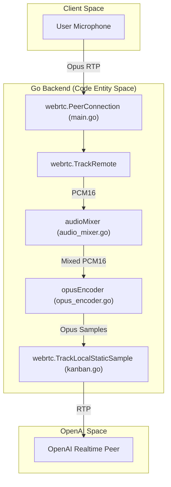
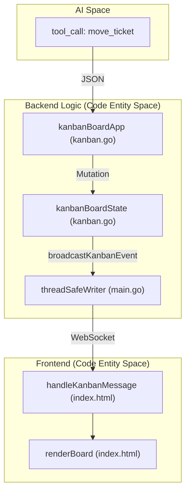

<!-- source: DeepWiki mcp.deepwiki.com · repo openai/openai-realtime-meeting-assistant · page 1 Overview · fetched 2026-10-26 -->

# Overview

Relevant source files

The following files were used as context for generating this wiki page:

- [README.md](README.md)
- [index.html](index.html)
- [kanban.go](kanban.go)
- [main.go](main.go)

The **Realtime Meeting Assistant** is a collaborative, voice-operated Kanban board designed for technical standups. It leverages the **OpenAI Realtime API** to listen to meeting participants in real-time, interpret their updates, and automatically manipulate a shared project board using function calling.

The system acts as a **Selective Forwarding Unit (SFU)**, mixing audio from multiple human participants and piping the combined stream to an AI "peer" that participates in the WebRTC session alongside them.

## Core Capabilities

*   **Voice-Driven Kanban**: Move tickets between columns (e.g., "Backlog" to "Done"), create new tickets, or add tags via natural conversation [kanban.go:91-101]().
*   **Multi-User WebRTC**: Multiple participants can join a single room with synchronized video and audio via Pion WebRTC [main.go:28-29]().
*   **Real-time State Sync**: Board updates triggered by the AI are broadcast instantly to all connected clients via WebSockets [kanban.go:485-494]().
*   **Automated AI Participation**: The backend maintains a persistent OpenAI Realtime session that functions as a virtual participant in the room [kanban.go:144-153]().

## System Components

The application is divided into three primary layers that bridge the gap between human audio and structured data mutations.

### 1. The Go Backend (SFU & Audio Mixer)
The server, written in Go, handles the heavy lifting of WebRTC signaling and audio processing. It manages a global `audioMixer` [main.go:34]() that collects Opus audio from all human participants, decodes it to PCM, mixes it, and re-encodes it for the OpenAI Realtime peer [audio_mixer.go:15-32]().

### 2. OpenAI Realtime Integration
The `kanbanBoardApp` [kanban.go:81-95]() manages a specialized WebRTC connection to OpenAI. It injects the current board state into the model's system instructions [kanban.go:343-345]() and handles incoming `function_call` events to mutate the `kanbanBoardState` [kanban.go:616-630]().

### 3. Reactive Frontend
The frontend is a single-page application (`index.html`) that renders the Kanban board and handles local media. It uses WebSockets to receive SDP signals for WebRTC and JSON snapshots of the board state [index.html:1037-1049]().

## Code Entity Space Mapping

The following diagrams illustrate how high-level concepts map to specific structures and files in the codebase.

### Audio Pipeline: From Voice to AI
This diagram shows how audio flows from a user's microphone through the backend entities to the OpenAI Realtime API.

**Sources:** [main.go:120-136](), [audio_mixer.go:115-135](), [kanban.go:155-174]()

### State Synchronization: From AI Tool to UI
This diagram shows how an AI's decision to move a ticket results in a UI update across all clients.

**Sources:** [kanban.go:656-680](), [kanban.go:485-494](), [index.html:1037-1055]()

## Getting Started

To run the assistant locally, you must provide an `OPENAI_API_KEY` and have `libopus` installed on your system.

1.  **Install Dependencies**: Requires Go 1.24+ and `libopus` [README.md:42-47]().
2.  **Set Environment**: `export OPENAI_API_KEY=<your_key>` [README.md:32-38]().
3.  **Launch**: Run `go run .` and navigate to `http://localhost:3000` [README.md:50-56]().

For a detailed step-by-step guide and common CLI flags, see **[Getting Started](#1.1)**.

## Architecture Deep Dive

The system is designed as a three-layer architecture:
1.  **Media Layer**: Pion WebRTC handles the SFU logic, fanning out video tracks and fanning in audio tracks [main.go:149-160]().
2.  **Intelligence Layer**: The OpenAI Realtime peer acts as a "silent" participant that receives the room mix and emits data events [kanban.go:201-208]().
3.  **State Layer**: A centralized Kanban state machine that ensures consistency across all connected clients [kanban.go:45-56]().

For a conceptual overview of how these layers interact, see **[System Architecture](#1.2)**.

Sources: [main.go:66-108](), [kanban.go:19-27](), [kanban.go:81-95](), [index.html:1-30](), [README.md:1-15]()

---

