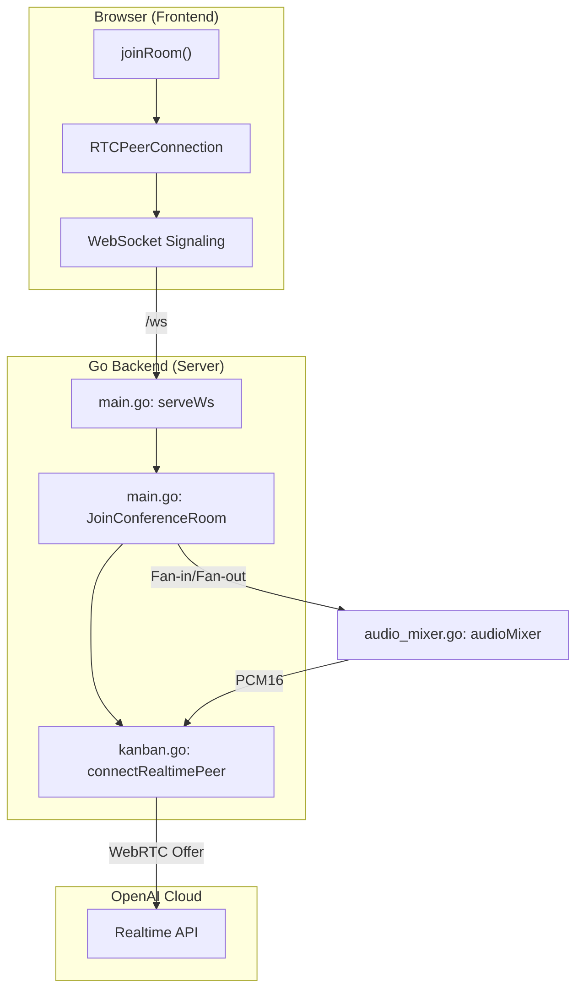
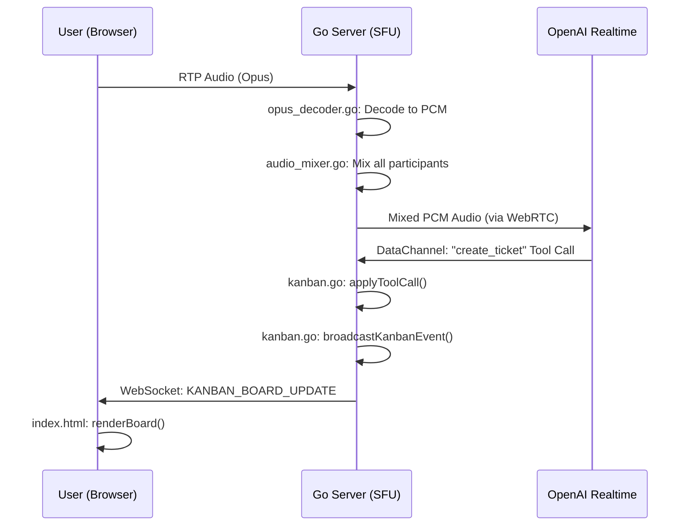

<!-- source: DeepWiki mcp.deepwiki.com · repo openai/openai-realtime-meeting-assistant · page 1.1 Getting Started · fetched 2026-10-26 -->

# Getting Started

<details>
<summary>Relevant source files</summary>

The following files were used as context for generating this wiki page:

- [.gitignore](.gitignore)
- [README.md](README.md)
- [go.mod](go.mod)

</details>


The Realtime Meeting Assistant is a collaborative, voice-operated Kanban board application. It leverages the OpenAI Realtime API to listen to multi-user conversations, understand the context of a standup meeting, and automatically manipulate a shared board state via function calling.

## Prerequisites

To run the application locally, your environment must meet the following requirements:

*   **Go 1.24+**: The project utilizes features and dependencies requiring the latest Go toolchain [go.mod:3-3]().
*   **libopus**: The application performs server-side audio decoding and encoding using CGO bindings. You must have the Opus development headers installed [README.md:44-48]().
*   **pkg-config**: Used by the Go build system to locate `libopus` [README.md:44-48]().

On macOS, these can be installed via Homebrew:
```bash
brew install opus pkg-config
```

## Environment Configuration

The server relies on environment variables for authentication and model selection. It does not automatically load `.env` files [README.md:40-40]().

| Variable | Required | Description | Default |
| :--- | :--- | :--- | :--- |
| `OPENAI_API_KEY` | **Yes** | Your OpenAI API key for Realtime API access [README.md:37-37](). | N/A |
| `OPENAI_REALTIME_MODEL` | No | The specific model ID to use for the session [README.md:110-110](). | `gpt-realtime-2` |
| `PION_NAT1TO1_IP` | No | Required if running behind NAT to provide the public IP for WebRTC candidates. | N/A |

## Execution and CLI Flags

The application is a single binary that serves both the frontend assets and the backend signaling/SFU logic.

### Running the App
```bash
export OPENAI_API_KEY=<your_api_key>
go run .
```

### CLI Flags
The server supports one primary flag for network configuration:
*   `-addr`: Sets the HTTP bind address. Defaults to `:3000` [README.md:112-112]().
    *   Example: `go run . -addr :8080` [README.md:61-61]().

## System Initialization and Data Flow

When the server starts, it initializes a global `kanbanBoardState` and attempts to establish a connection to OpenAI if the API key is present [README.md:66-66]().

### Connection Logic Diagram
This diagram maps the high-level "Natural Language" flow of joining a room to the specific "Code Entities" that handle the connection.


**Sources:** [README.md:66-73](), [kanban.go:101-101]()

## Demo Flow and Voice Commands

Once the application is running at `http://localhost:3000`, users can join the meeting. The assistant acts as a silent participant that listens to the "Room Mix" and executes tools based on the conversation.

### Recommended Interaction Sequence
1.  **Join**: Click "Join room" and allow microphone access [README.md:69-70]().
2.  **Verify**: Speak; you should see your local video and audio activity.
3.  **Command**: Use natural language to manipulate the default cards seeded in `initialKanbanBoardCards` [README.md:107-107]().

### Example Commands
The assistant is instructed via `sessionInstructions` to look for specific intent [README.md:108-108]().

| Action | Example Voice Command |
| :--- | :--- |
| **Move Ticket** | "I started the ICE restart handling ticket." [README.md:81-81]() |
| **Set Status** | "The DTLS cleanup work is blocked on a transport shutdown issue." [README.md:82-82]() |
| **Complete** | "We shipped the RTP HEVC packetizer." [README.md:83-83]() |
| **Create** | "Create a ticket to add subscription controls for simulcast forwarding." [README.md:84-84]() |
| **Tagging** | "Add the bandwidth tag to the simulcast card." [README.md:85-85]() |

### Data Flow: Voice to Board Update
The following diagram bridges the gap between the audio captured by the browser and the final state mutation on the Kanban board.


**Sources:** [README.md:10-10](), [README.md:71-71](), [kanban.go:344-380]()

## Troubleshooting
*   **No Assistant Response**: Ensure `OPENAI_API_KEY` is exported correctly. Check server logs for "connected to OpenAI" messages [README.md:66-66]().
*   **Echo/Feedback**: Use headphones. Because the server mixes all audio and sends it to OpenAI, background echo from speakers can be misinterpreted as new commands [README.md:77-77]().
*   **CGO Errors**: If the build fails with `opus.h not found`, ensure `pkg-config --cflags --libs opus` returns the correct paths for your installation [README.md:44-48]().

**Sources:**
* `README.md:10-10, 37-48, 61-85, 107-112`
* `go.mod:3-3`
* `kanban.go:101, 344-380`

---

