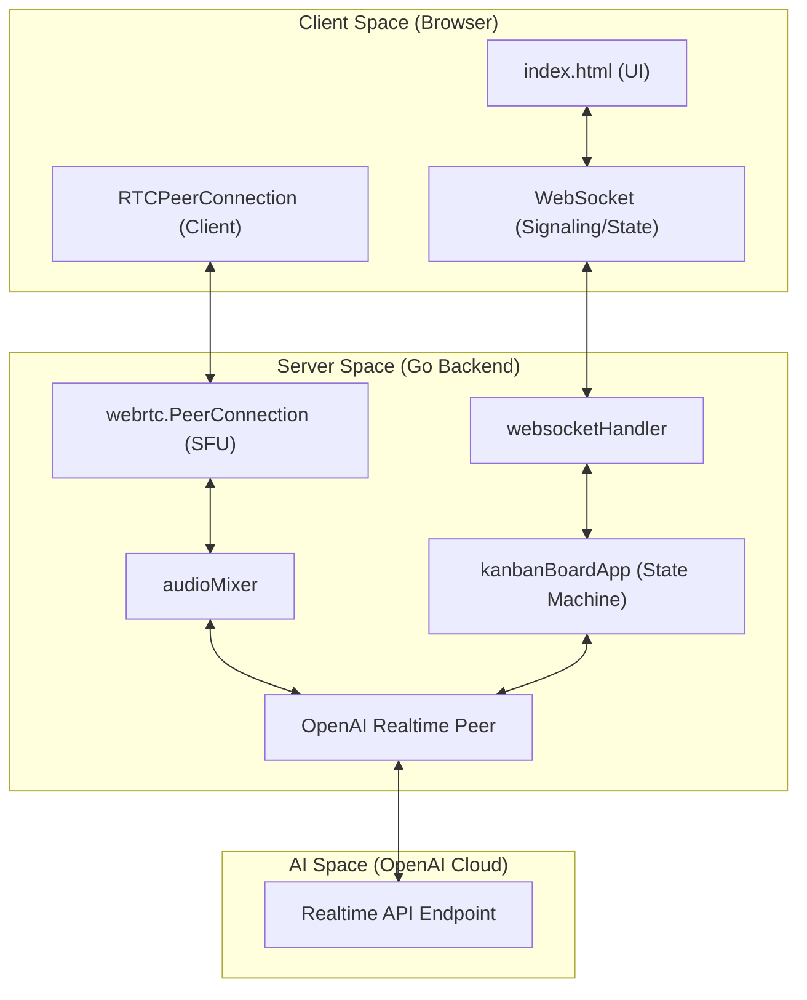
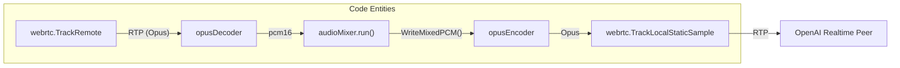
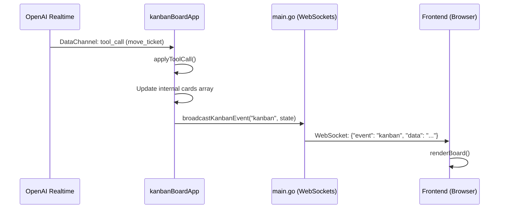

<!-- source: DeepWiki mcp.deepwiki.com · repo openai/openai-realtime-meeting-assistant · page 1.2 System Architecture · fetched 2026-10-26 -->

# System Architecture

Relevant source files

The following files were used as context for generating this wiki page:

- [README.md](README.md)
- [audio_mixer.go](audio_mixer.go)
- [kanban.go](kanban.go)
- [main.go](main.go)

The Realtime Meeting Assistant is a three-tier application designed to facilitate voice-driven interactions with a shared Kanban board. It leverages WebRTC for low-latency media transport, WebSockets for state synchronization, and the OpenAI Realtime API for natural language processing and tool execution.

### High-Level Components

1.  **Browser Frontend**: A single-page application that captures user media, renders the Kanban board, and communicates with the Go backend via WebRTC and WebSockets [[index.html:1-12]]().
2.  **Go Backend (SFU)**: A server built with Pion WebRTC that acts as a Selective Forwarding Unit (SFU). It manages room state, mixes participant audio, and coordinates communication between human peers and the AI peer [[main.go:1-35]]().
3.  **OpenAI Realtime Peer**: A server-side WebRTC client that joins the conference room as a virtual participant. It receives mixed audio from all human participants and emits board mutation events via function calling [[kanban.go:81-95]]().

### Data Flow Overview

The system maintains two primary communication loops:
*   **Media Loop**: Human participants send Opus-encoded audio/video to the SFU. The SFU decodes and mixes the audio, then re-encodes it to send to the OpenAI Realtime peer [[audio_mixer.go:26-33]](), [[kanban.go:144-180]]().
*   **State Loop**: The OpenAI peer triggers "tools" (function calls) based on the audio. These tools mutate the server-side `kanbanBoardApp` state, which is then broadcast to all frontends via WebSockets [[kanban.go:445-470]]().

#### Logical System Architecture

Sources: [main.go:21-35](), [kanban.go:81-95](), [audio_mixer.go:26-33]()

---

### The Audio Pipeline

The `audioMixer` is the heart of the server-side media processing. It aggregates audio from all human participants into a single stream for the AI.

1.  **Ingestion**: When a `webrtc.TrackRemote` of type audio is received, the server creates an `opusDecoder` [[audio_mixer.go:225-250]]().
2.  **Decoding**: Incoming RTP packets are decoded into raw PCM16 samples [[audio_mixer.go:271-282]]().
3.  **Mixing**: The `run()` loop in `audioMixer` ticks every 20ms [[audio_mixer.go:17-18]](). It pulls samples from all active `audioSource` buffers, averages them using `clampPCM16` to prevent clipping, and produces a mixed frame [[audio_mixer.go:183-208]]().
4.  **Fan-out**: The mixed PCM is sent to registered `mixedAudioSink` implementations. The `kanbanBoardApp` implements this interface to receive the mix [[audio_mixer.go:22-24]](), [[kanban.go:26-27]]().
5.  **AI Transmission**: The `kanbanBoardApp` encodes the mixed PCM back into Opus and writes it to the `inputTrack` (a `TrackLocalStaticSample`) connected to OpenAI [[kanban.go:155-179]]().

#### Audio Pipeline Entity Map

Sources: [audio_mixer.go:129-169](), [audio_mixer.go:271-282](), [kanban.go:169-180]()

---

### State Synchronization and Tool Execution

The system uses a "Server-as-Source-of-Truth" model for the Kanban board.

*   **Initial State**: The board is initialized with `initialKanbanBoardCards` [[kanban.go:97-133]]().
*   **Tool Dispatch**: When the OpenAI model identifies an intent (e.g., "Move the ICE ticket to Done"), it sends a `function_call` event over the `oai-events` DataChannel [[kanban.go:23-25]]().
*   **Mutation**: The `handleRealtimeEvent` function parses the tool arguments and calls mutation methods like `move_ticket` or `create_ticket` on the `kanbanBoardApp` [[kanban.go:445-460]]().
*   **Broadcast**: After mutation, `broadcastKanbanEvent` is called. It iterates through all active WebSockets and sends the updated board JSON [[main.go:37-40]]().

#### Tool Execution Sequence

Sources: [kanban.go:206-208](), [kanban.go:445-470](), [main.go:37-40]()

---

### SFU and Peer Management

The server maintains a global list of `peerConnections` [[main.go:28]]().

*   **Track Management**: When a new track is added by any peer, `addTrack` creates a `TrackLocalStaticRTP` and triggers `signalPeerConnections` [[main.go:120-136]]().
*   **Renegotiation**: The `signalPeerConnections` function performs the SFU logic: it ensures every peer connection is subscribed to every `trackLocal` currently in the room, excluding the peer's own tracks to prevent loopback [[main.go:150-205]]().
*   **Keyframes**: To ensure new participants see video immediately, `dispatchKeyFrame` sends RTCP PLI (Picture Loss Indicator) packets to all sources every 3 seconds [[main.go:98-102]]().

#### Peer State Tracking
| Entity | Role | Location |
| :--- | :--- | :--- |
| `peerConnectionState` | Wraps `webrtc.PeerConnection` and its WebSocket for signaling. | [main.go:42-48]() |
| `trackLocals` | Registry of all active media tracks to be forwarded. | [main.go:29]() |
| `threadSafeWriter` | Concurrency wrapper for WebSocket writes. | [main.go:241-255]() |
| `listLock` | RWMutex protecting the global peer and track lists. | [main.go:27]() |

Sources: [main.go:26-35](), [main.go:150-205](), [main.go:241-255]()

---

