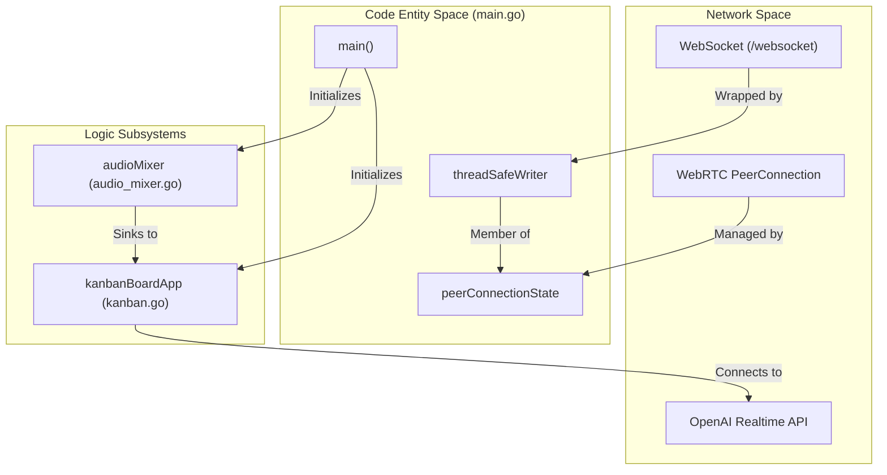
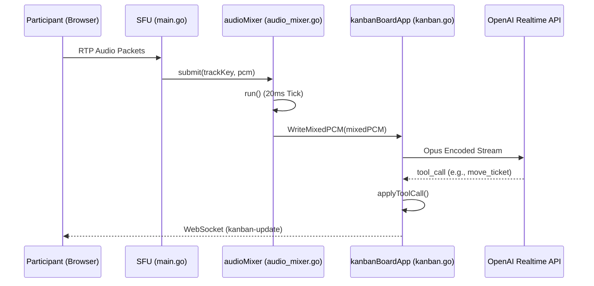

<!-- source: DeepWiki mcp.deepwiki.com · repo openai/openai-realtime-meeting-assistant · page 2 Backend Server · fetched 2026-10-26 -->

# Backend Server

Relevant source files

The following files were used as context for generating this wiki page:

- [audio_mixer.go](audio_mixer.go)
- [kanban.go](kanban.go)
- [main.go](main.go)

The backend of the Realtime Meeting Assistant is a Go-based application that serves as the central hub for WebRTC media distribution, audio processing, and state synchronization. It manages the lifecycle of browser participants and orchestrates the connection to the OpenAI Realtime API.

## Core Responsibilities

The server operates as a Selective Forwarding Unit (SFU) with an integrated audio processing engine. Its primary functions include:

*   **HTTP & WebSocket Hosting**: Serving the frontend assets and maintaining persistent signaling channels for WebRTC negotiation and Kanban state updates [main.go:88-107]().
*   **WebRTC SFU**: Managing a mesh of `RTCPeerConnection` objects, fanning out incoming media tracks to all other participants [main.go:149-218]().
*   **Audio Mixing**: Aggregating audio from all participants into a single PCM stream for the OpenAI Realtime peer [audio_mixer.go:129-169]().
*   **AI Orchestration**: Maintaining a virtual "AI Participant" (`kanbanBoardApp`) that listens to the meeting and manipulates the Kanban board [kanban.go:144-223]().

## System Architecture

The following diagram illustrates how the backend components bridge the gap between network signals and the internal logic entities.

### Backend Component Map

Sources: [main.go:21-35](), [main.go:42-48](), [main.go:66-79](), [audio_mixer.go:26-33](), [kanban.go:81-95]()

## Global State Management

The server maintains global state to track active participants and media tracks. This state is protected by `listLock` to ensure thread safety during rapid join/leave events.

| Entity | Type | Description |
| :--- | :--- | :--- |
| `peerConnections` | `[]peerConnectionState` | List of all active browser and AI peer connections [main.go:28](). |
| `trackLocals` | `map[string]*webrtc.TrackLocalStaticRTP` | Registry of media tracks currently being broadcast [main.go:29](). |
| `kanbanApp` | `*kanbanBoardApp` | The singleton managing Kanban cards and OpenAI integration [main.go:33](). |
| `roomMixer` | `*audioMixer` | The central engine for summing participant audio [main.go:34](). |

Sources: [main.go:19-35]()

## Media Flow and Tool Execution

The backend acts as a bridge between the "Natural Language Space" (audio) and the "Code Entity Space" (Kanban mutations).

### Audio to Tool Execution Flow

Sources: [audio_mixer.go:57-73](), [audio_mixer.go:156-168](), [kanban.go:217-219](), [kanban.go:1113-1120]()

## Subsystem Details

The backend logic is divided into three specialized areas:

### [WebRTC SFU and Signaling](#2.1)
Handles the `RTCPeerConnection` lifecycle, SDP exchange via WebSockets, and the fan-out logic that ensures every participant receives the video and audio tracks of every other participant. It uses a `signalPeerConnections` loop to handle renegotiation when tracks are added or removed.
*   **Key Files**: `main.go`

### [Audio Mixing Pipeline](#2.2)
Decodes incoming Opus RTP packets into raw PCM, buffers them, and mixes them every 20ms. This subsystem handles sample rate conversion, mono-to-stereo normalization, and provides the `mixedAudioSink` interface for the AI to "listen" to the room.
*   **Key Files**: `audio_mixer.go`, `opus_decoder.go`, `opus_encoder.go`

### [OpenAI Realtime Integration](#2.3)
Manages the connection to OpenAI's `/v1/realtime` endpoint. It treats the AI as a special "Peer" in the conference room, injecting the Kanban board's current state into the session instructions and executing tools based on the model's voice responses.
*   **Key Files**: `kanban.go`

Sources: [main.go:149-156](), [audio_mixer.go:12-20](), [kanban.go:243-260]()

---

