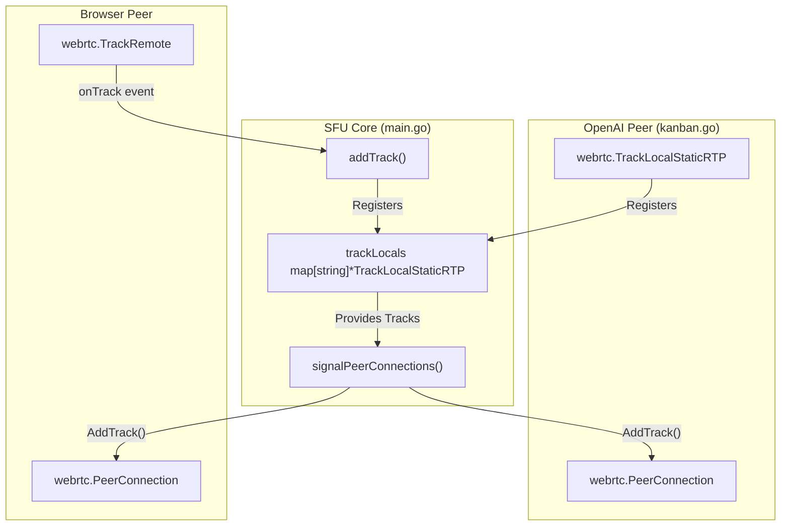
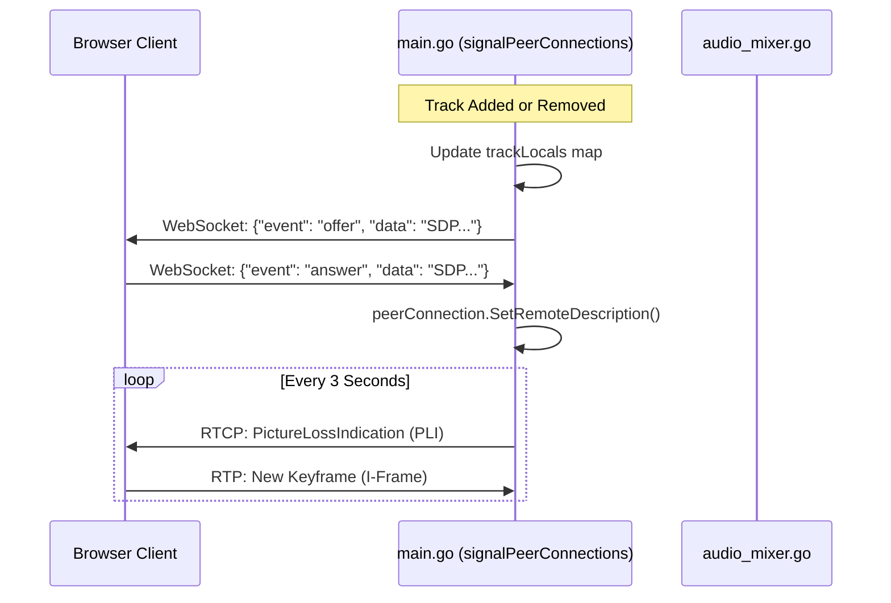

<!-- source: DeepWiki mcp.deepwiki.com · repo openai/openai-realtime-meeting-assistant · page 2.1 WebRTC SFU and Signaling · fetched 2026-10-26 -->

# WebRTC SFU and Signaling

Relevant source files

The following files were used as context for generating this wiki page:

- [go.mod](go.mod)
- [main.go](main.go)

The backend server serves as a Selective Forwarding Unit (SFU) that manages media distribution between browser clients and the OpenAI Realtime peer. It handles the lifecycle of WebRTC connections, media track fan-out, and the signaling required to keep all participants synchronized.

## Server Infrastructure

The entry point of the application is `main.go`, which initializes the HTTP server, the WebSocket signaling endpoint, and the global SFU state.

### HTTP and WebSocket Setup
The server uses `http.HandleFunc` to route requests. The root path `/` serves the frontend application, while `/websocket` handles signaling and state synchronization [main.go:88-95](). 

The `websocketHandler` upgrades incoming HTTP connections using the `gorilla/websocket` upgrader [main.go:21-23](). For every new connection, a `peerConnectionState` object is created to track the WebRTC session and its associated WebSocket [main.go:42-48]().

### Thread-Safe Writing
Because multiple goroutines (such as the Kanban event loop and the SFU signaling loop) may attempt to write to the same WebSocket simultaneously, the server wraps the connection in a `threadSafeWriter` [main.go:343-356]().

| Entity | Role |
| :--- | :--- |
| `threadSafeWriter` | Mutex-protected wrapper for `websocket.Conn` to prevent concurrent write errors [main.go:343-346](). |
| `peerConnectionState` | Stores the `RTCPeerConnection`, its signaling socket, and track filtering logic [main.go:42-48](). |
| `listLock` | A `sync.RWMutex` protecting the global `peerConnections` slice and `trackLocals` map [main.go:27-30](). |

**Sources:** [main.go:21-95](), [main.go:343-356]()

## SFU Media Flow and Track Management

The SFU implements a publish-subscribe model. When a client adds a track, it is converted into a `TrackLocalStaticRTP` and broadcast to all other peers.

### Track Lifecycle
1.  **Addition**: When a `TrackRemote` is received from a peer, `addTrack` is called. It creates a new `TrackLocalStaticRTP` with matching codecs and adds it to the global `trackLocals` map [main.go:120-136]().
2.  **Fan-out**: After adding a track, `signalPeerConnections` is triggered to update all existing `RTCPeerConnection` objects [main.go:124-125]().
3.  **Removal**: When a track ends, `removeTrack` deletes it from the map and triggers renegotiation [main.go:139-147]().

### Loopback Prevention
To prevent a user from receiving their own audio/video echo, the SFU checks the `RTCPeerConnection` receivers. If a track ID matches an incoming track on that specific peer, it is excluded from the list of tracks sent back to that peer [main.go:197-204]().

### Media Signaling Diagram
The following diagram illustrates how media tracks from different sources (Browser and OpenAI) are managed by the SFU entities.

**Media Distribution and Code Entities**

**Sources:** [main.go:120-155](), [main.go:168-217]()

## Signaling and Renegotiation

The SFU uses a "Full Mesh-like" signaling approach where the server generates offers whenever the global track state changes.

### signalPeerConnections Loop
The `signalPeerConnections` function is the core of the SFU's synchronization logic. It performs the following steps for every peer [main.go:150-260]():
1.  **Cleanup**: Removes closed connections from the `peerConnections` slice [main.go:158-163]().
2.  **Diffing**: Compares the tracks currently being sent (`GetSenders`) against the `trackLocals` map [main.go:180-195]().
3.  **Update**: Calls `AddTrack` for new media and `RemoveTrack` for stale media [main.go:189-217]().
4.  **Negotiation**: If changes occurred, it calls `CreateOffer`, updates the `LocalDescription`, and sends the SDP offer to the client via WebSocket [main.go:219-256]().

### Keyframe Dispatch (PLI)
Because WebRTC video requires a keyframe to start decoding, the SFU runs a background goroutine that dispatches a Picture Loss Indication (PLI) every 3 seconds [main.go:98-102](). The `dispatchKeyFrame` function iterates through all `RTCPeerConnection` receivers and sends a `rtcp.PictureLossIndication` packet to the source [main.go:281-294]().

**Signaling State Machine**

**Sources:** [main.go:150-260](), [main.go:281-294](), [main.go:98-102]()

## Peer Configuration

The server supports NAT traversal through a `SettingEngine`. If the `PION_NAT1TO1_IP` environment variable is set, the server configures its ICE candidates to use that specific IP, which is essential for deployments behind a 1:1 NAT or in cloud environments [main.go:110-117]().

### Connection States
The server monitors the `ConnectionState` of each peer. When a connection transitions to `PeerConnectionStateConnected`, it logs the event; if it fails or closes, the peer is eventually pruned during the next `signalPeerConnections` cycle [main.go:159-163](), [main.go:501-503]().

**Sources:** [main.go:110-117](), [main.go:159-163]()

---

