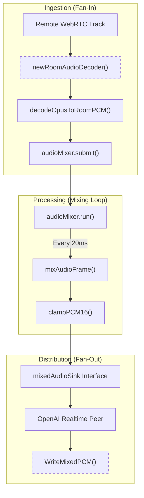
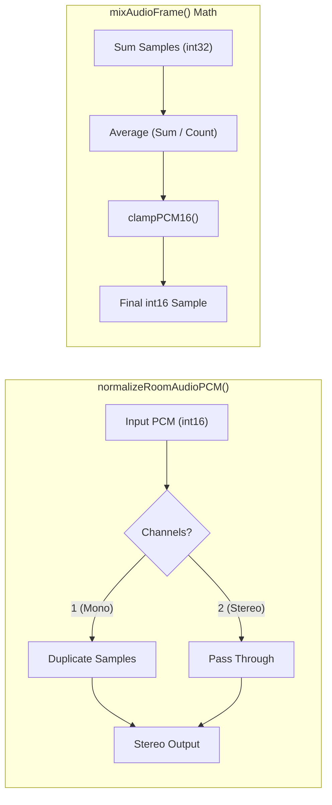

<!-- source: DeepWiki mcp.deepwiki.com · repo openai/openai-realtime-meeting-assistant · page 2.2 Audio Mixing Pipeline · fetched 2026-10-26 -->

# Audio Mixing Pipeline

<details>
<summary>Relevant source files</summary>

The following files were used as context for generating this wiki page:

- [audio_mixer.go](audio_mixer.go)
- [opus_decoder.go](opus_decoder.go)
- [opus_encoder.go](opus_encoder.go)

</details>


The Audio Mixing Pipeline is responsible for aggregating incoming audio tracks from multiple WebRTC participants, decoding them from Opus to PCM, mixing them into a single coherent stream, and fanning that stream out to consumers—primarily the OpenAI Realtime API. It operates on a high-precision 20ms tick loop to ensure low-latency processing and consistent audio quality.

## Pipeline Architecture

The pipeline follows a fan-in/fan-out architecture centered around the `audioMixer` [audio_mixer.go:26-33](). Multiple remote tracks submit decoded PCM data into a central channel, which is then processed by a background worker and distributed to registered sinks.

### Data Flow Diagram: Natural Language to Code Entities

The following diagram maps the conceptual audio flow to the specific Go structs and functions that implement the pipeline.

**Audio Pipeline Entity Mapping**


Sources: [audio_mixer.go:45-55](), [audio_mixer.go:129-169](), [audio_mixer.go:183-208](), [audio_mixer.go:225-250](), [audio_mixer.go:271-282]()

## The audioMixer Implementation

The `audioMixer` manages the lifecycle of audio sources and sinks. It uses a `sync.Mutex` to protect the map of sinks and a channel-based `input` mechanism to receive audio frames from various tracks asynchronously [audio_mixer.go:26-33]().

### Mixing Constants
The mixer is configured for high-fidelity conference audio:
| Constant | Value | Description |
| :--- | :--- | :--- |
| `roomAudioSampleRate` | 48000 | 48kHz sampling rate [audio_mixer.go:13]() |
| `roomAudioChannels` | 2 | Stereo output [audio_mixer.go:14]() |
| `roomAudioMixInterval` | 20ms | Tick rate for the mixing loop [audio_mixer.go:17]() |
| `roomAudioMixFrameSize` | 1920 samples | Calculated as `48000 / 50 * 2` [audio_mixer.go:18]() |

### The Mixing Loop
The `run()` method [audio_mixer.go:129-169]() executes the core logic:
1.  **Buffer Ingestion**: Incoming `audioInput` packets are appended to per-track `audioSource` buffers [audio_mixer.go:152]().
2.  **Overflow Protection**: To prevent memory leaks or excessive latency, source buffers are capped at `audioSourceLimit` (1 second of audio) [audio_mixer.go:153-155]().
3.  **Tick Execution**: Every 20ms, the mixer calls `mixAudioFrame()` [audio_mixer.go:157]().
4.  **Normalization**: The mixer averages the samples from all ready sources and applies `clampPCM16` to prevent clipping [audio_mixer.go:195-201]().
5.  **Fan-out**: The resulting `mixedPCM` is written to all registered `mixedAudioSink` implementations [audio_mixer.go:162-166]().

Sources: [audio_mixer.go:12-20](), [audio_mixer.go:129-169](), [audio_mixer.go:183-208]()

## Opus Codec Integration

The system uses `cgo` bindings to `libopus` for high-performance audio encoding and decoding.

### Memory Management Strategy
Because the Opus C-structs are managed via `cgo`, the application uses a specific memory management strategy to avoid GC overhead and ensure safety:
*   **Go-allocated C-structs**: Instead of `C.malloc`, the decoder and encoder structs allocate a Go byte slice (`mem`) of the size required by Opus [opus_decoder.go:26-30](), [opus_encoder.go:28-33]().
*   **Pointer Casting**: The pointer to the first element of the Go slice is cast to a C pointer (`*C.OpusDecoder` or `*C.OpusEncoder`). This ensures the memory is managed by the Go garbage collector while remaining accessible to the C library [opus_decoder.go:28](), [opus_encoder.go:30]().

### Decoder (`opusDecoder`)
The `newOpusDecoder` function initializes the decoder for a specific sample rate and channel count [opus_decoder.go:20-38](). The `Decode` method takes raw Opus bytes and populates a provided `int16` PCM buffer [opus_decoder.go:40-67]().

### Encoder (`opusEncoder`)
The `newOpusEncoder` function initializes the encoder with the `OPUS_APPLICATION_VOIP` setting for optimized speech transmission [opus_encoder.go:35-40](). The `Encode` method converts PCM samples into a compressed Opus packet [opus_encoder.go:47-71]().

Sources: [opus_decoder.go:14-18](), [opus_decoder.go:20-38](), [opus_encoder.go:16-20](), [opus_encoder.go:22-45]()

## Audio Normalization and Conversion

The pipeline ensures all audio entering the mixer is uniform (Stereo, 48kHz).

### Mono-to-Stereo Conversion
If a remote track provides mono audio (1 channel), the `normalizeRoomAudioPCM` function converts it to stereo by duplicating the sample for both left and right channels [audio_mixer.go:286-293]().

### PCM Clamping
To handle potential overflows when summing multiple audio sources, `clampPCM16` ensures the `int32` sum of samples is safely restricted to the `int16` range (-32768 to 32767) [audio_mixer.go:210-219]().

**Normalization Logic Flow**


Sources: [audio_mixer.go:195-201](), [audio_mixer.go:210-219](), [audio_mixer.go:284-299]()

## Interface: mixedAudioSink

The `mixedAudioSink` interface [audio_mixer.go:22-24]() allows any component to receive the final mixed audio stream. The primary implementation is the OpenAI Realtime Peer, which consumes the mixed audio to provide the AI with the full context of the meeting room.

```go
type mixedAudioSink interface {
	WriteMixedPCM([]int16) error
}
```

Sources: [audio_mixer.go:22-24](), [audio_mixer.go:162-166]()

---

