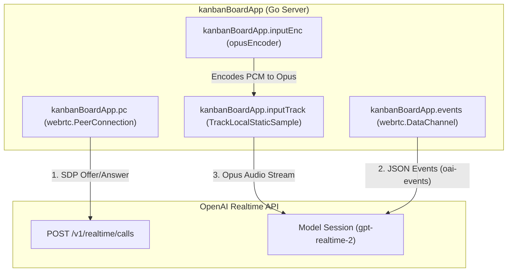
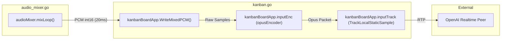

<!-- source: DeepWiki mcp.deepwiki.com · repo openai/openai-realtime-meeting-assistant · page 2.3 OpenAI Realtime Integration · fetched 2026-10-26 -->

# OpenAI Realtime Integration

Relevant source files

The following files were used as context for generating this wiki page:

- [README.md](README.md)
- [kanban.go](kanban.go)

The `kanbanBoardApp` acts as a virtual participant in the meeting room, bridging the WebRTC audio mixer with the OpenAI Realtime API. It facilitates a voice-driven interface where the model listens to the mixed room audio and executes tools to manipulate the Kanban board state.

## Peer Connection Setup

The integration begins in `JoinConferenceRoom`, which initializes a `webrtc.PeerConnection` specifically for the OpenAI Realtime session. Unlike browser clients, this peer is managed entirely on the server.

### Audio Pipeline Initialization
To send audio to OpenAI, the application creates a `TrackLocalStaticSample` with Opus codec capabilities.
*   **Input Track**: A local track is created using `webrtc.NewTrackLocalStaticSample` [kanban.go:155-163]().
*   **Opus Encoder**: Since the internal mixer provides raw PCM, a new `opusEncoder` is initialized to compress audio before transmission [kanban.go:169-173]().
*   **RTCP Handling**: The application spawns a `drainRTCP` goroutine to consume incoming RTCP packets (like Receiver Reports), ensuring the stack remains responsive [kanban.go:180]().

### Data Channel (oai-events)
A DataChannel named `oai-events` is created to handle bidirectional JSON signaling with the model [kanban.go:182-186]().
*   **OnOpen**: Once the channel is ready, it triggers a `session.update` event to configure the model's behavior [kanban.go:201-205]().
*   **OnMessage**: Incoming events (transcriptions, tool calls) are routed to `handleRealtimeEvent` [kanban.go:206-208]().

**Sources:** [kanban.go:144-223](), [kanban.go:19-27]()

## Realtime Session Flow

The connection to OpenAI uses a WebRTC-based signaling flow over HTTPS. This is orchestrated by `connectRealtimePeer`.

### SDP Offer/Answer Exchange
1.  **Offer Generation**: The Go backend generates a local SDP offer [kanban.go:245-248]().
2.  **POST Request**: The offer is sent to `https://api.openai.com/v1/realtime/calls` via an authenticated `POST` request [kanban.go:250-264]().
3.  **Answer Set**: The OpenAI API returns an SDP answer, which is applied as the `RemoteDescription` [kanban.go:281-284]().

### Connection Topology
The following diagram illustrates the relationship between the `kanbanBoardApp` code entities and the external OpenAI Realtime service.

**OpenAI Realtime Connectivity**

**Sources:** [kanban.go:20-27](), [kanban.go:81-95](), [kanban.go:243-286]()

## Session Configuration

Once the `oai-events` channel is open, the application sends a `session.update` event to define the assistant's persona and technical parameters.

### Model Parameters
The session is configured with specific audio and transcription settings:
*   **Model**: Defaults to `gpt-realtime-2` [kanban.go:21]().
*   **VAD (Voice Activity Detection)**: Enabled to allow the model to detect when users are speaking.
*   **Transcription**: Enabled using `whisper-1` to receive text previews of what the model hears [kanban.go:537-542]().

### Dynamic Context Injection
The `sessionInstructions` function generates the system prompt. Crucially, it injects the current board state into the prompt using `boardContextJSON()` [kanban.go:509](). This ensures the model knows which cards exist, their IDs, and their current status before it attempts to move or update them.

**Sources:** [kanban.go:502-531](), [kanban.go:533-556]()

## Audio Forwarding (WriteMixedPCM)

The `kanbanBoardApp` implements the `mixedAudioSink` interface, allowing it to receive mixed audio from the `audioMixer`.

### Implementation of WriteMixedPCM
The `audioMixer` calls `WriteMixedPCM` every 20ms with a buffer of `int16` samples [kanban.go:296-300]().
1.  **Encoding**: The samples are passed to `app.inputEnc.Encode`, which returns an Opus-encoded bitstream [kanban.go:310-313]().
2.  **Transmission**: The encoded packet is wrapped in a `media.Sample` and written to the `inputTrack` [kanban.go:315-318]().
3.  **Timing**: The `Duration` is set to 20ms to maintain proper playback timing on the remote end [kanban.go:316]().

**Data Flow: Mixer to OpenAI**

**Sources:** [kanban.go:296-320](), [audio_mixer.go:121-125]()

## Event Handling

The `handleRealtimeEvent` function processes all incoming DataChannel messages. It handles several key event types:

| Event Type | Action |
| :--- | :--- |
| `conversation.item.input_audio_transcription.completed` | Logs the user's transcribed speech for debugging [kanban.go:338-341](). |
| `response.audio_transcript.delta` | (Optional) Can be used for real-time captions of the AI response. |
| `response.done` | Inspects the response for `function_call` items to trigger board mutations [kanban.go:343-356](). |
| `error` | Logs API errors and broadcasts status updates to the frontend [kanban.go:358-362](). |

**Sources:** [kanban.go:322-364]()

---

