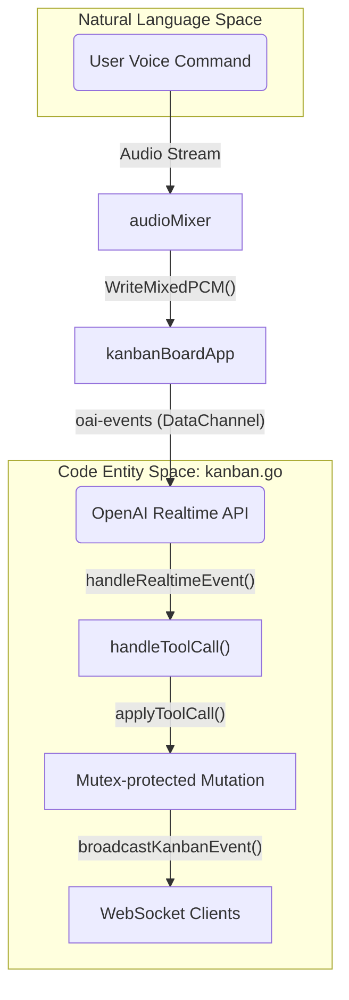
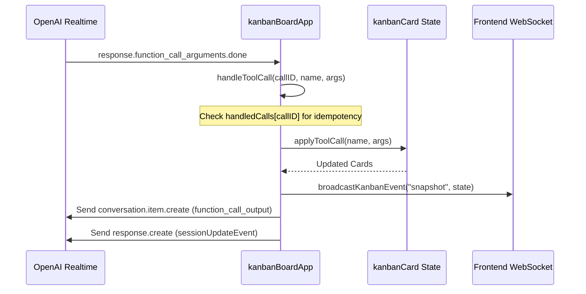

<!-- source: DeepWiki mcp.deepwiki.com · repo openai/openai-realtime-meeting-assistant · page 3 Kanban Board Logic · fetched 2026-10-26 -->

# Kanban Board Logic

Relevant source files

The following files were used as context for generating this wiki page:

- [kanban.go](kanban.go)

The Kanban Board Logic serves as the server-side state machine for the meeting assistant. It bridges the gap between the **Natural Language Space** (user voice commands) and the **Code Entity Space** (structured data and tool execution). The logic is responsible for maintaining a consistent board state, exposing that state to the AI model, and executing mutations based on the model's tool calls.

### System Overview

The Kanban logic is encapsulated within the `kanbanBoardApp` struct. It manages a collection of `kanbanCard` objects and coordinates with the OpenAI Realtime API to provide an interactive, voice-controlled project management experience.

#### High-Level Interaction Flow

The following diagram illustrates how a voice command translates into a state update on the Kanban board.

**Natural Language to Code Entity Mapping**

Sources: [kanban.go:81-95](), [kanban.go:206-208](), [kanban.go:217-219](), [kanban.go:343-345]()

---

### Data Model and State Management

The core of the system is a thread-safe state machine that manages the lifecycle of Kanban cards. The state is represented by a slice of `kanbanCard` objects, each possessing a status (Backlog, In Progress, Blocked, or Done), a title, notes, and tags.

Key components of state management include:
*   **Thread Safety**: All mutations to the `cards` slice are protected by a `sync.Mutex` in the `kanbanBoardApp` struct.
*   **Idempotency**: A `handledCalls` map tracks `call_id` strings from the AI to ensure that a single tool invocation is never processed twice.
*   **Context Injection**: The `boardContextJSON()` method generates a compact JSON representation of the board, which is injected into the AI's system instructions so it "sees" the current state of the project.
*   **State Synchronization**: Whenever the board changes, `broadcastKanbanEvent()` is called to push the new state to all connected frontend clients via WebSockets.

For a deep dive into the structs and synchronization primitives, see **[Data Model and State Management (#3.1)](#)**.

Sources: [kanban.go:29-56](), [kanban.go:81-86](), [kanban.go:610-618](), [kanban.go:641-655]()

---

### AI Tool Definitions and Execution

The assistant interacts with the board using a set of five predefined tools. These tools are defined as JSON schemas and shared with the OpenAI model during the session configuration phase.

| Tool Name | Purpose |
| :--- | :--- |
| `create_ticket` | Adds a new card to the Backlog. |
| `move_ticket` | Transitions a card between statuses (e.g., Backlog to In Progress). |
| `update_ticket` | Modifies the title or notes of an existing card. |
| `add_tags` | Appends new labels to a specific card. |
| `do_nothing` | Explicitly signals that no action is required. |

#### Tool Execution Pipeline

When the AI decides to take action, it sends a `response.function_call_arguments.done` event. The server then validates the request and applies the change.

**Tool Execution Sequence**

For detailed schema definitions and the dispatch loop logic, see **[AI Tool Definitions and Execution (#3.2)](#)**.

Sources: [kanban.go:343-380](), [kanban.go:432-460](), [kanban.go:502-530]()

---

