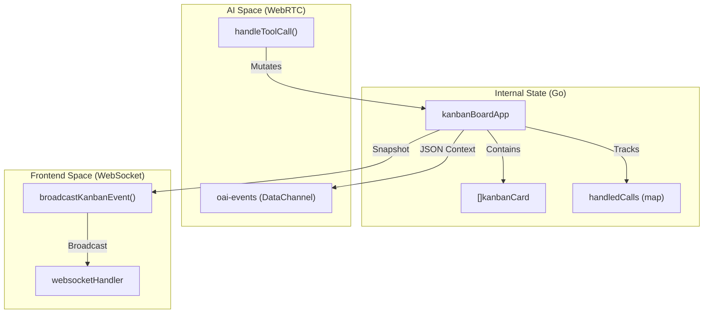
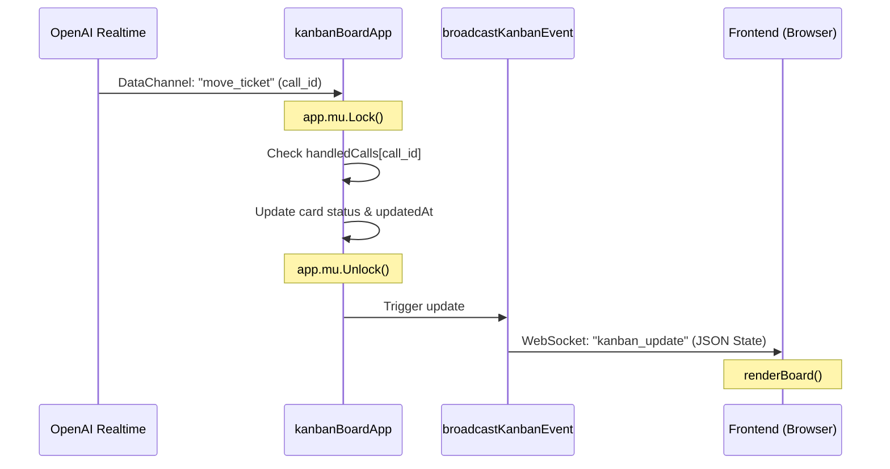

<!-- source: DeepWiki mcp.deepwiki.com · repo openai/openai-realtime-meeting-assistant · page 3.1 Data Model and State Management · fetched 2026-10-26 -->

# Data Model and State Management

Relevant source files

The following files were used as context for generating this wiki page:

- [kanban.go](kanban.go)
- [main.go](main.go)

This page documents the server-side data structures and state management mechanisms for the Kanban board. The system uses a centralized Go-based state machine to manage ticket lifecycles, ensuring consistency between the AI assistant's actions and the frontend visualization.

## Kanban Data Structures

The Kanban board state is defined by a collection of cards, each possessing a status, title, and metadata. The system uses a strictly typed enum for column management.

### kanbanStatus Enum
The `kanbanStatus` type defines the valid columns for the board:
*   `Backlog` [kanban.go:32]()
*   `In Progress` [kanban.go:33]()
*   `Blocked` [kanban.go:34]()
*   `Done` [kanban.go:35]()

### Core Structs
The board's internal representation is managed through three primary structures:

| Struct | Purpose | Key Fields |
| :--- | :--- | :--- |
| `kanbanCard` | Represents an individual ticket. | `ID`, `Status`, `Title`, `Notes`, `Tags` [kanban.go:45-51]() |
| `kanbanBoardState` | A serializable snapshot of the entire board. | `Cards`, `UpdatedAt` [kanban.go:53-56]() |
| `kanbanBoardApp` | The global application state and AI peer controller. | `cards`, `mu` (Mutex), `handledCalls` (Idempotency map) [kanban.go:81-95]() |

**Sources:** [kanban.go:29-56](), [kanban.go:81-95]()

## State Initialization and Seeding

Upon startup, the `kanbanBoardApp` is initialized with a set of seed data to provide immediate context for the meeting assistant.

### Seed Data
The `initialKanbanBoardCards` slice contains five default tickets related to WebRTC infrastructure tasks, such as "Add RTP Retransmission Buffer" and "Implement ICE Restart Handling" [kanban.go:97-133]().

### Initialization Flow
1.  `main()` calls `newKanbanBoardApp()` [main.go:74]().
2.  `newKanbanBoardApp` clones the seed data into the app's internal `cards` slice [kanban.go:137]().
3.  The `updatedAt` timestamp is set to the current UTC time [kanban.go:139]().
4.  The `handledCalls` map is initialized to track processed AI tool calls [kanban.go:140]().

**Sources:** [kanban.go:97-142](), [main.go:74]()

## State Mutation and Thread Safety

All modifications to the Kanban board are protected by a `sync.Mutex` within the `kanbanBoardApp` struct to prevent race conditions during concurrent updates from multiple WebRTC or WebSocket clients.

### Mutation Pattern
The system follows a strict pattern for modifying state:
1.  **Lock**: Acquire `app.mu.Lock()` [kanban.go:449]().
2.  **Modify**: Update the `cards` slice or specific card properties.
3.  **Timestamp**: Update `app.updatedAt = time.Now().UTC()` [kanban.go:453]().
4.  **Unlock**: Release `app.mu.Unlock()` [kanban.go:454]().
5.  **Broadcast**: Fan-out the new state to all connected clients via `broadcastKanbanEvent` [kanban.go:455]().

### Idempotency Management
To prevent the AI model from executing the same tool multiple times (e.g., due to network retries or model loops), the `handledCalls` map stores `call_id` strings [kanban.go:86](). The `handleToolCall` function checks this map before applying any mutations [kanban.go:394-398]().

**Sources:** [kanban.go:81-95](), [kanban.go:394-398](), [kanban.go:448-456]()

## State Serialization and AI Context

The AI model requires a text-based representation of the board to understand the current state before making decisions.

### snapshotState()
This method returns a `kanbanBoardState` struct containing a deep copy of the current cards [kanban.go:484-491](). It is used primarily for broadcasting updates to the frontend.

### boardContextJSON()
This method serializes the current board into a JSON string [kanban.go:493-500](). This JSON is injected into the OpenAI Realtime `session.instructions` so the model "sees" the board state in its system prompt [kanban.go:277-285]().

**Sources:** [kanban.go:484-500](), [kanban.go:277-285]()

## Communication and Fan-out

The system uses two primary channels for state synchronization: WebRTC DataChannels for the AI and WebSockets for the human-facing frontend.

### Entity Relationship: State to Communication
The following diagram illustrates how internal Go structs map to external communication events.

**Diagram: State Synchronization Flow**

**Sources:** [kanban.go:81-95](), [kanban.go:394-405](), [main.go:270-285]()

### broadcastKanbanEvent
This function facilitates the "fan-out" of state changes. It iterates through all active `peerConnections` and writes a `websocketMessage` to each client's `threadSafeWriter` [main.go:270-285]().

**Diagram: Data Mutation and Fan-out**

**Sources:** [kanban.go:394-410](), [kanban.go:448-456](), [main.go:270-285]()

## Summary of Key Functions

| Function | Location | Description |
| :--- | :--- | :--- |
| `newKanbanBoardApp` | [kanban.go:135]() | Initializes the application state with seed data. |
| `handleToolCall` | [kanban.go:394]() | Entry point for AI-driven mutations; handles idempotency. |
| `applyToolCall` | [kanban.go:414]() | Dispatches specific mutation logic (create, move, tag). |
| `broadcastKanbanEvent` | [main.go:270]() | Sends a named event and JSON payload to all connected WebSockets. |
| `snapshotState` | [kanban.go:484]() | Generates a thread-safe copy of the board for external consumption. |

**Sources:** [kanban.go:135-142](), [kanban.go:394-410](), [kanban.go:414-446](), [kanban.go:484-491](), [main.go:270-285]()

---

