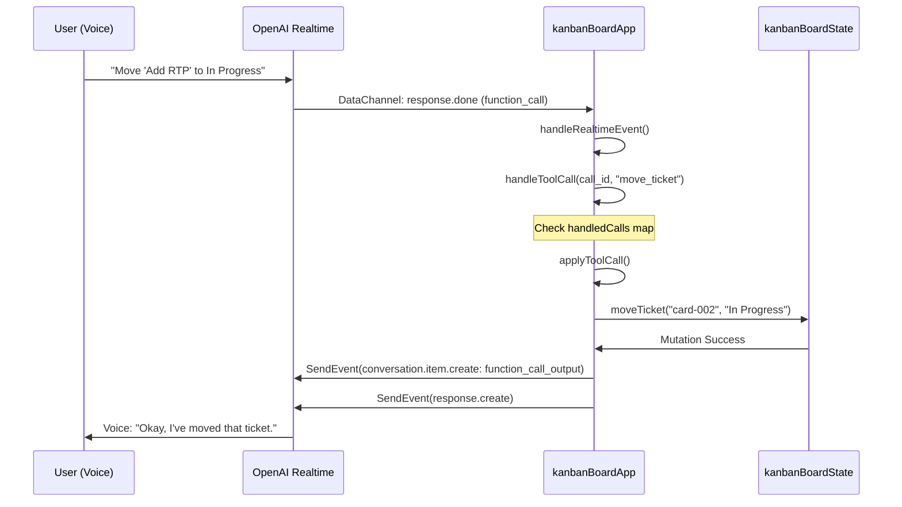
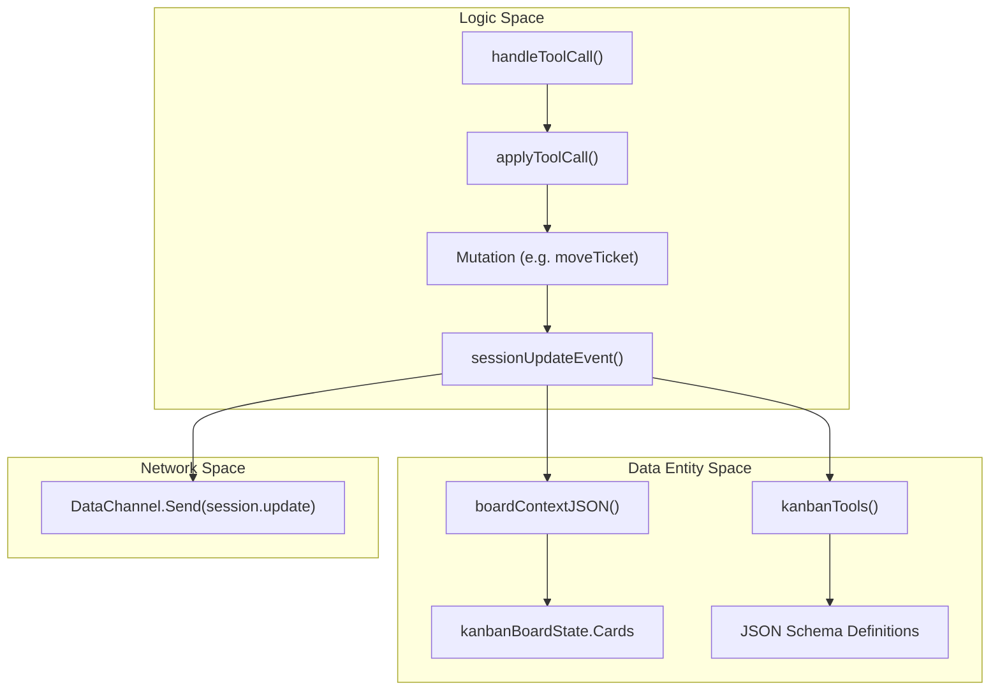

<!-- source: DeepWiki mcp.deepwiki.com · repo openai/openai-realtime-meeting-assistant · page 3.2 AI Tool Definitions and Execution · fetched 2026-10-26 -->

# AI Tool Definitions and Execution

Relevant source files

The following files were used as context for generating this wiki page:

- [kanban.go](kanban.go)

The Kanban Assistant utilizes the OpenAI Realtime API to perform structured mutations on the board state via function calling. This page details the JSON schema definitions of these tools, the event dispatch loop for processing model requests, and the execution flow that ensures data integrity and model feedback.

## Tool Definitions (JSON Schema)

The tools available to the AI model are defined in `kanbanTools()` using the standard OpenAI function calling schema. These definitions are injected into the session configuration during the `session.update` event.

| Tool Name | Purpose | Key Parameters |
| :--- | :--- | :--- |
| `create_ticket` | Adds a new card to the board. | `title`, `status`, `notes`, `tags` |
| `move_ticket` | Changes the status of an existing card. | `id`, `status` |
| `add_tags` | Appends tags to an existing card. | `id`, `tags` |
| `update_ticket` | Modifies title or notes of a card. | `id`, `title`, `notes` |
| `do_nothing` | Explicitly acknowledges a command without action. | `reason` |

The schema defines `kanbanStatus` as an enum: `Backlog`, `In Progress`, `Blocked`, `Done` [kanban.go:31-36]().

### Tool Implementation Details
- **`create_ticket`**: Automatically assigns a unique ID using an internal counter `nextCreatedIndex` [kanban.go:572-575]().
- **`move_ticket`**: Transitions a card between columns. If a card is moved to `Done`, the frontend triggers a confetti effect [kanban.go:598-600]().
- **`do_nothing`**: Used when the model determines a user's request is out of scope or requires no state change, providing a `reason` for the transcript [kanban.go:635-637]().

Sources: [kanban.go:31-36](), [kanban.go:518-644](), [kanban.go:572-575](), [kanban.go:598-600](), [kanban.go:635-637]()

## Event Dispatch and Tool Execution

The system processes model requests through a structured pipeline that bridges the Realtime API's asynchronous events with the backend's synchronous state mutations.

### The Realtime Event Loop
The `handleRealtimeEvent` function serves as the primary ingress for DataChannel messages from OpenAI. It parses the incoming JSON into a `kanbanRealtimeEvent` struct and dispatches based on the `type` field [kanban.go:414-419]().

1.  **`response.done`**: Triggered when the model finishes a turn. The server iterates through `event.Response.Output` to find items of type `function_call` [kanban.go:426-435]().
2.  **`conversation.item.created`**: Specifically monitors for `function_call` items to trigger the execution logic [kanban.go:421-424]().

### Idempotency and Mutation
To prevent duplicate executions of the same tool call (e.g., due to network retries or model re-transmission), the `kanbanBoardApp` maintains a `handledCalls` map [kanban.go:86]().

- **`handleToolCall`**: Checks if the `call_id` exists in the map. If not, it marks it as handled and invokes `applyToolCall` [kanban.go:445-453]().
- **`applyToolCall`**: A large switch statement that unmarshals the tool arguments and calls the corresponding mutation method (e.g., `createTicket`, `moveTicket`) [kanban.go:462-506]().

### Feedback Loop
After a tool is executed, the server must inform the model of the result so the model can continue the conversation (e.g., saying "I've moved that ticket for you").
1.  The server sends a `conversation.item.create` event with `type: "function_call_output"` containing the tool result [kanban.go:509-514]().
2.  The server sends a `response.create` event to prompt the model to generate a verbal response [kanban.go:438-442]().

Sources: [kanban.go:86](), [kanban.go:414-419](), [kanban.go:421-424](), [kanban.go:426-435](), [kanban.go:438-442](), [kanban.go:445-453](), [kanban.go:462-506](), [kanban.go:509-514]()

## Data Flow: Voice to Mutation

The following diagram illustrates the flow from a user's voice command to a state mutation on the Kanban board.

**Natural Language to Kanban Mutation Flow**

Sources: [kanban.go:414-442](), [kanban.go:462-506](), [kanban.go:593-605]()

## Session Refresh and Context Sync

Because the Kanban board is dynamic, the model's instructions must be updated whenever the board state changes. This ensures the model "knows" which IDs exist and what their current status is.

### `sessionUpdateEvent`
Whenever a tool execution modifies the board, the `kanbanBoardApp` generates a new session configuration [kanban.go:361-383]():
1.  **Dynamic Context**: It calls `boardContextJSON()` to get a minified JSON representation of all cards [kanban.go:691-700]().
2.  **System Instructions**: It wraps this JSON in a system prompt that explains the board's current state [kanban.go:375-376]().
3.  **Tool Injection**: It re-attaches the tool definitions from `kanbanTools()` [kanban.go:377]().

This updated session is sent to OpenAI via the `session.update` event, effectively "refreshing" the AI's memory with the latest board state [kanban.go:203]().

**Code Entity Association: Session Update**

Sources: [kanban.go:203](), [kanban.go:361-383](), [kanban.go:375-377](), [kanban.go:691-700]()

---

