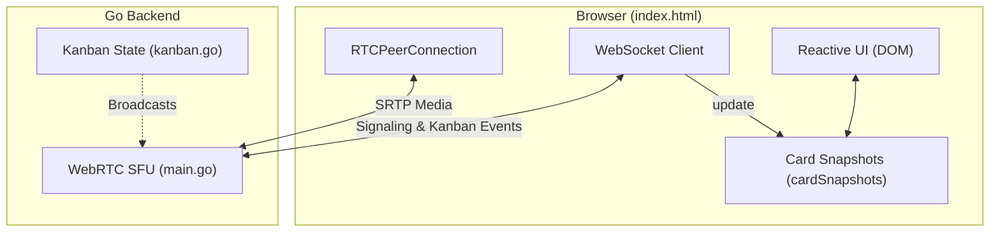
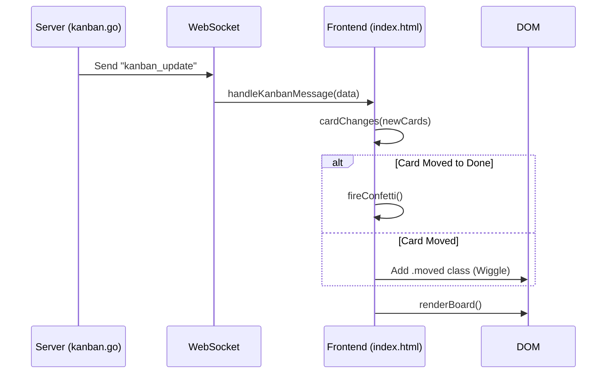

<!-- source: DeepWiki mcp.deepwiki.com · repo openai/openai-realtime-meeting-assistant · page 4 Frontend Application · fetched 2026-10-26 -->

# Frontend Application

Relevant source files

The following files were used as context for generating this wiki page:

- [index.html](index.html)

The frontend of the Realtime Meeting Assistant is a single-page application (SPA) built with vanilla JavaScript and CSS, served directly from `index.html`. It acts as a WebRTC client for multi-user video/audio conferencing and a reactive Kanban board that synchronizes in real-time with the server-side AI assistant.

### System Overview

The application is structured around two primary communication channels:
1.  **WebRTC PeerConnection**: Handles the negotiation and transport of media tracks (audio/video) and the OpenAI Realtime API's audio stream via the Go backend SFU.
2.  **WebSocket Connection**: Serves as the signaling plane for WebRTC (SDP/ICE exchange) and the state synchronization plane for the Kanban board data.

Sources: [index.html:1-30](), [index.html:105-185]()

---

### WebRTC and Connection Management

The frontend manages the lifecycle of the meeting through `joinRoom()` and `leaveRoom()` functions. It utilizes `getUserMedia` to capture local media and interfaces with the `RTCPeerConnection` API to establish a session with the backend SFU. 

Key responsibilities include:
*   **Signaling**: Processing `offer`, `answer`, and `candidate` messages via the `handleSignal()` function [index.html:565-586]().
*   **Media Rendering**: Dynamically creating `<video>` elements for remote participants and managing the "video rail" UI [index.html:588-620]().

For details, see [WebRTC Client and WebSocket Signaling](#4.1).

Sources: [index.html:500-530](), [index.html:565-586]()

---

### Kanban Board and Reactive UI

The Kanban board is a high-fidelity, reactive interface that reflects the state of the `kanbanBoardState` maintained on the server. The UI is reconstructed via `renderBoard()` whenever a `kanban_sync` or `kanban_update` event is received over the WebSocket.

#### UI Interaction Model
| Component | Function | Description |
| :--- | :--- | :--- |
| **Board Surface** | `renderBoard()` | Iterates through columns (Backlog, In Progress, Blocked, Done) and renders cards. |
| **Card Diffing** | `cardChanges()` | Identifies new or moved cards by comparing the current state against `cardSnapshots`. |
| **Animations** | `card-move-wiggle` | A CSS animation applied to cards that have changed columns [index.html:279-286](). |
| **Modals** | `showCardDetail()` | Displays card descriptions, tags, and owners in an overlay. |

#### State Synchronization Flow
The frontend maintains a local cache of card positions to trigger visual cues (like confetti or wiggles) when the AI or other users modify the board.

Sources: [index.html:758-790](), [index.html:865-900](), [index.html:1020-1050]()

For details, see [Kanban Board UI and Reactive Rendering](#4.2).

---

### Visual Components and Utilities

The frontend includes several utility systems to enhance the user experience without external dependencies:
*   **Identicons**: The `renderIdenticon()` function generates unique SVG avatars for card owners using an FNV-1a hash of the owner's name [index.html:1120-1155]().
*   **Toast System**: A non-blocking notification stack managed via `showToast()` to alert users of board changes or connection status [index.html:1080-1110]().
*   **Audio Visualizer**: (If applicable) Logic to provide visual feedback for active speakers in the video rail.

Sources: [index.html:298-320](), [index.html:1120-1155]()

---

