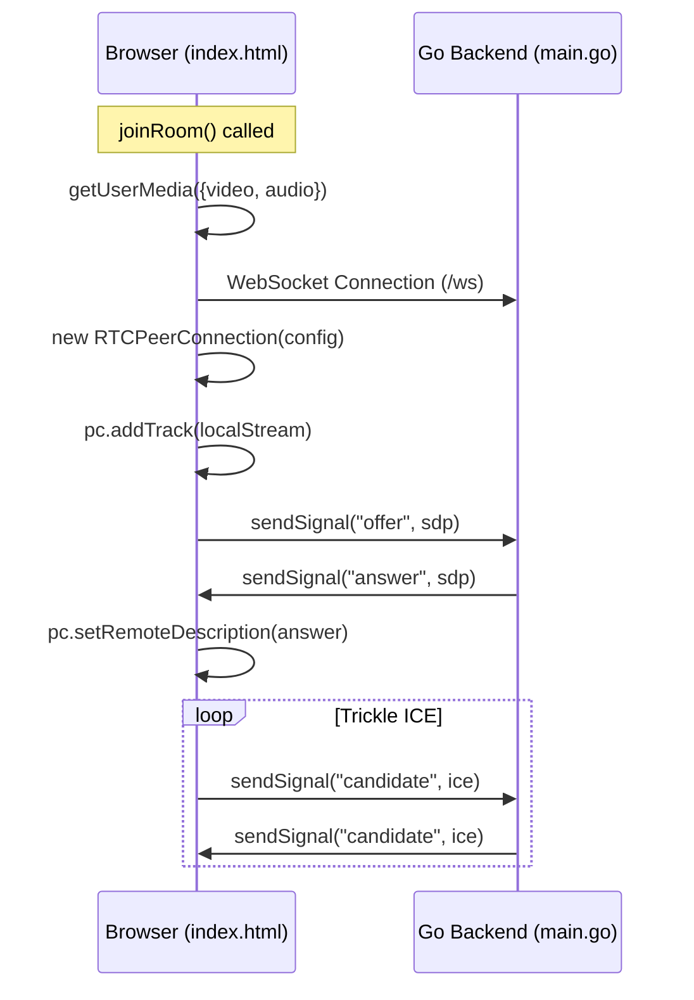
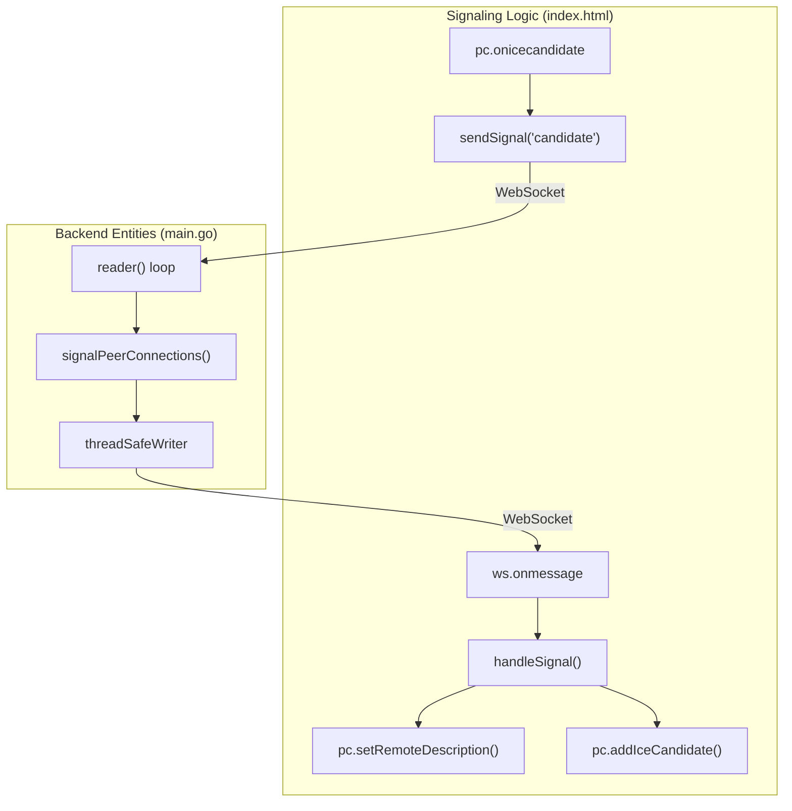
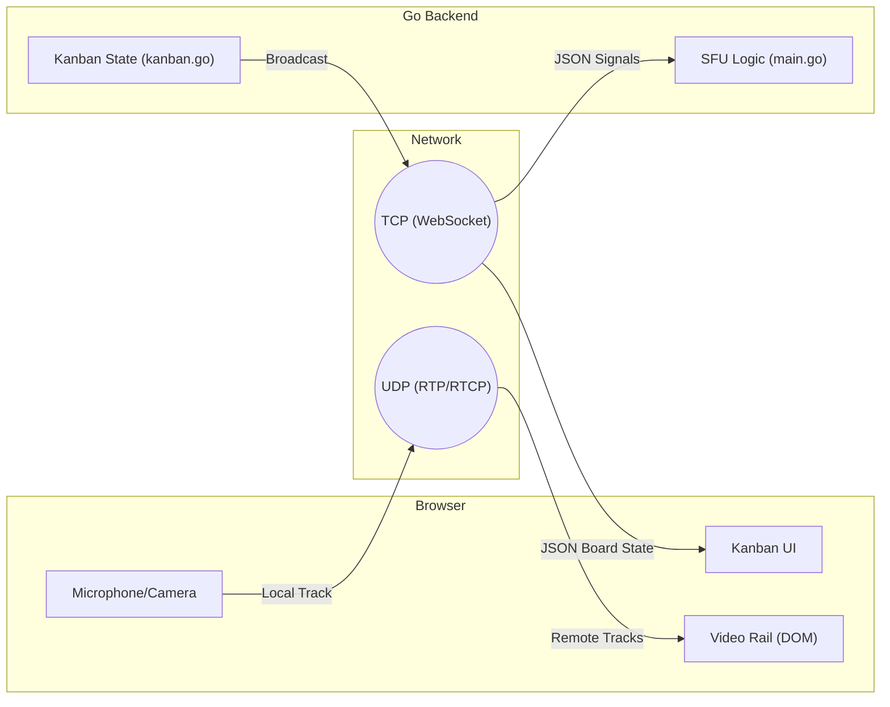

<!-- source: DeepWiki mcp.deepwiki.com · repo openai/openai-realtime-meeting-assistant · page 4.1 WebRTC Client and WebSocket Signaling · fetched 2026-10-26 -->

# WebRTC Client and WebSocket Signaling

Relevant source files

The following files were used as context for generating this wiki page:

- [index.html](index.html)

The frontend application utilizes a dual-channel communication strategy to facilitate real-time collaboration. It employs a **WebSocket** connection for signaling and state synchronization, and a **WebRTC** `RTCPeerConnection` for low-latency media streaming. The browser client acts as a participant in a Selective Forwarding Unit (SFU) architecture, where it publishes its local media and subscribes to remote tracks from other participants and the OpenAI Realtime AI peer.

## Connection Lifecycle

The connection lifecycle is managed through the `joinRoom()` and `leaveRoom()` functions. Joining a room involves initializing local media devices, establishing the WebSocket signaling channel, and configuring the WebRTC peer connection.

### Lifecycle Sequence
1.  **Media Acquisition**: The client requests access to the user's microphone and camera using `navigator.mediaDevices.getUserMedia` [[index.html:565-568]]().
2.  **WebSocket Handshake**: A WebSocket connection is established to the `/ws` endpoint [[index.html:573-573]]().
3.  **PeerConnection Setup**: An `RTCPeerConnection` is instantiated with a STUN server configuration to handle NAT traversal [[index.html:585-588]]().
4.  **Track Registration**: Local tracks from the media stream are added to the `RTCPeerConnection` [[index.html:591-593]]().
5.  **Signaling**: The client creates an SDP Offer, sets its local description, and sends the offer to the server via the WebSocket [[index.html:633-638]]().

**Sources:** [index.html:561-641](), [index.html:509-519]()

## Signaling and Renegotiation

The application uses "Trickle ICE," where ICE candidates are sent over the WebSocket as soon as they are discovered, rather than waiting for the entire SDP exchange to complete [[index.html:601-605]]().

### Incoming Signal Handling
The `handleSignal()` function processes messages received from the server's signaling loop. It dispatches actions based on the signal type:
*   **`answer`**: Calls `pc.setRemoteDescription()` to finalize the WebRTC handshake [[index.html:514-514]]().
*   **`offer`**: Used during renegotiation (e.g., when a new participant joins). The client sets the remote description, creates an answer, and sends it back [[index.html:511-513]]().
*   **`candidate`**: Calls `pc.addIceCandidate()` to update network routing paths [[index.html:515-517]]().

### Function Mapping: Signaling Entities

**Sources:** [index.html:509-525](), [index.html:551-558](), [index.html:601-606]()

## Remote Track Rendering

The client dynamically manages remote video elements using a `remoteElements` Map, which tracks the association between WebRTC `MediaStream` IDs and DOM elements [[index.html:479-479]]().

### The Video Rail
When a remote track is received via the `ontrack` event:
1.  **Track Association**: The client checks if an element already exists for the incoming stream [[index.html:609-612]]().
2.  **Element Creation**: If new, it creates a "video-tile" container containing a `<video>` element and a label [[index.html:614-624]]().
3.  **DOM Integration**: The new tile is appended to the `.video-stack` (the "video rail") on the right side of the UI [[index.html:623-625]]().
4.  **Cleanup**: When a track ends or a user leaves, the `onmute` or `onended` events trigger the removal of the corresponding DOM element from the `remoteElements` map and the UI [[index.html:627-630]]().

| Entity | Description | Code Reference |
| :--- | :--- | :--- |
| `remoteElements` | Map of `stream.id` to `HTMLDivElement` | [index.html:479]() |
| `ontrack` | Event handler for incoming media | [index.html:608-631]() |
| `.video-stack` | Container for remote participant tiles | [index.html:137-142]() |
| `video-label` | Overlay displaying participant ID | [index.html:152-167]() |

**Sources:** [index.html:479-479](), [index.html:608-631](), [index.html:137-167]()

## Data Flow: Media and State

The client handles two distinct data flows: the **Media Plane** (RTP/RTCP) for voice and video, and the **Data/Signaling Plane** (WebSocket) for Kanban board updates and WebRTC negotiation.

**Sources:** [index.html:591-593](), [index.html:608-615](), [index.html:533-549]()

---

