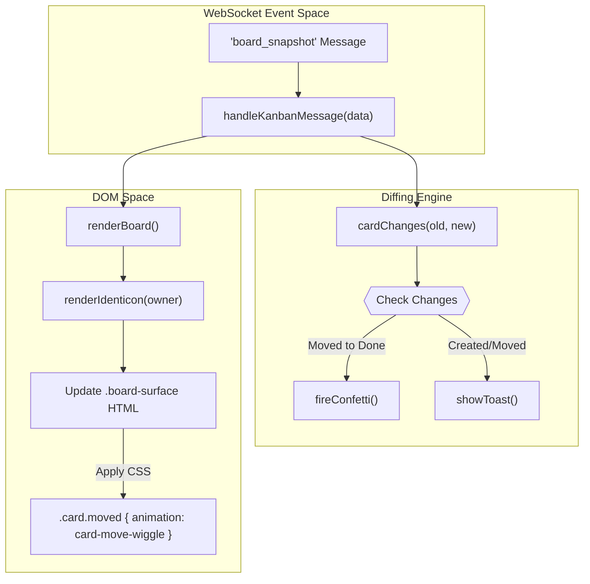
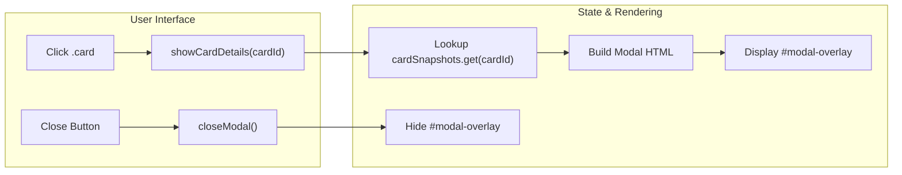

<!-- source: DeepWiki mcp.deepwiki.com · repo openai/openai-realtime-meeting-assistant · page 4.2 Kanban Board UI and Reactive Rendering · fetched 2026-10-26 -->

# Kanban Board UI and Reactive Rendering

Relevant source files

The following files were used as context for generating this wiki page:

- [index.html](index.html)
- [public/screenshot.png](public/screenshot.png)

The frontend of the Realtime Meeting Assistant utilizes a reactive rendering engine to synchronize the visual state of the Kanban board with updates received from the backend. Instead of full page reloads, the application performs granular DOM reconstruction and state diffing to provide a smooth user experience, including animations for card movements and visual feedback for task completions.

## Board Rendering Engine

The primary entry point for Kanban UI updates is `handleKanbanMessage()`, which processes incoming WebSocket messages of type `board_snapshot` [index.html:1121-1123]().

### State Synchronization Flow

1.  **Message Reception**: The WebSocket `onmessage` handler identifies Kanban events and routes them to `handleKanbanMessage(data)` [index.html:1011-1014]().
2.  **Diffing**: The system compares the new board state against a locally cached `cardSnapshots` map to identify which cards have been created, moved, or updated [index.html:1126-1130]().
3.  **DOM Reconstruction**: The `renderBoard()` function clears the existing board container and rebuilds the columns and cards based on the latest state [index.html:1139-1141]().
4.  **Post-Processing**: Animations (wiggles) and effects (confetti) are triggered based on the diff results [index.html:1132-1136]().

### Card Diffing and Reactive Logic
The `cardChanges()` function calculates the delta between the previous state and the incoming state [index.html:1162-1185](). It tracks:
*   **Created**: Cards present in the new state but not the old.
*   **Moved**: Cards whose `status` (column) has changed [index.html:1174-1176]().
*   **Updated**: Cards whose content (title, tags, or owner) has changed.

**Sources:** [index.html:1011-1014](), [index.html:1121-1185]()

## UI Components and Rendering

### DOM Construction (`renderBoard`)
The `renderBoard()` function iterates through the four standard Kanban columns: `backlog`, `in_progress`, `blocked`, and `done` [index.html:1191-1194](). For each column, it filters the `board.cards` array and generates HTML fragments.

| Element | Responsibility | Code Reference |
| :--- | :--- | :--- |
| **Column** | Groups cards by status; displays card count. | [index.html:1200-1209]() |
| **Card** | Displays title, owner identicon, and tags. | [index.html:1211-1243]() |
| **Identicon** | Generates a deterministic SVG avatar for the card owner. | [index.html:1260-1286]() |
| **Tags** | Renders small pills for metadata like "High Priority". | [index.html:1228-1232]() |

### Identicon Generation
The `renderIdenticon(name)` function uses an **FNV-1a hash** algorithm to generate a deterministic color and pattern for a user's avatar based on their name [index.html:1260-1286](). This ensures that the same owner always has the same visual representation across all clients.

**Sources:** [index.html:1191-1243](), [index.html:1260-1286]()

## Visual Effects and Notifications

The UI provides immediate feedback for AI-driven actions through CSS animations and specialized JS effects.

### Card Move Wiggle
When `cardChanges()` detects a card has moved between columns, the `moved` CSS class is applied to that card's DOM element [index.html:1212-1214]().
*   **Animation**: Defined as `card-move-wiggle`, a 1100ms ease-in-out transform [index.html:279-285]().
*   **Visual Style**: The card gains a blue border and a shadow to highlight the movement [index.html:281-282]().

### Completion Confetti
If a card's status changes to `done`, the `fireConfetti()` function is triggered [index.html:1133-1135]().
*   **Implementation**: It creates 40 individual `div` elements with random colors and trajectories [index.html:1301-1313]().
*   **Animation**: Uses the `confetti-pop` CSS animation to simulate a burst from the center of the screen [index.html:287-296]().

### Toast Notifications
A stack of non-blocking toast notifications is managed in the `toast-region` [index.html:298-307]().
*   **`showToast(message, type)`**: Adds a message to the UI stack [index.html:1288-1299]().
*   **Auto-dismiss**: Toasts are automatically removed from the DOM after 4 seconds [index.html:1296-1298]().

**Sources:** [index.html:279-307](), [index.html:1132-1136](), [index.html:1288-1320]()

## Modals and Interaction

The frontend includes two primary modal interfaces for detailed data viewing.

### Card Detail Modal
Triggered when a user clicks on a card. It displays the full title, status, tags, and the assigned owner [index.html:1322-1335]().
*   **Function**: `showCardDetails(cardId)` [index.html:1322]().
*   **State**: Pulls data from the `cardSnapshots` map [index.html:1323]().

### Comment Preview Modal
Used to show transcripts or notes associated with a card.
*   **Function**: `showCommentPreview(content)` [index.html:1347-1355]().
*   **Closing**: Modals are dismissed via `closeModal()` which clears the `modal-overlay` content and hides the container [index.html:1357-1361]().

**Sources:** [index.html:1322-1361]()

## Logic Flow Diagrams

### Reactive Rendering Pipeline
This diagram bridges the Natural Language concept of "Board Updating" to the specific Code Entities involved in the rendering loop.

**Sources:** [index.html:1121-1136](), [index.html:1162-1185](), [index.html:1191-1243]()

### Modal Interaction Flow
Describes how user interactions trigger detail views using the cached board state.

**Sources:** [index.html:1322-1335](), [index.html:1357-1361]()

---

