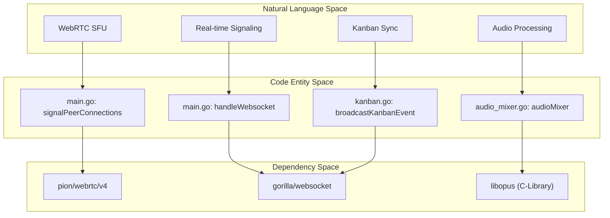

<!-- source: DeepWiki mcp.deepwiki.com · repo openai/openai-realtime-meeting-assistant · page 5 Dependencies and Project Configuration · fetched 2026-10-26 -->

# Dependencies and Project Configuration

Relevant source files

The following files were used as context for generating this wiki page:

- [.gitignore](.gitignore)
- [LICENSE](LICENSE)
- [go.mod](go.mod)
- [go.sum](go.sum)

This page provides a high-level overview of the external libraries, native requirements, and project-level configurations that enable the Realtime Meeting Assistant to function. The project is built using **Go 1.24** and relies on a combination of modern WebRTC protocols, WebSocket signaling, and native C-based audio encoding.

## Dependency Ecosystem

The project leverages the **Pion** ecosystem for WebRTC implementation and **Gorilla WebSocket** for real-time signaling between the browser and the Go backend. These dependencies handle the complex negotiation of media tracks, data channels, and network traversal.

### Core Go Dependencies
*   **github.com/pion/webrtc/v4**: The primary engine for the Selective Forwarding Unit (SFU) logic, managing `PeerConnection` and `TrackLocalStaticRTP` [go.mod:10-10]().
*   **github.com/gorilla/websocket**: Used for the signaling server to exchange SDP offers/answers and to broadcast Kanban state updates [go.mod:6-6]().
*   **github.com/pion/rtp & github.com/pion/rtcp**: Specialized libraries for packet-level manipulation, essential for audio mixing and requesting keyframes via PLI [go.mod:8-9]().

For a detailed breakdown of how these libraries are utilized within the SFU and signaling layers, see **[Go Module and Third-Party Libraries](#5.1)**.

### Dependency Relationship Map

The following diagram illustrates how high-level system requirements map to specific code entities and their underlying third-party dependencies.

**System to Code Dependency Mapping**

Sources: [go.mod:1-11](), [main.go:1-10](), [audio_mixer.go:1-10]()

## Native Dependencies and Build Setup

Unlike pure Go projects, this assistant requires **libopus** to perform high-performance audio encoding and decoding for the OpenAI Realtime API. This is achieved via `cgo` and `pkg-config`.

*   **libopus**: Required for the `OpusDecoder` and `OpusEncoder` types. The project uses `pkg-config` to locate the headers and shared libraries during the build process.
*   **CGO Integration**: The Go runtime manages pointers to C-allocated memory for Opus structs, requiring specific cleanup patterns to avoid memory leaks.
*   **Network Configuration**: For production environments behind NAT, the `PION_NAT1TO1_IP` environment variable is supported to ensure ICE candidates are correctly advertised.

For setup instructions and platform-specific requirements, see **[Native Dependencies and Build Setup](#5.2)**.

## Project Configuration

The project follows standard Go conventions for configuration and source control.

### Source Control (.gitignore)
The project ignores OS-specific files, test binaries, and the compiled output of the main application.
*   **Build Artifact**: `/openai-realtime-meeting-assistant` [ .gitignore:3-3]()
*   **Tests**: `/*.test` [ .gitignore:2-2]()

### Licensing
The project is released under the **MIT License**, allowing for broad reuse, modification, and distribution, provided the original copyright notice and permission notice are included [LICENSE:1-21]().

### Configuration Mapping

| Feature | Code/Config Entity | Purpose |
| :--- | :--- | :--- |
| **Module Path** | `github.com/openai/openai-realtime-meeting-assistant` | Unique identifier for Go dependency resolution [go.mod:1-1]() |
| **Go Version** | `1.24.0` | Minimum required Go runtime version [go.mod:3-3]() |
| **Binary Name** | `openai-realtime-meeting-assistant` | The resulting executable after running `go build` [.gitignore:3-3]() |
| **License** | `MIT` | Legal framework for the codebase [LICENSE:1-1]() |

Sources: [go.mod:1-3](), [.gitignore:1-4](), [LICENSE:1-21]()

---

