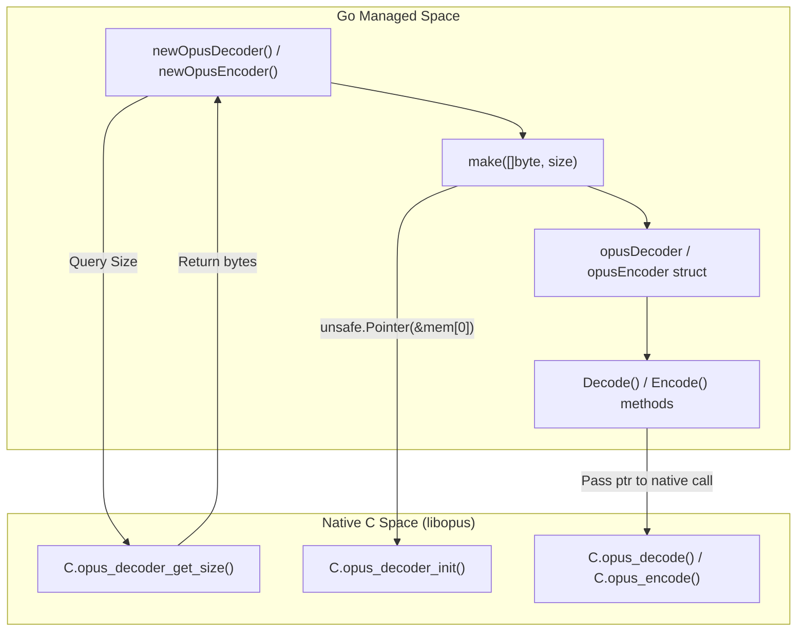
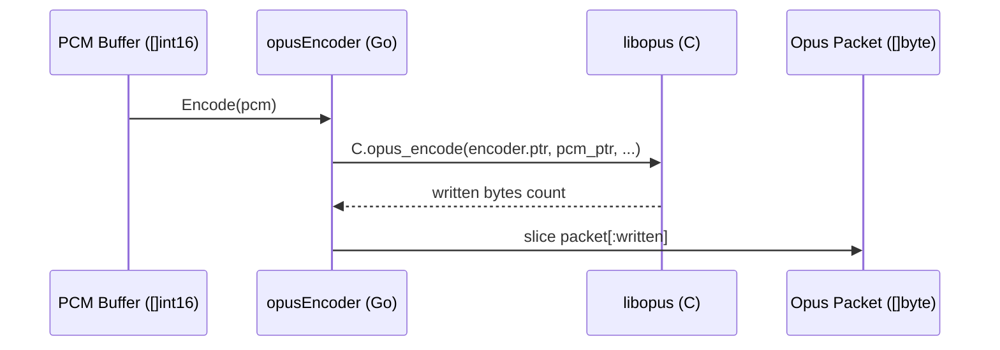

<!-- source: DeepWiki mcp.deepwiki.com · repo openai/openai-realtime-meeting-assistant · page 5.2 Native Dependencies and Build Setup · fetched 2026-10-26 -->

# Native Dependencies and Build Setup

Relevant source files

The following files were used as context for generating this wiki page:

- [.gitignore](.gitignore)
- [opus_decoder.go](opus_decoder.go)
- [opus_encoder.go](opus_encoder.go)

This page details the native requirements and build configuration for the Realtime Meeting Assistant. The application relies on **cgo** to interface with the high-performance `libopus` library for audio encoding and decoding, and utilizes specific environment configurations for network traversal in production.

## libopus CGO Integration

The backend leverages the Opus interactive audio codec for handling WebRTC audio streams. Rather than using a pure-Go implementation, the project interfaces directly with the native C library `libopus` via cgo to ensure performance and compatibility with standard Opus implementations.

### pkg-config Usage
The build system uses `pkg-config` to locate the necessary header files and library binaries for `libopus`. This is defined in the preamble of the Opus wrapper files:

*   **Decoder:** `[opus_decoder.go:4-6]()`
*   **Encoder:** `[opus_encoder.go:4-6]()`

To build the project, `libopus` must be installed on the host system (e.g., `brew install opus` on macOS or `apt-get install libopus-dev` on Ubuntu).

### Memory Management Pattern
A distinctive feature of this implementation is the "Go-heap-allocated C struct" pattern. Instead of using `C.malloc` (which requires manual `free` calls and is invisible to the Go garbage collector), the application allocates the memory for Opus structures as Go byte slices.

1.  **Size Calculation:** The code queries the native library for the exact byte size required for a decoder or encoder state using `C.opus_decoder_get_size` `[opus_decoder.go:25-25]()` and `C.opus_encoder_get_size` `[opus_encoder.go:27-27]()`.
2.  **Go Allocation:** A byte slice is allocated on the Go heap: `make([]byte, int(size))` `[opus_decoder.go:26-26]()`, `[opus_encoder.go:28-28]()`.
3.  **Pointer Casting:** The address of the first element of this slice is cast to a C pointer (`*C.OpusDecoder` or `*C.OpusEncoder`) `[opus_decoder.go:28-28]()`, `[opus_encoder.go:30-30]()`.
4.  **Initialization:** The native `opus_decoder_init` or `opus_encoder_init` function is called on that memory `[opus_decoder.go:33-33]()`, `[opus_encoder.go:35-40]()`.

This approach ensures that when the Go struct (`opusDecoder` or `opusEncoder`) is garbage collected, the underlying C state memory is also reclaimed automatically.

### Code Entity Mapping: Opus Lifecycle

The following diagram illustrates how Go entities interact with the native Opus library during initialization and processing.

**Opus CGO Memory Flow**

**Sources:** `[opus_decoder.go:20-38]()`, `[opus_encoder.go:22-45]()`

## Audio Data Flow

The `opusDecoder` and `opusEncoder` structs provide a high-level Go API for the raw C functions.

| Entity | Function | Data Transformation |
| :--- | :--- | :--- |
| `opusDecoder.Decode` | `[opus_decoder.go:40-67]()` | `[]byte` (Opus) -> `[]int16` (PCM) |
| `opusEncoder.Encode` | `[opus_encoder.go:47-71]()` | `[]int16` (PCM) -> `[]byte` (Opus) |
| `opusErrorText` | `[opus_decoder.go:69-71]()` | `C.int` code -> `string` via `C.opus_strerror` |

**Audio Processing Sequence**

**Sources:** `[opus_encoder.go:47-71]()`, `[opus_decoder.go:40-67]()`

## Platform Support and Build Artifacts

The project is designed for Unix-like environments (Linux, macOS) where `pkg-config` and `libopus` are readily available.

*   **Binary Output:** The default build produces a single executable named `openai-realtime-meeting-assistant`, which is excluded from version control via `.gitignore` `[.gitignore:3-3]()`.
*   **Static Linking:** While the project uses dynamic linking by default through `pkg-config`, it can be cross-compiled or statically linked if the environment provides a static `libopus.a`.

## Production Deployment: NAT Traversal

In production environments (e.g., AWS, GCP, or Docker containers), the server is often behind a NAT. The underlying Pion WebRTC library requires knowledge of the public IP to successfully establish media paths with clients.

### PION_NAT1TO1_IP
The environment variable `PION_NAT1TO1_IP` is used to facilitate NAT traversal. 

*   **Purpose:** Informs the WebRTC stack of the external IP address to include in ICE candidates.
*   **Usage:** Set this variable to the public IPv4 address of your server.
*   **Impact:** Without this, the browser client may fail to establish a `PeerConnection` if the server only advertises internal/private IP addresses (e.g., `10.x.x.x` or `172.x.x.x`).

**Sources:** `[1.1. Getting Started]()` (Conceptual), `[2.1. WebRTC SFU and Signaling]()` (Implementation Context).

---

