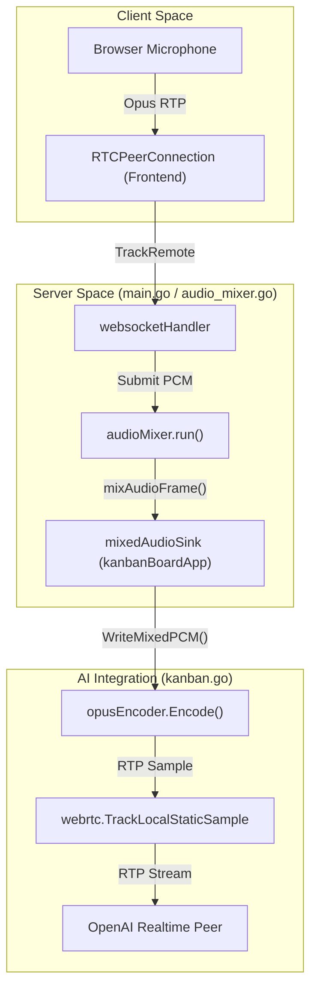
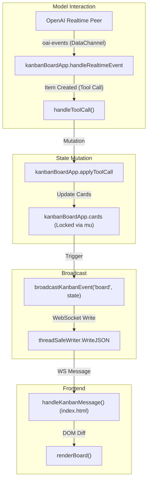

<!-- source: DeepWiki mcp.deepwiki.com · repo openai/openai-realtime-meeting-assistant · page 6 Glossary · fetched 2026-10-26 -->

# Glossary

Relevant source files

The following files were used as context for generating this wiki page:

- [README.md](README.md)
- [audio_mixer.go](audio_mixer.go)
- [index.html](index.html)
- [kanban.go](kanban.go)
- [main.go](main.go)
- [opus_decoder.go](opus_decoder.go)
- [opus_encoder.go](opus_encoder.go)

This glossary defines technical terms, domain concepts, and implementation-specific identifiers used throughout the Realtime Meeting Assistant codebase.

## Core Concepts

### SFU (Selective Forwarding Unit)
A WebRTC topology where the server acts as a central hub. Instead of participants sending media to every other participant (Mesh), they send one stream to the server, which forwards it to all other connected peers [main.go:149-260](). The backend implements this using the `pion/webrtc` library [main.go:15-16]().

### Mixed Audio Sink
An interface `mixedAudioSink` defined in `audio_mixer.go` that allows entities to receive the combined PCM audio from all meeting participants [audio_mixer.go:22-24](). The `kanbanBoardApp` implements this interface to feed room audio into the OpenAI Realtime model [kanban.go:81-95](), [kanban.go:217-219]().

### Tool/Function Calling
The mechanism by which the OpenAI model triggers actions on the Kanban board. Tools are defined as JSON schemas in `kanbanTools()` [kanban.go:445-560]() and executed via the `handleToolCall` function [kanban.go:588-608]().

---

## Data Structures & Entities

| Term | Definition | Code Pointer |
|:---|:---|:---|
| `kanbanCard` | The primary data entity representing a ticket on the board, containing ID, Status, Title, Notes, and Tags. | [kanban.go:45-51]() |
| `kanbanStatus` | An enumeration of valid ticket states: `Backlog`, `In Progress`, `Blocked`, or `Done`. | [kanban.go:32-36]() |
| `peerConnectionState` | A server-side struct tracking a user's WebRTC connection, their WebSocket for signaling, and track filtering logic. | [main.go:42-48]() |
| `audioMixer` | A central coordinator that collects decoded PCM from all participants and mixes it into a single stream. | [audio_mixer.go:26-33]() |
| `threadSafeWriter` | A wrapper around Gorilla WebSocket to ensure concurrent writes from different goroutines do not collide. | [main.go:338-348]() |

**Sources:** [kanban.go:45-51](), [main.go:42-48](), [audio_mixer.go:26-33](), [main.go:338-348]()

---

## Technical Terms & Acronyms

### CGO / Libopus
The project uses `cgo` to interface with the native `libopus` library for high-performance audio encoding and decoding.
*   **`opusDecoder`**: Manages C-allocated memory for the Opus decoding state [opus_decoder.go:14-18]().
*   **`opusEncoder`**: Manages C-allocated memory for the Opus encoding state [opus_encoder.go:16-20]().

### PLI (Picture Loss Indicator)
A RTCP message sent to a video sender to request a full keyframe. The server dispatches these every 3 seconds via `dispatchKeyFrame()` to ensure new participants see a clear video stream quickly [main.go:98-102](), [main.go:275-294]().

### SDP (Session Description Protocol)
The format used to describe WebRTC media capabilities. The system exchanges SDP "offers" and "answers" via WebSockets to establish connections [main.go:219-257]().

### VAD (Voice Activity Detection)
The OpenAI Realtime API uses server-side VAD to detect when a user starts and stops speaking, which triggers the model's response [kanban.go:281-285]().

---

## System Interaction Diagrams

### Audio Pipeline: From Browser to AI
This diagram bridges the "Natural Language Space" (voice) to the "Code Entity Space" (mixers and encoders).

**Sources:** [main.go:400-450](), [audio_mixer.go:129-169](), [kanban.go:414-443](), [opus_encoder.go:47-71]()

### Kanban State Synchronization
This diagram illustrates how a voice command becomes a UI update.

**Sources:** [kanban.go:562-586](), [kanban.go:588-608](), [kanban.go:610-650](), [main.go:303-316](), [index.html:1050-1100]()

---

## File Summary Table

| File | Primary Responsibility |
|:---|:---|
| `main.go` | Entry point, HTTP/WebSocket server, and WebRTC SFU signaling logic [main.go:66-108](). |
| `kanban.go` | Manages the OpenAI Realtime connection, board state, and AI tool definitions [kanban.go:81-95](). |
| `audio_mixer.go` | Implements the PCM mixing loop and audio track lifecycle management [audio_mixer.go:45-55](). |
| `opus_decoder.go` | CGO bindings for converting incoming Opus packets to raw PCM [opus_decoder.go:20-38](). |
| `opus_encoder.go` | CGO bindings for converting mixed PCM to Opus for the AI assistant [opus_encoder.go:22-45](). |
| `index.html` | The SPA frontend; handles WebRTC media, board rendering, and UI animations [index.html:840-860](). |

**Sources:** [main.go:1-35](), [kanban.go:1-80](), [audio_mixer.go:1-33](), [opus_decoder.go:1-18](), [opus_encoder.go:1-20](), [index.html:1-830]()