# Page: Overview

# Overview

<details>
<summary>Relevant source files</summary>

The following files were used as context for generating this wiki page:

- [README.md](README.md)
- [index.html](index.html)
- [kanban.go](kanban.go)
- [main.go](main.go)

</details>


The **Realtime Meeting Assistant** is a collaborative, voice-operated Kanban board designed for technical standups. It leverages the **OpenAI Realtime API** to listen to meeting participants in real-time, interpret their updates, and automatically manipulate a shared project board using function calling.

The system acts as a **Selective Forwarding Unit (SFU)**, mixing audio from multiple human participants and piping the combined stream to an AI "peer" that participates in the WebRTC session alongside them.

## Core Capabilities

*   **Voice-Driven Kanban**: Move tickets between columns (e.g., "Backlog" to "Done"), create new tickets, or add tags via natural conversation [kanban.go:91-101]().
*   **Multi-User WebRTC**: Multiple participants can join a single room with synchronized video and audio via Pion WebRTC [main.go:28-29]().
*   **Real-time State Sync**: Board updates triggered by the AI are broadcast instantly to all connected clients via WebSockets [kanban.go:485-494]().
*   **Automated AI Participation**: The backend maintains a persistent OpenAI Realtime session that functions as a virtual participant in the room [kanban.go:144-153]().

## System Components

The application is divided into three primary layers that bridge the gap between human audio and structured data mutations.

### 1. The Go Backend (SFU & Audio Mixer)
The server, written in Go, handles the heavy lifting of WebRTC signaling and audio processing. It manages a global `audioMixer` [main.go:34]() that collects Opus audio from all human participants, decodes it to PCM, mixes it, and re-encodes it for the OpenAI Realtime peer [audio_mixer.go:15-32]().

### 2. OpenAI Realtime Integration
The `kanbanBoardApp` [kanban.go:81-95]() manages a specialized WebRTC connection to OpenAI. It injects the current board state into the model's system instructions [kanban.go:343-345]() and handles incoming `function_call` events to mutate the `kanbanBoardState` [kanban.go:616-630]().

### 3. Reactive Frontend
The frontend is a single-page application (`index.html`) that renders the Kanban board and handles local media. It uses WebSockets to receive SDP signals for WebRTC and JSON snapshots of the board state [index.html:1037-1049]().

## Code Entity Space Mapping

The following diagrams illustrate how high-level concepts map to specific structures and files in the codebase.

### Audio Pipeline: From Voice to AI
This diagram shows how audio flows from a user's microphone through the backend entities to the OpenAI Realtime API.

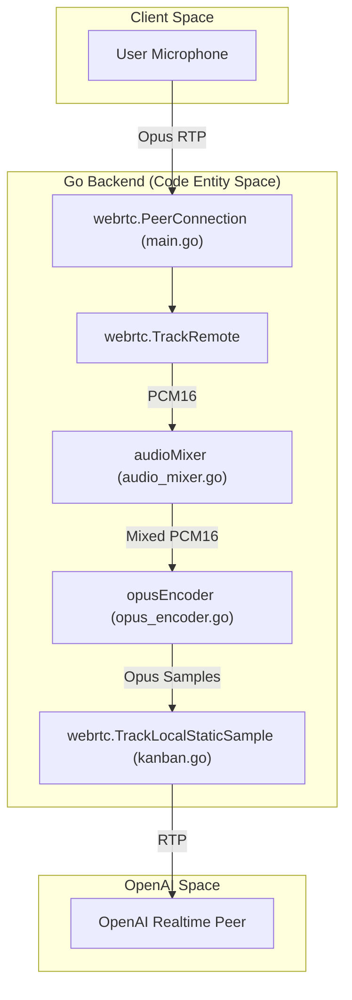
**Sources:** [main.go:120-136](), [audio_mixer.go:115-135](), [kanban.go:155-174]()

### State Synchronization: From AI Tool to UI
This diagram shows how an AI's decision to move a ticket results in a UI update across all clients.

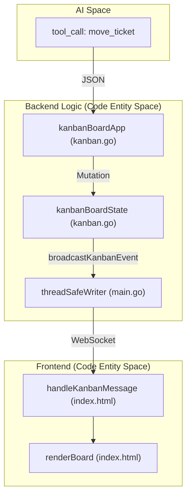
**Sources:** [kanban.go:656-680](), [kanban.go:485-494](), [index.html:1037-1055]()

## Getting Started

To run the assistant locally, you must provide an `OPENAI_API_KEY` and have `libopus` installed on your system.

1.  **Install Dependencies**: Requires Go 1.24+ and `libopus` [README.md:42-47]().
2.  **Set Environment**: `export OPENAI_API_KEY=<your_key>` [README.md:32-38]().
3.  **Launch**: Run `go run .` and navigate to `http://localhost:3000` [README.md:50-56]().

For a detailed step-by-step guide and common CLI flags, see **[Getting Started](#1.1)**.

## Architecture Deep Dive

The system is designed as a three-layer architecture:
1.  **Media Layer**: Pion WebRTC handles the SFU logic, fanning out video tracks and fanning in audio tracks [main.go:149-160]().
2.  **Intelligence Layer**: The OpenAI Realtime peer acts as a "silent" participant that receives the room mix and emits data events [kanban.go:201-208]().
3.  **State Layer**: A centralized Kanban state machine that ensures consistency across all connected clients [kanban.go:45-56]().

For a conceptual overview of how these layers interact, see **[System Architecture](#1.2)**.

Sources: [main.go:66-108](), [kanban.go:19-27](), [kanban.go:81-95](), [index.html:1-30](), [README.md:1-15]()

---

# Page: Getting Started

# Getting Started

<details>
<summary>Relevant source files</summary>

The following files were used as context for generating this wiki page:

- [.gitignore](.gitignore)
- [README.md](README.md)
- [go.mod](go.mod)

</details>


The Realtime Meeting Assistant is a collaborative, voice-operated Kanban board application. It leverages the OpenAI Realtime API to listen to multi-user conversations, understand the context of a standup meeting, and automatically manipulate a shared board state via function calling.

## Prerequisites

To run the application locally, your environment must meet the following requirements:

*   **Go 1.24+**: The project utilizes features and dependencies requiring the latest Go toolchain [go.mod:3-3]().
*   **libopus**: The application performs server-side audio decoding and encoding using CGO bindings. You must have the Opus development headers installed [README.md:44-48]().
*   **pkg-config**: Used by the Go build system to locate `libopus` [README.md:44-48]().

On macOS, these can be installed via Homebrew:
```bash
brew install opus pkg-config
```

## Environment Configuration

The server relies on environment variables for authentication and model selection. It does not automatically load `.env` files [README.md:40-40]().

| Variable | Required | Description | Default |
| :--- | :--- | :--- | :--- |
| `OPENAI_API_KEY` | **Yes** | Your OpenAI API key for Realtime API access [README.md:37-37](). | N/A |
| `OPENAI_REALTIME_MODEL` | No | The specific model ID to use for the session [README.md:110-110](). | `gpt-realtime-2` |
| `PION_NAT1TO1_IP` | No | Required if running behind NAT to provide the public IP for WebRTC candidates. | N/A |

## Execution and CLI Flags

The application is a single binary that serves both the frontend assets and the backend signaling/SFU logic.

### Running the App
```bash
export OPENAI_API_KEY=<your_api_key>
go run .
```

### CLI Flags
The server supports one primary flag for network configuration:
*   `-addr`: Sets the HTTP bind address. Defaults to `:3000` [README.md:112-112]().
    *   Example: `go run . -addr :8080` [README.md:61-61]().

## System Initialization and Data Flow

When the server starts, it initializes a global `kanbanBoardState` and attempts to establish a connection to OpenAI if the API key is present [README.md:66-66]().

### Connection Logic Diagram
This diagram maps the high-level "Natural Language" flow of joining a room to the specific "Code Entities" that handle the connection.

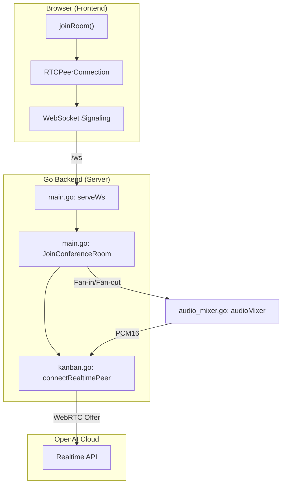
**Sources:** [README.md:66-73](), [kanban.go:101-101]()

## Demo Flow and Voice Commands

Once the application is running at `http://localhost:3000`, users can join the meeting. The assistant acts as a silent participant that listens to the "Room Mix" and executes tools based on the conversation.

### Recommended Interaction Sequence
1.  **Join**: Click "Join room" and allow microphone access [README.md:69-70]().
2.  **Verify**: Speak; you should see your local video and audio activity.
3.  **Command**: Use natural language to manipulate the default cards seeded in `initialKanbanBoardCards` [README.md:107-107]().

### Example Commands
The assistant is instructed via `sessionInstructions` to look for specific intent [README.md:108-108]().

| Action | Example Voice Command |
| :--- | :--- |
| **Move Ticket** | "I started the ICE restart handling ticket." [README.md:81-81]() |
| **Set Status** | "The DTLS cleanup work is blocked on a transport shutdown issue." [README.md:82-82]() |
| **Complete** | "We shipped the RTP HEVC packetizer." [README.md:83-83]() |
| **Create** | "Create a ticket to add subscription controls for simulcast forwarding." [README.md:84-84]() |
| **Tagging** | "Add the bandwidth tag to the simulcast card." [README.md:85-85]() |

### Data Flow: Voice to Board Update
The following diagram bridges the gap between the audio captured by the browser and the final state mutation on the Kanban board.

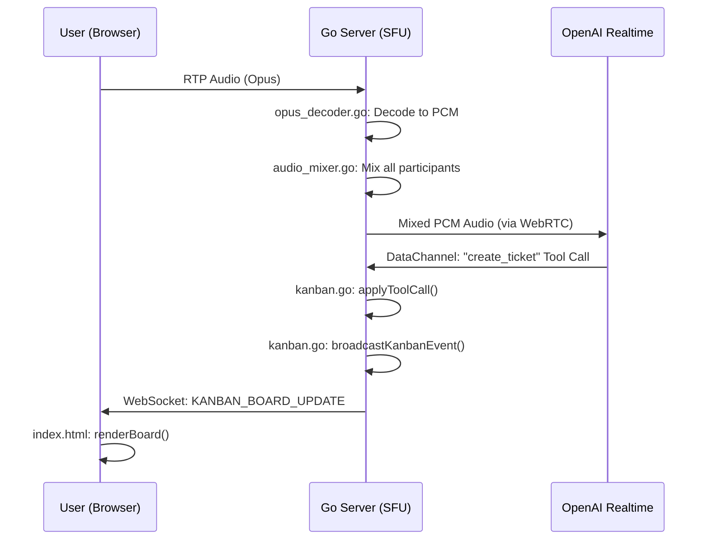
**Sources:** [README.md:10-10](), [README.md:71-71](), [kanban.go:344-380]()

## Troubleshooting
*   **No Assistant Response**: Ensure `OPENAI_API_KEY` is exported correctly. Check server logs for "connected to OpenAI" messages [README.md:66-66]().
*   **Echo/Feedback**: Use headphones. Because the server mixes all audio and sends it to OpenAI, background echo from speakers can be misinterpreted as new commands [README.md:77-77]().
*   **CGO Errors**: If the build fails with `opus.h not found`, ensure `pkg-config --cflags --libs opus` returns the correct paths for your installation [README.md:44-48]().

**Sources:**
* `README.md:10-10, 37-48, 61-85, 107-112`
* `go.mod:3-3`
* `kanban.go:101, 344-380`

---

# Page: System Architecture

# System Architecture

<details>
<summary>Relevant source files</summary>

The following files were used as context for generating this wiki page:

- [README.md](README.md)
- [audio_mixer.go](audio_mixer.go)
- [kanban.go](kanban.go)
- [main.go](main.go)

</details>


The Realtime Meeting Assistant is a three-tier application designed to facilitate voice-driven interactions with a shared Kanban board. It leverages WebRTC for low-latency media transport, WebSockets for state synchronization, and the OpenAI Realtime API for natural language processing and tool execution.

### High-Level Components

1.  **Browser Frontend**: A single-page application that captures user media, renders the Kanban board, and communicates with the Go backend via WebRTC and WebSockets [[index.html:1-12]]().
2.  **Go Backend (SFU)**: A server built with Pion WebRTC that acts as a Selective Forwarding Unit (SFU). It manages room state, mixes participant audio, and coordinates communication between human peers and the AI peer [[main.go:1-35]]().
3.  **OpenAI Realtime Peer**: A server-side WebRTC client that joins the conference room as a virtual participant. It receives mixed audio from all human participants and emits board mutation events via function calling [[kanban.go:81-95]]().

### Data Flow Overview

The system maintains two primary communication loops:
*   **Media Loop**: Human participants send Opus-encoded audio/video to the SFU. The SFU decodes and mixes the audio, then re-encodes it to send to the OpenAI Realtime peer [[audio_mixer.go:26-33]](), [[kanban.go:144-180]]().
*   **State Loop**: The OpenAI peer triggers "tools" (function calls) based on the audio. These tools mutate the server-side `kanbanBoardApp` state, which is then broadcast to all frontends via WebSockets [[kanban.go:445-470]]().

#### Logical System Architecture
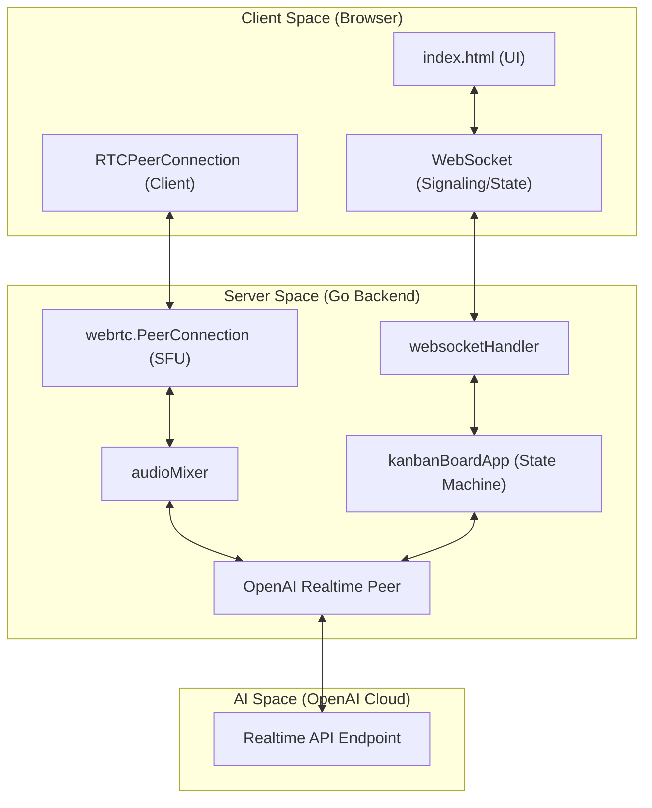
Sources: [main.go:21-35](), [kanban.go:81-95](), [audio_mixer.go:26-33]()

---

### The Audio Pipeline

The `audioMixer` is the heart of the server-side media processing. It aggregates audio from all human participants into a single stream for the AI.

1.  **Ingestion**: When a `webrtc.TrackRemote` of type audio is received, the server creates an `opusDecoder` [[audio_mixer.go:225-250]]().
2.  **Decoding**: Incoming RTP packets are decoded into raw PCM16 samples [[audio_mixer.go:271-282]]().
3.  **Mixing**: The `run()` loop in `audioMixer` ticks every 20ms [[audio_mixer.go:17-18]](). It pulls samples from all active `audioSource` buffers, averages them using `clampPCM16` to prevent clipping, and produces a mixed frame [[audio_mixer.go:183-208]]().
4.  **Fan-out**: The mixed PCM is sent to registered `mixedAudioSink` implementations. The `kanbanBoardApp` implements this interface to receive the mix [[audio_mixer.go:22-24]](), [[kanban.go:26-27]]().
5.  **AI Transmission**: The `kanbanBoardApp` encodes the mixed PCM back into Opus and writes it to the `inputTrack` (a `TrackLocalStaticSample`) connected to OpenAI [[kanban.go:155-179]]().

#### Audio Pipeline Entity Map
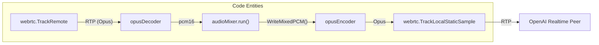
Sources: [audio_mixer.go:129-169](), [audio_mixer.go:271-282](), [kanban.go:169-180]()

---

### State Synchronization and Tool Execution

The system uses a "Server-as-Source-of-Truth" model for the Kanban board.

*   **Initial State**: The board is initialized with `initialKanbanBoardCards` [[kanban.go:97-133]]().
*   **Tool Dispatch**: When the OpenAI model identifies an intent (e.g., "Move the ICE ticket to Done"), it sends a `function_call` event over the `oai-events` DataChannel [[kanban.go:23-25]]().
*   **Mutation**: The `handleRealtimeEvent` function parses the tool arguments and calls mutation methods like `move_ticket` or `create_ticket` on the `kanbanBoardApp` [[kanban.go:445-460]]().
*   **Broadcast**: After mutation, `broadcastKanbanEvent` is called. It iterates through all active WebSockets and sends the updated board JSON [[main.go:37-40]]().

#### Tool Execution Sequence
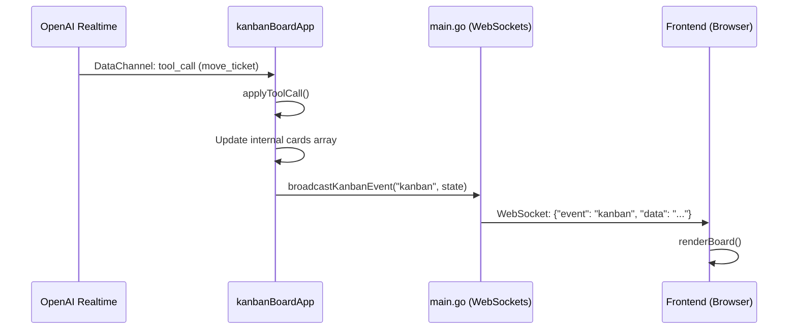
Sources: [kanban.go:206-208](), [kanban.go:445-470](), [main.go:37-40]()

---

### SFU and Peer Management

The server maintains a global list of `peerConnections` [[main.go:28]]().

*   **Track Management**: When a new track is added by any peer, `addTrack` creates a `TrackLocalStaticRTP` and triggers `signalPeerConnections` [[main.go:120-136]]().
*   **Renegotiation**: The `signalPeerConnections` function performs the SFU logic: it ensures every peer connection is subscribed to every `trackLocal` currently in the room, excluding the peer's own tracks to prevent loopback [[main.go:150-205]]().
*   **Keyframes**: To ensure new participants see video immediately, `dispatchKeyFrame` sends RTCP PLI (Picture Loss Indicator) packets to all sources every 3 seconds [[main.go:98-102]]().

#### Peer State Tracking
| Entity | Role | Location |
| :--- | :--- | :--- |
| `peerConnectionState` | Wraps `webrtc.PeerConnection` and its WebSocket for signaling. | [main.go:42-48]() |
| `trackLocals` | Registry of all active media tracks to be forwarded. | [main.go:29]() |
| `threadSafeWriter` | Concurrency wrapper for WebSocket writes. | [main.go:241-255]() |
| `listLock` | RWMutex protecting the global peer and track lists. | [main.go:27]() |

Sources: [main.go:26-35](), [main.go:150-205](), [main.go:241-255]()

---

# Page: Backend Server

# Backend Server

<details>
<summary>Relevant source files</summary>

The following files were used as context for generating this wiki page:

- [audio_mixer.go](audio_mixer.go)
- [kanban.go](kanban.go)
- [main.go](main.go)

</details>


The backend of the Realtime Meeting Assistant is a Go-based application that serves as the central hub for WebRTC media distribution, audio processing, and state synchronization. It manages the lifecycle of browser participants and orchestrates the connection to the OpenAI Realtime API.

## Core Responsibilities

The server operates as a Selective Forwarding Unit (SFU) with an integrated audio processing engine. Its primary functions include:

*   **HTTP & WebSocket Hosting**: Serving the frontend assets and maintaining persistent signaling channels for WebRTC negotiation and Kanban state updates [main.go:88-107]().
*   **WebRTC SFU**: Managing a mesh of `RTCPeerConnection` objects, fanning out incoming media tracks to all other participants [main.go:149-218]().
*   **Audio Mixing**: Aggregating audio from all participants into a single PCM stream for the OpenAI Realtime peer [audio_mixer.go:129-169]().
*   **AI Orchestration**: Maintaining a virtual "AI Participant" (`kanbanBoardApp`) that listens to the meeting and manipulates the Kanban board [kanban.go:144-223]().

## System Architecture

The following diagram illustrates how the backend components bridge the gap between network signals and the internal logic entities.

### Backend Component Map
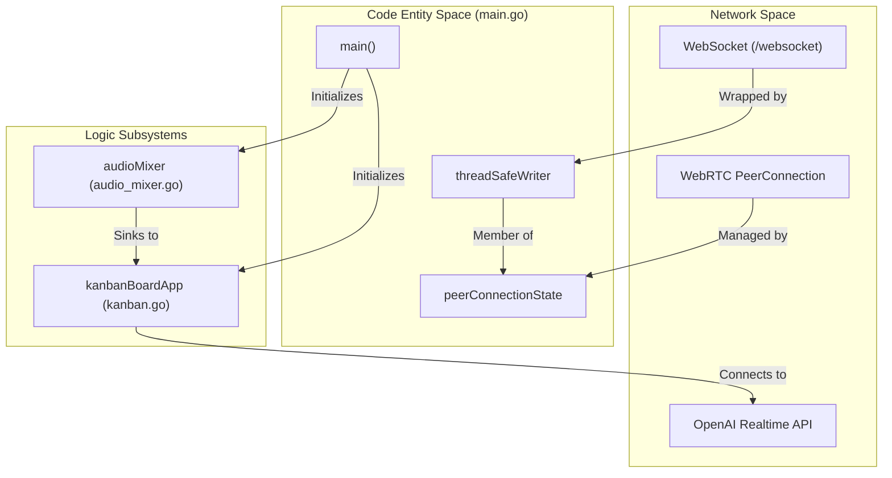
Sources: [main.go:21-35](), [main.go:42-48](), [main.go:66-79](), [audio_mixer.go:26-33](), [kanban.go:81-95]()

## Global State Management

The server maintains global state to track active participants and media tracks. This state is protected by `listLock` to ensure thread safety during rapid join/leave events.

| Entity | Type | Description |
| :--- | :--- | :--- |
| `peerConnections` | `[]peerConnectionState` | List of all active browser and AI peer connections [main.go:28](). |
| `trackLocals` | `map[string]*webrtc.TrackLocalStaticRTP` | Registry of media tracks currently being broadcast [main.go:29](). |
| `kanbanApp` | `*kanbanBoardApp` | The singleton managing Kanban cards and OpenAI integration [main.go:33](). |
| `roomMixer` | `*audioMixer` | The central engine for summing participant audio [main.go:34](). |

Sources: [main.go:19-35]()

## Media Flow and Tool Execution

The backend acts as a bridge between the "Natural Language Space" (audio) and the "Code Entity Space" (Kanban mutations).

### Audio to Tool Execution Flow
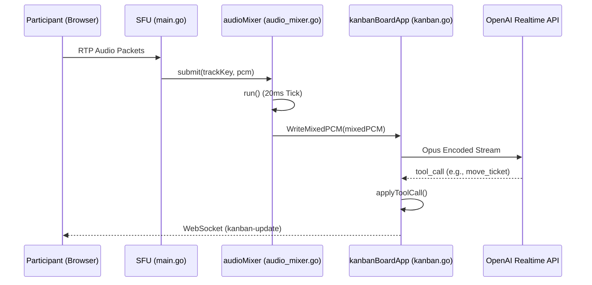
Sources: [audio_mixer.go:57-73](), [audio_mixer.go:156-168](), [kanban.go:217-219](), [kanban.go:1113-1120]()

## Subsystem Details

The backend logic is divided into three specialized areas:

### [WebRTC SFU and Signaling](#2.1)
Handles the `RTCPeerConnection` lifecycle, SDP exchange via WebSockets, and the fan-out logic that ensures every participant receives the video and audio tracks of every other participant. It uses a `signalPeerConnections` loop to handle renegotiation when tracks are added or removed.
*   **Key Files**: `main.go`

### [Audio Mixing Pipeline](#2.2)
Decodes incoming Opus RTP packets into raw PCM, buffers them, and mixes them every 20ms. This subsystem handles sample rate conversion, mono-to-stereo normalization, and provides the `mixedAudioSink` interface for the AI to "listen" to the room.
*   **Key Files**: `audio_mixer.go`, `opus_decoder.go`, `opus_encoder.go`

### [OpenAI Realtime Integration](#2.3)
Manages the connection to OpenAI's `/v1/realtime` endpoint. It treats the AI as a special "Peer" in the conference room, injecting the Kanban board's current state into the session instructions and executing tools based on the model's voice responses.
*   **Key Files**: `kanban.go`

Sources: [main.go:149-156](), [audio_mixer.go:12-20](), [kanban.go:243-260]()

---

# Page: WebRTC SFU and Signaling

# WebRTC SFU and Signaling

<details>
<summary>Relevant source files</summary>

The following files were used as context for generating this wiki page:

- [go.mod](go.mod)
- [main.go](main.go)

</details>


The backend server serves as a Selective Forwarding Unit (SFU) that manages media distribution between browser clients and the OpenAI Realtime peer. It handles the lifecycle of WebRTC connections, media track fan-out, and the signaling required to keep all participants synchronized.

## Server Infrastructure

The entry point of the application is `main.go`, which initializes the HTTP server, the WebSocket signaling endpoint, and the global SFU state.

### HTTP and WebSocket Setup
The server uses `http.HandleFunc` to route requests. The root path `/` serves the frontend application, while `/websocket` handles signaling and state synchronization [main.go:88-95](). 

The `websocketHandler` upgrades incoming HTTP connections using the `gorilla/websocket` upgrader [main.go:21-23](). For every new connection, a `peerConnectionState` object is created to track the WebRTC session and its associated WebSocket [main.go:42-48]().

### Thread-Safe Writing
Because multiple goroutines (such as the Kanban event loop and the SFU signaling loop) may attempt to write to the same WebSocket simultaneously, the server wraps the connection in a `threadSafeWriter` [main.go:343-356]().

| Entity | Role |
| :--- | :--- |
| `threadSafeWriter` | Mutex-protected wrapper for `websocket.Conn` to prevent concurrent write errors [main.go:343-346](). |
| `peerConnectionState` | Stores the `RTCPeerConnection`, its signaling socket, and track filtering logic [main.go:42-48](). |
| `listLock` | A `sync.RWMutex` protecting the global `peerConnections` slice and `trackLocals` map [main.go:27-30](). |

**Sources:** [main.go:21-95](), [main.go:343-356]()

## SFU Media Flow and Track Management

The SFU implements a publish-subscribe model. When a client adds a track, it is converted into a `TrackLocalStaticRTP` and broadcast to all other peers.

### Track Lifecycle
1.  **Addition**: When a `TrackRemote` is received from a peer, `addTrack` is called. It creates a new `TrackLocalStaticRTP` with matching codecs and adds it to the global `trackLocals` map [main.go:120-136]().
2.  **Fan-out**: After adding a track, `signalPeerConnections` is triggered to update all existing `RTCPeerConnection` objects [main.go:124-125]().
3.  **Removal**: When a track ends, `removeTrack` deletes it from the map and triggers renegotiation [main.go:139-147]().

### Loopback Prevention
To prevent a user from receiving their own audio/video echo, the SFU checks the `RTCPeerConnection` receivers. If a track ID matches an incoming track on that specific peer, it is excluded from the list of tracks sent back to that peer [main.go:197-204]().

### Media Signaling Diagram
The following diagram illustrates how media tracks from different sources (Browser and OpenAI) are managed by the SFU entities.

**Media Distribution and Code Entities**
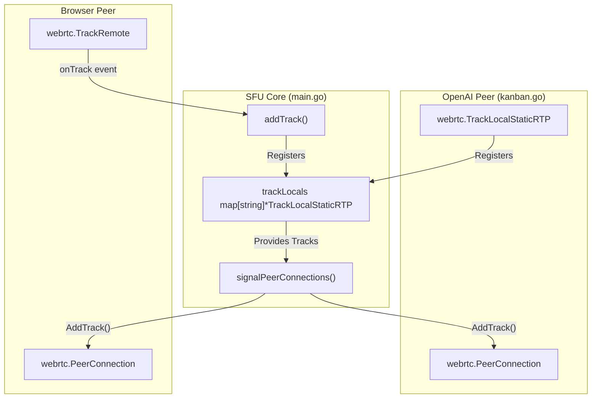
**Sources:** [main.go:120-155](), [main.go:168-217]()

## Signaling and Renegotiation

The SFU uses a "Full Mesh-like" signaling approach where the server generates offers whenever the global track state changes.

### signalPeerConnections Loop
The `signalPeerConnections` function is the core of the SFU's synchronization logic. It performs the following steps for every peer [main.go:150-260]():
1.  **Cleanup**: Removes closed connections from the `peerConnections` slice [main.go:158-163]().
2.  **Diffing**: Compares the tracks currently being sent (`GetSenders`) against the `trackLocals` map [main.go:180-195]().
3.  **Update**: Calls `AddTrack` for new media and `RemoveTrack` for stale media [main.go:189-217]().
4.  **Negotiation**: If changes occurred, it calls `CreateOffer`, updates the `LocalDescription`, and sends the SDP offer to the client via WebSocket [main.go:219-256]().

### Keyframe Dispatch (PLI)
Because WebRTC video requires a keyframe to start decoding, the SFU runs a background goroutine that dispatches a Picture Loss Indication (PLI) every 3 seconds [main.go:98-102](). The `dispatchKeyFrame` function iterates through all `RTCPeerConnection` receivers and sends a `rtcp.PictureLossIndication` packet to the source [main.go:281-294]().

**Signaling State Machine**
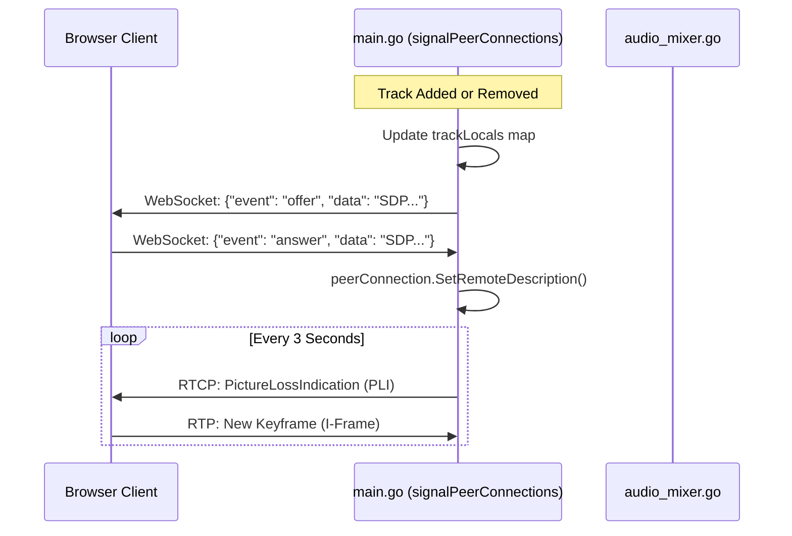
**Sources:** [main.go:150-260](), [main.go:281-294](), [main.go:98-102]()

## Peer Configuration

The server supports NAT traversal through a `SettingEngine`. If the `PION_NAT1TO1_IP` environment variable is set, the server configures its ICE candidates to use that specific IP, which is essential for deployments behind a 1:1 NAT or in cloud environments [main.go:110-117]().

### Connection States
The server monitors the `ConnectionState` of each peer. When a connection transitions to `PeerConnectionStateConnected`, it logs the event; if it fails or closes, the peer is eventually pruned during the next `signalPeerConnections` cycle [main.go:159-163](), [main.go:501-503]().

**Sources:** [main.go:110-117](), [main.go:159-163]()

---

# Page: Audio Mixing Pipeline

# Audio Mixing Pipeline

<details>
<summary>Relevant source files</summary>

The following files were used as context for generating this wiki page:

- [audio_mixer.go](audio_mixer.go)
- [opus_decoder.go](opus_decoder.go)
- [opus_encoder.go](opus_encoder.go)

</details>


The Audio Mixing Pipeline is responsible for aggregating incoming audio tracks from multiple WebRTC participants, decoding them from Opus to PCM, mixing them into a single coherent stream, and fanning that stream out to consumers—primarily the OpenAI Realtime API. It operates on a high-precision 20ms tick loop to ensure low-latency processing and consistent audio quality.

## Pipeline Architecture

The pipeline follows a fan-in/fan-out architecture centered around the `audioMixer` [audio_mixer.go:26-33](). Multiple remote tracks submit decoded PCM data into a central channel, which is then processed by a background worker and distributed to registered sinks.

### Data Flow Diagram: Natural Language to Code Entities

The following diagram maps the conceptual audio flow to the specific Go structs and functions that implement the pipeline.

**Audio Pipeline Entity Mapping**

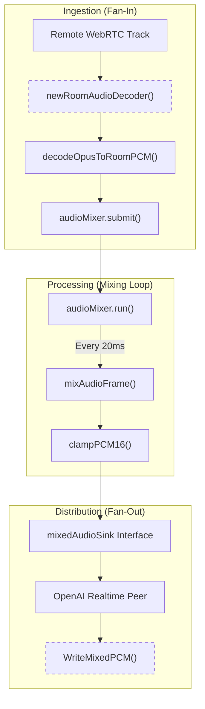
Sources: [audio_mixer.go:45-55](), [audio_mixer.go:129-169](), [audio_mixer.go:183-208](), [audio_mixer.go:225-250](), [audio_mixer.go:271-282]()

## The audioMixer Implementation

The `audioMixer` manages the lifecycle of audio sources and sinks. It uses a `sync.Mutex` to protect the map of sinks and a channel-based `input` mechanism to receive audio frames from various tracks asynchronously [audio_mixer.go:26-33]().

### Mixing Constants
The mixer is configured for high-fidelity conference audio:
| Constant | Value | Description |
| :--- | :--- | :--- |
| `roomAudioSampleRate` | 48000 | 48kHz sampling rate [audio_mixer.go:13]() |
| `roomAudioChannels` | 2 | Stereo output [audio_mixer.go:14]() |
| `roomAudioMixInterval` | 20ms | Tick rate for the mixing loop [audio_mixer.go:17]() |
| `roomAudioMixFrameSize` | 1920 samples | Calculated as `48000 / 50 * 2` [audio_mixer.go:18]() |

### The Mixing Loop
The `run()` method [audio_mixer.go:129-169]() executes the core logic:
1.  **Buffer Ingestion**: Incoming `audioInput` packets are appended to per-track `audioSource` buffers [audio_mixer.go:152]().
2.  **Overflow Protection**: To prevent memory leaks or excessive latency, source buffers are capped at `audioSourceLimit` (1 second of audio) [audio_mixer.go:153-155]().
3.  **Tick Execution**: Every 20ms, the mixer calls `mixAudioFrame()` [audio_mixer.go:157]().
4.  **Normalization**: The mixer averages the samples from all ready sources and applies `clampPCM16` to prevent clipping [audio_mixer.go:195-201]().
5.  **Fan-out**: The resulting `mixedPCM` is written to all registered `mixedAudioSink` implementations [audio_mixer.go:162-166]().

Sources: [audio_mixer.go:12-20](), [audio_mixer.go:129-169](), [audio_mixer.go:183-208]()

## Opus Codec Integration

The system uses `cgo` bindings to `libopus` for high-performance audio encoding and decoding.

### Memory Management Strategy
Because the Opus C-structs are managed via `cgo`, the application uses a specific memory management strategy to avoid GC overhead and ensure safety:
*   **Go-allocated C-structs**: Instead of `C.malloc`, the decoder and encoder structs allocate a Go byte slice (`mem`) of the size required by Opus [opus_decoder.go:26-30](), [opus_encoder.go:28-33]().
*   **Pointer Casting**: The pointer to the first element of the Go slice is cast to a C pointer (`*C.OpusDecoder` or `*C.OpusEncoder`). This ensures the memory is managed by the Go garbage collector while remaining accessible to the C library [opus_decoder.go:28](), [opus_encoder.go:30]().

### Decoder (`opusDecoder`)
The `newOpusDecoder` function initializes the decoder for a specific sample rate and channel count [opus_decoder.go:20-38](). The `Decode` method takes raw Opus bytes and populates a provided `int16` PCM buffer [opus_decoder.go:40-67]().

### Encoder (`opusEncoder`)
The `newOpusEncoder` function initializes the encoder with the `OPUS_APPLICATION_VOIP` setting for optimized speech transmission [opus_encoder.go:35-40](). The `Encode` method converts PCM samples into a compressed Opus packet [opus_encoder.go:47-71]().

Sources: [opus_decoder.go:14-18](), [opus_decoder.go:20-38](), [opus_encoder.go:16-20](), [opus_encoder.go:22-45]()

## Audio Normalization and Conversion

The pipeline ensures all audio entering the mixer is uniform (Stereo, 48kHz).

### Mono-to-Stereo Conversion
If a remote track provides mono audio (1 channel), the `normalizeRoomAudioPCM` function converts it to stereo by duplicating the sample for both left and right channels [audio_mixer.go:286-293]().

### PCM Clamping
To handle potential overflows when summing multiple audio sources, `clampPCM16` ensures the `int32` sum of samples is safely restricted to the `int16` range (-32768 to 32767) [audio_mixer.go:210-219]().

**Normalization Logic Flow**

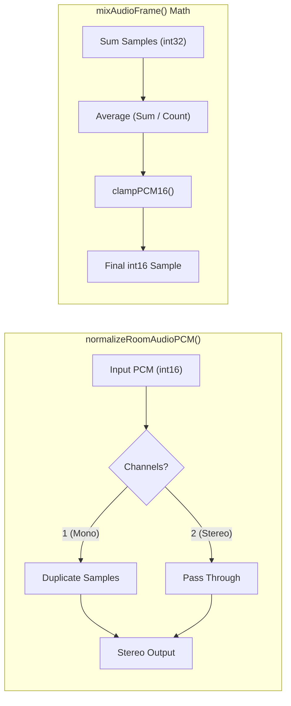
Sources: [audio_mixer.go:195-201](), [audio_mixer.go:210-219](), [audio_mixer.go:284-299]()

## Interface: mixedAudioSink

The `mixedAudioSink` interface [audio_mixer.go:22-24]() allows any component to receive the final mixed audio stream. The primary implementation is the OpenAI Realtime Peer, which consumes the mixed audio to provide the AI with the full context of the meeting room.

```go
type mixedAudioSink interface {
	WriteMixedPCM([]int16) error
}
```

Sources: [audio_mixer.go:22-24](), [audio_mixer.go:162-166]()

---

# Page: OpenAI Realtime Integration

# OpenAI Realtime Integration

<details>
<summary>Relevant source files</summary>

The following files were used as context for generating this wiki page:

- [README.md](README.md)
- [kanban.go](kanban.go)

</details>


The `kanbanBoardApp` acts as a virtual participant in the meeting room, bridging the WebRTC audio mixer with the OpenAI Realtime API. It facilitates a voice-driven interface where the model listens to the mixed room audio and executes tools to manipulate the Kanban board state.

## Peer Connection Setup

The integration begins in `JoinConferenceRoom`, which initializes a `webrtc.PeerConnection` specifically for the OpenAI Realtime session. Unlike browser clients, this peer is managed entirely on the server.

### Audio Pipeline Initialization
To send audio to OpenAI, the application creates a `TrackLocalStaticSample` with Opus codec capabilities.
*   **Input Track**: A local track is created using `webrtc.NewTrackLocalStaticSample` [kanban.go:155-163]().
*   **Opus Encoder**: Since the internal mixer provides raw PCM, a new `opusEncoder` is initialized to compress audio before transmission [kanban.go:169-173]().
*   **RTCP Handling**: The application spawns a `drainRTCP` goroutine to consume incoming RTCP packets (like Receiver Reports), ensuring the stack remains responsive [kanban.go:180]().

### Data Channel (oai-events)
A DataChannel named `oai-events` is created to handle bidirectional JSON signaling with the model [kanban.go:182-186]().
*   **OnOpen**: Once the channel is ready, it triggers a `session.update` event to configure the model's behavior [kanban.go:201-205]().
*   **OnMessage**: Incoming events (transcriptions, tool calls) are routed to `handleRealtimeEvent` [kanban.go:206-208]().

**Sources:** [kanban.go:144-223](), [kanban.go:19-27]()

## Realtime Session Flow

The connection to OpenAI uses a WebRTC-based signaling flow over HTTPS. This is orchestrated by `connectRealtimePeer`.

### SDP Offer/Answer Exchange
1.  **Offer Generation**: The Go backend generates a local SDP offer [kanban.go:245-248]().
2.  **POST Request**: The offer is sent to `https://api.openai.com/v1/realtime/calls` via an authenticated `POST` request [kanban.go:250-264]().
3.  **Answer Set**: The OpenAI API returns an SDP answer, which is applied as the `RemoteDescription` [kanban.go:281-284]().

### Connection Topology
The following diagram illustrates the relationship between the `kanbanBoardApp` code entities and the external OpenAI Realtime service.

**OpenAI Realtime Connectivity**
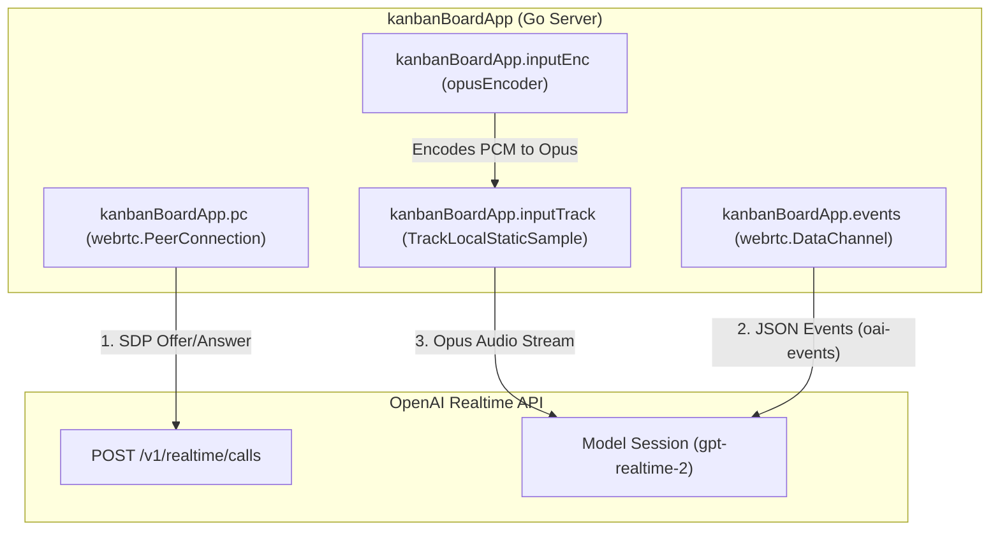
**Sources:** [kanban.go:20-27](), [kanban.go:81-95](), [kanban.go:243-286]()

## Session Configuration

Once the `oai-events` channel is open, the application sends a `session.update` event to define the assistant's persona and technical parameters.

### Model Parameters
The session is configured with specific audio and transcription settings:
*   **Model**: Defaults to `gpt-realtime-2` [kanban.go:21]().
*   **VAD (Voice Activity Detection)**: Enabled to allow the model to detect when users are speaking.
*   **Transcription**: Enabled using `whisper-1` to receive text previews of what the model hears [kanban.go:537-542]().

### Dynamic Context Injection
The `sessionInstructions` function generates the system prompt. Crucially, it injects the current board state into the prompt using `boardContextJSON()` [kanban.go:509](). This ensures the model knows which cards exist, their IDs, and their current status before it attempts to move or update them.

**Sources:** [kanban.go:502-531](), [kanban.go:533-556]()

## Audio Forwarding (WriteMixedPCM)

The `kanbanBoardApp` implements the `mixedAudioSink` interface, allowing it to receive mixed audio from the `audioMixer`.

### Implementation of WriteMixedPCM
The `audioMixer` calls `WriteMixedPCM` every 20ms with a buffer of `int16` samples [kanban.go:296-300]().
1.  **Encoding**: The samples are passed to `app.inputEnc.Encode`, which returns an Opus-encoded bitstream [kanban.go:310-313]().
2.  **Transmission**: The encoded packet is wrapped in a `media.Sample` and written to the `inputTrack` [kanban.go:315-318]().
3.  **Timing**: The `Duration` is set to 20ms to maintain proper playback timing on the remote end [kanban.go:316]().

**Data Flow: Mixer to OpenAI**
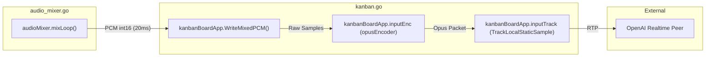
**Sources:** [kanban.go:296-320](), [audio_mixer.go:121-125]()

## Event Handling

The `handleRealtimeEvent` function processes all incoming DataChannel messages. It handles several key event types:

| Event Type | Action |
| :--- | :--- |
| `conversation.item.input_audio_transcription.completed` | Logs the user's transcribed speech for debugging [kanban.go:338-341](). |
| `response.audio_transcript.delta` | (Optional) Can be used for real-time captions of the AI response. |
| `response.done` | Inspects the response for `function_call` items to trigger board mutations [kanban.go:343-356](). |
| `error` | Logs API errors and broadcasts status updates to the frontend [kanban.go:358-362](). |

**Sources:** [kanban.go:322-364]()

---

# Page: Kanban Board Logic

# Kanban Board Logic

<details>
<summary>Relevant source files</summary>

The following files were used as context for generating this wiki page:

- [kanban.go](kanban.go)

</details>


The Kanban Board Logic serves as the server-side state machine for the meeting assistant. It bridges the gap between the **Natural Language Space** (user voice commands) and the **Code Entity Space** (structured data and tool execution). The logic is responsible for maintaining a consistent board state, exposing that state to the AI model, and executing mutations based on the model's tool calls.

### System Overview

The Kanban logic is encapsulated within the `kanbanBoardApp` struct. It manages a collection of `kanbanCard` objects and coordinates with the OpenAI Realtime API to provide an interactive, voice-controlled project management experience.

#### High-Level Interaction Flow

The following diagram illustrates how a voice command translates into a state update on the Kanban board.

**Natural Language to Code Entity Mapping**
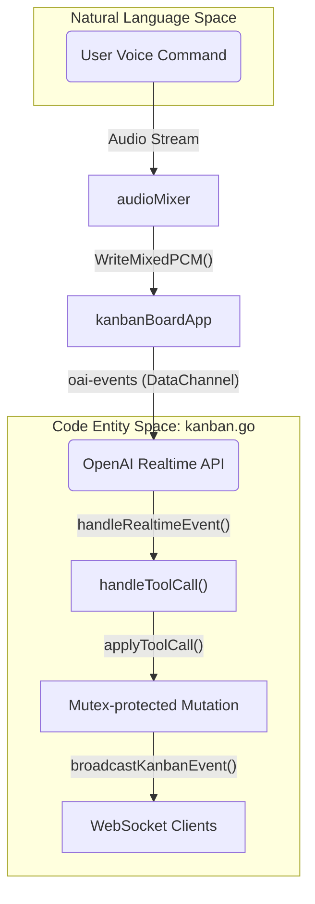
Sources: [kanban.go:81-95](), [kanban.go:206-208](), [kanban.go:217-219](), [kanban.go:343-345]()

---

### Data Model and State Management

The core of the system is a thread-safe state machine that manages the lifecycle of Kanban cards. The state is represented by a slice of `kanbanCard` objects, each possessing a status (Backlog, In Progress, Blocked, or Done), a title, notes, and tags.

Key components of state management include:
*   **Thread Safety**: All mutations to the `cards` slice are protected by a `sync.Mutex` in the `kanbanBoardApp` struct.
*   **Idempotency**: A `handledCalls` map tracks `call_id` strings from the AI to ensure that a single tool invocation is never processed twice.
*   **Context Injection**: The `boardContextJSON()` method generates a compact JSON representation of the board, which is injected into the AI's system instructions so it "sees" the current state of the project.
*   **State Synchronization**: Whenever the board changes, `broadcastKanbanEvent()` is called to push the new state to all connected frontend clients via WebSockets.

For a deep dive into the structs and synchronization primitives, see **[Data Model and State Management (#3.1)](#)**.

Sources: [kanban.go:29-56](), [kanban.go:81-86](), [kanban.go:610-618](), [kanban.go:641-655]()

---

### AI Tool Definitions and Execution

The assistant interacts with the board using a set of five predefined tools. These tools are defined as JSON schemas and shared with the OpenAI model during the session configuration phase.

| Tool Name | Purpose |
| :--- | :--- |
| `create_ticket` | Adds a new card to the Backlog. |
| `move_ticket` | Transitions a card between statuses (e.g., Backlog to In Progress). |
| `update_ticket` | Modifies the title or notes of an existing card. |
| `add_tags` | Appends new labels to a specific card. |
| `do_nothing` | Explicitly signals that no action is required. |

#### Tool Execution Pipeline

When the AI decides to take action, it sends a `response.function_call_arguments.done` event. The server then validates the request and applies the change.

**Tool Execution Sequence**
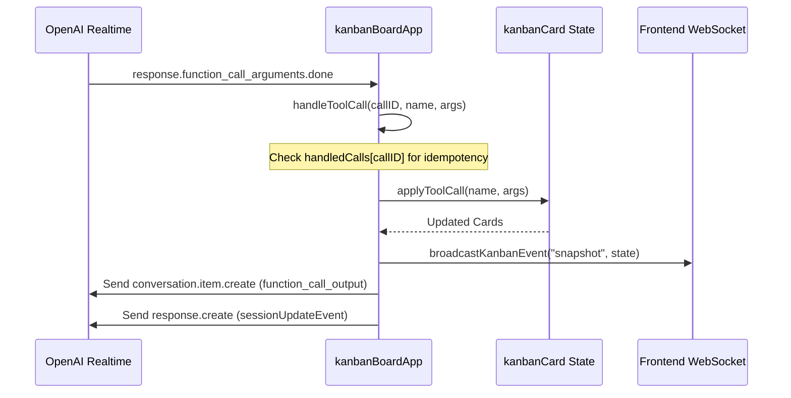

For detailed schema definitions and the dispatch loop logic, see **[AI Tool Definitions and Execution (#3.2)](#)**.

Sources: [kanban.go:343-380](), [kanban.go:432-460](), [kanban.go:502-530]()

---

# Page: Data Model and State Management

# Data Model and State Management

<details>
<summary>Relevant source files</summary>

The following files were used as context for generating this wiki page:

- [kanban.go](kanban.go)
- [main.go](main.go)

</details>


This page documents the server-side data structures and state management mechanisms for the Kanban board. The system uses a centralized Go-based state machine to manage ticket lifecycles, ensuring consistency between the AI assistant's actions and the frontend visualization.

## Kanban Data Structures

The Kanban board state is defined by a collection of cards, each possessing a status, title, and metadata. The system uses a strictly typed enum for column management.

### kanbanStatus Enum
The `kanbanStatus` type defines the valid columns for the board:
*   `Backlog` [kanban.go:32]()
*   `In Progress` [kanban.go:33]()
*   `Blocked` [kanban.go:34]()
*   `Done` [kanban.go:35]()

### Core Structs
The board's internal representation is managed through three primary structures:

| Struct | Purpose | Key Fields |
| :--- | :--- | :--- |
| `kanbanCard` | Represents an individual ticket. | `ID`, `Status`, `Title`, `Notes`, `Tags` [kanban.go:45-51]() |
| `kanbanBoardState` | A serializable snapshot of the entire board. | `Cards`, `UpdatedAt` [kanban.go:53-56]() |
| `kanbanBoardApp` | The global application state and AI peer controller. | `cards`, `mu` (Mutex), `handledCalls` (Idempotency map) [kanban.go:81-95]() |

**Sources:** [kanban.go:29-56](), [kanban.go:81-95]()

## State Initialization and Seeding

Upon startup, the `kanbanBoardApp` is initialized with a set of seed data to provide immediate context for the meeting assistant.

### Seed Data
The `initialKanbanBoardCards` slice contains five default tickets related to WebRTC infrastructure tasks, such as "Add RTP Retransmission Buffer" and "Implement ICE Restart Handling" [kanban.go:97-133]().

### Initialization Flow
1.  `main()` calls `newKanbanBoardApp()` [main.go:74]().
2.  `newKanbanBoardApp` clones the seed data into the app's internal `cards` slice [kanban.go:137]().
3.  The `updatedAt` timestamp is set to the current UTC time [kanban.go:139]().
4.  The `handledCalls` map is initialized to track processed AI tool calls [kanban.go:140]().

**Sources:** [kanban.go:97-142](), [main.go:74]()

## State Mutation and Thread Safety

All modifications to the Kanban board are protected by a `sync.Mutex` within the `kanbanBoardApp` struct to prevent race conditions during concurrent updates from multiple WebRTC or WebSocket clients.

### Mutation Pattern
The system follows a strict pattern for modifying state:
1.  **Lock**: Acquire `app.mu.Lock()` [kanban.go:449]().
2.  **Modify**: Update the `cards` slice or specific card properties.
3.  **Timestamp**: Update `app.updatedAt = time.Now().UTC()` [kanban.go:453]().
4.  **Unlock**: Release `app.mu.Unlock()` [kanban.go:454]().
5.  **Broadcast**: Fan-out the new state to all connected clients via `broadcastKanbanEvent` [kanban.go:455]().

### Idempotency Management
To prevent the AI model from executing the same tool multiple times (e.g., due to network retries or model loops), the `handledCalls` map stores `call_id` strings [kanban.go:86](). The `handleToolCall` function checks this map before applying any mutations [kanban.go:394-398]().

**Sources:** [kanban.go:81-95](), [kanban.go:394-398](), [kanban.go:448-456]()

## State Serialization and AI Context

The AI model requires a text-based representation of the board to understand the current state before making decisions.

### snapshotState()
This method returns a `kanbanBoardState` struct containing a deep copy of the current cards [kanban.go:484-491](). It is used primarily for broadcasting updates to the frontend.

### boardContextJSON()
This method serializes the current board into a JSON string [kanban.go:493-500](). This JSON is injected into the OpenAI Realtime `session.instructions` so the model "sees" the board state in its system prompt [kanban.go:277-285]().

**Sources:** [kanban.go:484-500](), [kanban.go:277-285]()

## Communication and Fan-out

The system uses two primary channels for state synchronization: WebRTC DataChannels for the AI and WebSockets for the human-facing frontend.

### Entity Relationship: State to Communication
The following diagram illustrates how internal Go structs map to external communication events.

**Diagram: State Synchronization Flow**
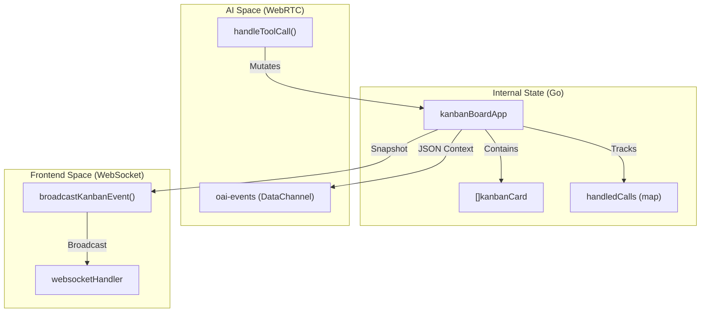
**Sources:** [kanban.go:81-95](), [kanban.go:394-405](), [main.go:270-285]()

### broadcastKanbanEvent
This function facilitates the "fan-out" of state changes. It iterates through all active `peerConnections` and writes a `websocketMessage` to each client's `threadSafeWriter` [main.go:270-285]().

**Diagram: Data Mutation and Fan-out**
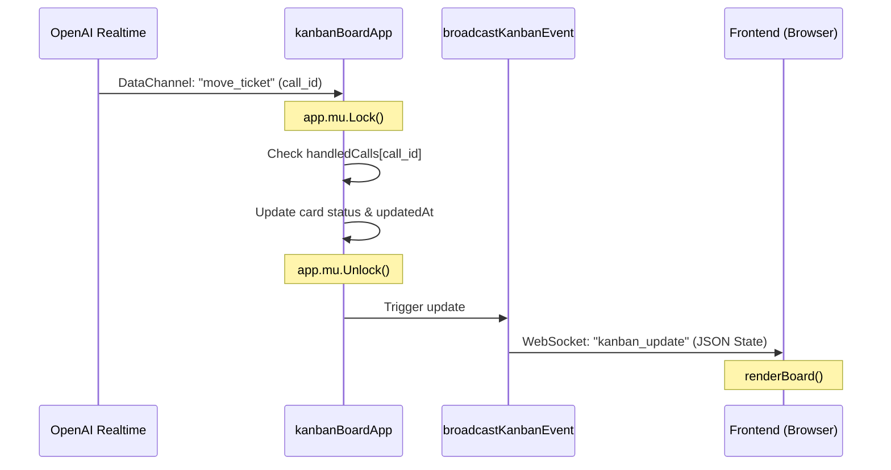
**Sources:** [kanban.go:394-410](), [kanban.go:448-456](), [main.go:270-285]()

## Summary of Key Functions

| Function | Location | Description |
| :--- | :--- | :--- |
| `newKanbanBoardApp` | [kanban.go:135]() | Initializes the application state with seed data. |
| `handleToolCall` | [kanban.go:394]() | Entry point for AI-driven mutations; handles idempotency. |
| `applyToolCall` | [kanban.go:414]() | Dispatches specific mutation logic (create, move, tag). |
| `broadcastKanbanEvent` | [main.go:270]() | Sends a named event and JSON payload to all connected WebSockets. |
| `snapshotState` | [kanban.go:484]() | Generates a thread-safe copy of the board for external consumption. |

**Sources:** [kanban.go:135-142](), [kanban.go:394-410](), [kanban.go:414-446](), [kanban.go:484-491](), [main.go:270-285]()

---

# Page: AI Tool Definitions and Execution

# AI Tool Definitions and Execution

<details>
<summary>Relevant source files</summary>

The following files were used as context for generating this wiki page:

- [kanban.go](kanban.go)

</details>


The Kanban Assistant utilizes the OpenAI Realtime API to perform structured mutations on the board state via function calling. This page details the JSON schema definitions of these tools, the event dispatch loop for processing model requests, and the execution flow that ensures data integrity and model feedback.

## Tool Definitions (JSON Schema)

The tools available to the AI model are defined in `kanbanTools()` using the standard OpenAI function calling schema. These definitions are injected into the session configuration during the `session.update` event.

| Tool Name | Purpose | Key Parameters |
| :--- | :--- | :--- |
| `create_ticket` | Adds a new card to the board. | `title`, `status`, `notes`, `tags` |
| `move_ticket` | Changes the status of an existing card. | `id`, `status` |
| `add_tags` | Appends tags to an existing card. | `id`, `tags` |
| `update_ticket` | Modifies title or notes of a card. | `id`, `title`, `notes` |
| `do_nothing` | Explicitly acknowledges a command without action. | `reason` |

The schema defines `kanbanStatus` as an enum: `Backlog`, `In Progress`, `Blocked`, `Done` [kanban.go:31-36]().

### Tool Implementation Details
- **`create_ticket`**: Automatically assigns a unique ID using an internal counter `nextCreatedIndex` [kanban.go:572-575]().
- **`move_ticket`**: Transitions a card between columns. If a card is moved to `Done`, the frontend triggers a confetti effect [kanban.go:598-600]().
- **`do_nothing`**: Used when the model determines a user's request is out of scope or requires no state change, providing a `reason` for the transcript [kanban.go:635-637]().

Sources: [kanban.go:31-36](), [kanban.go:518-644](), [kanban.go:572-575](), [kanban.go:598-600](), [kanban.go:635-637]()

## Event Dispatch and Tool Execution

The system processes model requests through a structured pipeline that bridges the Realtime API's asynchronous events with the backend's synchronous state mutations.

### The Realtime Event Loop
The `handleRealtimeEvent` function serves as the primary ingress for DataChannel messages from OpenAI. It parses the incoming JSON into a `kanbanRealtimeEvent` struct and dispatches based on the `type` field [kanban.go:414-419]().

1.  **`response.done`**: Triggered when the model finishes a turn. The server iterates through `event.Response.Output` to find items of type `function_call` [kanban.go:426-435]().
2.  **`conversation.item.created`**: Specifically monitors for `function_call` items to trigger the execution logic [kanban.go:421-424]().

### Idempotency and Mutation
To prevent duplicate executions of the same tool call (e.g., due to network retries or model re-transmission), the `kanbanBoardApp` maintains a `handledCalls` map [kanban.go:86]().

- **`handleToolCall`**: Checks if the `call_id` exists in the map. If not, it marks it as handled and invokes `applyToolCall` [kanban.go:445-453]().
- **`applyToolCall`**: A large switch statement that unmarshals the tool arguments and calls the corresponding mutation method (e.g., `createTicket`, `moveTicket`) [kanban.go:462-506]().

### Feedback Loop
After a tool is executed, the server must inform the model of the result so the model can continue the conversation (e.g., saying "I've moved that ticket for you").
1.  The server sends a `conversation.item.create` event with `type: "function_call_output"` containing the tool result [kanban.go:509-514]().
2.  The server sends a `response.create` event to prompt the model to generate a verbal response [kanban.go:438-442]().

Sources: [kanban.go:86](), [kanban.go:414-419](), [kanban.go:421-424](), [kanban.go:426-435](), [kanban.go:438-442](), [kanban.go:445-453](), [kanban.go:462-506](), [kanban.go:509-514]()

## Data Flow: Voice to Mutation

The following diagram illustrates the flow from a user's voice command to a state mutation on the Kanban board.

**Natural Language to Kanban Mutation Flow**
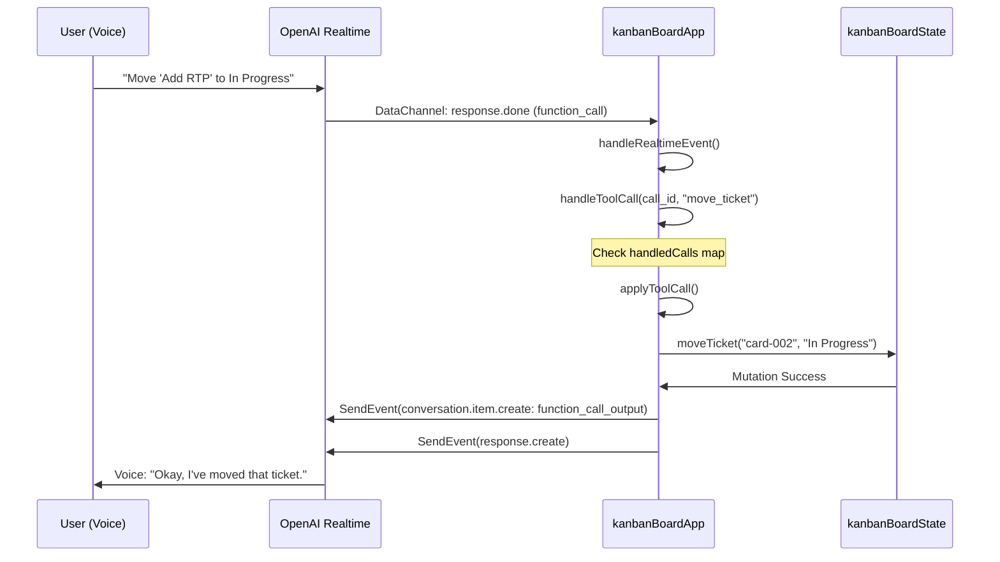
Sources: [kanban.go:414-442](), [kanban.go:462-506](), [kanban.go:593-605]()

## Session Refresh and Context Sync

Because the Kanban board is dynamic, the model's instructions must be updated whenever the board state changes. This ensures the model "knows" which IDs exist and what their current status is.

### `sessionUpdateEvent`
Whenever a tool execution modifies the board, the `kanbanBoardApp` generates a new session configuration [kanban.go:361-383]():
1.  **Dynamic Context**: It calls `boardContextJSON()` to get a minified JSON representation of all cards [kanban.go:691-700]().
2.  **System Instructions**: It wraps this JSON in a system prompt that explains the board's current state [kanban.go:375-376]().
3.  **Tool Injection**: It re-attaches the tool definitions from `kanbanTools()` [kanban.go:377]().

This updated session is sent to OpenAI via the `session.update` event, effectively "refreshing" the AI's memory with the latest board state [kanban.go:203]().

**Code Entity Association: Session Update**
```mermaid
graph TD
    subgraph "Logic Space"
        A["handleToolCall()"] --> B["applyToolCall()"]
        B --> C["Mutation (e.g. moveTicket)"]
        C --> D["sessionUpdateEvent()"]
    end

    subgraph "Data Entity Space"
        D --> E["boardContextJSON()"]
        E --> F["kanbanBoardState.Cards"]
        D --> G["kanbanTools()"]
        G --> H["JSON Schema Definitions"]
    end

    subgraph "Network Space"
        D --> I["DataChannel.Send(session.update)"]
    end
```

Sources: [kanban.go:203](), [kanban.go:361-383](), [kanban.go:375-377](), [kanban.go:691-700]()

---

# Page: Frontend Application

# Frontend Application

<details>
<summary>Relevant source files</summary>

The following files were used as context for generating this wiki page:

- [index.html](index.html)

</details>


The frontend of the Realtime Meeting Assistant is a single-page application (SPA) built with vanilla JavaScript and CSS, served directly from `index.html`. It acts as a WebRTC client for multi-user video/audio conferencing and a reactive Kanban board that synchronizes in real-time with the server-side AI assistant.

### System Overview

The application is structured around two primary communication channels:
1.  **WebRTC PeerConnection**: Handles the negotiation and transport of media tracks (audio/video) and the OpenAI Realtime API's audio stream via the Go backend SFU.
2.  **WebSocket Connection**: Serves as the signaling plane for WebRTC (SDP/ICE exchange) and the state synchronization plane for the Kanban board data.

```mermaid
graph TD
    subgraph "Browser (index.html)"
        UI["Reactive UI (DOM)"]
        WS_Client["WebSocket Client"]
        RTC_Client["RTCPeerConnection"]
        State["Card Snapshots (cardSnapshots)"]
    end

    subgraph "Go Backend"
        SFU["WebRTC SFU (main.go)"]
        K_State["Kanban State (kanban.go)"]
    end

    WS_Client <-->|Signaling & Kanban Events| SFU
    RTC_Client <-->|SRTP Media| SFU
    K_State -.->|Broadcasts| SFU
    UI <--> State
    WS_Client -->|update| State
```
Sources: [index.html:1-30](), [index.html:105-185]()

---

### WebRTC and Connection Management

The frontend manages the lifecycle of the meeting through `joinRoom()` and `leaveRoom()` functions. It utilizes `getUserMedia` to capture local media and interfaces with the `RTCPeerConnection` API to establish a session with the backend SFU. 

Key responsibilities include:
*   **Signaling**: Processing `offer`, `answer`, and `candidate` messages via the `handleSignal()` function [index.html:565-586]().
*   **Media Rendering**: Dynamically creating `<video>` elements for remote participants and managing the "video rail" UI [index.html:588-620]().

For details, see [WebRTC Client and WebSocket Signaling](#4.1).

Sources: [index.html:500-530](), [index.html:565-586]()

---

### Kanban Board and Reactive UI

The Kanban board is a high-fidelity, reactive interface that reflects the state of the `kanbanBoardState` maintained on the server. The UI is reconstructed via `renderBoard()` whenever a `kanban_sync` or `kanban_update` event is received over the WebSocket.

#### UI Interaction Model
| Component | Function | Description |
| :--- | :--- | :--- |
| **Board Surface** | `renderBoard()` | Iterates through columns (Backlog, In Progress, Blocked, Done) and renders cards. |
| **Card Diffing** | `cardChanges()` | Identifies new or moved cards by comparing the current state against `cardSnapshots`. |
| **Animations** | `card-move-wiggle` | A CSS animation applied to cards that have changed columns [index.html:279-286](). |
| **Modals** | `showCardDetail()` | Displays card descriptions, tags, and owners in an overlay. |

#### State Synchronization Flow
The frontend maintains a local cache of card positions to trigger visual cues (like confetti or wiggles) when the AI or other users modify the board.

```mermaid
sequenceDiagram
    participant S as Server (kanban.go)
    participant W as WebSocket
    participant F as Frontend (index.html)
    participant D as DOM

    S->>W: Send "kanban_update"
    W->>F: handleKanbanMessage(data)
    F->>F: cardChanges(newCards)
    alt Card Moved to Done
        F->>F: fireConfetti()
    else Card Moved
        F->>D: Add .moved class (Wiggle)
    end
    F->>D: renderBoard()
```
Sources: [index.html:758-790](), [index.html:865-900](), [index.html:1020-1050]()

For details, see [Kanban Board UI and Reactive Rendering](#4.2).

---

### Visual Components and Utilities

The frontend includes several utility systems to enhance the user experience without external dependencies:
*   **Identicons**: The `renderIdenticon()` function generates unique SVG avatars for card owners using an FNV-1a hash of the owner's name [index.html:1120-1155]().
*   **Toast System**: A non-blocking notification stack managed via `showToast()` to alert users of board changes or connection status [index.html:1080-1110]().
*   **Audio Visualizer**: (If applicable) Logic to provide visual feedback for active speakers in the video rail.

Sources: [index.html:298-320](), [index.html:1120-1155]()

---

# Page: WebRTC Client and WebSocket Signaling

# WebRTC Client and WebSocket Signaling

<details>
<summary>Relevant source files</summary>

The following files were used as context for generating this wiki page:

- [index.html](index.html)

</details>


The frontend application utilizes a dual-channel communication strategy to facilitate real-time collaboration. It employs a **WebSocket** connection for signaling and state synchronization, and a **WebRTC** `RTCPeerConnection` for low-latency media streaming. The browser client acts as a participant in a Selective Forwarding Unit (SFU) architecture, where it publishes its local media and subscribes to remote tracks from other participants and the OpenAI Realtime AI peer.

## Connection Lifecycle

The connection lifecycle is managed through the `joinRoom()` and `leaveRoom()` functions. Joining a room involves initializing local media devices, establishing the WebSocket signaling channel, and configuring the WebRTC peer connection.

### Lifecycle Sequence
1.  **Media Acquisition**: The client requests access to the user's microphone and camera using `navigator.mediaDevices.getUserMedia` [[index.html:565-568]]().
2.  **WebSocket Handshake**: A WebSocket connection is established to the `/ws` endpoint [[index.html:573-573]]().
3.  **PeerConnection Setup**: An `RTCPeerConnection` is instantiated with a STUN server configuration to handle NAT traversal [[index.html:585-588]]().
4.  **Track Registration**: Local tracks from the media stream are added to the `RTCPeerConnection` [[index.html:591-593]]().
5.  **Signaling**: The client creates an SDP Offer, sets its local description, and sends the offer to the server via the WebSocket [[index.html:633-638]]().

```mermaid
sequenceDiagram
    participant B as Browser (index.html)
    participant S as Go Backend (main.go)
    
    Note over B: joinRoom() called
    B->>B: getUserMedia({video, audio})
    B->>S: WebSocket Connection (/ws)
    B->>B: new RTCPeerConnection(config)
    B->>B: pc.addTrack(localStream)
    B->>S: sendSignal("offer", sdp)
    S->>B: sendSignal("answer", sdp)
    B->>B: pc.setRemoteDescription(answer)
    
    loop Trickle ICE
        B->>S: sendSignal("candidate", ice)
        S->>B: sendSignal("candidate", ice)
    end
```
**Sources:** [index.html:561-641](), [index.html:509-519]()

## Signaling and Renegotiation

The application uses "Trickle ICE," where ICE candidates are sent over the WebSocket as soon as they are discovered, rather than waiting for the entire SDP exchange to complete [[index.html:601-605]]().

### Incoming Signal Handling
The `handleSignal()` function processes messages received from the server's signaling loop. It dispatches actions based on the signal type:
*   **`answer`**: Calls `pc.setRemoteDescription()` to finalize the WebRTC handshake [[index.html:514-514]]().
*   **`offer`**: Used during renegotiation (e.g., when a new participant joins). The client sets the remote description, creates an answer, and sends it back [[index.html:511-513]]().
*   **`candidate`**: Calls `pc.addIceCandidate()` to update network routing paths [[index.html:515-517]]().

### Function Mapping: Signaling Entities
```mermaid
graph TD
    subgraph "Signaling Logic (index.html)"
        JS_WS["ws.onmessage"] --> JS_HS["handleSignal()"]
        JS_HS --> JS_SRD["pc.setRemoteDescription()"]
        JS_HS --> JS_AIC["pc.addIceCandidate()"]
        JS_PC["pc.onicecandidate"] --> JS_SS["sendSignal('candidate')"]
    end

    subgraph "Backend Entities (main.go)"
        GO_WS["reader() loop"] --> GO_SIG["signalPeerConnections()"]
        GO_SIG --> GO_WRI["threadSafeWriter"]
    end

    JS_SS -- "WebSocket" --> GO_WS
    GO_WRI -- "WebSocket" --> JS_WS
```
**Sources:** [index.html:509-525](), [index.html:551-558](), [index.html:601-606]()

## Remote Track Rendering

The client dynamically manages remote video elements using a `remoteElements` Map, which tracks the association between WebRTC `MediaStream` IDs and DOM elements [[index.html:479-479]]().

### The Video Rail
When a remote track is received via the `ontrack` event:
1.  **Track Association**: The client checks if an element already exists for the incoming stream [[index.html:609-612]]().
2.  **Element Creation**: If new, it creates a "video-tile" container containing a `<video>` element and a label [[index.html:614-624]]().
3.  **DOM Integration**: The new tile is appended to the `.video-stack` (the "video rail") on the right side of the UI [[index.html:623-625]]().
4.  **Cleanup**: When a track ends or a user leaves, the `onmute` or `onended` events trigger the removal of the corresponding DOM element from the `remoteElements` map and the UI [[index.html:627-630]]().

| Entity | Description | Code Reference |
| :--- | :--- | :--- |
| `remoteElements` | Map of `stream.id` to `HTMLDivElement` | [index.html:479]() |
| `ontrack` | Event handler for incoming media | [index.html:608-631]() |
| `.video-stack` | Container for remote participant tiles | [index.html:137-142]() |
| `video-label` | Overlay displaying participant ID | [index.html:152-167]() |

**Sources:** [index.html:479-479](), [index.html:608-631](), [index.html:137-167]()

## Data Flow: Media and State

The client handles two distinct data flows: the **Media Plane** (RTP/RTCP) for voice and video, and the **Data/Signaling Plane** (WebSocket) for Kanban board updates and WebRTC negotiation.

```mermaid
flowchart LR
    subgraph "Browser"
        MIC["Microphone/Camera"]
        V_RAIL["Video Rail (DOM)"]
        K_UI["Kanban UI"]
    end

    subgraph "Network"
        UDP_RTP(("UDP (RTP/RTCP)"))
        TCP_WS(("TCP (WebSocket)"))
    end

    subgraph "Go Backend"
        SFU["SFU Logic (main.go)"]
        K_STATE["Kanban State (kanban.go)"]
    end

    MIC -- "Local Track" --> UDP_RTP
    UDP_RTP -- "Remote Tracks" --> V_RAIL
    TCP_WS -- "JSON Signals" --> SFU
    TCP_WS -- "JSON Board State" --> K_UI
    K_STATE -- "Broadcast" --> TCP_WS
```
**Sources:** [index.html:591-593](), [index.html:608-615](), [index.html:533-549]()

---

# Page: Kanban Board UI and Reactive Rendering

# Kanban Board UI and Reactive Rendering

<details>
<summary>Relevant source files</summary>

The following files were used as context for generating this wiki page:

- [index.html](index.html)
- [public/screenshot.png](public/screenshot.png)

</details>


The frontend of the Realtime Meeting Assistant utilizes a reactive rendering engine to synchronize the visual state of the Kanban board with updates received from the backend. Instead of full page reloads, the application performs granular DOM reconstruction and state diffing to provide a smooth user experience, including animations for card movements and visual feedback for task completions.

## Board Rendering Engine

The primary entry point for Kanban UI updates is `handleKanbanMessage()`, which processes incoming WebSocket messages of type `board_snapshot` [index.html:1121-1123]().

### State Synchronization Flow

1.  **Message Reception**: The WebSocket `onmessage` handler identifies Kanban events and routes them to `handleKanbanMessage(data)` [index.html:1011-1014]().
2.  **Diffing**: The system compares the new board state against a locally cached `cardSnapshots` map to identify which cards have been created, moved, or updated [index.html:1126-1130]().
3.  **DOM Reconstruction**: The `renderBoard()` function clears the existing board container and rebuilds the columns and cards based on the latest state [index.html:1139-1141]().
4.  **Post-Processing**: Animations (wiggles) and effects (confetti) are triggered based on the diff results [index.html:1132-1136]().

### Card Diffing and Reactive Logic
The `cardChanges()` function calculates the delta between the previous state and the incoming state [index.html:1162-1185](). It tracks:
*   **Created**: Cards present in the new state but not the old.
*   **Moved**: Cards whose `status` (column) has changed [index.html:1174-1176]().
*   **Updated**: Cards whose content (title, tags, or owner) has changed.

**Sources:** [index.html:1011-1014](), [index.html:1121-1185]()

## UI Components and Rendering

### DOM Construction (`renderBoard`)
The `renderBoard()` function iterates through the four standard Kanban columns: `backlog`, `in_progress`, `blocked`, and `done` [index.html:1191-1194](). For each column, it filters the `board.cards` array and generates HTML fragments.

| Element | Responsibility | Code Reference |
| :--- | :--- | :--- |
| **Column** | Groups cards by status; displays card count. | [index.html:1200-1209]() |
| **Card** | Displays title, owner identicon, and tags. | [index.html:1211-1243]() |
| **Identicon** | Generates a deterministic SVG avatar for the card owner. | [index.html:1260-1286]() |
| **Tags** | Renders small pills for metadata like "High Priority". | [index.html:1228-1232]() |

### Identicon Generation
The `renderIdenticon(name)` function uses an **FNV-1a hash** algorithm to generate a deterministic color and pattern for a user's avatar based on their name [index.html:1260-1286](). This ensures that the same owner always has the same visual representation across all clients.

**Sources:** [index.html:1191-1243](), [index.html:1260-1286]()

## Visual Effects and Notifications

The UI provides immediate feedback for AI-driven actions through CSS animations and specialized JS effects.

### Card Move Wiggle
When `cardChanges()` detects a card has moved between columns, the `moved` CSS class is applied to that card's DOM element [index.html:1212-1214]().
*   **Animation**: Defined as `card-move-wiggle`, a 1100ms ease-in-out transform [index.html:279-285]().
*   **Visual Style**: The card gains a blue border and a shadow to highlight the movement [index.html:281-282]().

### Completion Confetti
If a card's status changes to `done`, the `fireConfetti()` function is triggered [index.html:1133-1135]().
*   **Implementation**: It creates 40 individual `div` elements with random colors and trajectories [index.html:1301-1313]().
*   **Animation**: Uses the `confetti-pop` CSS animation to simulate a burst from the center of the screen [index.html:287-296]().

### Toast Notifications
A stack of non-blocking toast notifications is managed in the `toast-region` [index.html:298-307]().
*   **`showToast(message, type)`**: Adds a message to the UI stack [index.html:1288-1299]().
*   **Auto-dismiss**: Toasts are automatically removed from the DOM after 4 seconds [index.html:1296-1298]().

**Sources:** [index.html:279-307](), [index.html:1132-1136](), [index.html:1288-1320]()

## Modals and Interaction

The frontend includes two primary modal interfaces for detailed data viewing.

### Card Detail Modal
Triggered when a user clicks on a card. It displays the full title, status, tags, and the assigned owner [index.html:1322-1335]().
*   **Function**: `showCardDetails(cardId)` [index.html:1322]().
*   **State**: Pulls data from the `cardSnapshots` map [index.html:1323]().

### Comment Preview Modal
Used to show transcripts or notes associated with a card.
*   **Function**: `showCommentPreview(content)` [index.html:1347-1355]().
*   **Closing**: Modals are dismissed via `closeModal()` which clears the `modal-overlay` content and hides the container [index.html:1357-1361]().

**Sources:** [index.html:1322-1361]()

## Logic Flow Diagrams

### Reactive Rendering Pipeline
This diagram bridges the Natural Language concept of "Board Updating" to the specific Code Entities involved in the rendering loop.

```mermaid
graph TD
    subgraph "WebSocket Event Space"
        A["'board_snapshot' Message"] --> B["handleKanbanMessage(data)"]
    end

    subgraph "Diffing Engine"
        B --> C["cardChanges(old, new)"]
        C --> D{{"Check Changes"}}
        D -- "Moved to Done" --> E["fireConfetti()"]
        D -- "Created/Moved" --> F["showToast()"]
    end

    subgraph "DOM Space"
        B --> G["renderBoard()"]
        G --> H["renderIdenticon(owner)"]
        H --> I["Update .board-surface HTML"]
        I -- "Apply CSS" --> J[".card.moved { animation: card-move-wiggle }"]
    end
```
**Sources:** [index.html:1121-1136](), [index.html:1162-1185](), [index.html:1191-1243]()

### Modal Interaction Flow
Describes how user interactions trigger detail views using the cached board state.

```mermaid
graph LR
    subgraph "User Interface"
        K["Click .card"] --> L["showCardDetails(cardId)"]
        M["Close Button"] --> N["closeModal()"]
    end

    subgraph "State & Rendering"
        L --> O["Lookup cardSnapshots.get(cardId)"]
        O --> P["Build Modal HTML"]
        P --> Q["Display #modal-overlay"]
        N --> R["Hide #modal-overlay"]
    end
```
**Sources:** [index.html:1322-1335](), [index.html:1357-1361]()

---

# Page: Dependencies and Project Configuration

# Dependencies and Project Configuration

<details>
<summary>Relevant source files</summary>

The following files were used as context for generating this wiki page:

- [.gitignore](.gitignore)
- [LICENSE](LICENSE)
- [go.mod](go.mod)
- [go.sum](go.sum)

</details>


This page provides a high-level overview of the external libraries, native requirements, and project-level configurations that enable the Realtime Meeting Assistant to function. The project is built using **Go 1.24** and relies on a combination of modern WebRTC protocols, WebSocket signaling, and native C-based audio encoding.

## Dependency Ecosystem

The project leverages the **Pion** ecosystem for WebRTC implementation and **Gorilla WebSocket** for real-time signaling between the browser and the Go backend. These dependencies handle the complex negotiation of media tracks, data channels, and network traversal.

### Core Go Dependencies
*   **github.com/pion/webrtc/v4**: The primary engine for the Selective Forwarding Unit (SFU) logic, managing `PeerConnection` and `TrackLocalStaticRTP` [go.mod:10-10]().
*   **github.com/gorilla/websocket**: Used for the signaling server to exchange SDP offers/answers and to broadcast Kanban state updates [go.mod:6-6]().
*   **github.com/pion/rtp & github.com/pion/rtcp**: Specialized libraries for packet-level manipulation, essential for audio mixing and requesting keyframes via PLI [go.mod:8-9]().

For a detailed breakdown of how these libraries are utilized within the SFU and signaling layers, see **[Go Module and Third-Party Libraries](#5.1)**.

### Dependency Relationship Map

The following diagram illustrates how high-level system requirements map to specific code entities and their underlying third-party dependencies.

**System to Code Dependency Mapping**
```mermaid
graph TD
    subgraph "Natural Language Space"
        A["WebRTC SFU"]
        B["Real-time Signaling"]
        C["Audio Processing"]
        D["Kanban Sync"]
    end

    subgraph "Code Entity Space"
        A1["main.go: signalPeerConnections"]
        B1["main.go: handleWebsocket"]
        C1["audio_mixer.go: audioMixer"]
        D1["kanban.go: broadcastKanbanEvent"]
    end

    subgraph "Dependency Space"
        Pion["pion/webrtc/v4"]
        Gorilla["gorilla/websocket"]
        Opus["libopus (C-Library)"]
    end

    A --> A1
    B --> B1
    C --> C1
    D --> D1

    A1 --> Pion
    B1 --> Gorilla
    C1 --> Opus
    D1 --> Gorilla
```
Sources: [go.mod:1-11](), [main.go:1-10](), [audio_mixer.go:1-10]()

## Native Dependencies and Build Setup

Unlike pure Go projects, this assistant requires **libopus** to perform high-performance audio encoding and decoding for the OpenAI Realtime API. This is achieved via `cgo` and `pkg-config`.

*   **libopus**: Required for the `OpusDecoder` and `OpusEncoder` types. The project uses `pkg-config` to locate the headers and shared libraries during the build process.
*   **CGO Integration**: The Go runtime manages pointers to C-allocated memory for Opus structs, requiring specific cleanup patterns to avoid memory leaks.
*   **Network Configuration**: For production environments behind NAT, the `PION_NAT1TO1_IP` environment variable is supported to ensure ICE candidates are correctly advertised.

For setup instructions and platform-specific requirements, see **[Native Dependencies and Build Setup](#5.2)**.

## Project Configuration

The project follows standard Go conventions for configuration and source control.

### Source Control (.gitignore)
The project ignores OS-specific files, test binaries, and the compiled output of the main application.
*   **Build Artifact**: `/openai-realtime-meeting-assistant` [ .gitignore:3-3]()
*   **Tests**: `/*.test` [ .gitignore:2-2]()

### Licensing
The project is released under the **MIT License**, allowing for broad reuse, modification, and distribution, provided the original copyright notice and permission notice are included [LICENSE:1-21]().

### Configuration Mapping

| Feature | Code/Config Entity | Purpose |
| :--- | :--- | :--- |
| **Module Path** | `github.com/openai/openai-realtime-meeting-assistant` | Unique identifier for Go dependency resolution [go.mod:1-1]() |
| **Go Version** | `1.24.0` | Minimum required Go runtime version [go.mod:3-3]() |
| **Binary Name** | `openai-realtime-meeting-assistant` | The resulting executable after running `go build` [.gitignore:3-3]() |
| **License** | `MIT` | Legal framework for the codebase [LICENSE:1-1]() |

Sources: [go.mod:1-3](), [.gitignore:1-4](), [LICENSE:1-21]()

---

# Page: Go Module and Third-Party Libraries

# Go Module and Third-Party Libraries

<details>
<summary>Relevant source files</summary>

The following files were used as context for generating this wiki page:

- [go.mod](go.mod)
- [go.sum](go.sum)

</details>


This page provides a detailed technical breakdown of the direct and indirect dependencies used in the Realtime Meeting Assistant. The project is built using Go 1.24.0 [go.mod:3-3]() and leverages the Pion WebRTC stack for media handling and Gorilla WebSocket for signaling and state synchronization.

## Direct Dependencies

The application relies on several high-level libraries to manage the complexities of WebRTC, real-time networking, and concurrency.

### 1. pion/webrtc/v4
The core of the Selective Forwarding Unit (SFU) logic is powered by `github.com/pion/webrtc/v4` [go.mod:10-10](). This library manages the PeerConnection lifecycle, media tracks, and data channels.

*   **PeerConnection**: Used to establish a media session between the Go server and each participant (browser or OpenAI Realtime API).
*   **TrackLocalStaticRTP**: Implemented to handle the fan-out of media. When a participant sends audio or video, the server broadcasts it to all other peers using these local tracks.
*   **DataChannel**: Used for low-latency event exchange, specifically the `oai-events` channel for communicating with the OpenAI Realtime model.

### 2. gorilla/websocket
The `github.com/gorilla/websocket` [go.mod:6-6]() library handles the initial signaling handshake and the live synchronization of the Kanban board state.

*   **WebSocket Upgrade**: Converts standard HTTP requests into persistent WebSocket connections for real-time signaling.
*   **threadSafeWriter**: A custom wrapper implemented in the codebase to ensure that concurrent writes to a single WebSocket connection do not result in interleaved frames or panics.

### 3. pion/rtcp and pion/rtp
These libraries provide low-level packet manipulation capabilities required for the SFU to function correctly.

*   **pion/rtcp**: Specifically used for dispatching **Picture Loss Indication (PLI)** packets [go.mod:8-8](). This is critical for video; when a new peer joins, the server sends a PLI to the source to force a keyframe, ensuring the new peer doesn't wait for the next GOP (Group of Pictures) interval.
*   **pion/rtp**: Used for parsing and modifying RTP headers [go.mod:9-9](). This allows the server to rewrite sequence numbers and timestamps when switching or forwarding packets between different peers.

### Summary Table of Direct Dependencies

| Library | Primary Use Case | Key Code Entities |
| :--- | :--- | :--- |
| `pion/webrtc/v4` | WebRTC Stack | `PeerConnection`, `TrackLocalStaticRTP` |
| `gorilla/websocket` | Signaling & State | `websocket.Upgrader`, `Conn` |
| `pion/rtcp` | Media Control | `rtcp.PictureLossIndication` |
| `pion/rtp` | Packet Handling | `rtp.Packet` |

**Sources:** [go.mod:5-11]()

---

## Indirect Dependencies (Pion Ecosystem)

The WebRTC implementation pulls in a suite of specialized libraries from the Pion ecosystem to handle the underlying protocols of a secure real-time session.

### Networking and Security
*   **pion/ice/v4**: Handles Interactive Connectivity Establishment (ICE). It manages STUN/TURN protocols to find the best network path between peers [go.mod:17-17]().
*   **pion/dtls/v3**: Provides Datagram Transport Layer Security (DTLS) for encrypting the media and data streams [go.mod:16-16]().
*   **pion/srtp/v3**: Implements Secure Real-time Transport Protocol to ensure the privacy and integrity of RTP packets [go.mod:23-23]().

### Protocol Support
*   **pion/sdp/v3**: Used for Session Description Protocol (SDP) parsing and generation during the offer/answer exchange [go.mod:22-22]().
*   **pion/sctp**: Supports the Stream Control Transmission Protocol used by WebRTC DataChannels [go.mod:21-21]().
*   **pion/interceptor**: Provides a framework for RTP/RTCP packet processing pipelines, such as NACK generation and bandwidth estimation [go.mod:18-18]().

**Sources:** [go.mod:13-31]()

---

## Data Flow and Entity Mapping

The following diagrams illustrate how these third-party libraries map to the internal logic of the Meeting Assistant.

### Entity Mapping: Signaling and Peer Setup
This diagram bridges the "Natural Language Space" of a connection request to the specific "Code Entities" provided by the dependencies.

**Signaling to Code Entity Mapping**
```mermaid
graph TD
    subgraph "External World"
        "Browser_Client"["Browser Client"]
        "OpenAI_API"["OpenAI Realtime API"]
    end

    subgraph "Go Server (gorilla/websocket)"
        "Upgrader"["websocket.Upgrader"]
        "TSWriter"["threadSafeWriter"]
    end

    subgraph "WebRTC Stack (pion/webrtc)"
        "PC"["webrtc.PeerConnection"]
        "LocalTrack"["webrtc.TrackLocalStaticRTP"]
        "DataChan"["webrtc.DataChannel"]
    end

    "Browser_Client" -- "WS Upgrade" --> "Upgrader"
    "Upgrader" -- "Encapsulates" --> "TSWriter"
    "TSWriter" -- "Signaling (SDP/ICE)" --> "PC"
    "PC" -- "Media Flow" --> "LocalTrack"
    "OpenAI_API" -- "Events" --> "DataChan"
```
**Sources:** [go.mod:6-10](), [go.sum:5-38]()

### Media Packet Dispatch Logic
This diagram shows how `pion/rtp` and `pion/rtcp` are utilized within the SFU's packet loop.

**Packet Handling Flow**
```mermaid
flowchart LR
    subgraph "Ingress"
        "RemoteTrack"["webrtc.TrackRemote"]
    end

    subgraph "Processing (pion/rtp & pion/rtcp)"
        "RTP_Parser"["rtp.Packet.Unmarshal"]
        "PLI_Gen"["rtcp.PictureLossIndication"]
    end

    subgraph "Egress"
        "LocalTrack"["webrtc.TrackLocalStaticRTP"]
    end

    "RemoteTrack" -- "Raw Bytes" --> "RTP_Parser"
    "RTP_Parser" -- "Modified Packet" --> "LocalTrack"
    "LocalTrack" -- "On New Subscriber" --> "PLI_Gen"
    "PLI_Gen" -- "Feedback" --> "RemoteTrack"
```
**Sources:** [go.mod:8-10](), [go.sum:21-24]()

---

## Dependency Management Strategy

The project uses Go Modules for strict versioning of dependencies.

### Version Pinning
The `go.mod` file pins major versions (e.g., `pion/webrtc/v4`) to ensure API stability while allowing for minor/patch updates [go.mod:10-10](). The `go.sum` file provides cryptographic checksums for every dependency to prevent supply-chain attacks and ensure reproducible builds [go.sum:1-52]().

### Indirect Dependency Resolution
Many of the `pion` sub-packages are listed as `// indirect` [go.mod:14-31](). These are managed automatically by the Go toolchain because `pion/webrtc/v4` depends on them. This modularity allows the SFU to benefit from specialized updates in the ICE or DTLS layers without requiring a full rewrite of the high-level PeerConnection logic.

**Sources:** [go.mod:1-32](), [go.sum:1-53]()

---

# Page: Native Dependencies and Build Setup

# Native Dependencies and Build Setup

<details>
<summary>Relevant source files</summary>

The following files were used as context for generating this wiki page:

- [.gitignore](.gitignore)
- [opus_decoder.go](opus_decoder.go)
- [opus_encoder.go](opus_encoder.go)

</details>


This page details the native requirements and build configuration for the Realtime Meeting Assistant. The application relies on **cgo** to interface with the high-performance `libopus` library for audio encoding and decoding, and utilizes specific environment configurations for network traversal in production.

## libopus CGO Integration

The backend leverages the Opus interactive audio codec for handling WebRTC audio streams. Rather than using a pure-Go implementation, the project interfaces directly with the native C library `libopus` via cgo to ensure performance and compatibility with standard Opus implementations.

### pkg-config Usage
The build system uses `pkg-config` to locate the necessary header files and library binaries for `libopus`. This is defined in the preamble of the Opus wrapper files:

*   **Decoder:** `[opus_decoder.go:4-6]()`
*   **Encoder:** `[opus_encoder.go:4-6]()`

To build the project, `libopus` must be installed on the host system (e.g., `brew install opus` on macOS or `apt-get install libopus-dev` on Ubuntu).

### Memory Management Pattern
A distinctive feature of this implementation is the "Go-heap-allocated C struct" pattern. Instead of using `C.malloc` (which requires manual `free` calls and is invisible to the Go garbage collector), the application allocates the memory for Opus structures as Go byte slices.

1.  **Size Calculation:** The code queries the native library for the exact byte size required for a decoder or encoder state using `C.opus_decoder_get_size` `[opus_decoder.go:25-25]()` and `C.opus_encoder_get_size` `[opus_encoder.go:27-27]()`.
2.  **Go Allocation:** A byte slice is allocated on the Go heap: `make([]byte, int(size))` `[opus_decoder.go:26-26]()`, `[opus_encoder.go:28-28]()`.
3.  **Pointer Casting:** The address of the first element of this slice is cast to a C pointer (`*C.OpusDecoder` or `*C.OpusEncoder`) `[opus_decoder.go:28-28]()`, `[opus_encoder.go:30-30]()`.
4.  **Initialization:** The native `opus_decoder_init` or `opus_encoder_init` function is called on that memory `[opus_decoder.go:33-33]()`, `[opus_encoder.go:35-40]()`.

This approach ensures that when the Go struct (`opusDecoder` or `opusEncoder`) is garbage collected, the underlying C state memory is also reclaimed automatically.

### Code Entity Mapping: Opus Lifecycle

The following diagram illustrates how Go entities interact with the native Opus library during initialization and processing.

**Opus CGO Memory Flow**
```mermaid
graph TD
    subgraph "Go Managed Space"
        A["newOpusDecoder() / newOpusEncoder()"] --> B["make([]byte, size)"]
        B --> C["opusDecoder / opusEncoder struct"]
        C --> D["Decode() / Encode() methods"]
    end

    subgraph "Native C Space (libopus)"
        E["C.opus_decoder_get_size()"]
        F["C.opus_decoder_init()"]
        G["C.opus_decode() / C.opus_encode()"]
    end

    A -- "Query Size" --> E
    E -- "Return bytes" --> A
    B -- "unsafe.Pointer(&mem[0])" --> F
    D -- "Pass ptr to native call" --> G
```
**Sources:** `[opus_decoder.go:20-38]()`, `[opus_encoder.go:22-45]()`

## Audio Data Flow

The `opusDecoder` and `opusEncoder` structs provide a high-level Go API for the raw C functions.

| Entity | Function | Data Transformation |
| :--- | :--- | :--- |
| `opusDecoder.Decode` | `[opus_decoder.go:40-67]()` | `[]byte` (Opus) -> `[]int16` (PCM) |
| `opusEncoder.Encode` | `[opus_encoder.go:47-71]()` | `[]int16` (PCM) -> `[]byte` (Opus) |
| `opusErrorText` | `[opus_decoder.go:69-71]()` | `C.int` code -> `string` via `C.opus_strerror` |

**Audio Processing Sequence**
```mermaid
sequenceDiagram
    participant P as PCM Buffer ([]int16)
    participant E as opusEncoder (Go)
    participant L as libopus (C)
    participant O as Opus Packet ([]byte)

    P->>E: Encode(pcm)
    E->>L: C.opus_encode(encoder.ptr, pcm_ptr, ...)
    L-->>E: written bytes count
    E->>O: slice packet[:written]
```
**Sources:** `[opus_encoder.go:47-71]()`, `[opus_decoder.go:40-67]()`

## Platform Support and Build Artifacts

The project is designed for Unix-like environments (Linux, macOS) where `pkg-config` and `libopus` are readily available.

*   **Binary Output:** The default build produces a single executable named `openai-realtime-meeting-assistant`, which is excluded from version control via `.gitignore` `[.gitignore:3-3]()`.
*   **Static Linking:** While the project uses dynamic linking by default through `pkg-config`, it can be cross-compiled or statically linked if the environment provides a static `libopus.a`.

## Production Deployment: NAT Traversal

In production environments (e.g., AWS, GCP, or Docker containers), the server is often behind a NAT. The underlying Pion WebRTC library requires knowledge of the public IP to successfully establish media paths with clients.

### PION_NAT1TO1_IP
The environment variable `PION_NAT1TO1_IP` is used to facilitate NAT traversal. 

*   **Purpose:** Informs the WebRTC stack of the external IP address to include in ICE candidates.
*   **Usage:** Set this variable to the public IPv4 address of your server.
*   **Impact:** Without this, the browser client may fail to establish a `PeerConnection` if the server only advertises internal/private IP addresses (e.g., `10.x.x.x` or `172.x.x.x`).

**Sources:** `[1.1. Getting Started]()` (Conceptual), `[2.1. WebRTC SFU and Signaling]()` (Implementation Context).

---

# Page: Glossary

# Glossary

<details>
<summary>Relevant source files</summary>

The following files were used as context for generating this wiki page:

- [README.md](README.md)
- [audio_mixer.go](audio_mixer.go)
- [index.html](index.html)
- [kanban.go](kanban.go)
- [main.go](main.go)
- [opus_decoder.go](opus_decoder.go)
- [opus_encoder.go](opus_encoder.go)

</details>


This glossary defines technical terms, domain concepts, and implementation-specific identifiers used throughout the Realtime Meeting Assistant codebase.

## Core Concepts

### SFU (Selective Forwarding Unit)
A WebRTC topology where the server acts as a central hub. Instead of participants sending media to every other participant (Mesh), they send one stream to the server, which forwards it to all other connected peers [main.go:149-260](). The backend implements this using the `pion/webrtc` library [main.go:15-16]().

### Mixed Audio Sink
An interface `mixedAudioSink` defined in `audio_mixer.go` that allows entities to receive the combined PCM audio from all meeting participants [audio_mixer.go:22-24](). The `kanbanBoardApp` implements this interface to feed room audio into the OpenAI Realtime model [kanban.go:81-95](), [kanban.go:217-219]().

### Tool/Function Calling
The mechanism by which the OpenAI model triggers actions on the Kanban board. Tools are defined as JSON schemas in `kanbanTools()` [kanban.go:445-560]() and executed via the `handleToolCall` function [kanban.go:588-608]().

---

## Data Structures & Entities

| Term | Definition | Code Pointer |
|:---|:---|:---|
| `kanbanCard` | The primary data entity representing a ticket on the board, containing ID, Status, Title, Notes, and Tags. | [kanban.go:45-51]() |
| `kanbanStatus` | An enumeration of valid ticket states: `Backlog`, `In Progress`, `Blocked`, or `Done`. | [kanban.go:32-36]() |
| `peerConnectionState` | A server-side struct tracking a user's WebRTC connection, their WebSocket for signaling, and track filtering logic. | [main.go:42-48]() |
| `audioMixer` | A central coordinator that collects decoded PCM from all participants and mixes it into a single stream. | [audio_mixer.go:26-33]() |
| `threadSafeWriter` | A wrapper around Gorilla WebSocket to ensure concurrent writes from different goroutines do not collide. | [main.go:338-348]() |

**Sources:** [kanban.go:45-51](), [main.go:42-48](), [audio_mixer.go:26-33](), [main.go:338-348]()

---

## Technical Terms & Acronyms

### CGO / Libopus
The project uses `cgo` to interface with the native `libopus` library for high-performance audio encoding and decoding.
*   **`opusDecoder`**: Manages C-allocated memory for the Opus decoding state [opus_decoder.go:14-18]().
*   **`opusEncoder`**: Manages C-allocated memory for the Opus encoding state [opus_encoder.go:16-20]().

### PLI (Picture Loss Indicator)
A RTCP message sent to a video sender to request a full keyframe. The server dispatches these every 3 seconds via `dispatchKeyFrame()` to ensure new participants see a clear video stream quickly [main.go:98-102](), [main.go:275-294]().

### SDP (Session Description Protocol)
The format used to describe WebRTC media capabilities. The system exchanges SDP "offers" and "answers" via WebSockets to establish connections [main.go:219-257]().

### VAD (Voice Activity Detection)
The OpenAI Realtime API uses server-side VAD to detect when a user starts and stops speaking, which triggers the model's response [kanban.go:281-285]().

---

## System Interaction Diagrams

### Audio Pipeline: From Browser to AI
This diagram bridges the "Natural Language Space" (voice) to the "Code Entity Space" (mixers and encoders).

```mermaid
graph TD
    subgraph "Client Space"
        A["Browser Microphone"] -- "Opus RTP" --> B["RTCPeerConnection (Frontend)"]
    end

    subgraph "Server Space (main.go / audio_mixer.go)"
        B -- "TrackRemote" --> C["websocketHandler"]
        C -- "Submit PCM" --> D["audioMixer.run()"]
        D -- "mixAudioFrame()" --> E["mixedAudioSink (kanbanBoardApp)"]
    end

    subgraph "AI Integration (kanban.go)"
        E -- "WriteMixedPCM()" --> F["opusEncoder.Encode()"]
        F -- "RTP Sample" --> G["webrtc.TrackLocalStaticSample"]
        G -- "RTP Stream" --> H["OpenAI Realtime Peer"]
    end
```
**Sources:** [main.go:400-450](), [audio_mixer.go:129-169](), [kanban.go:414-443](), [opus_encoder.go:47-71]()

### Kanban State Synchronization
This diagram illustrates how a voice command becomes a UI update.

```mermaid
graph TD
    subgraph "Model Interaction"
        A["OpenAI Realtime Peer"] -- "oai-events (DataChannel)" --> B["kanbanBoardApp.handleRealtimeEvent"]
        B -- "Item Created (Tool Call)" --> C["handleToolCall()"]
    end

    subgraph "State Mutation"
        C -- "Mutation" --> D["kanbanBoardApp.applyToolCall"]
        D -- "Update Cards" --> E["kanbanBoardApp.cards (Locked via mu)"]
    end

    subgraph "Broadcast"
        E -- "Trigger" --> F["broadcastKanbanEvent('board', state)"]
        F -- "WebSocket Write" --> G["threadSafeWriter.WriteJSON"]
    end

    subgraph "Frontend"
        G -- "WS Message" --> H["handleKanbanMessage() (index.html)"]
        H -- "DOM Diff" --> I["renderBoard()"]
    end
```
**Sources:** [kanban.go:562-586](), [kanban.go:588-608](), [kanban.go:610-650](), [main.go:303-316](), [index.html:1050-1100]()

---

## File Summary Table

| File | Primary Responsibility |
|:---|:---|
| `main.go` | Entry point, HTTP/WebSocket server, and WebRTC SFU signaling logic [main.go:66-108](). |
| `kanban.go` | Manages the OpenAI Realtime connection, board state, and AI tool definitions [kanban.go:81-95](). |
| `audio_mixer.go` | Implements the PCM mixing loop and audio track lifecycle management [audio_mixer.go:45-55](). |
| `opus_decoder.go` | CGO bindings for converting incoming Opus packets to raw PCM [opus_decoder.go:20-38](). |
| `opus_encoder.go` | CGO bindings for converting mixed PCM to Opus for the AI assistant [opus_encoder.go:22-45](). |
| `index.html` | The SPA frontend; handles WebRTC media, board rendering, and UI animations [index.html:840-860](). |

**Sources:** [main.go:1-35](), [kanban.go:1-80](), [audio_mixer.go:1-33](), [opus_decoder.go:1-18](), [opus_encoder.go:1-20](), [index.html:1-830]()