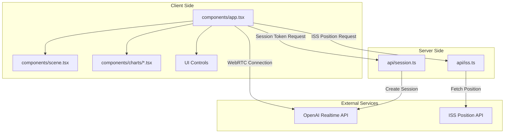
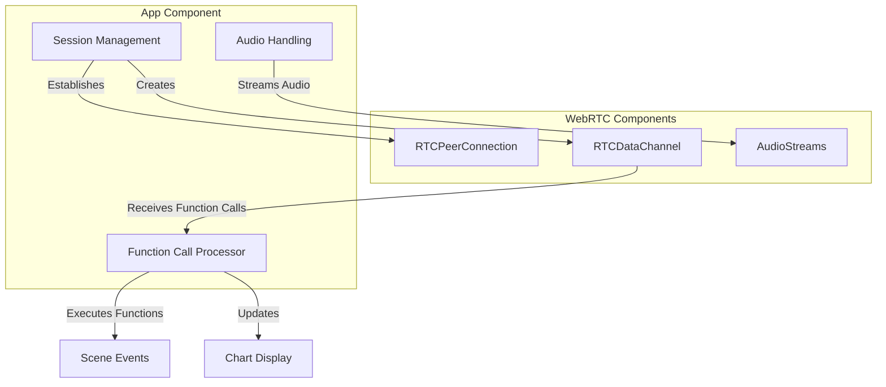
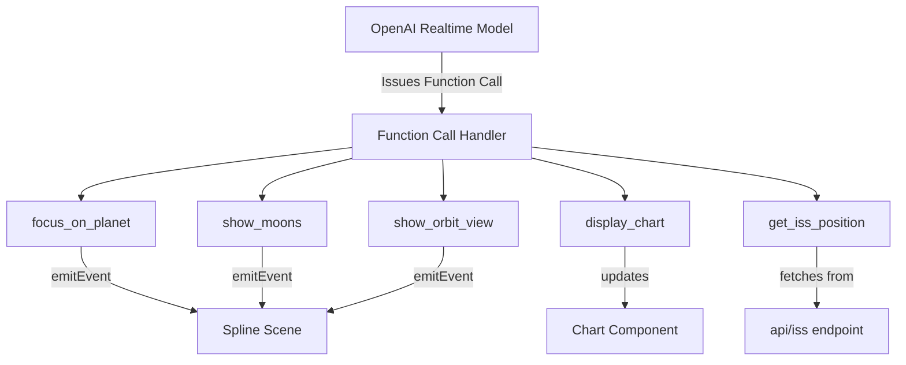
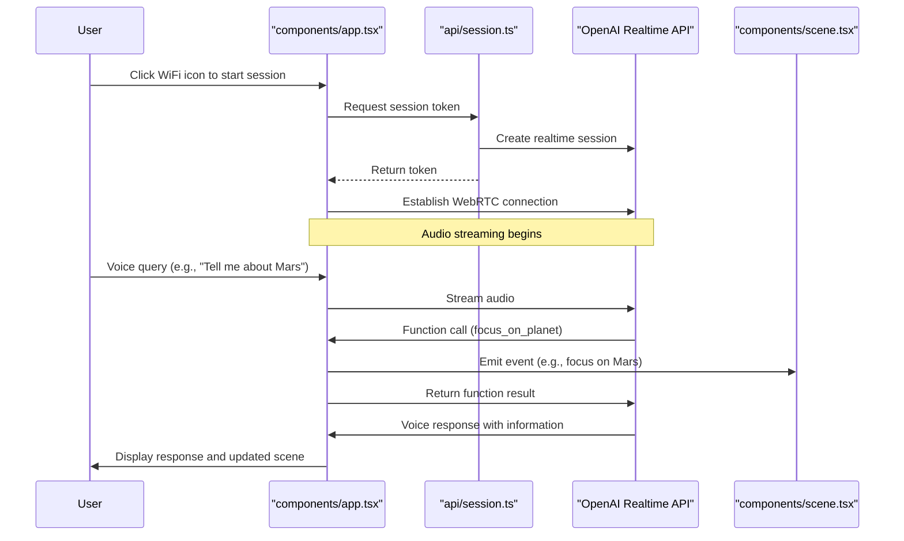
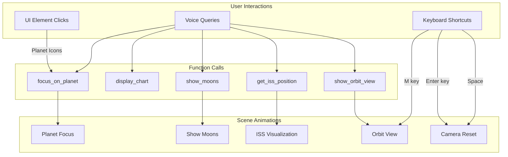

<!-- source: DeepWiki mcp.deepwiki.com · repo openai/openai-realtime-solar-system · page 1 Overview · fetched 2026-10-26 -->

# Overview

Relevant source files

The following files were used as context for generating this wiki page:

- [README.md](README.md)

This document provides a technical overview of the OpenAI Realtime Solar System Demo, which demonstrates the integration of the OpenAI Realtime API with a 3D solar system visualization. The demo showcases voice-based interaction with a dynamic 3D scene built with Spline, utilizing WebRTC for real-time communication and Function Calling for triggering actions within the application.

For installation and configuration instructions, see [Getting Started](#1.1). For licensing information, see [License and Legal](#1.2).

## System Architecture

The OpenAI Realtime Solar System Demo follows a client-server architecture with most of the processing happening on the client side, interfacing with external APIs as needed.

The application consists of a Next.js web application that serves as the central hub, establishing a WebRTC connection with the OpenAI Realtime API for voice interaction. The application utilizes a Spline 3D scene for visualizing the solar system and includes chart components for data visualization.

Sources: [README.md:6-9]()

## Key Components

### Next.js Web Application

The application is built using Next.js, with the following core components:

| Component | Purpose | File Location |
|-----------|---------|---------------|
| App | Main orchestration component managing WebRTC, audio, and UI states | components/app.tsx |
| Scene | Integration with Spline 3D scene | components/scene.tsx |
| Charts | Data visualization components | components/charts/*.tsx |
| API Endpoints | Server-side endpoints for session management and ISS data | app/api/* |

### OpenAI Realtime API Integration

The application integrates with the OpenAI Realtime API using WebRTC, enabling real-time voice-based interactions and function calling capabilities.

The WebRTC integration handles bidirectional audio communication with the OpenAI API while the function call processor interprets and executes commands received from the API.

Sources: [README.md:8-9]()

### Spline 3D Scene

The application uses a pre-built Spline 3D scene that visualizes the solar system. The scene is loaded in the browser and controlled via events triggered by function calls.

### Function Calling System

The OpenAI model can trigger actions in the application through a function calling system defined in the configuration.

Each function maps to specific actions in the application, such as focusing on a planet, displaying a chart, or showing the International Space Station position.

Sources: [README.md:72-86](), [lib/config.ts]()

## Data Flow

The following sequence diagram illustrates the typical data flow during a user interaction:

This flow demonstrates how user voice queries are processed through the OpenAI API, which may respond with function calls that trigger animations in the Spline scene along with voice responses.

Sources: [README.md:56-64]()

## Configured Interactions

The demo supports several predefined interactions that showcase the integration between voice commands, the AI model, and the 3D scene:

1. **Planet Focus**: Asking about specific planets triggers visual focus animations
2. **Moons Display**: Requesting information about moons causes them to appear in the scene
3. **Data Visualization**: Questions about planetary data can trigger chart displays
4. **ISS Tracking**: Inquiries about the ISS position fetch real-time data and display the station
5. **Orbit View**: Questions about planetary orbits trigger a top-down view of the solar system
6. **Conversation Reset**: Ending the conversation resets the camera position

These interactions demonstrate the power of combining voice interaction with function calling to create an interactive educational experience.

Sources: [README.md:74-86]()

## Technical Components

### App Component

The central orchestration component managing:
- WebRTC connection to OpenAI API
- Audio processing and streaming
- Function call handling
- UI state management

### Scene Component

Integrates the Spline 3D scene and provides methods to trigger animations and events within the scene.

### Chart System

Generates visual representations of data about celestial bodies based on user queries.

### API Endpoints

Two main endpoints facilitate the application's functionality:
1. `/api/session`: Creates and manages OpenAI Realtime API sessions
2. `/api/iss`: Fetches real-time position data for the International Space Station

### Function Call Configuration

The function definitions and system instructions are configured in `lib/config.ts`, which determines:
- Available functions for the AI model
- Function parameters and constraints
- System instructions for the AI model's behavior

Sources: [lib/config.ts]()

## Related Pages

For more detailed information about specific system components, refer to these wiki pages:

- [System Architecture](#2) - Comprehensive overview of the system architecture
- [WebRTC Integration](#2.1) - Details on the WebRTC communication implementation
- [OpenAI Realtime API](#2.2) - Specifics of the OpenAI API integration
- [Function Calling System](#2.3) - In-depth explanation of the function calling mechanism
- [Core Components](#3) - Detailed descriptions of the main application components

Sources: [README.md]()

---

