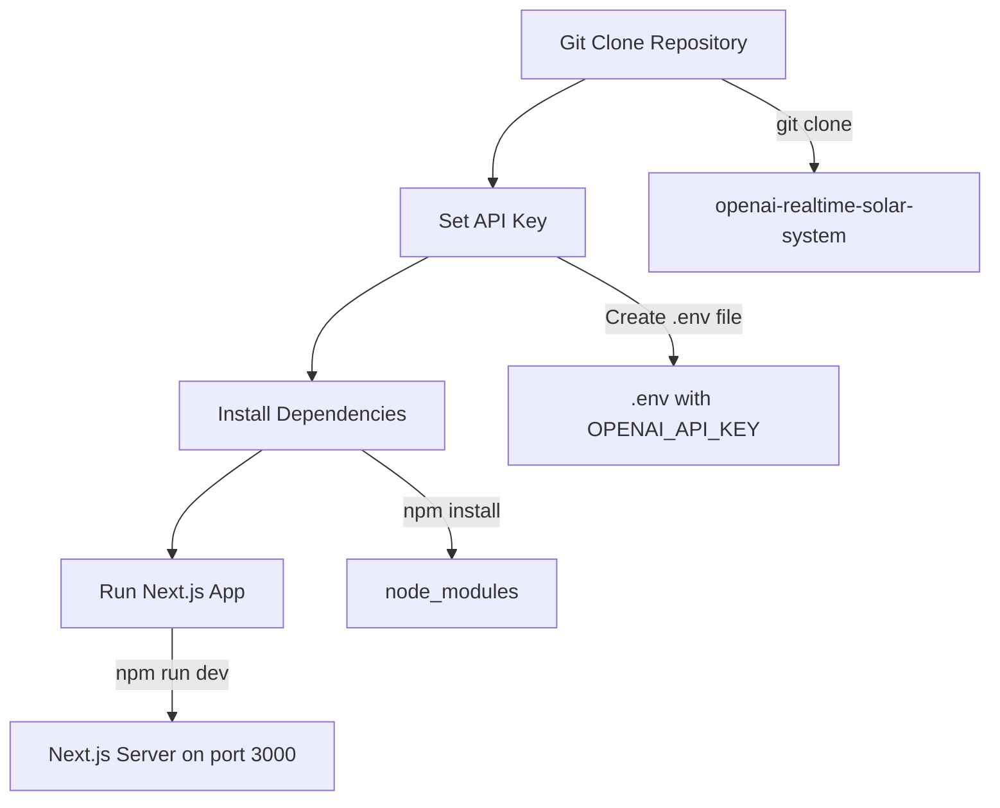
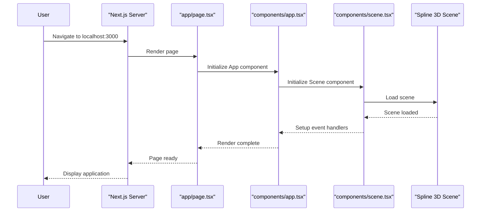
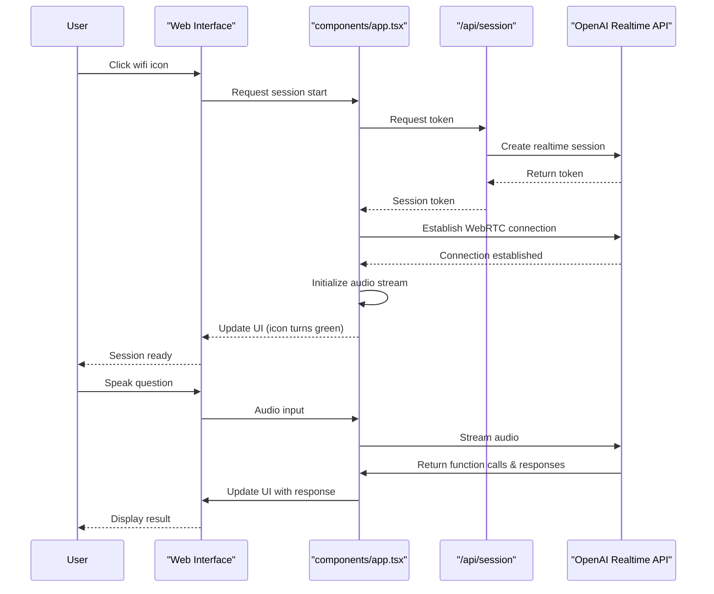
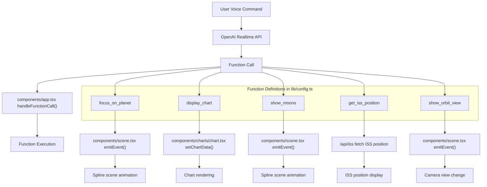

<!-- source: DeepWiki mcp.deepwiki.com · repo openai/openai-realtime-solar-system · page 1.1 Getting Started · fetched 2026-10-26 -->

# Getting Started

<details>
<summary>Relevant source files</summary>

The following files were used as context for generating this wiki page:

- [.gitignore](.gitignore)
- [README.md](README.md)

</details>


This document guides you through the process of setting up and running the OpenAI Realtime Solar System Demo locally. It covers prerequisites, installation, configuration, and initializing your first interactive session. For information about the overall architecture of the system, see [System Architecture](#2).

## Prerequisites

Before you begin, ensure you have:

- Node.js (v14 or later)
- npm package manager
- An OpenAI API key with access to the Realtime API
- Git installed on your system

## Installation Process

The installation process involves cloning the repository, setting up your API key, and installing dependencies.

### Installation Flow



Sources: [README.md:24-53]()

### 1. Clone the Repository

Clone the repository from GitHub using the following command:

```bash
git clone https://github.com/openai/openai-realtime-solar-system.git
cd openai-realtime-solar-system
```

Sources: [README.md:24-26]()

### 2. Set Your OpenAI API Key

You have two options for setting your API key:

#### Option 1: Global Environment Variable

Set the `OPENAI_API_KEY` environment variable globally in your system.

#### Option 2: Project-specific .env File

Create a `.env` file in the root directory of the project and add your API key:

```
OPENAI_API_KEY=your_api_key_here
```

Sources: [README.md:28-37](), [.gitignore:34]()

### 3. Install Dependencies

Install the required dependencies using npm:

```bash
npm install
```

Sources: [README.md:39-45]()

## Running the Application

After installation, start the application with:

```bash
npm run dev
```

The application will be available at http://localhost:3000.

**Note:** The first time you load the app, the 3D scene may take a while to load as it's quite large. Subsequent loads should be faster as the scene will be cached in your browser.

Sources: [README.md:47-55]()

### Application Initialization Flow



Sources: Based on the Component Architecture diagram provided

## Starting a Session

To begin interacting with the solar system demo:

1. Wait for the page to load completely
2. Click on the wifi icon in the top right corner of the app
3. When the icon turns green, your session is active and ready
4. Speak into your microphone to interact with the model
5. Use the microphone icon to toggle your microphone on/off
6. Click the wifi icon again to end the session and reset the conversation

Sources: [README.md:57-64]()

### Session Establishment Flow



Sources: Based on the Data Flow and Communication diagram provided

## Voice Command to Code Execution Flow

This diagram illustrates how user voice commands are processed and mapped to specific code functions:



Sources: Based on the Function Calling System diagram provided

## Example Interactions

Here are some example interactions you can try with the demo:

| Voice Command | Function Called | Result |
|---------------|----------------|--------|
| "Tell me about Mars" | `focus_on_planet('mars')` | Camera focuses on Mars with information |
| "Show me a chart of planet sizes" | `display_chart({type: 'bar', ...})` | Bar chart of planet sizes appears |
| "Does Jupiter have moons?" | `show_moons('jupiter')` | Jupiter's Galilean moons are displayed |
| "Where is the ISS right now?" | `get_iss_position()` | Current ISS position is displayed |
| "Show me the orbits of planets" | `show_orbit_view()` | Camera changes to orbital perspective |
| "Thank you, I'm good" | N/A | Camera resets to initial position |

Sources: [README.md:73-86](), [README.md:92-104]()

## Configuration Options

The demo can be customized by modifying several configuration files:

| File | Purpose | What You Can Change |
|------|---------|---------------------|
| `lib/config.ts` | Defines AI instructions and available function tools | System instructions, function definitions, parameters |
| `lib/constants.ts` | Contains API parameters | Voice settings, model settings |
| `components/scene.tsx` | Controls the Spline scene | Scene URL, event handlers |

To use your own Spline scene, update the scene URL in `components/scene.tsx` and configure the appropriate event handlers to trigger animations. Make sure to update the function definitions in `lib/config.ts` to match your custom scene's capabilities.

Sources: [README.md:105-127]()

## Troubleshooting

### Common Issues

| Issue | Solution |
|-------|----------|
| API key not recognized | Verify your `.env` file is in the correct location and properly formatted |
| Scene not loading | Check your internet connection and browser console for errors |
| Voice not recognized | Ensure microphone permissions are granted and there's minimal background noise |
| WebRTC connection fails | Check if your network allows WebRTC connections |
| Function calls not working | Review the examples in the README for properly formatted requests |

### Browser Compatibility

For optimal performance, use recent versions of Chrome, Firefox, or Edge browsers. Safari may have limited WebRTC support in some versions.

Sources: [README.md:68]()

---

