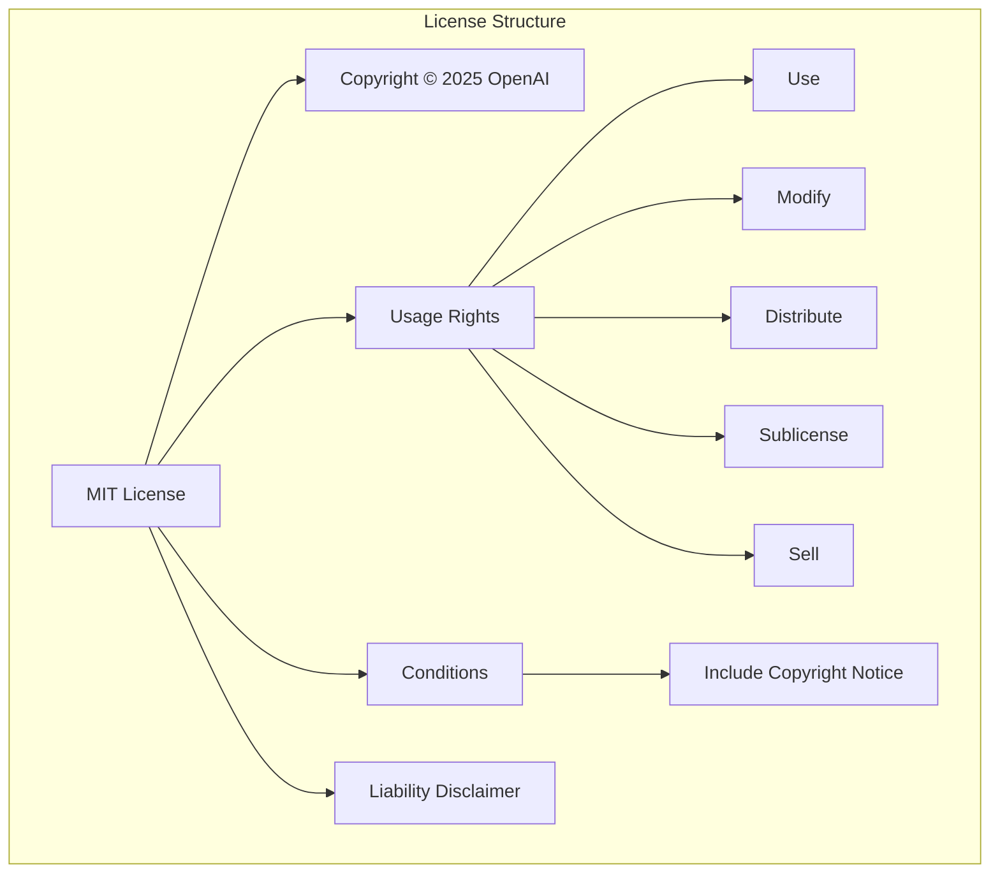
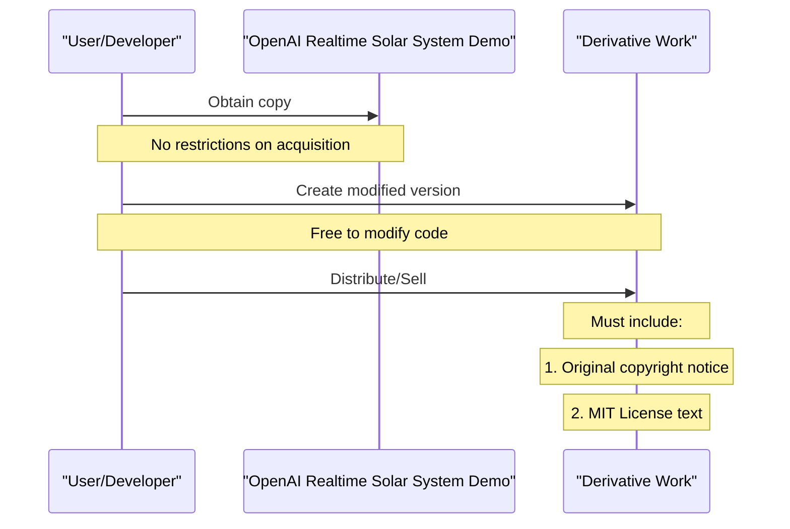
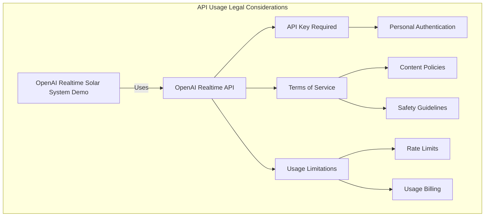
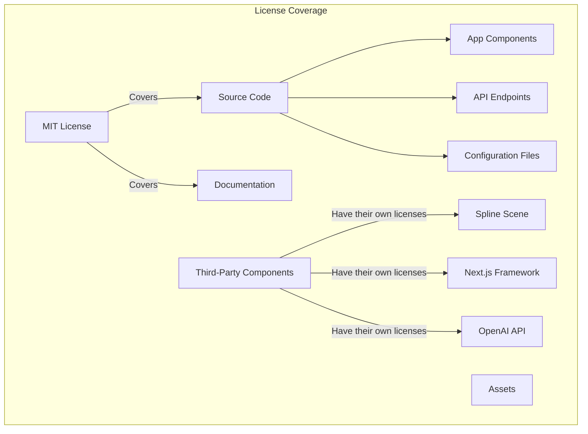

<!-- source: DeepWiki mcp.deepwiki.com · repo openai/openai-realtime-solar-system · page 1.2 License and Legal · fetched 2026-10-26 -->

# License and Legal

Relevant source files

The following files were used as context for generating this wiki page:

- [LICENSE](LICENSE)
- [README.md](README.md)

This document outlines the licensing terms and legal considerations for the OpenAI Realtime Solar System Demo. It covers the project's license, usage permissions, attribution requirements, and legal considerations when using the OpenAI API with this demo.

## License Overview

The OpenAI Realtime Solar System Demo is licensed under the MIT License, a permissive open-source license that allows for extensive freedom in using, modifying, and distributing the software.

Sources: [LICENSE:1-21](), [README.md:3-3](), [README.md:128-130]()

## MIT License Details

The MIT License grants the following permissions without restriction:

| Permission | Description |
|------------|-------------|
| Use | You can use the software for any purpose, private or commercial |
| Modify | You can modify the source code to suit your needs |
| Distribute | You can distribute original or modified versions |
| Sublicense | You can incorporate the software into products that have different licenses |
| Sell | You can sell copies of the software |

The license only requires that all copies of the software include the original copyright notice and the MIT License text. The full text of the license can be found in the LICENSE file at the project root.

Sources: [LICENSE:1-21]()

## License Compliance

To comply with the MIT License when using, modifying, or distributing this software:

1. **Retain the copyright notice**: Include the original copyright notice (`Copyright (c) 2025 OpenAI`) in all copies or substantial portions of the software.

2. **Include the full license text**: The complete MIT License text must be included in all copies or substantial portions of the software.

3. **No warranty**: Acknowledge that the software is provided "as is", without warranty of any kind.

Sources: [LICENSE:5-21]()

## Legal Considerations for API Usage

The demo uses the OpenAI Realtime API, which has its own terms of service and usage requirements:

When using this demo with the OpenAI API:

1. **API Key**: You must use your own OpenAI API key, which requires agreeing to OpenAI's terms of service.

2. **Usage Costs**: Using the OpenAI Realtime API with this demo will incur charges to your OpenAI account according to OpenAI's pricing structure.

3. **Compliance**: Your use of the API through this demo must comply with OpenAI's usage policies.

4. **Rate Limits**: Be aware of rate limits and other restrictions imposed by the OpenAI API.

Sources: [README.md:17-37]()

## Third-Party Components

The demo integrates several third-party technologies, each with their own licenses:

| Component | Usage in Demo | License Type |
|-----------|---------------|--------------|
| Next.js | Web application framework | MIT License |
| Spline | 3D scene rendering | Free for use as integrated |
| OpenAI Realtime API | Voice interaction and AI responses | Commercial API with Terms of Service |

When deploying or distributing this demo, ensure compliance with all individual licenses of these components.

Sources: [README.md:4-9](), [README.md:107-116]()

## Using the Demo for Commercial Purposes

The MIT License allows for commercial use of the OpenAI Realtime Solar System Demo. However, commercial deployments should consider:

1. **API Costs**: OpenAI API usage will incur charges that scale with usage.

2. **Attribution**: While the MIT License only requires including the license text and copyright notice, it's good practice to acknowledge the original work.

3. **Liability**: The MIT License explicitly states that the authors or copyright holders are not liable for any claims, damages, or other liability arising from the software.

4. **Third-Party Services**: Commercial usage must comply with the terms of all third-party services incorporated (especially the OpenAI API).

Sources: [LICENSE:15-21](), [README.md:106-127]()

## License Applicability

The MIT License applies to the OpenAI Realtime Solar System Demo codebase specifically, including:

- Custom React components (`components/` directory)
- API implementation (`pages/api/` directory)
- Configuration and utility files

The license does not override or replace the licenses of third-party dependencies or services integrated into the demo.

Sources: [LICENSE:1-21](), [README.md:128-130]()

## Questions and Legal Support

The MIT License does not provide legal support or warranty. If you have specific legal questions about using this demo or need clarification on licensing terms, consider:

1. Consulting with a legal professional who specializes in software licensing
2. Reviewing the [MIT License FAQ](https://opensource.org/licenses/MIT) on the Open Source Initiative website
3. Consulting OpenAI's terms of service for API usage questions

Note that this wiki page provides general information and not legal advice.

Sources: [LICENSE:15-21]()

---

