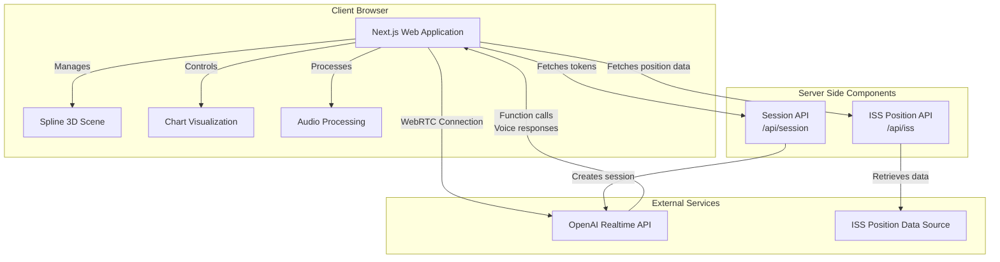
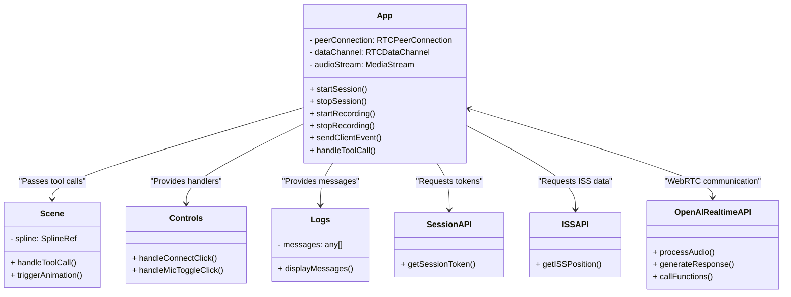
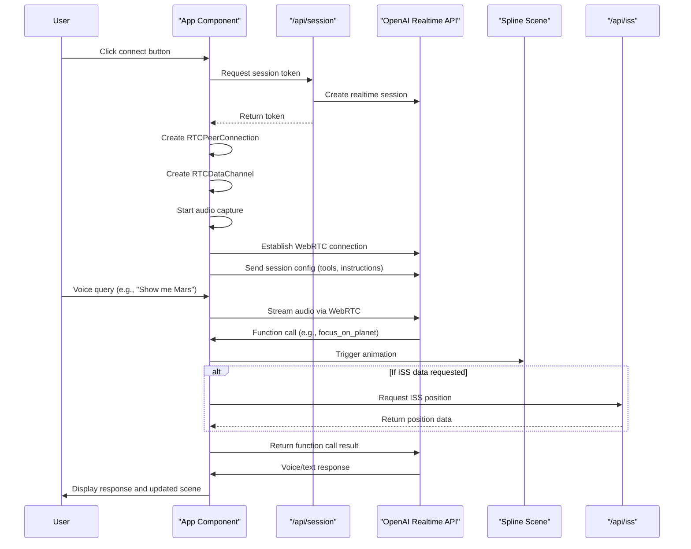
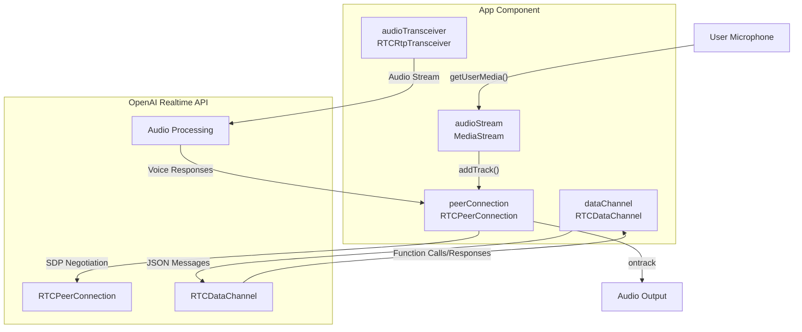
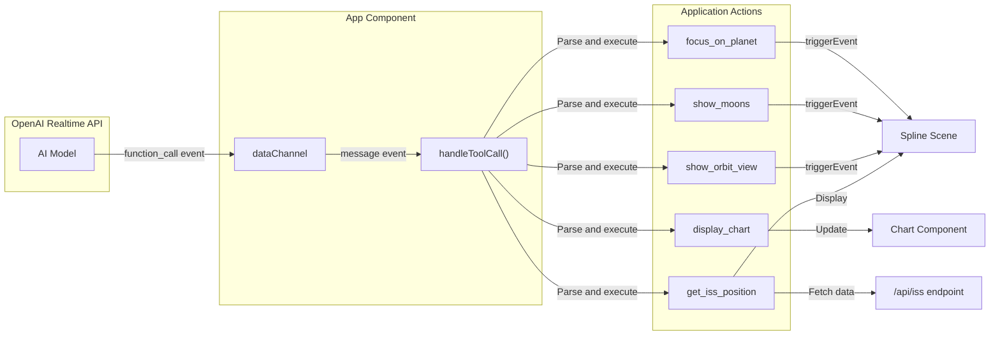
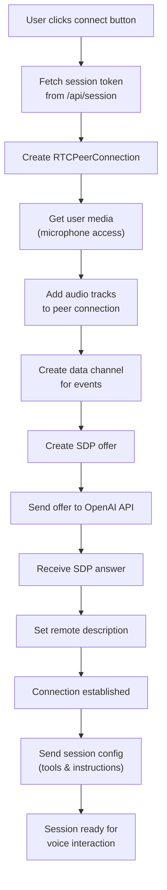
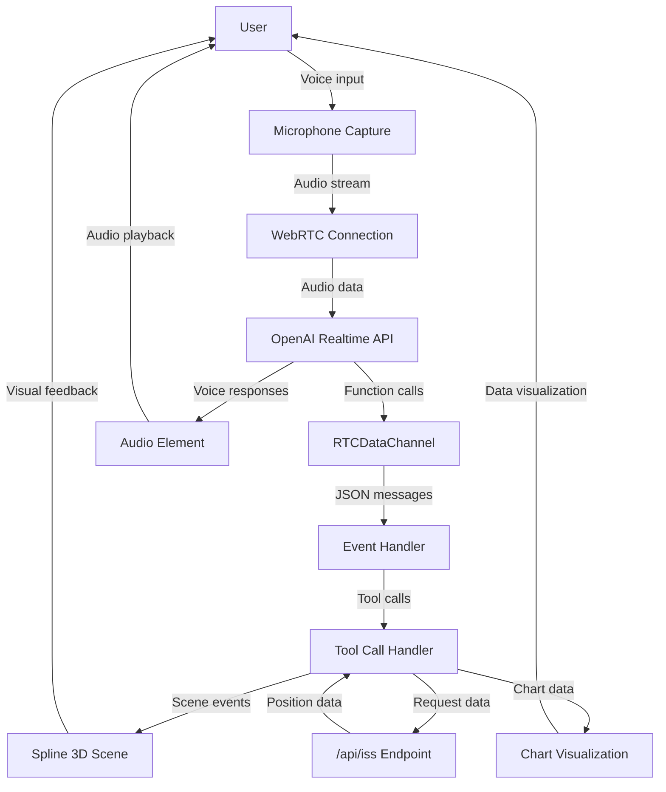

<!-- source: DeepWiki mcp.deepwiki.com · repo openai/openai-realtime-solar-system · page 2 System Architecture · fetched 2026-10-26 -->

# System Architecture

Relevant source files

The following files were used as context for generating this wiki page:

- [README.md](README.md)
- [components/app.tsx](components/app.tsx)

This document provides a high-level overview of the OpenAI Realtime Solar System Demo's architecture, explaining how the different components interact to create an interactive, voice-controlled solar system visualization. For specific details about WebRTC integration, see [WebRTC Integration](#2.1), for OpenAI Realtime API integration, see [OpenAI Realtime API](#2.2), and for the function calling system, see [Function Calling System](#2.3).

## System Overview

The OpenAI Realtime Solar System Demo is a web application that combines WebRTC-based voice communication with the OpenAI Realtime API, interactive 3D visualization using Spline, and data visualization via charts. It allows users to interact with a 3D solar system model through voice commands, with the AI interpreting requests and triggering appropriate actions in the interface.

Sources:
- [README.md:7-9]()
- [components/app.tsx:3-8]()

## Core Components

The system consists of the following core components:

1. **Next.js Web Application**: The central hub that manages user interactions, WebRTC connections, and orchestrates all other components.
2. **Spline 3D Scene**: Interactive 3D visualization of the solar system.
3. **OpenAI Realtime API Integration**: Handles voice processing and provides AI responses.
4. **WebRTC Communication**: Establishes real-time audio connections.
5. **Function Calling System**: Allows the AI to trigger actions in the application.
6. **API Endpoints**: Provides session management and external data integration.

### Component Relationships

Sources:
- [components/app.tsx:15-301]()
- [README.md:72-86]()

## Communication Flow

The following sequence diagram illustrates the typical communication flow during a user interaction with the system:

Sources:
- [components/app.tsx:30-177]()
- [components/app.tsx:194-235]()

## WebRTC Integration

The application establishes real-time communication with the OpenAI API using WebRTC, enabling bidirectional audio streaming and data exchange. The WebRTC connection consists of two main channels:

1. **Audio Channel**: Sends user's voice input to the API and receives audio responses.
2. **Data Channel**: Exchanges JSON messages for function calls, responses, and session management.

Sources:
- [components/app.tsx:22-27]()
- [components/app.tsx:30-90]()
- [components/app.tsx:119-167]()

## Function Calling System

The application implements a function calling mechanism that allows the OpenAI model to trigger specific actions in the interface. This is handled through the WebRTC data channel:

Sources:
- [components/app.tsx:194-235]()
- [README.md:72-86]()

## System Initialization and Session Management

The system initialization process involves establishing a WebRTC connection with the OpenAI Realtime API and configuring the session parameters:

### Session Establishment Process

1. **Token Acquisition**: The application requests a session token from the `/api/session` endpoint.
2. **WebRTC Setup**: A new `RTCPeerConnection` is created and configured.
3. **Media Capture**: User's microphone is accessed using `getUserMedia()`.
4. **Data Channel Creation**: An `RTCDataChannel` is established for exchanging JSON messages.
5. **SDP Negotiation**: The application creates an offer, sends it to the API, and processes the answer.
6. **Session Configuration**: Once the connection is established, the application sends configuration data, including tools and instructions.

Sources:
- [components/app.tsx:30-90]()
- [components/app.tsx:237-267]()

## Data Flow Architecture

The application's data flow architecture illustrates how information travels through the system during user interactions:

Sources:
- [components/app.tsx:15-301]()
- [README.md:72-86]()

## Key Technical Implementation Details

### WebRTC Connection Management

The application implements careful WebRTC connection and media stream management:

1. **Connection Initialization**: The `startSession()` function sets up the WebRTC connection with proper event handlers.
2. **Media Stream Control**: The application provides functions to start and stop recording from the user's microphone.
3. **Connection Cleanup**: The `stopSession()` function ensures proper cleanup of all resources when a session ends.

### Tool Call Handling

The system processes tool calls from the OpenAI API through the `handleToolCall()` function, which:

1. Parses the incoming function call data
2. Executes the appropriate action based on the function name
3. Handles special cases like fetching ISS position data
4. Returns the result back to the API
5. Forces a model response when necessary

Sources:
- [components/app.tsx:194-235]()

## Summary

The OpenAI Realtime Solar System Demo showcases a sophisticated architecture that combines modern web technologies to create an interactive, voice-controlled solar system exploration experience. The application leverages WebRTC for real-time communication, integrates with the OpenAI Realtime API for voice processing and AI responses, and uses function calling to trigger actions in a 3D visualization built with Spline.

Key strengths of the architecture include:
- Clean separation of concerns between components
- Bidirectional real-time communication
- Flexible function calling system
- Integration of multiple visualization techniques (3D scene and charts)
- Real-time external data integration (ISS position)

For more details about specific aspects of the architecture, refer to the related pages:
- [WebRTC Integration](#2.1)
- [OpenAI Realtime API](#2.2)
- [Function Calling System](#2.3)

Sources:
- [README.md:7-9]()
- [components/app.tsx:15-301]()

---

