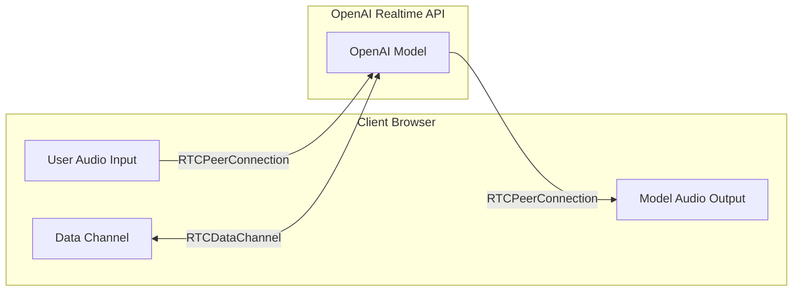
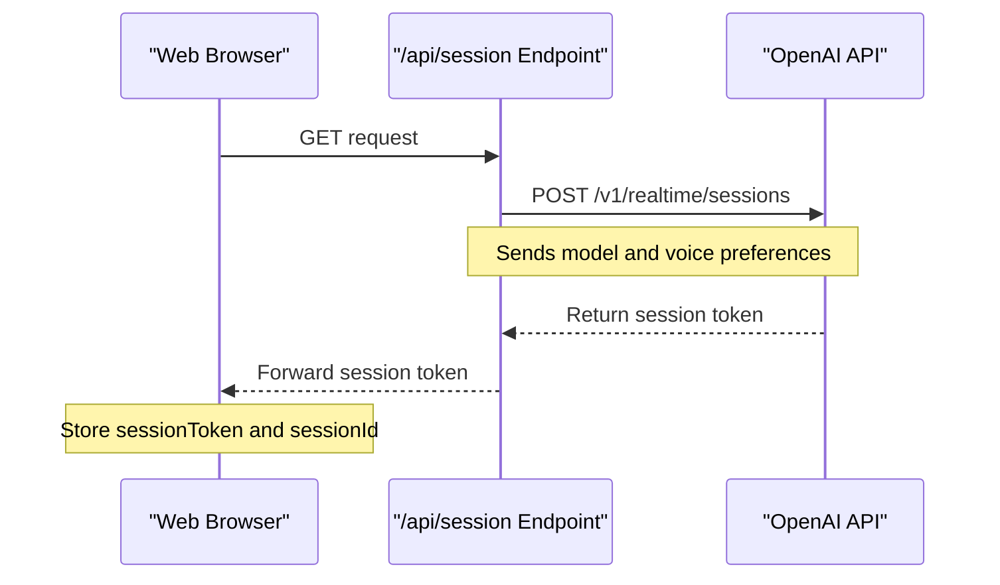
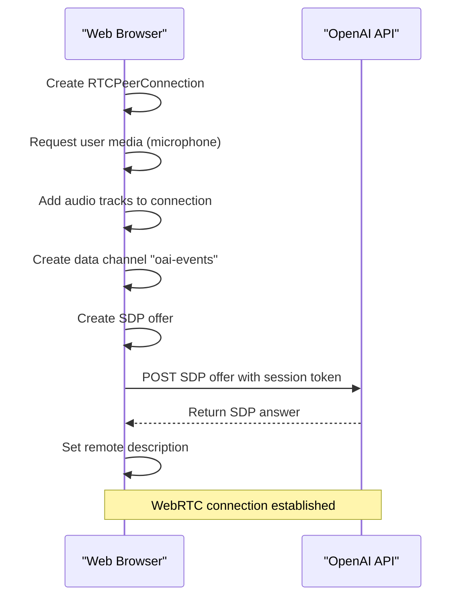
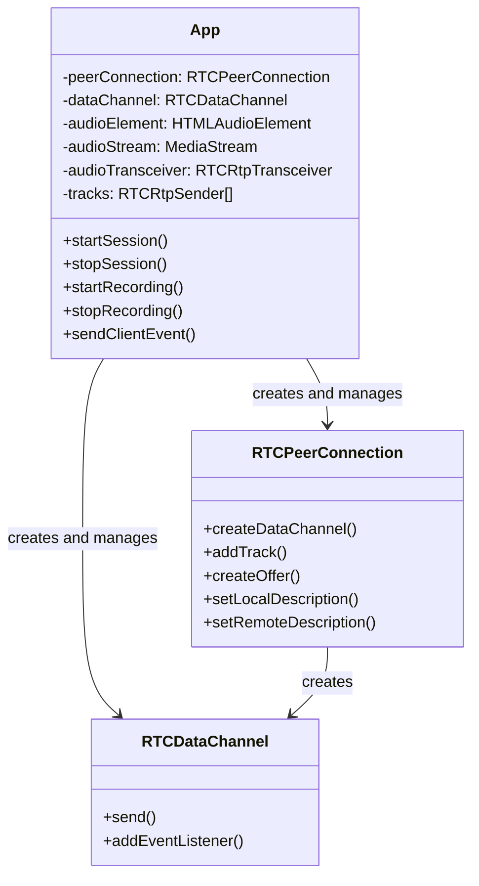
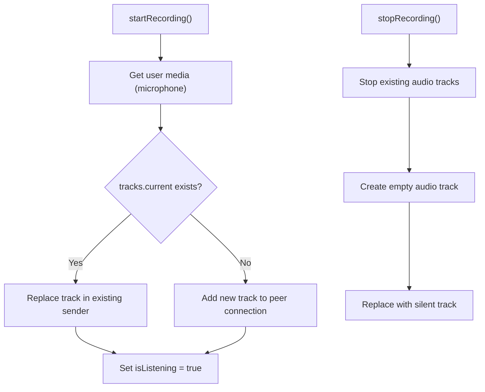
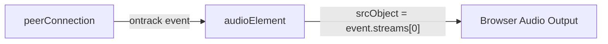
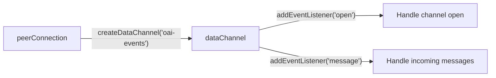
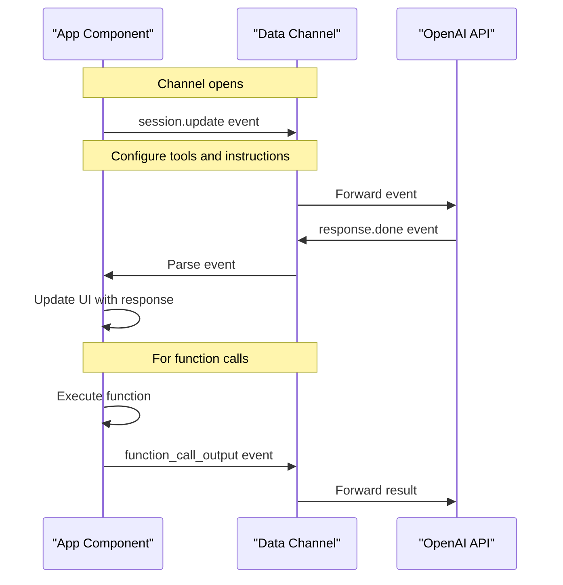
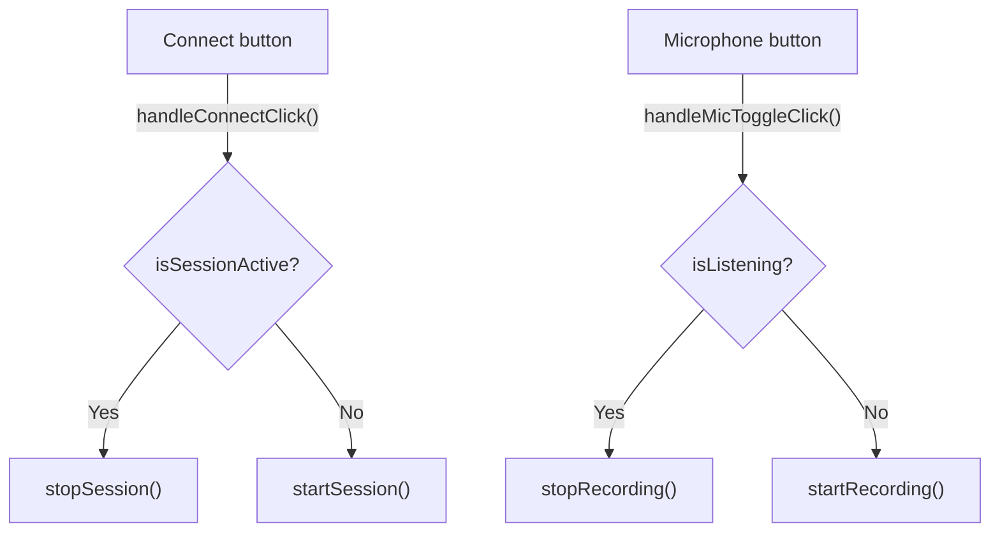

<!-- source: DeepWiki mcp.deepwiki.com · repo openai/openai-realtime-solar-system · page 2.1 WebRTC Integration · fetched 2026-10-26 -->

# WebRTC Integration

Relevant source files

The following files were used as context for generating this wiki page:

- [app/api/session/route.ts](app/api/session/route.ts)
- [components/app.tsx](components/app.tsx)

This document explains how WebRTC (Web Real-Time Communication) is implemented in the OpenAI Realtime Solar System Demo to establish bidirectional, real-time communication between the web browser and the OpenAI Realtime API. For information about the OpenAI Realtime API itself and its capabilities, see [OpenAI Realtime API](#2.2). For details on how function calling works over this connection, see [Function Calling System](#2.3).

## 1. Overview of WebRTC Integration

The demo uses WebRTC to establish two critical communication channels:

1. **Audio Stream**: Bidirectional audio transmission that sends user voice input to the OpenAI API and receives AI-generated voice responses
2. **Data Channel**: Bidirectional messaging channel for sending function calls, text responses, and other structured data

Sources: [components/app.tsx:21-27](components/app.tsx:21-27)

## 2. WebRTC Connection Lifecycle

### 2.1 Session Initialization

Before establishing a WebRTC connection, the application obtains a session token from the OpenAI API.

Sources: [app/api/session/route.ts:4-31](app/api/session/route.ts:4-31), [components/app.tsx:30-38](components/app.tsx:30-38)

### 2.2 Peer Connection Establishment

Once a session token is obtained, the application sets up the WebRTC peer connection using the Session Description Protocol (SDP).

Sources: [components/app.tsx:43-91](components/app.tsx:43-91)

## 3. WebRTC Component Architecture

The application manages the WebRTC connection through several key components within the App component:

Sources: [components/app.tsx:15-27](components/app.tsx:15-27), [components/app.tsx:30-96](components/app.tsx:30-96)

## 4. Media Stream Handling

The application implements sophisticated management of audio streams to control when the microphone is active.

### 4.1 Audio Input Handling

The application uses track replacement to toggle the microphone on and off without disrupting the WebRTC connection:

1. **Start Recording**: Acquires microphone access and adds the track to the peer connection
2. **Stop Recording**: Replaces the active microphone track with a silent placeholder track
3. **Empty Audio Track**: Creates a silent audio track using the Web Audio API

Sources: [components/app.tsx:120-174](components/app.tsx:120-174)

### 4.2 Audio Output Handling

Sources: [components/app.tsx:46-55](components/app.tsx:46-55)

## 5. Data Channel Communication

The data channel (`oai-events`) handles bidirectional structured data exchange between the client and the OpenAI API.

### 5.1 Data Channel Setup

Sources: [components/app.tsx:68-70](components/app.tsx:68-70), [components/app.tsx:193-267](components/app.tsx:193-267)

### 5.2 Message Flow

Messages sent through the data channel follow a specific event-based structure, with the most common events being:

- `session.update`: Configures the session with tools and instructions
- `response.done`: Contains responses from the model, including function calls
- `conversation.item.create`: Used to send function call outputs back to the model

Sources: [components/app.tsx:177-235](components/app.tsx:177-235), [components/app.tsx:237-267](components/app.tsx:237-267)

## 6. Session Management

The application provides methods to start and stop WebRTC sessions:

### 6.1 Starting a Session

The `startSession` function performs these key steps:
1. Fetches a session token from the server
2. Creates the RTCPeerConnection
3. Sets up audio playback
4. Captures microphone input and adds tracks
5. Establishes the data channel
6. Creates and exchanges SDP offers/answers to establish the connection

Sources: [components/app.tsx:30-96](components/app.tsx:30-96)

### 6.2 Stopping a Session

The `stopSession` function:
1. Closes the data channel
2. Closes the peer connection
3. Stops all audio tracks
4. Resets state variables

This ensures clean termination of the WebRTC connection and releases all media resources.

Sources: [components/app.tsx:98-117](components/app.tsx:98-117)

## 7. Integration with UI Controls

The WebRTC functionality is exposed to users through simple UI controls:

These controls allow users to:
1. Start/stop the WebRTC connection to the OpenAI API
2. Toggle the microphone on/off during an active session

Sources: [components/app.tsx:269-287](components/app.tsx:269-287), [components/app.tsx:289-301](components/app.tsx:289-301)

## 8. Technical Considerations

### 8.1 Browser Compatibility

WebRTC is supported in all modern browsers, but the implementation specifically uses:
- `navigator.mediaDevices.getUserMedia()` for microphone access
- `RTCPeerConnection` API for connection management
- `RTCDataChannel` for data messaging
- Web Audio API for creating silent audio tracks

### 8.2 Error Handling

The implementation includes basic error handling for:
- Failed session token requests
- Microphone access errors
- WebRTC connection setup failures

Sources: [components/app.tsx:93-96](components/app.tsx:93-96), [components/app.tsx:145-147](components/app.tsx:145-147)

---

