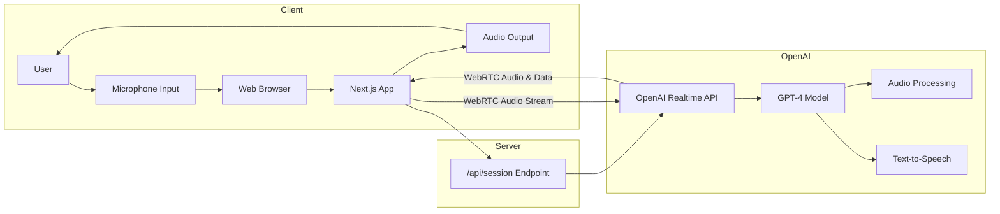
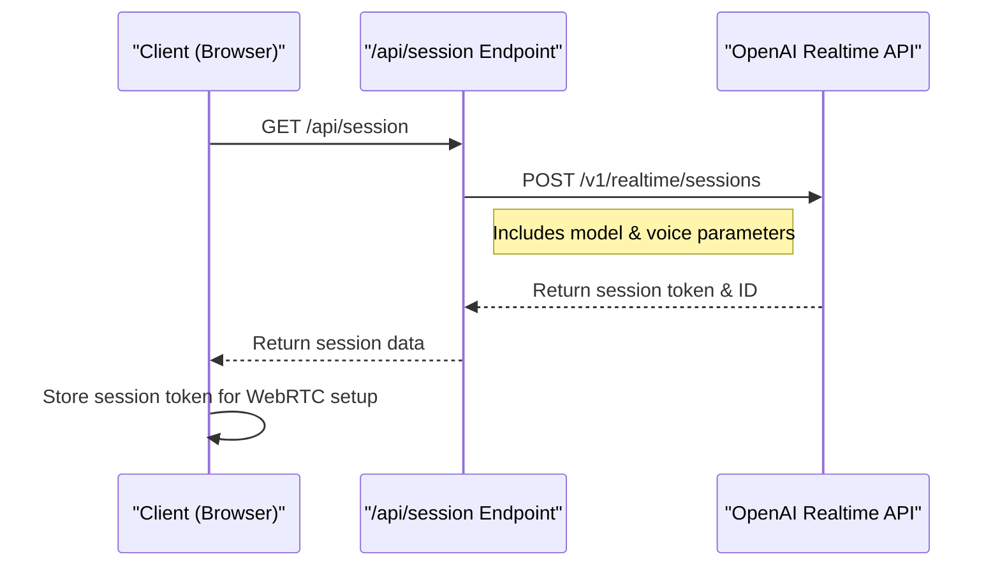
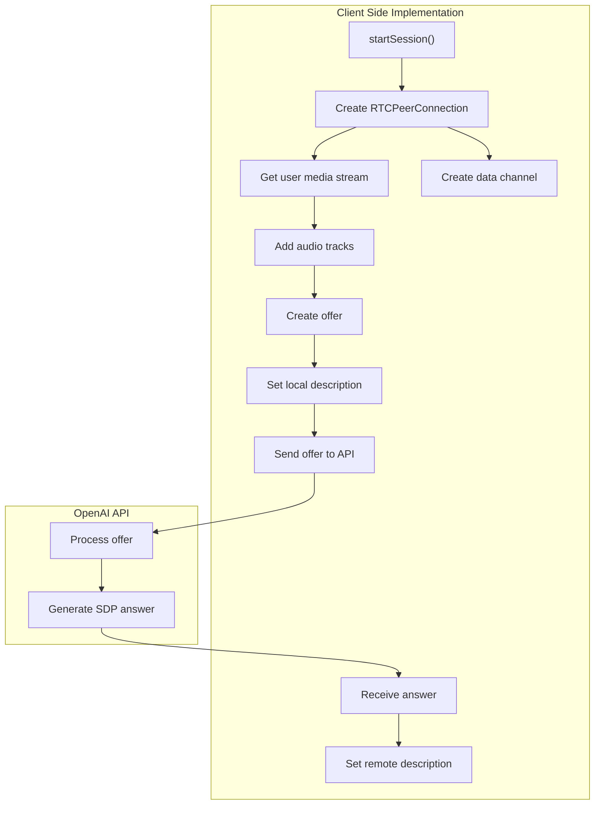
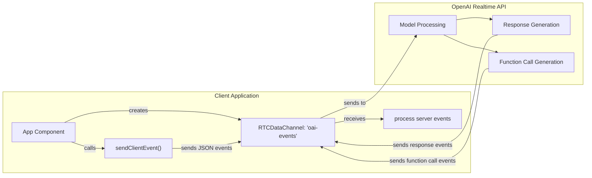
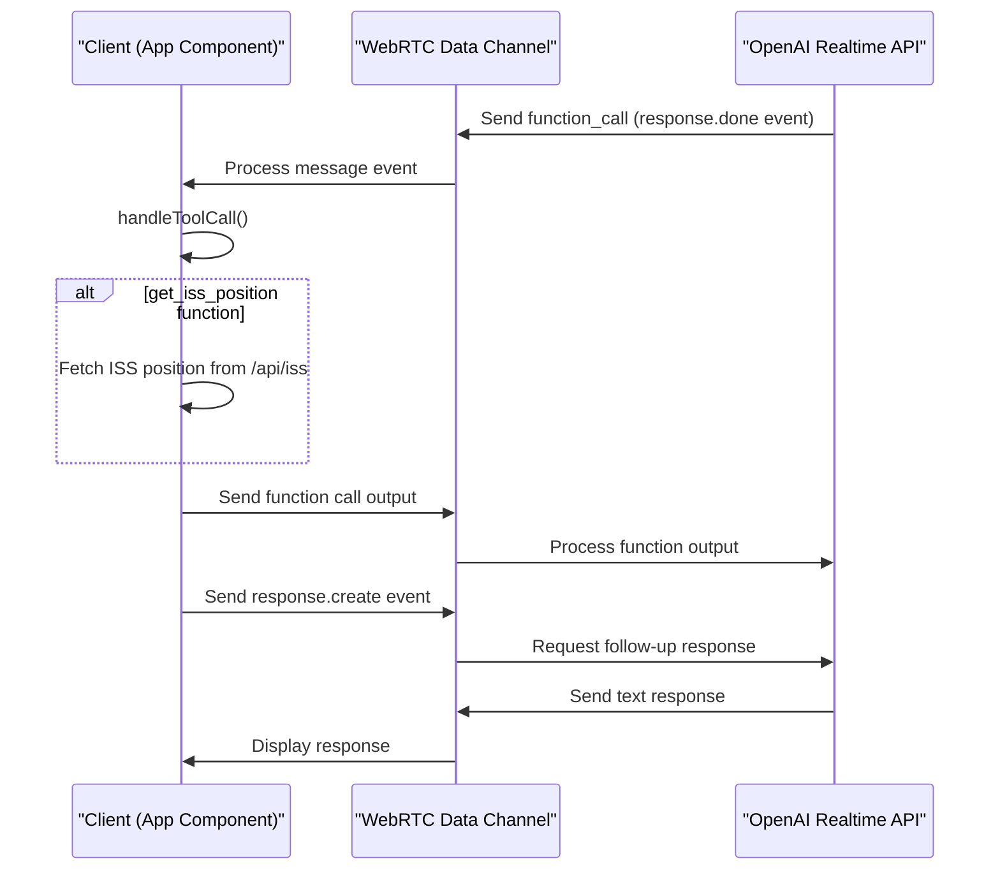
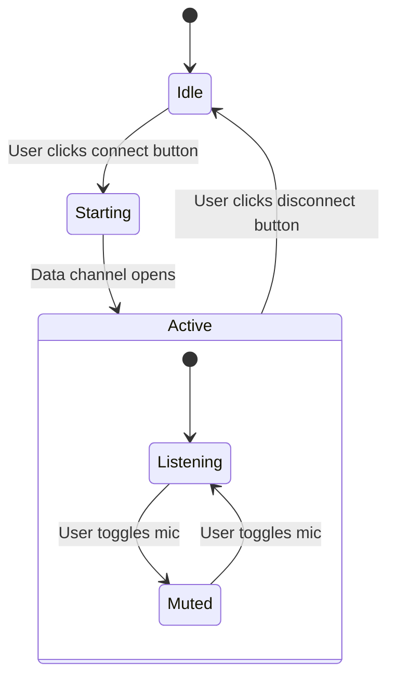
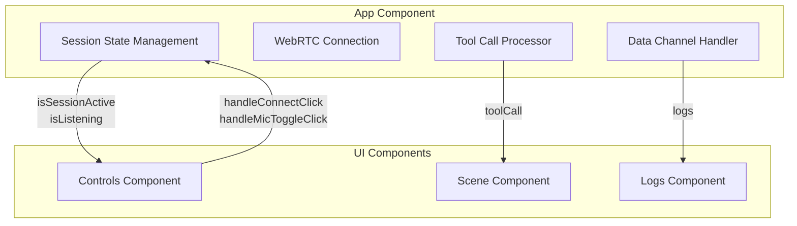

<!-- source: DeepWiki mcp.deepwiki.com · repo openai/openai-realtime-solar-system · page 2.2 OpenAI Realtime API · fetched 2026-10-26 -->

# OpenAI Realtime API

<details>
<summary>Relevant source files</summary>

The following files were used as context for generating this wiki page:

- [README.md](README.md)
- [app/api/session/route.ts](app/api/session/route.ts)
- [components/app.tsx](components/app.tsx)

</details>


This document explains how the Solar System Demo integrates with the OpenAI Realtime API for voice-based interactions. It covers the session creation process, WebRTC communication setup, data flow between the client and API, and function call handling.

For information about the WebRTC implementation details, see [WebRTC Integration](#2.1). For details on the function calling system, see [Function Calling System](#2.3).

## 1. Overview

The OpenAI Realtime API enables real-time voice conversations with AI models using WebRTC for low-latency audio streaming. In this demo, it powers the interactive voice interface that allows users to ask questions about the solar system and trigger various visualizations through voice commands.



Sources: [README.md:7-9](). [components/app.tsx:76-89]()

## 2. Session Management

Before establishing a WebRTC connection, the application must first obtain a session token from the OpenAI Realtime API.

### 2.1 Session Creation Flow



Sources: [app/api/session/route.ts:5-31](). [components/app.tsx:30-45]()

### 2.2 Session Endpoint Implementation

The application includes a server-side endpoint that proxies requests to the OpenAI API to obtain session tokens:

```
GET /api/session
```

This endpoint makes a POST request to `https://api.openai.com/v1/realtime/sessions` with the configured model and voice parameters and returns the response to the client.

Sources: [app/api/session/route.ts:5-31]()

## 3. WebRTC Communication

After obtaining a session token, the application establishes a WebRTC connection with the OpenAI Realtime API.

### 3.1 WebRTC Connection Setup



Sources: [components/app.tsx:30-96]()

### 3.2 Audio Stream Management

The application manages two audio streams:

1. **Input Stream**: Audio from the user's microphone sent to the API
2. **Output Stream**: Audio responses from the API played back to the user

The application provides controls to start/stop the microphone input while keeping the session active.

Sources: [components/app.tsx:120-169]()

## 4. Data Communication Channel

In addition to audio streams, the WebRTC connection includes a data channel for exchanging JSON messages between the client and the API.

### 4.1 Data Channel Architecture



Sources: [components/app.tsx:169-190](). [components/app.tsx:193-267]()

### 4.2 Message Types

The data channel exchanges several types of JSON messages:

| Message Type | Direction | Purpose |
|--------------|-----------|---------|
| `session.update` | Client to API | Set instructions and available tools |
| `conversation.item.create` | Client to API | Send function call outputs |
| `response.create` | Client to API | Request model to respond |
| `response.done` | API to Client | Deliver model responses and function calls |

Sources: [components/app.tsx:217-234](). [components/app.tsx:239-265]()

## 5. Function Call Processing

The OpenAI model can trigger predefined functions in the application through function calling.

### 5.1 Function Call Flow



Sources: [components/app.tsx:194-235]()

### 5.2 Tool Configuration

During session initialization, the application sends a configuration message that defines the available tools (functions) that the model can call:

```json
{
  "type": "session.update",
  "session": {
    "tools": [/* tool definitions */],
    "instructions": "/* system instructions */"
  }
}
```

Sources: [components/app.tsx:256-264]()

## 6. Session Lifecycle Management

The application manages the complete lifecycle of the Realtime API session:

### 6.1 Session Lifecycle States



Sources: [components/app.tsx:30-96](). [components/app.tsx:99-117](). [components/app.tsx:269-287]()

### 6.2 Cleanup on Session End

When a session ends, the application performs the following cleanup:
- Closes the data channel
- Closes the peer connection
- Stops all audio tracks
- Resets state variables

Sources: [components/app.tsx:99-117]()

## 7. Error Handling

The application implements error handling for various scenarios:

- Session creation errors
- WebRTC connection failures
- Microphone access errors
- Data channel communication errors

Sources: [components/app.tsx:94-96](). [app/api/session/route.ts:25-30]()

## 8. Integration with UI Components

The App component coordinates the Realtime API integration with other UI components:



Sources: [components/app.tsx:289-301]()

This integration allows the OpenAI Realtime API to control the 3D solar system scene, trigger chart visualizations, and provide informative responses based on user voice commands.

---

