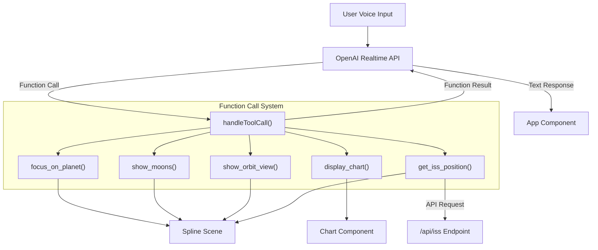
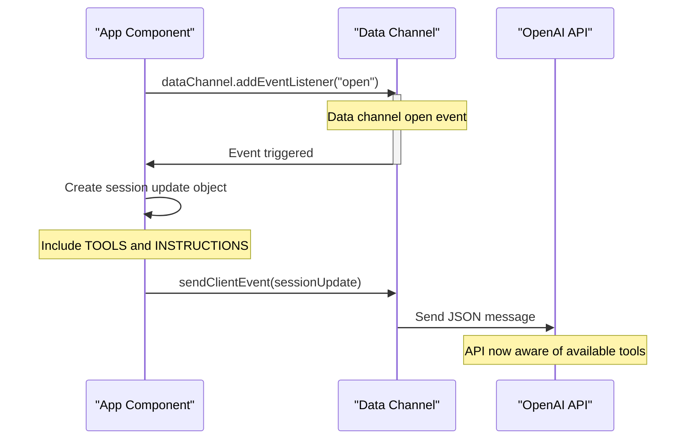
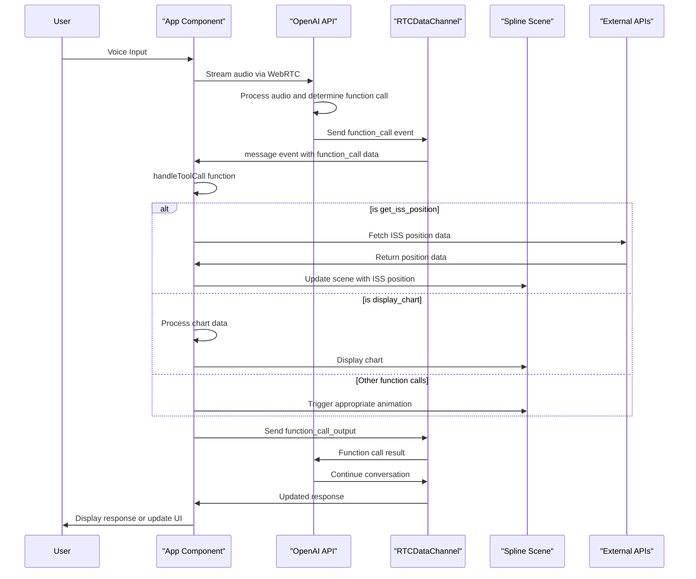
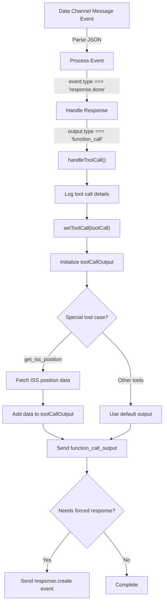
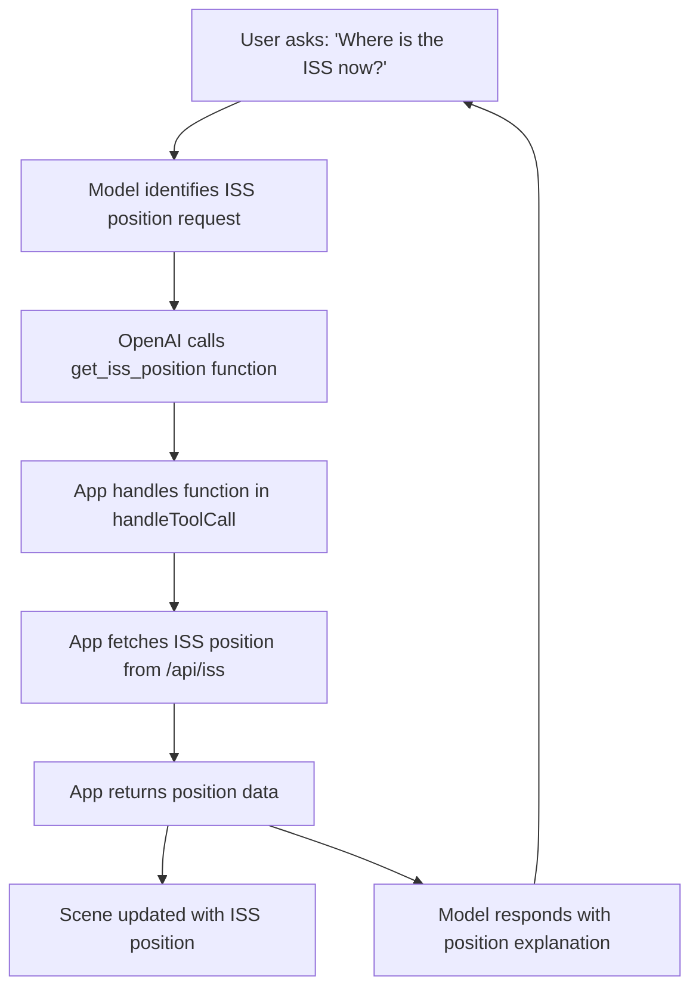
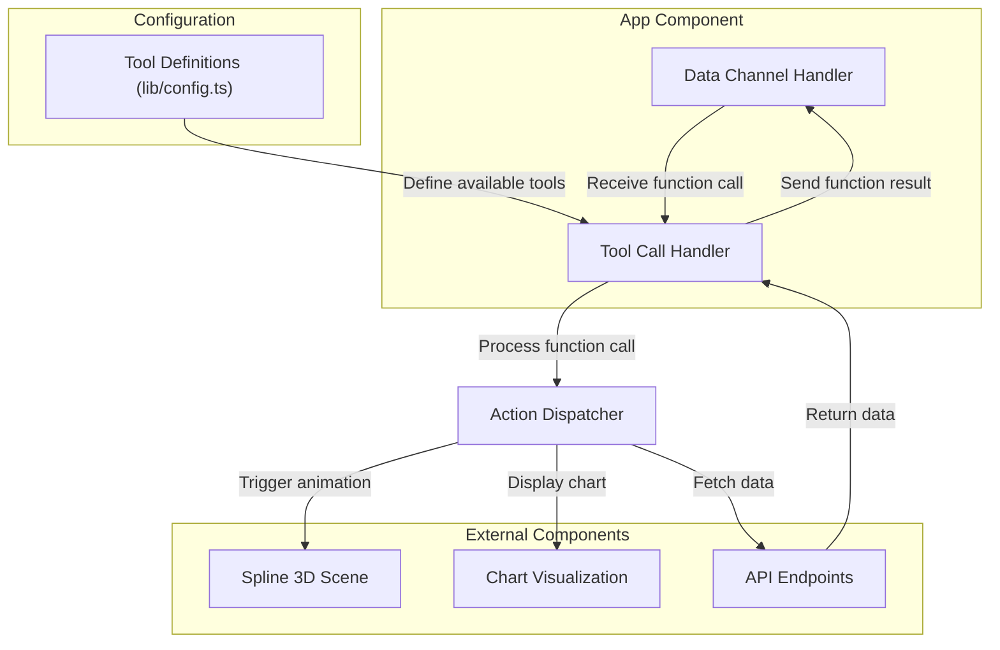

<!-- source: DeepWiki mcp.deepwiki.com · repo openai/openai-realtime-solar-system · page 2.3 Function Calling System · fetched 2026-10-26 -->

# Function Calling System

<details>
<summary>Relevant source files</summary>

The following files were used as context for generating this wiki page:

- [README.md](README.md)
- [components/app.tsx](components/app.tsx)

</details>


The Function Calling System is a core component of the OpenAI Realtime Solar System Demo that enables the AI model to trigger specific actions in the application. This document describes how function calls (also known as tool calls) are defined, processed, and handled within the application architecture. For details about the overall architecture, see [System Architecture](#2).

## Overview

The Function Calling System provides a bridge between natural language user queries and specific application actions. When a user asks about planets, moons, or data that can be visualized, the OpenAI model can call functions that trigger animations, display charts, or fetch real-time data like the ISS position.



Sources: [README.md:7-9](), [components/app.tsx:194-235]()

## Tool Configuration and Registration

The application defines a set of tools in the configuration that the AI model can use to perform actions. These tools are registered with the OpenAI API during session initialization.

### Tool Definition Structure

Tools are defined in the configuration file and follow a specific structure that the OpenAI API requires:

```mermaid
classDiagram
    class "Tool Configuration" {
        name: string
        description: string
        parameters: object
        return_type: object
    }
    
    class "Parameter Schema" {
        type: string
        properties: object
        required: string[]
    }
    
    class "Return Schema" {
        type: string
        properties: object
    }
    
    "Tool Configuration" --> "Parameter Schema" : defines
    "Tool Configuration" --> "Return Schema" : defines
```

Sources: [components/app.tsx:256-265](), [README.md:84-88]()

### Tool Registration Process

When a new session starts, the application sends the configured tools to the OpenAI API as part of the session update:



Sources: [components/app.tsx:256-265]()

## Function Call Workflow

When a user interacts with the application, the following sequence occurs for function calls:



Sources: [components/app.tsx:194-235](), [components/app.tsx:239-246]()

## Function Call Handling

The application handles function calls through the `handleToolCall` function in the App component. This function processes the tool call data received from the OpenAI API and takes appropriate actions.

### Function Call Processing



Sources: [components/app.tsx:194-235](), [components/app.tsx:237-247]()

### Function Call Output Handling

After handling a tool call, the application sends the result back to the OpenAI API:

```typescript
sendClientEvent({
  type: "conversation.item.create",
  item: {
    type: "function_call_output",
    call_id: output.call_id,
    output: JSON.stringify(toolCallOutput),
  },
});
```

For certain function calls like `get_iss_position` and `display_data`, the application explicitly requests a response from the API to ensure continuity in the conversation:

```typescript
if (toolCall.name === "get_iss_position" || toolCall.name === "display_chart") {
  sendClientEvent({
    type: "response.create",
  });
}
```

Sources: [components/app.tsx:217-234]()

## Supported Function Calls

The application supports several types of function calls that trigger different actions:

| Function Name | Description | Action | Trigger |
|---------------|-------------|--------|---------|
| `focus_on_planet` | Focus the view on a specific planet | Triggers animation in Spline scene | User asking about a specific planet |
| `show_moons` | Display moons for a planet | Shows moon objects in Spline scene | User asking about moons |
| `display_chart` | Show data visualization | Displays bar or pie chart | User asking about data that can be visualized |
| `get_iss_position` | Fetch and display ISS position | Fetches data and shows ISS in scene | User asking about ISS position |
| `show_orbit_view` | Show orbital view of solar system | Changes camera to top-down view | User asking about orbits |
| `reset_view` | Reset camera to default position | Resets camera animation | User ending conversation |

Sources: [README.md:72-86]()

### ISS Position Function Example

The `get_iss_position` function call demonstrates how the application interacts with external APIs:



Sources: [components/app.tsx:209-215](), [README.md:81-82]()

## Integration with Application Components

The function calling system integrates with other components of the application:



Sources: [components/app.tsx:194-235](), [components/app.tsx:290-300]()

## Implementation Details

The function call implementation involves several key parts of the codebase:

1. **Tool Definitions**: Defined in `lib/config.ts` and imported into the App component
2. **Tool Registration**: Tools are sent to the OpenAI API when the data channel opens
3. **Message Handling**: The data channel's message event is used to detect function calls
4. **Function Call Processing**: The `handleToolCall` function processes function calls
5. **Result Handling**: Function call results are sent back to the OpenAI API
6. **Scene Integration**: Function calls trigger actions in the Spline scene

Sources: [components/app.tsx:7-8](), [components/app.tsx:194-235](), [components/app.tsx:237-266]()

## Customization

The function calling system can be customized by modifying the tool definitions in `lib/config.ts`. This allows developers to add new tools or modify existing ones to create different interactive experiences.

For example, to add a new tool that performs a specific action in the Spline scene, you would:

1. Add the tool definition to `lib/config.ts`
2. Update the `handleToolCall` function to handle the new tool
3. Add the corresponding animation or event in the Spline scene
4. Connect the function call to the Spline event

Sources: [README.md:124-126]()

---

